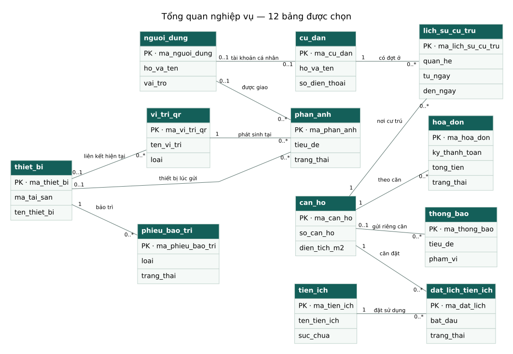
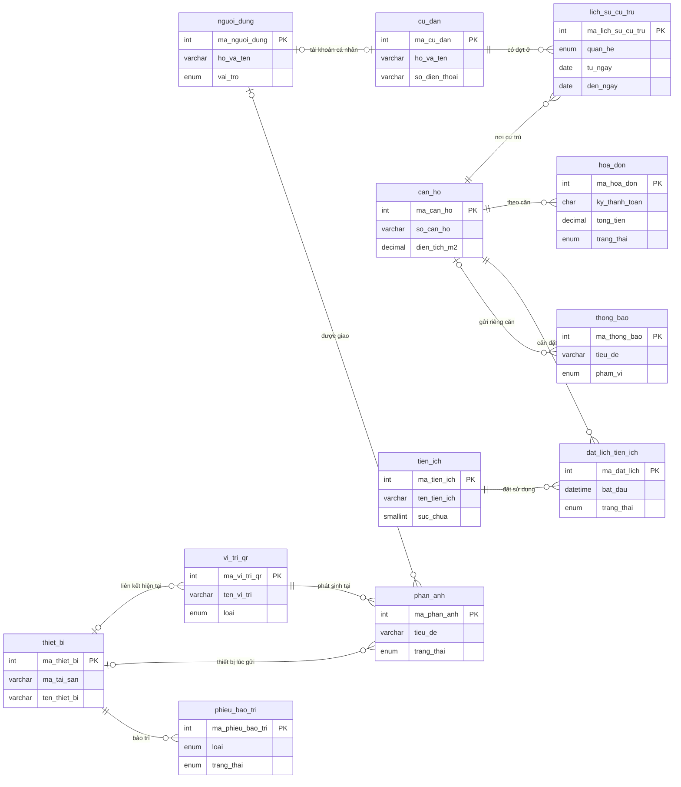

# ERD rút gọn cho báo cáo đồ án

**Database giữ nguyên 38 bảng; bản này rút gọn phần trình bày theo yêu cầu của người dùng.** Hình tổng quan chọn **12 bảng**, kèm **6 sơ đồ phân hệ**, mỗi hình 4–7 bảng. Các bảng/cột/quan hệ được đối chiếu với metadata MySQL sau migration `018_equipment_qr.sql`, ngày 21/10/2026. Không có migration hoặc thay đổi code nghiệp vụ.

## Mở ngay

- **[PDF A4 ngang — trọn bộ 7 trang](erd-gon-a4.pdf)**: xem/in hoặc gửi GVHD.
- **[File draw.io — 7 trang chỉnh sửa được](erd-gon.drawio)**: mở trong diagrams.net hoặc draw.io Desktop.
- **[Ảnh tổng quan PNG](00-tong-quan-12-bang.png)** / **[SVG](00-tong-quan-12-bang.svg)**: chèn trực tiếp vào Word.
- **[Ánh xạ đầy đủ 38 bảng](doi-chieu-38-bang.md)**: biết bảng nào ở hình nào hoặc phần phụ lục.

## Cách dùng trong Word

Trong phần thiết kế cơ sở dữ liệu của chương 2, dùng hình tổng quan và hình QR–phản ánh làm trọng tâm đề tài. Đưa các hình nhà ở, hóa đơn, bảo trì, tiện ích/thông báo và quỹ vào các mục tương ứng. Giữ [ERD vật lý đầy đủ](../erd-phan-he.md) và [từ điển dữ liệu 38 bảng](../tu-dien-du-lieu.md) ở phụ lục hoặc mục thiết kế chi tiết.

Word: **Insert → Pictures → This Device**, chọn `.svg` để giữ nét khi phóng to; nếu phiên bản Word không hỗ trợ SVG thì chọn `.png`. Dùng A4 ngang cho hình tổng quan. Mỗi hình có thể tải riêng từ GitHub bằng nút Download raw file; không phải tải lại mã nguồn hoặc đổi database.

Chú thích có thể dùng:

> Hình X. Sơ đồ quan hệ dữ liệu tổng quan, biểu diễn 12 bảng được chọn và các quan hệ nghiệp vụ chính. Thiết kế triển khai đầy đủ gồm 38 bảng; các bảng hỗ trợ, lịch sử và quan hệ còn lại được trình bày ở sơ đồ phân hệ và phụ lục.

## Danh mục hình

| Hình | Nội dung | Số bảng được vẽ | Chèn Word | Mã Mermaid |
|---|---|---:|---|---|
| 0 | Tổng quan nghiệp vụ | 12 | [SVG](00-tong-quan-12-bang.svg) · [PNG](00-tong-quan-12-bang.png) · [PDF](00-tong-quan-12-bang.pdf) | [Mã nguồn](00-tong-quan-12-bang.mmd) |
| 1 | Nhà ở, cư trú, tài khoản và xe | 7 | [SVG](01-nha-o-cu-tru-xe.svg) · [PNG](01-nha-o-cu-tru-xe.png) · [PDF](01-nha-o-cu-tru-xe.pdf) | [Mã nguồn](01-nha-o-cu-tru-xe.mmd) |
| 2 | QR, phản ánh và tiến độ | 6 | [SVG](02-qr-phan-anh.svg) · [PNG](02-qr-phan-anh.png) · [PDF](02-qr-phan-anh.pdf) | [Mã nguồn](02-qr-phan-anh.mmd) |
| 3 | Phí, chỉ số và hóa đơn | 7 | [SVG](03-phi-chi-so-hoa-don.svg) · [PNG](03-phi-chi-so-hoa-don.png) · [PDF](03-phi-chi-so-hoa-don.pdf) | [Mã nguồn](03-phi-chi-so-hoa-don.mmd) |
| 4 | Thiết bị và bảo trì | 4 | [SVG](04-thiet-bi-bao-tri.svg) · [PNG](04-thiet-bi-bao-tri.png) · [PDF](04-thiet-bi-bao-tri.pdf) | [Mã nguồn](04-thiet-bi-bao-tri.mmd) |
| 5 | Tiện ích và thông báo | 6 | [SVG](05-tien-ich-thong-bao.svg) · [PNG](05-tien-ich-thong-bao.png) · [PDF](05-tien-ich-thong-bao.pdf) | [Mã nguồn](05-tien-ich-thong-bao.mmd) |
| 6 | Quỹ, thu chi và chứng từ | 4 | [SVG](06-quy-thu-chi.svg) · [PNG](06-quy-thu-chi.png) · [PDF](06-quy-thu-chi.pdf) | [Mã nguồn](06-quy-thu-chi.mmd) |

Số bảng giữa các hình có lặp lại, ví dụ `nguoi_dung`/`can_ho`; không cộng số bảng của các hình để suy ra tổng số bảng hệ thống. Sáu hình chi tiết bao phủ đủ **24 bảng nghiệp vụ**, đồng thời minh họa thêm lịch sử phản ánh và bảo trì.

## Chỉnh sửa bằng draw.io

1. Tải `erd-gon.drawio` về máy.
2. Mở diagrams.net hoặc draw.io Desktop → **File → Open From → Device**, chọn file.
3. Chọn tab hình ở phía dưới, kéo bảng/đường nối hoặc sửa chữ bằng nhấp đúp.
4. Dùng **File → Export as → SVG / PNG / PDF** để chèn Word.

Các bảng và quan hệ là đối tượng chỉnh sửa được, không phải một ảnh dán vào draw.io. Cách tự định tuyến đường nối có thể khác bản SVG đã dàn trang; có thể kéo các điểm nối trong draw.io nếu cần. Giữ nguồn `.drawio` khi chỉnh để xuất lại.

## Quy ước và giới hạn của bản rút gọn

- `PK` là khóa chính; khóa ghép `(khoi, tang)` được giữ ở bảng tầng. Đường nối thể hiện quan hệ FK thật, nhưng mỗi bảng chỉ hiện một số thuộc tính để hình gọn; không phải tất cả cột FK đều hiện trong ô bảng.
- SVG/PNG/PDF dùng `1` = đúng một, `0..1` = không hoặc một, `0..*` = không hoặc nhiều. Mermaid/draw.io dùng ký pháp chân quạ tương đương.
- Nguồn suy ra số lượng từ FK nullable/UNIQUE của schema. Ví dụ một người dùng có thể không gắn hồ sơ cư dân; quan hệ không được đổi tùy tiện thành 1–N.
- Nhiều FK tới người tạo/người duyệt/người hủy và các quan hệ audit được ẩn để tránh đường nối chồng nhau. Tên constraint và quan hệ đã chọn có trong `nguon-mo-hinh.json`; phần vật lý đầy đủ nằm ở phụ lục.
- Sơ đồ nhà ở giữ tài khoản căn nhưng ẩn riêng đường `nguoi_dung.ma_cu_dan_phu_trach → cu_dan`; quan hệ chủ hộ và lịch sử bàn giao vẫn tồn tại, xem ERD vật lý/từ điển. Không suy ra rằng mọi cư dân đều có tài khoản riêng.
- QR hiện tại và thiết bị trong phản ánh là hai quan hệ riêng; đổi liên kết QR không sửa snapshot thiết bị của phản ánh cũ.
- Phiếu thu chi và hóa đơn không có FK trực tiếp với nhau. Quỹ vận hành tổng hợp hóa đơn đã thu bằng nghiệp vụ truy vấn; không vẽ thêm quan hệ FK ngân hàng/quỹ/hóa đơn không có trong schema.
- Chỉ mục, CHECK, UNIQUE có điều kiện qua cột sinh, token, trường chống ghi đè và các quy tắc khóa giao dịch xem từ điển/mã nguồn. Hình gọn không chứng minh các quy tắc đó được triển khai bằng đường nối ERD.

Các file `.dot` là nguồn dàn trang Graphviz; `.mmd` là mã Mermaid; `.drawio` là nguồn để chỉnh hình. `nguon-mo-hinh.json` lưu tập bảng/cột/FK được chọn, không chứa dữ liệu cư dân, tài khoản đăng nhập hay mật khẩu. Đây là bản tài liệu theo schema 018; khi đổi schema cần đối chiếu và cập nhật hình.

## Xem mã Mermaid của hình tổng quan

