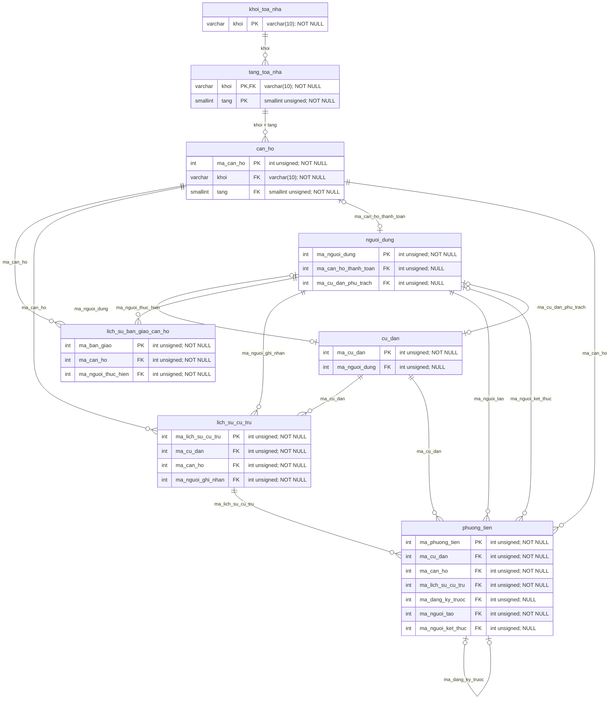
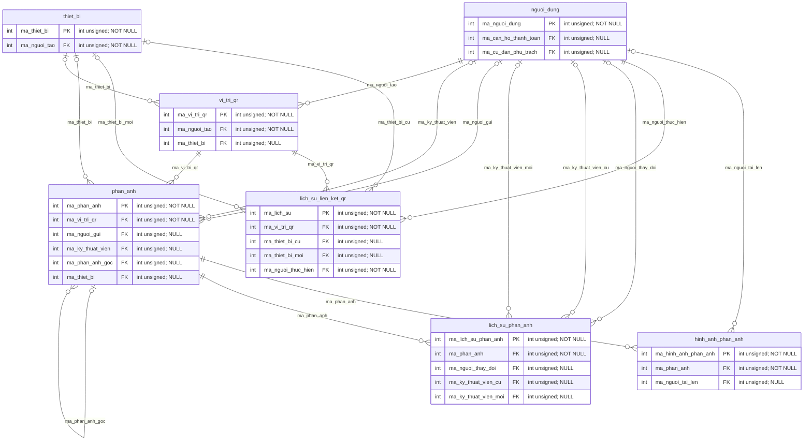

# ERD vật lý theo phân hệ

Tự sinh từ cùng metadata với [từ điển dữ liệu](tu-dien-du-lieu.md). Cột trong hình rút gọn còn PK/FK; tên cột, kiểu đầy đủ, CHECK và UNIQUE xem từ điển. Bảng cha ngoài nhóm được thêm làm điểm nối. FK ghép được vẽ một quan hệ. UNIQUE ghép/sinh cần đọc thêm biểu thức trong từ điển.

Ký hiệu: `||` đúng một; `o|` không hoặc một; `o{` không hoặc nhiều. Cột FK nullable cho phép không có cha. Đây là quan hệ vật lý; quy tắc một đợt cư trú đang mở hay một chủ hộ hiện tại còn phụ thuộc UNIQUE sinh và transaction service.

[ERD toàn bộ bảng (.mmd)](erd-vat-ly.mmd) có tất cả cột, phù hợp mở bằng công cụ Mermaid; không nên ép toàn bộ vào một trang A4.

## nha-o

## qr-phan-anh

## tai-chinh

```mermaid
erDiagram
  can_ho {
    int ma_can_ho PK "int unsigned; NOT NULL"
    varchar khoi FK "varchar(10); NOT NULL"
    smallint tang FK "smallint unsigned; NOT NULL"
  }
  cau_hinh_phi {
    int ma_cau_hinh_phi PK "int unsigned; NOT NULL"
    varchar loai_phi FK "varchar(30); NOT NULL"
    int ma_nguoi_tao FK "int unsigned; NOT NULL"
  }
  chi_so_dich_vu {
    int ma_chi_so_dich_vu PK "int unsigned; NOT NULL"
    int ma_can_ho FK "int unsigned; NOT NULL"
    int ma_nguoi_ghi FK "int unsigned; NOT NULL"
  }
  chi_tiet_hoa_don {
    int ma_chi_tiet_hoa_don PK "int unsigned; NOT NULL"
    int ma_hoa_don FK "int unsigned; NOT NULL"
    int ma_cau_hinh_phi FK "int unsigned; NOT NULL"
    int ma_chi_so_dich_vu FK "int unsigned; NULL"
  }
  chung_tu_thu_chi {
    int ma_chung_tu PK "int unsigned; NOT NULL"
    int ma_phieu FK "int unsigned; NOT NULL"
    int ma_nguoi_tai FK "int unsigned; NOT NULL"
  }
  dot_lap_hoa_don {
    int ma_dot_lap PK "int unsigned; NOT NULL"
    int ma_nguoi_lap FK "int unsigned; NOT NULL"
  }
  dot_xu_ly_hoa_don {
    int ma_dot_xu_ly PK "int unsigned; NOT NULL"
    int ma_nguoi_thuc_hien FK "int unsigned; NOT NULL"
  }
  hoa_don {
    int ma_hoa_don PK "int unsigned; NOT NULL"
    int ma_can_ho FK "int unsigned; NOT NULL"
    int ma_hoa_don_thay_the_cho FK "int unsigned; NULL"
    int ma_nguoi_lap FK "int unsigned; NOT NULL"
    int ma_nguoi_duyet FK "int unsigned; NULL"
    int ma_nguoi_gui FK "int unsigned; NULL"
    int ma_nguoi_huy FK "int unsigned; NULL"
    int ma_nguoi_xac_nhan FK "int unsigned; NULL"
  }
  lich_su_hoa_don {
    int ma_lich_su_hoa_don PK "int unsigned; NOT NULL"
    int ma_hoa_don FK "int unsigned; NOT NULL"
    int ma_nguoi_ghi FK "int unsigned; NOT NULL"
  }
  lich_su_thu_chi {
    int ma_lich_su PK "int unsigned; NOT NULL"
    int ma_phieu FK "int unsigned; NOT NULL"
    int ma_nguoi_thuc_hien FK "int unsigned; NOT NULL"
  }
  loai_phi {
    varchar loai_phi PK "varchar(30); NOT NULL"
  }
  nguoi_dung {
    int ma_nguoi_dung PK "int unsigned; NOT NULL"
    int ma_can_ho_thanh_toan FK "int unsigned; NULL"
    int ma_cu_dan_phu_trach FK "int unsigned; NULL"
  }
  phieu_thu_chi {
    int ma_phieu PK "int unsigned; NOT NULL"
    int ma_quy FK "int unsigned; NOT NULL"
    int ma_nguoi_lap FK "int unsigned; NOT NULL"
    int ma_nguoi_duyet FK "int unsigned; NULL"
    int ma_phieu_goc FK "int unsigned; NULL"
  }
  quy_tai_chinh {
    int ma_quy PK "int unsigned; NOT NULL"
  }
  loai_phi ||--o{ cau_hinh_phi : "loai_phi"
  nguoi_dung ||--o{ cau_hinh_phi : "ma_nguoi_tao"
  can_ho ||--o{ chi_so_dich_vu : "ma_can_ho"
  nguoi_dung ||--o{ chi_so_dich_vu : "ma_nguoi_ghi"
  hoa_don ||--o{ chi_tiet_hoa_don : "ma_hoa_don"
  cau_hinh_phi ||--o{ chi_tiet_hoa_don : "ma_cau_hinh_phi"
  chi_so_dich_vu o|--o{ chi_tiet_hoa_don : "ma_chi_so_dich_vu"
  phieu_thu_chi ||--o{ chung_tu_thu_chi : "ma_phieu"
  nguoi_dung ||--o{ chung_tu_thu_chi : "ma_nguoi_tai"
  nguoi_dung ||--o{ dot_lap_hoa_don : "ma_nguoi_lap"
  nguoi_dung ||--o{ dot_xu_ly_hoa_don : "ma_nguoi_thuc_hien"
  can_ho ||--o{ hoa_don : "ma_can_ho"
  hoa_don o|--o| hoa_don : "ma_hoa_don_thay_the_cho"
  nguoi_dung ||--o{ hoa_don : "ma_nguoi_lap"
  nguoi_dung o|--o{ hoa_don : "ma_nguoi_duyet"
  nguoi_dung o|--o{ hoa_don : "ma_nguoi_gui"
  nguoi_dung o|--o{ hoa_don : "ma_nguoi_huy"
  nguoi_dung o|--o{ hoa_don : "ma_nguoi_xac_nhan"
  hoa_don ||--o{ lich_su_hoa_don : "ma_hoa_don"
  nguoi_dung ||--o{ lich_su_hoa_don : "ma_nguoi_ghi"
  phieu_thu_chi ||--o{ lich_su_thu_chi : "ma_phieu"
  nguoi_dung ||--o{ lich_su_thu_chi : "ma_nguoi_thuc_hien"
  quy_tai_chinh ||--o{ phieu_thu_chi : "ma_quy"
  nguoi_dung ||--o{ phieu_thu_chi : "ma_nguoi_lap"
  nguoi_dung o|--o{ phieu_thu_chi : "ma_nguoi_duyet"
  phieu_thu_chi o|--o| phieu_thu_chi : "ma_phieu_goc"
```

## van-hanh

```mermaid
erDiagram
  can_ho {
    int ma_can_ho PK "int unsigned; NOT NULL"
    varchar khoi FK "varchar(10); NOT NULL"
    smallint tang FK "smallint unsigned; NOT NULL"
  }
  cu_dan {
    int ma_cu_dan PK "int unsigned; NOT NULL"
    int ma_nguoi_dung FK "int unsigned; NULL"
  }
  dat_lich_tien_ich {
    int ma_dat_lich PK "int unsigned; NOT NULL"
    int ma_tien_ich FK "int unsigned; NOT NULL"
    int ma_can_ho FK "int unsigned; NOT NULL"
    int ma_nguoi_dat FK "int unsigned; NOT NULL"
    int ma_cu_dan FK "int unsigned; NOT NULL"
    int ma_lich_su_cu_tru FK "int unsigned; NOT NULL"
  }
  hoa_don {
    int ma_hoa_don PK "int unsigned; NOT NULL"
    int ma_can_ho FK "int unsigned; NOT NULL"
    int ma_hoa_don_thay_the_cho FK "int unsigned; NULL"
    int ma_nguoi_lap FK "int unsigned; NOT NULL"
    int ma_nguoi_duyet FK "int unsigned; NULL"
    int ma_nguoi_gui FK "int unsigned; NULL"
    int ma_nguoi_huy FK "int unsigned; NULL"
    int ma_nguoi_xac_nhan FK "int unsigned; NULL"
  }
  lich_su_bao_tri {
    int ma_lich_su PK "int unsigned; NOT NULL"
    int ma_thiet_bi FK "int unsigned; NOT NULL"
    int ma_phieu_bao_tri FK "int unsigned; NULL"
    int ma_nguoi_thuc_hien FK "int unsigned; NOT NULL"
  }
  lich_su_cu_tru {
    int ma_lich_su_cu_tru PK "int unsigned; NOT NULL"
    int ma_cu_dan FK "int unsigned; NOT NULL"
    int ma_can_ho FK "int unsigned; NOT NULL"
    int ma_nguoi_ghi_nhan FK "int unsigned; NOT NULL"
  }
  lich_su_dat_lich {
    int ma_lich_su PK "int unsigned; NOT NULL"
    int ma_dat_lich FK "int unsigned; NOT NULL"
    int ma_nguoi_thuc_hien FK "int unsigned; NOT NULL"
  }
  lich_su_thong_bao {
    int ma_lich_su PK "int unsigned; NOT NULL"
    int ma_thong_bao FK "int unsigned; NOT NULL"
    int ma_nguoi_thuc_hien FK "int unsigned; NOT NULL"
  }
  nguoi_dung {
    int ma_nguoi_dung PK "int unsigned; NOT NULL"
    int ma_can_ho_thanh_toan FK "int unsigned; NULL"
    int ma_cu_dan_phu_trach FK "int unsigned; NULL"
  }
  phieu_bao_tri {
    int ma_phieu_bao_tri PK "int unsigned; NOT NULL"
    int ma_thiet_bi FK "int unsigned; NOT NULL"
    int ma_ky_thuat_vien FK "int unsigned; NULL"
    int ma_nguoi_lap FK "int unsigned; NOT NULL"
    int ma_nguoi_nghiem_thu FK "int unsigned; NULL"
    int ma_nguoi_huy FK "int unsigned; NULL"
  }
  thiet_bi {
    int ma_thiet_bi PK "int unsigned; NOT NULL"
    int ma_nguoi_tao FK "int unsigned; NOT NULL"
  }
  thong_bao {
    int ma_thong_bao PK "int unsigned; NOT NULL"
    int ma_can_ho FK "int unsigned; NULL"
    int ma_hoa_don FK "int unsigned; NULL"
    int ma_nguoi_tao FK "int unsigned; NOT NULL"
    int ma_nguoi_gui FK "int unsigned; NULL"
    int ma_nguoi_thu_hoi FK "int unsigned; NULL"
  }
  thong_bao_da_doc {
    int ma_thong_bao PK,FK "int unsigned; NOT NULL"
    int ma_nguoi_dung PK,FK "int unsigned; NOT NULL"
    int nguoi_tiep_nhan PK "int unsigned; NOT NULL"
  }
  tien_ich {
    int ma_tien_ich PK "int unsigned; NOT NULL"
    int ma_nguoi_tao FK "int unsigned; NOT NULL"
  }
  tien_ich ||--o{ dat_lich_tien_ich : "ma_tien_ich"
  can_ho ||--o{ dat_lich_tien_ich : "ma_can_ho"
  nguoi_dung ||--o{ dat_lich_tien_ich : "ma_nguoi_dat"
  cu_dan ||--o{ dat_lich_tien_ich : "ma_cu_dan"
  lich_su_cu_tru ||--o{ dat_lich_tien_ich : "ma_lich_su_cu_tru"
  thiet_bi ||--o{ lich_su_bao_tri : "ma_thiet_bi"
  phieu_bao_tri o|--o{ lich_su_bao_tri : "ma_phieu_bao_tri"
  nguoi_dung ||--o{ lich_su_bao_tri : "ma_nguoi_thuc_hien"
  dat_lich_tien_ich ||--o{ lich_su_dat_lich : "ma_dat_lich"
  nguoi_dung ||--o{ lich_su_dat_lich : "ma_nguoi_thuc_hien"
  thong_bao ||--o{ lich_su_thong_bao : "ma_thong_bao"
  nguoi_dung ||--o{ lich_su_thong_bao : "ma_nguoi_thuc_hien"
  thiet_bi ||--o{ phieu_bao_tri : "ma_thiet_bi"
  nguoi_dung o|--o{ phieu_bao_tri : "ma_ky_thuat_vien"
  nguoi_dung ||--o{ phieu_bao_tri : "ma_nguoi_lap"
  nguoi_dung o|--o{ phieu_bao_tri : "ma_nguoi_nghiem_thu"
  nguoi_dung o|--o{ phieu_bao_tri : "ma_nguoi_huy"
  nguoi_dung ||--o{ thiet_bi : "ma_nguoi_tao"
  can_ho o|--o{ thong_bao : "ma_can_ho"
  hoa_don o|--o{ thong_bao : "ma_hoa_don"
  nguoi_dung ||--o{ thong_bao : "ma_nguoi_tao"
  nguoi_dung o|--o{ thong_bao : "ma_nguoi_gui"
  nguoi_dung o|--o{ thong_bao : "ma_nguoi_thu_hoi"
  thong_bao ||--o{ thong_bao_da_doc : "ma_thong_bao"
  nguoi_dung ||--o{ thong_bao_da_doc : "ma_nguoi_dung"
  nguoi_dung ||--o{ tien_ich : "ma_nguoi_tao"
```

