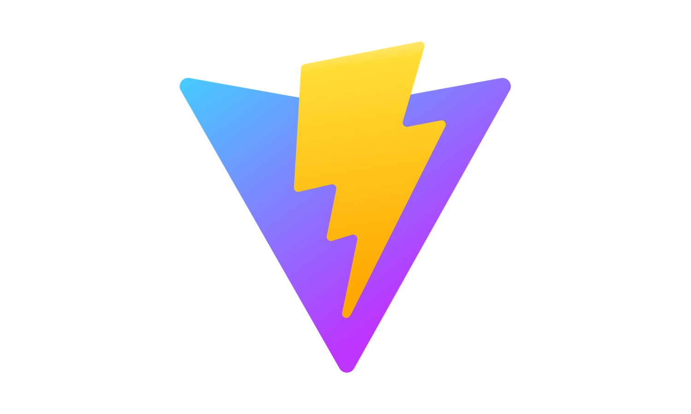
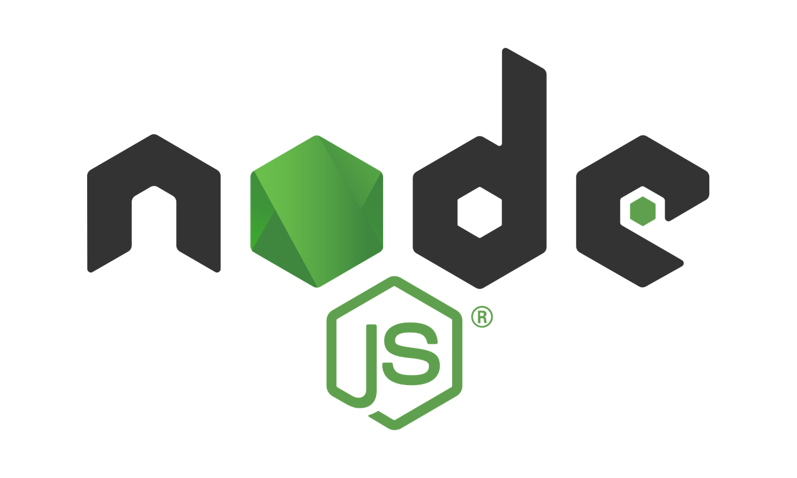
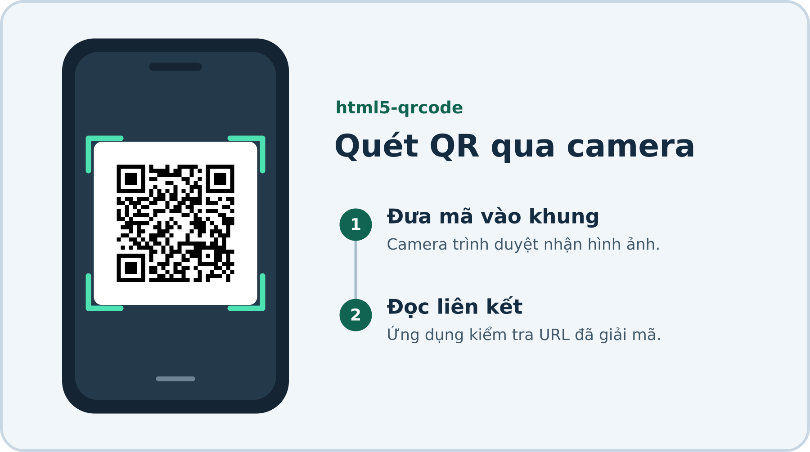
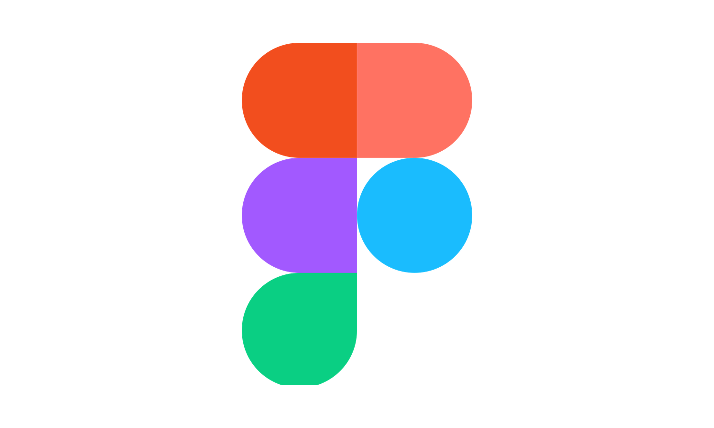

# Bộ hình mục 1.3. Công nghệ và công cụ sử dụng

[Word tập hình](Hinh-cong-cu-muc-1-3.docx) · [PDF xem trước](Hinh-cong-cu-muc-1-3.pdf) · [ZIP trọn bộ](Hinh-cong-cu-muc-1-3.zip)

PNG dùng để chèn vào Word. SVG của logo giữ nguyên từ Devicon. Hai SVG QR minh họa chức năng
quét và sinh mã. Số hình gợi ý theo Chương 1, có thể cập nhật theo thứ tự khi đưa vào báo cáo.

[Danh mục URL và SHA-256 của từng logo](nguon/nguon-logo.json) · [Giấy phép MIT của Devicon](nguon/DEVICON-LICENSE.txt)

## 1.3.1. React, giao diện thích ứng và Vite

| Xem hình | Chú thích và tệp |
| --- | --- |
|  | **Hình 1.1. Logo React** Thư viện xây dựng giao diện theo thành phần. [PNG](png/react.png) · [SVG](svg/react.svg) · [Devicon](https://raw.githubusercontent.com/devicons/devicon/32fe1d3b3f36ad11f90ab94f7db59738139c2bf6/icons/react/react-original.svg) |
|  | **Hình 1.2. Logo Vite** Máy chủ phát triển và công cụ tạo bản dựng frontend. [PNG](png/vite.png) · [SVG](svg/vite.svg) · [Devicon](https://raw.githubusercontent.com/devicons/devicon/32fe1d3b3f36ad11f90ab94f7db59738139c2bf6/icons/vitejs/vitejs-original.svg) |

## 1.3.2. Node.js, Express và MySQL

| Xem hình | Chú thích và tệp |
| --- | --- |
|  | **Hình 1.3. Logo Node.js** Môi trường chạy JavaScript phía máy chủ. [PNG](png/nodejs.png) · [SVG](svg/nodejs.svg) · [Devicon](https://raw.githubusercontent.com/devicons/devicon/32fe1d3b3f36ad11f90ab94f7db59738139c2bf6/icons/nodejs/nodejs-original-wordmark.svg) |
|  | **Hình 1.4. Logo Express** Framework định tuyến và xử lý middleware của API. [PNG](png/express.png) · [SVG](svg/express.svg) · [Devicon](https://raw.githubusercontent.com/devicons/devicon/32fe1d3b3f36ad11f90ab94f7db59738139c2bf6/icons/express/express-original-wordmark.svg) |
|  | **Hình 1.5. Logo MySQL** Hệ quản trị cơ sở dữ liệu quan hệ của hệ thống. [PNG](png/mysql.png) · [SVG](svg/mysql.svg) · [Devicon](https://raw.githubusercontent.com/devicons/devicon/32fe1d3b3f36ad11f90ab94f7db59738139c2bf6/icons/mysql/mysql-original-wordmark.svg) |

## 1.3.3. html5-qrcode, qrcode và camera trình duyệt

Hai hình minh họa chức năng, dùng URL mẫu thuộc miền example.org.

| Xem hình | Chú thích và tệp |
| --- | --- |
|  | **Hình 1.6. Minh họa quét QR bằng html5-qrcode** Camera trình duyệt nhận ảnh. Thư viện giải mã để ứng dụng kiểm tra liên kết. [PNG](png/html5-qrcode-quet.png) · [SVG](svg/html5-qrcode-quet.svg) · [Tài liệu thư viện html5-qrcode](https://github.com/mebjas/html5-qrcode) |
|  | **Hình 1.7. Mã QR mẫu sinh bằng qrcode** Mã chứa URL minh họa https://example.org/qr/demo. [PNG](png/qrcode-mau.png) · [SVG](svg/qrcode-mau.svg) · [Tài liệu thư viện qrcode](https://github.com/soldair/node-qrcode) |

## 1.3.4. Công cụ phát triển và kiểm thử

| Xem hình | Chú thích và tệp |
| --- | --- |
|  | **Hình 1.8. Logo Git** Quản lý lịch sử phiên bản của mã nguồn và tài liệu. [PNG](png/git.png) · [SVG](svg/git.svg) · [Devicon](https://raw.githubusercontent.com/devicons/devicon/32fe1d3b3f36ad11f90ab94f7db59738139c2bf6/icons/git/git-original-wordmark.svg) |
|  | **Hình 1.9. Logo GitHub** Lưu trữ kho mã và tài liệu của dự án. [PNG](png/github.png) · [SVG](svg/github.svg) · [Devicon](https://raw.githubusercontent.com/devicons/devicon/32fe1d3b3f36ad11f90ab94f7db59738139c2bf6/icons/github/github-original-wordmark.svg) |
|  | **Hình 1.10. Logo Visual Studio Code** Soạn thảo, đọc mã và chạy lệnh phát triển. [PNG](png/vscode.png) · [SVG](svg/vscode.svg) · [Devicon](https://raw.githubusercontent.com/devicons/devicon/32fe1d3b3f36ad11f90ab94f7db59738139c2bf6/icons/vscode/vscode-original.svg) |
|  | **Hình 1.11. Logo Playwright** Tự động hóa kiểm thử trên trình duyệt. [PNG](png/playwright.png) · [SVG](svg/playwright.svg) · [Devicon](https://raw.githubusercontent.com/devicons/devicon/32fe1d3b3f36ad11f90ab94f7db59738139c2bf6/icons/playwright/playwright-original.svg) |

## Tham khảo từ đề cương

Tài liệu hiện có chưa xác nhận việc sử dụng Figma hoặc Postman trong sản phẩm.

| Xem hình | Chú thích và tệp |
| --- | --- |
|  | **Hình TK.1. Logo Figma** Công cụ thiết kế giao diện được nêu trong đề cương. [PNG](png/figma.png) · [SVG](svg/figma.svg) · [Devicon](https://raw.githubusercontent.com/devicons/devicon/32fe1d3b3f36ad11f90ab94f7db59738139c2bf6/icons/figma/figma-original.svg) |
|  | **Hình TK.2. Logo Postman** Công cụ thử API được nêu trong đề cương. [PNG](png/postman.png) · [SVG](svg/postman.svg) · [Devicon](https://raw.githubusercontent.com/devicons/devicon/32fe1d3b3f36ad11f90ab94f7db59738139c2bf6/icons/postman/postman-original.svg) |

## Tái tạo tập hình

Tại gốc checkout, chạy `node docs/bao-cao/hinh-cong-cu-muc-1-3-2026-11-18/nguon/tao-qr.mjs`
với dependency `qrcode` của dự án. Sau đó chạy
`python docs/bao-cao/hinh-cong-cu-muc-1-3-2026-11-18/nguon/tao-bo-hinh.py`
với Inkscape, LibreOffice, Python 3.10+, Pillow và python-docx. Dùng phông DejaVu Sans
cho sơ đồ quét QR và Times New Roman hoặc phông tương thích cho tập Word.
