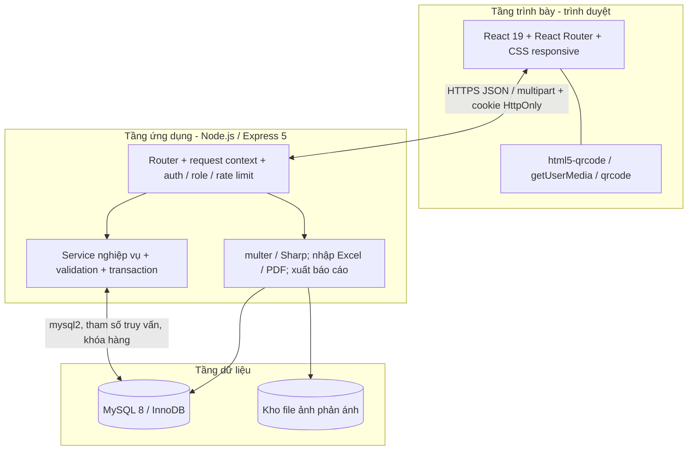
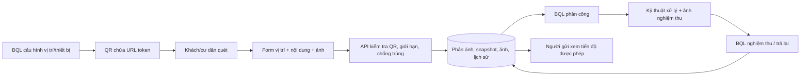
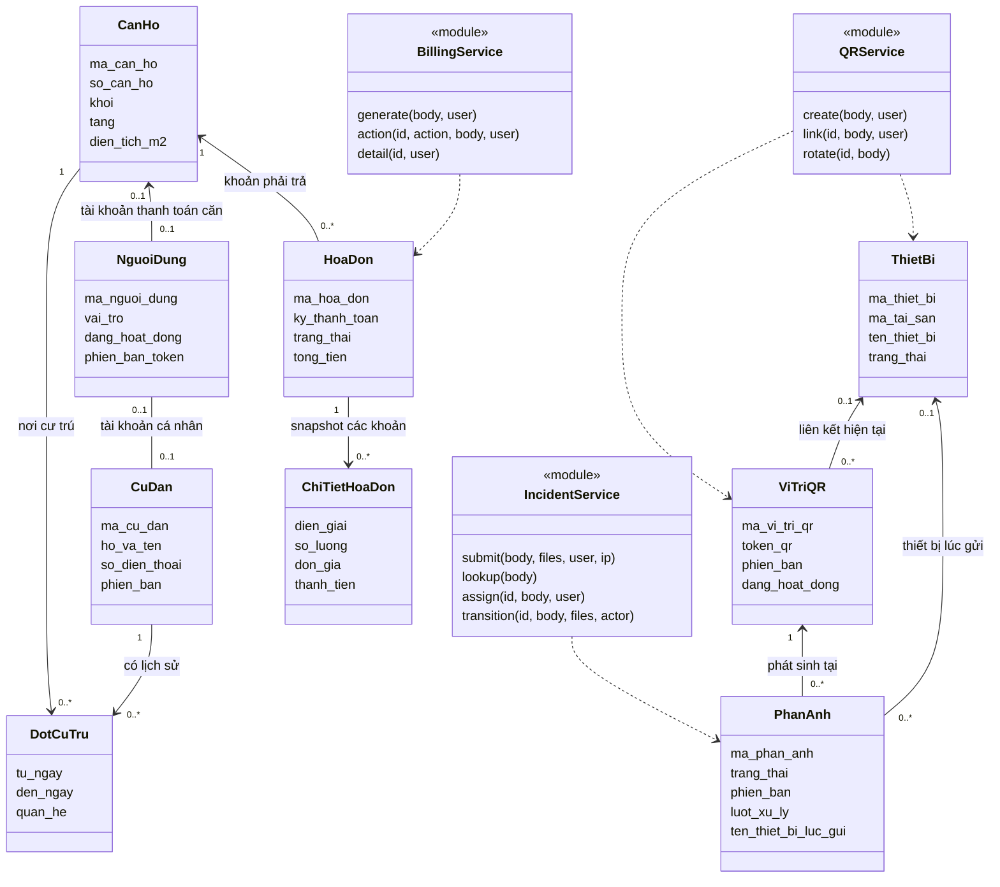
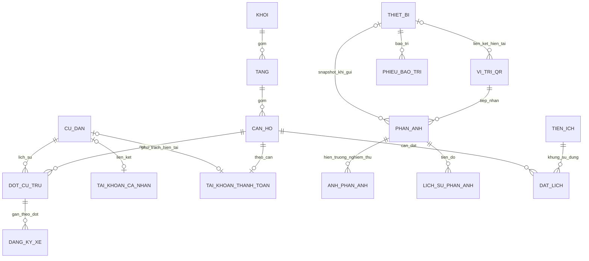
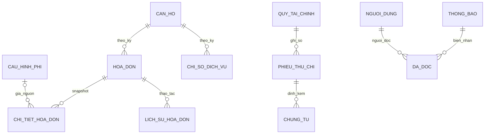

# Kiến trúc, phân rã chức năng, Class Diagram và ERD logic

Đây là mô hình phân tích theo mã nguồn hiện hành. [ERD vật lý](erd-phan-he.md) và [từ điển](tu-dien-du-lieu.md) mới là nguồn tên cột/khóa/ràng buộc đầy đủ. Không suy ra ứng dụng dùng ORM hoặc có các lớp runtime chỉ vì biểu diễn đối tượng nghiệp vụ bằng Class Diagram.

## Phân rã chức năng

```mermaid
flowchart TD
  HT["Quản lý vận hành chung cư"]
  HT --> A["Hồ sơ và quyền"] & B["Tiếp nhận sự cố QR"] & C["Tài chính"] & D["Vận hành"] & E["Điều hành"]
  A --> A1["Đăng nhập, phiên, phân quyền"] & A2["Khối / tầng / căn"] & A3["Cư dân / cư trú / xe"] & A4["Tài khoản căn, bàn giao chủ hộ"]
  B --> B1["Vị trí / thiết bị / QR"] & B2["Quét, form, ảnh và tra cứu"] & B3["Phân công, xử lý, nghiệm thu"]
  C --> C1["Đơn giá hiệu lực / chỉ số"] & C2["Hóa đơn / VietQR / xác nhận thu"] & C3["Công nợ / thu phí / quỹ"]
  D --> D1["Thiết bị và lịch bảo trì"] & D2["Phiếu bảo trì và nghiệm thu"] & D3["Tiện ích và duyệt đặt lịch"]
  E --> E1["Thông báo / nhắc phí trên web"] & E2["Dashboard, biểu đồ theo thời gian"] & E3["Nhập/xuất Excel và PDF biểu mẫu"]
```

## Kiến trúc ba tầng

Frontend/API phục vụ cùng origin; Vite proxy `/api` khi phát triển. Backend không mở thư mục ảnh công khai; endpoint ảnh kiểm tra quyền bản ghi. Chứng từ quỹ dùng binary trong DB, còn ảnh phản ánh là file + metadata. Sao lưu phải tính cả MySQL và kho ảnh; chưa có bằng chứng nghiệm thu phục hồi.

JWT dùng `jose` HS256, bcrypt cost 12. Request thay đổi cần `X-App-Request: 1`, từ chối `Sec-Fetch-Site: cross-site`, cookie SameSite=Strict; cookie Secure bật khi HTTPS. API không tin role hoặc ID thiết bị gửi từ frontend để cấp quyền/chụp snapshot. `phien_ban` + khóa hàng tránh cập nhật từ form cũ; lỗi nghiệp vụ có code/message/request ID. Không có WebSocket/message broker, tác vụ SMS/email nền hay kết nối ngân hàng tự động.

## Luồng dữ liệu tổng quát

Hai vòng độc lập: sự cố QR không tự tạo phiếu bảo trì; thanh toán VietQR không tự chuyển DA_THANH_TOAN. BQL thực hiện các quyết định tương ứng qua màn nghiệp vụ.

## Class Diagram phân tích

Tên lớp là khái niệm, thuộc tính chọn từ schema. Service dưới đây là mô hình hóa các **hàm export** hiện có, không khẳng định có `class` hoặc entity ORM trong mã.

Một căn có tối đa một tài khoản thanh toán theo ràng buộc DB; luồng tạo căn bảo đảm có tài khoản, nhưng đây không phải tổng quát rằng mọi người dùng đều là cư dân. Trách nhiệm chủ hộ nằm ở người phụ trách căn hiện tại và lịch sử bàn giao, không tự ghi đè người chịu trách nhiệm ở snapshot cũ.

## ERD logic — nhà ở và vận hành

Mô hình rút gọn quan hệ nghiệp vụ, không liệt kê mọi cột kỹ thuật/lịch sử audit. Mỗi đợt cư trú thuộc đúng một căn và một cư dân. Cùng ngày được phép kết thúc/mở đợt mới; UNIQUE cột sinh và service giới hạn tối đa một đợt đang mở mỗi cư dân.

`TAI_KHOAN_CA_NHAN` và `TAI_KHOAN_THANH_TOAN` là hai khái niệm của cùng bảng `nguoi_dung`, không phải hai bảng mới. QR gắn thiết bị là tùy chọn; phản ánh giữ liên kết và tên/mã/vị trí thiết bị lúc gửi, khác với thiết bị hiện tại của QR sau bàn giao. Xem ERD vật lý cho cả khóa ngoại tới actor, bản gốc gộp và lịch sử đổi liên kết.

## ERD logic — hóa đơn và thông báo

Thu hóa đơn đi vào báo cáo/quỹ vận hành từ nguồn hóa đơn đã xác nhận; không vẽ một bảng “giao dịch ngân hàng” hay tự tạo phiếu thu trùng khoản. Khoản tiền hóa đơn nguyên đồng, xử lý tổng bằng BigInt ở các luồng tài chính để giữ chính xác; `DECIMAL` từ MySQL trả về chuỗi. Số lượng và đơn giá có độ chính xác riêng, không định dạng mọi loại thành số nguyên. Biểu giá điện là cấu hình có hiệu lực, không phải khẳng định mức EVN hiện tại sẽ mãi cố định.

## Quy tắc phải giữ khi đưa vào báo cáo

| Miền dữ liệu | Ràng buộc/thực thi |
|---|---|
| Khối/tầng/căn | Khóa ghép `(khoi,tang)`; đổi mã/số cascade và tăng phiên bản căn; không xóa mục đang dùng |
| Cư trú/xe | Khoảng `[bắt đầu,kết thúc)`; ngày kết thúc bằng bắt đầu được phép; chuyển căn và xe cùng transaction |
| QR/phản ánh | QR version, snapshot server, replay chống gửi trùng, giới hạn gửi, quyền ảnh và lịch sử |
| Xử lý | KTV được giao mới sửa; ảnh mới từng lượt; BQL nghiệm thu, không tự hoàn thành hộ |
| Hóa đơn | Snapshot; duyệt rồi gửi; chưa thu mới hủy/thay thế; đã nhận đủ mới BQL xác nhận thu |
| Bảo trì | Phiếu định kỳ mở duy nhất mỗi thiết bị; nghiệm thu mới dời lịch theo ngày thực hiện + chu kỳ snapshot |
| Đặt lịch | Lượt chờ cũng giữ chỗ; khóa server ngăn trùng; không chia sẻ sức chứa giữa nhóm |
| Quỹ | Ghi sổ không sửa; đảo có lý do; không chi quá số dư hiện tại; chưa khóa sổ kỳ |
| Nhập file | Xem trước chưa lưu; xác nhận kiểm tra lại; lỗi một dòng rollback lô; PDF phải có trường điền, không OCR |

Kiến trúc này là phiên bản demo/đồ án. Hiệu năng tải lớn, sao lưu phục hồi và thiết bị thật phải có kết quả đo riêng trong [nghiệm thu](nghiem-thu.md).
