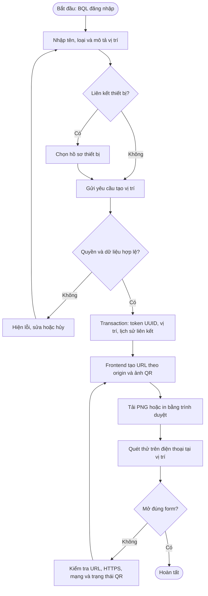
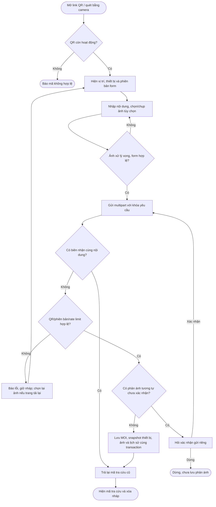
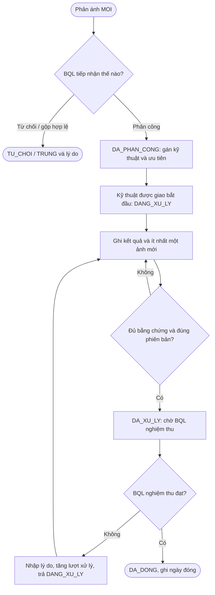
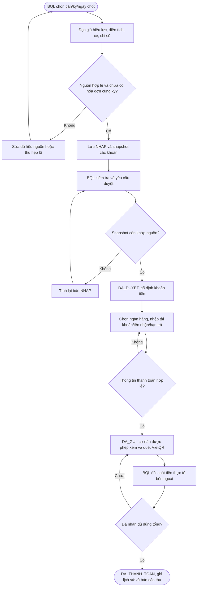
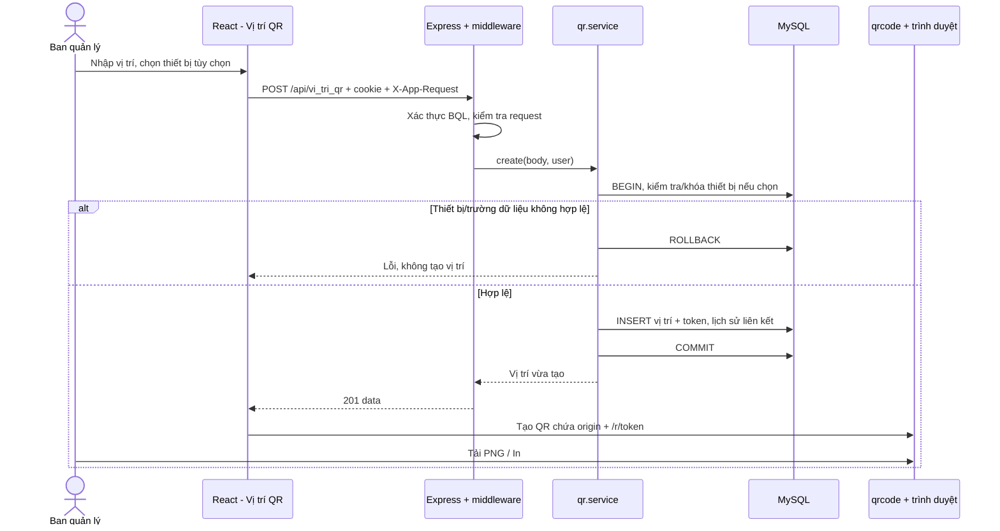
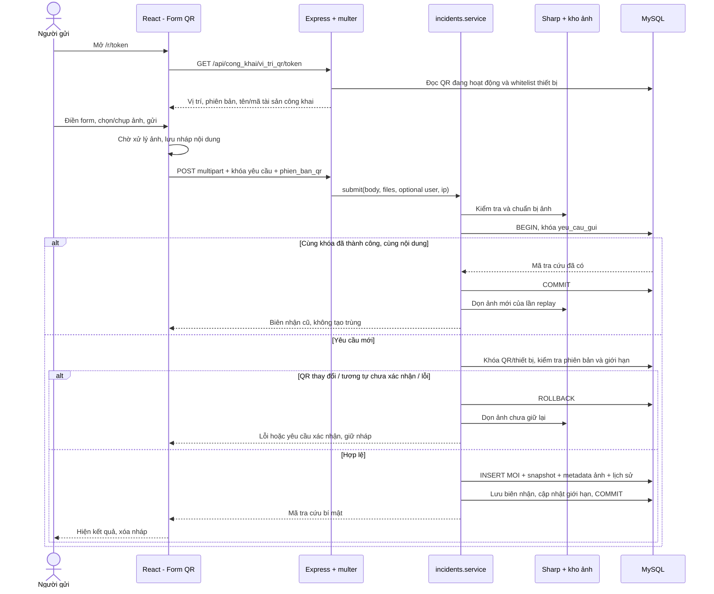
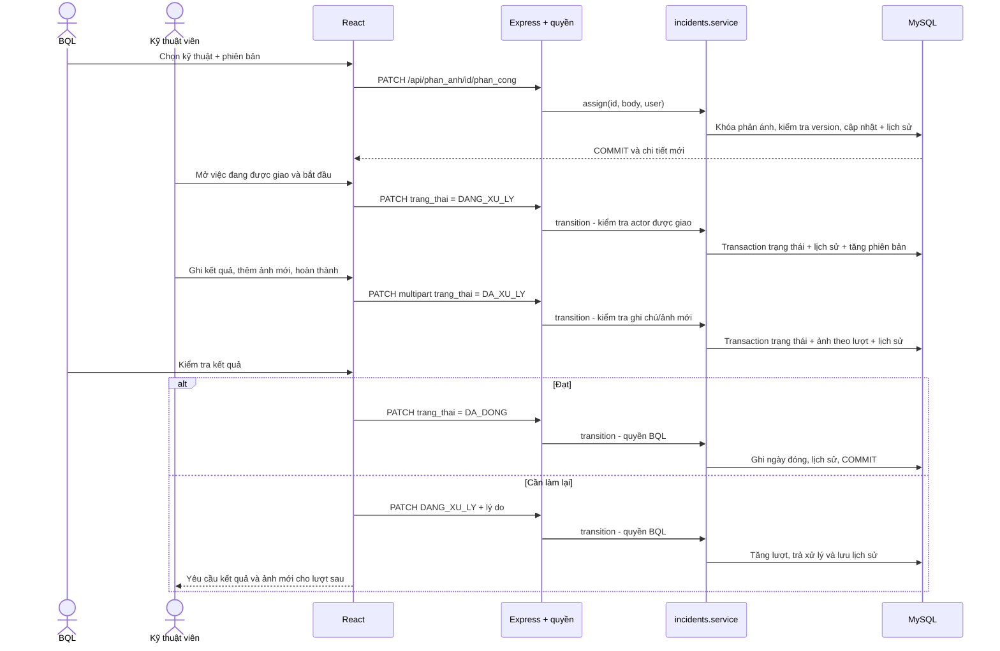
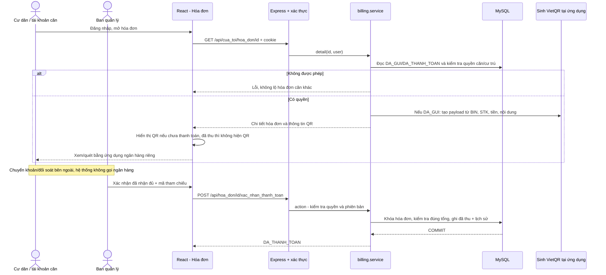
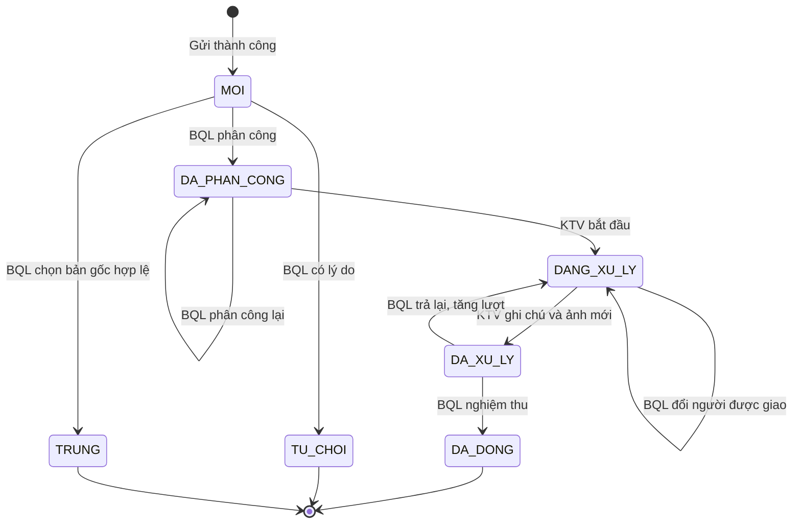
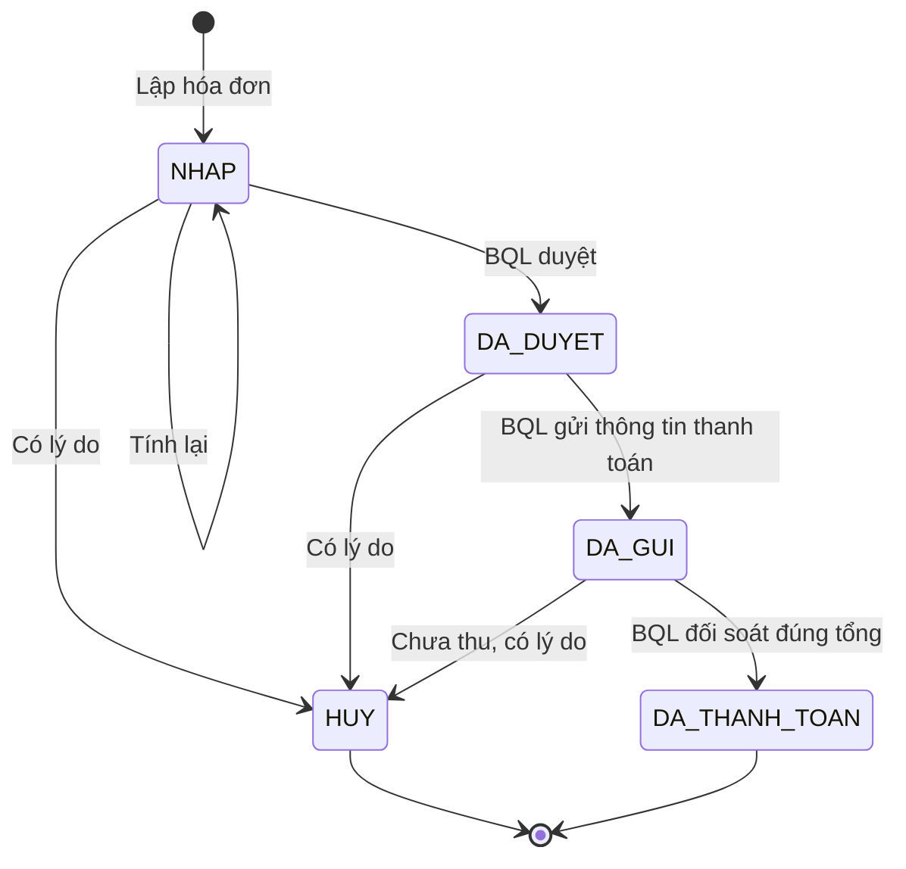

# Bốn Activity, bốn Sequence và trạng thái nghiệp vụ

Các sơ đồ mô tả đường đi chính của mã nguồn sau migration 018. Nhánh lỗi được rút gọn; chi tiết quyền/ngoại lệ xem [năm đặc tả](use-case.md). Activity dùng Mermaid flowchart; Sequence dùng đúng participant frontend, API, service, DB/lưu ảnh. Không có dịch vụ ngân hàng hay hàng đợi nền tự động trong triển khai hiện tại.

## Activity 1 — Tạo và in QR

## Activity 2 — Quét QR và gửi ảnh

Ảnh được xử lý/lưu file trước khi mở khóa DB; nếu transaction không commit hoặc replay thì dọn file mới. MySQL không có transaction chung với filesystem; không mô tả ảnh là BLOB trong bảng phản ánh. Chứng từ quỹ là phân hệ khác và được lưu binary trong DB.

## Activity 3 — Phân công, hoàn thành, nghiệm thu

Mỗi mũi tên cập nhật gồm kiểm tra quyền/phạm vi, phiên bản và khóa hàng. Phân công lại khi đang làm không biến thành nghiệm thu và không giữ quyền kỹ thuật cũ.

## Activity 4 — Lập, duyệt và gửi hóa đơn

Lập/duyệt/gửi hàng loạt có xem trước, xác nhận và kiểm tra lại trong một transaction; một dòng lỗi rollback lô. Lược đồ trên rút gọn đường đi một hóa đơn. Hủy được trước đã thu; lập thay thế tạo bản mới, không sửa lịch sử cũ.

## Sequence 1 — Tạo và in QR

## Sequence 2 — Quét và gửi phản ánh

Khác nội dung dùng lại cùng khóa là 409, không phải replay. Sơ đồ bỏ bớt middleware rate-limit cho dễ đọc. Nội dung nháp ở sessionStorage không chứa dữ liệu file ảnh.

## Sequence 3 — Phân công và hoàn thành

Các dòng DB trả về FE là kết quả qua service/API, không phải trình duyệt kết nối MySQL trực tiếp. Khi version sai, rollback và 409; khi đã đổi người, kỹ thuật cũ không được đọc/sửa.

## Sequence 4 — Tra cứu hóa đơn và VietQR

## State Diagram — Phản ánh

## State Diagram — Hóa đơn

Hóa đơn thay thế là NHAP có ID mới và tham chiếu bản hủy; không có chuyển trạng thái HUY → NHAP trên cùng bản ghi.
