# MỞ ĐẦU

Sự cố tại thang máy, hành lang, bãi giữ xe hoặc khu sinh hoạt chung thường cần được tiếp nhận ngay tại nơi phát sinh. Nếu thông tin chỉ được chuyển qua cuộc gọi hoặc nhóm trò chuyện, Ban quản lý (BQL) khó liên kết nội dung phản ánh với vị trí, người phụ trách và bằng chứng xử lý. Khi số lượng yêu cầu tăng, việc tìm lại lịch sử và xác định một sự cố đã hoàn tất hay chưa cũng trở nên phức tạp. Đây là bài toán tổ chức quy trình và duy trì dữ liệu xuyên suốt, bên cạnh việc quản lý danh sách căn hộ và cư dân.

Đề tài “Xây dựng hệ thống quản lý vận hành chung cư và tiếp nhận phản ánh cư dân” được thực hiện nhằm xây dựng một ứng dụng web phục vụ hoạt động của một chung cư. Trọng tâm của đề tài là luồng tiếp nhận phản ánh bằng mã phản hồi nhanh (Quick Response — QR): người sử dụng mở liên kết tại vị trí, nhập nội dung và ảnh hiện trường; Ban quản lý tiếp nhận, phân công; kỹ thuật viên (KTV) xử lý và gửi bằng chứng; Ban quản lý nghiệm thu; người gửi theo dõi kết quả. Các chức năng căn hộ, cư trú, phương tiện, hóa đơn và thông báo cung cấp dữ liệu nền cho quá trình vận hành.

Mục tiêu cụ thể là hình thành một quy trình có thể truy vết từ lúc gửi đến khi đóng phản ánh; giảm việc nhập lại vị trí; phân chia quyền theo vai trò và theo từng bản ghi; lưu lịch sử thay đổi; hỗ trợ tra cứu khoản phải trả theo căn hộ. Hệ thống được thiết kế để sử dụng trên trình duyệt máy tính và điện thoại. Người gửi phản ánh qua QR không bị bắt buộc cài đặt ứng dụng hoặc đăng nhập, nhưng các chức năng quản trị, xử lý kỹ thuật và xem hóa đơn riêng vẫn yêu cầu xác thực.

Đối tượng nghiên cứu gồm quy trình vận hành chung cư, vòng đời phản ánh, quan hệ cư trú theo thời gian và cách hình thành hóa đơn dịch vụ. Phạm vi triển khai là một chung cư có nhiều khối và tầng, với ba vai trò tài khoản: Ban quản lý, kỹ thuật viên và cư dân. Khách gửi phản ánh là tác nhân công khai, không phải vai trò quản trị thứ tư. Đề tài được xây dựng trong phạm vi học thuật; chưa có căn cứ xác nhận đã triển khai vận hành chính thức tại một đơn vị quản lý chung cư.

Phương pháp thực hiện gồm phân tích yêu cầu từ đề cương, mô hình hóa bằng ngôn ngữ mô hình hóa thống nhất (UML) và sơ đồ quan hệ thực thể (ERD), thiết kế cơ sở dữ liệu (CSDL) quan hệ, xây dựng ứng dụng theo các module nghiệp vụ và kiểm tra bằng các tình huống đúng, sai, xung đột và thiếu quyền. Các chức năng được đối chiếu trực tiếp với mã nguồn tại phiên bản 56ebfe8. Báo cáo phân biệt kết quả kiểm thử đã lưu trong repository, kiểm tra được thực hiện khi soạn bản thảo và phần thực nghiệm trên thiết bị thật còn cần bổ sung.

Ứng dụng sử dụng React, Node.js, Express và MySQL. Mã QR được sinh từ một địa chỉ tài nguyên thống nhất (Uniform Resource Locator — URL) định danh vị trí, không chứa mật khẩu hoặc dữ liệu cá nhân. VietQR trong hóa đơn hỗ trợ hiển thị thông tin chuyển khoản; việc quét mã không đồng nghĩa với đã thanh toán. Ban quản lý phải đối soát trước khi xác nhận thu. Bộ dữ liệu quy mô lớn dùng cho kiểm tra là dữ liệu mô phỏng được sinh theo ràng buộc nghiệp vụ, không phải hồ sơ thu thập từ cư dân thực tế.

Báo cáo gồm ba chương. Chương 1 trình bày các hướng tiếp cận liên quan và cơ sở lý thuyết. Chương 2 mô tả yêu cầu, mô hình nghiệp vụ, thiết kế dữ liệu, kiến trúc và các vấn đề kỹ thuật. Chương 3 trình bày hiện thực, giao diện, kết quả kiểm tra và đánh giá giới hạn. Phần kết luận tổng hợp mức độ đáp ứng mục tiêu và hướng phát triển. Phụ lục cung cấp từ điển dữ liệu, kịch bản nghiệm thu và hướng dẫn vận hành. Bố cục và hình thức được xây dựng theo hướng dẫn của Khoa [1] và PDF hướng dẫn do GVHD cung cấp.

# CHƯƠNG 1. TỔNG QUAN TÀI LIỆU

## 1.1. Bài toán quản lý vận hành và các hướng tiếp cận liên quan

### 1.1.1. Phân biệt quản lý hồ sơ với quản lý vận hành

Quản lý hồ sơ tập trung trả lời các câu hỏi như căn hộ thuộc khối nào, cư dân nào đang ở và có bao nhiêu phương tiện. Quản lý vận hành còn phải theo dõi công việc phát sinh theo thời gian: ai tiếp nhận, ai được giao, trạng thái hiện tại, bằng chứng hoàn thành và người nghiệm thu. Do đó, một danh sách phản ánh chỉ có nội dung và trạng thái cuối cùng chưa đủ để mô tả trách nhiệm trong toàn bộ quá trình.

Trong đề tài này, dữ liệu hồ sơ và dữ liệu quy trình có quan hệ chặt chẽ. Một đợt cư trú xác định bối cảnh đăng ký phương tiện và quyền xem dữ liệu. Một vị trí QR có thể liên kết với thiết bị. Khi phản ánh được gửi, thiết bị lúc gửi được lưu lại để việc thay đổi liên kết QR sau đó không làm sai bối cảnh cũ. Tương tự, hóa đơn lưu các khoản đã tính tại ngày chốt, thay vì tính lại theo đơn giá mới mỗi khi người dùng mở trang.

### 1.1.2. Các hệ thống và công cụ có liên quan

ERPNext là một hệ thống hoạch định nguồn lực doanh nghiệp (Enterprise Resource Planning — ERP) mã nguồn mở có các nhóm chức năng kế toán, quản lý tài sản và theo dõi công việc được giới thiệu trong tài liệu dự án [4]. Đây là một tham chiếu về cách tổ chức nhiều nghiệp vụ trong cùng hệ thống. Tuy nhiên, phạm vi ERP tổng quát khác với phạm vi một chung cư và luồng gửi phản ánh tại vị trí của đề tài. Báo cáo không kết luận ERPNext thiếu chức năng nào chỉ từ nội dung giới thiệu công khai.

Html5-qrcode cung cấp thành phần quét QR và mã vạch trong ứng dụng web, bao gồm giao diện tích hợp sẵn và giao diện lập trình ở mức thấp [6]. Thư viện này hỗ trợ khâu nhận diện nội dung mã; nó không quản lý vị trí chung cư, phân công kỹ thuật, lịch sử nghiệm thu hoặc quyền xem ảnh. Vì vậy, phần đóng góp của ứng dụng là kết nối kết quả quét với quy trình nghiệp vụ và dữ liệu, thay vì xây dựng một thuật toán nhận dạng QR mới.

Bảng 1.1. So sánh các hướng tiếp cận đối với bài toán của đề tài

| Hướng tiếp cận | Giá trị sử dụng | Vấn đề cần xử lý trong đề tài |
| --- | --- | --- |
| Bảng tính và nhóm trò chuyện | Dễ bắt đầu, người dùng quen thao tác | Liên kết vị trí–công việc–người phụ trách và kiểm soát quyền khi dữ liệu tăng |
| Hệ thống ERP tổng quát, tham chiếu ERPNext | Tập trung dữ liệu nhiều phân hệ | Cần xác định cấu hình và quy trình phù hợp phạm vi một chung cư |
| Thành phần quét QR trên web | Đọc nội dung QR ngay trong trình duyệt | Cần bổ sung định danh vị trí, form, ảnh, xử lý và tra cứu |
| Ứng dụng web của đề tài | Kết nối QR với vòng đời phản ánh và dữ liệu vận hành | Cần nghiệm thu thiết bị thật và đánh giá triển khai dài hạn |

Nguồn: phân tích phạm vi đề tài; tài liệu ERPNext [4] và Html5-qrcode [6]. Bảng là so sánh cách tiếp cận, không phải phép đo hay xếp hạng sản phẩm thương mại.

## 1.2. Ứng dụng web, kiến trúc phân tầng và API

Ứng dụng web cho phép người dùng truy cập thông qua URL và trình duyệt. Việc chọn web cho luồng phản ánh phù hợp với yêu cầu mở liên kết từ QR mà không phải cài đặt ứng dụng riêng. Đổi lại, quyền camera, chất lượng mạng và các chính sách của trình duyệt trở thành những điều kiện phải kiểm tra. Giao diện tương thích kích thước màn hình không tự chứng minh camera sẽ hoạt động trên mọi thiết bị.

Kiến trúc được phân thành tầng trình bày, tầng ứng dụng và tầng dữ liệu. React quản lý trạng thái và hiển thị giao diện theo thành phần [11]. Express cung cấp cơ chế định tuyến và middleware trên Node.js [3]. MySQL lưu trữ dữ liệu quan hệ và thực thi ràng buộc dữ liệu [9]. Sự phân tầng giúp xác định nơi thực hiện từng trách nhiệm: giao diện hỗ trợ nhập liệu, API quyết định quyền và nghiệp vụ, cơ sở dữ liệu bảo vệ quan hệ và tính nhất quán.

Giao diện lập trình ứng dụng (Application Programming Interface — API) dùng giao thức truyền siêu văn bản (HTTP) với dữ liệu JavaScript Object Notation (JSON) hoặc multipart khi gửi ảnh. Một yêu cầu thay đổi không được xem là hợp lệ chỉ vì nút tương ứng xuất hiện trên giao diện. API phải kiểm tra người dùng, phạm vi bản ghi, dữ liệu đầu vào và trạng thái hiện tại. Các phản hồi lỗi cần giúp người dùng sửa thao tác mà không lộ câu truy vấn, mật khẩu hoặc thông tin kết nối máy chủ.

## 1.3. Mã QR, URL định danh và camera trình duyệt

QR là phương tiện mang dữ liệu có thể đọc bằng camera. Trong hệ thống, nội dung mã là URL có dạng origin/r/token; token định danh một vị trí đang được quản lý. Thư viện qrcode tạo ảnh từ chuỗi URL [12], còn Html5-qrcode đọc chuỗi từ hình ảnh camera [6]. Sau khi đọc được URL, ứng dụng gọi API để lấy vị trí. Việc xác định vị trí dựa trên bản ghi máy chủ, không dựa vào một tên vị trí do người gửi tự khai.

Cần phân biệt mã hóa biểu diễn với mã hóa bảo mật. Chuyển URL thành các ô đen trắng của QR không bảo vệ bí mật nội dung. Mã QR dán ở khu vực chung là điểm truy cập công khai; người có mã có thể mở biểu mẫu. Bởi vậy, thông tin cá nhân và mã tra cứu phản ánh không được đưa vào QR vị trí. API còn phải kiểm tra mã đang hoạt động, phiên bản và giới hạn gửi.

Truy cập camera qua getUserMedia phụ thuộc vào ngữ cảnh an toàn, quyền người dùng và hỗ trợ thiết bị [14]. HTTP qua kết nối bảo mật (HTTPS) là phương án phù hợp khi điện thoại truy cập máy tính qua địa chỉ mạng nội bộ. Ngoại lệ cho localhost chỉ có ý nghĩa trên chính thiết bị đang mở trình duyệt. Điện thoại truy cập địa chỉ IP của laptop qua HTTP không được coi là truy cập localhost.

## 1.4. Mô hình hóa nghiệp vụ bằng UML

UML cung cấp các cách biểu diễn bổ sung cho nhau khi phân tích và thiết kế phần mềm [8]. Use Case mô tả mục tiêu của tác nhân và phạm vi tương tác. Sơ đồ hoạt động thể hiện các bước xử lý và nhánh quyết định. Sơ đồ tuần tự thể hiện thông điệp giữa các thành phần theo thời gian. Sơ đồ lớp mô tả các khái niệm, thuộc tính và quan hệ cần quan tâm.

Trong báo cáo, Use Case không được dùng thay sơ đồ thứ tự thao tác. Tương tự, sơ đồ lớp là mô hình phân tích của bài toán, không phải bằng chứng mã nguồn sử dụng class hoặc một thư viện ánh xạ đối tượng–quan hệ. Bản hiện thực dùng các hàm và module JavaScript; quan hệ dữ liệu thực tế được mô tả riêng bằng ERD và từ điển dữ liệu.

## 1.5. Cơ sở dữ liệu quan hệ và bảo toàn lịch sử

Khóa chính nhận diện bản ghi; khóa ngoại liên kết các thực thể; UNIQUE và CHECK hỗ trợ ngăn dữ liệu không hợp lệ. Giao dịch cho phép nhóm nhiều thay đổi cần cùng thành công hoặc cùng hoàn tác. Dữ liệu được truy vấn bằng ngôn ngữ truy vấn có cấu trúc (Structured Query Language — SQL). Với nghiệp vụ phân công, thay đổi trạng thái phản ánh và ghi nhật ký phải nằm trong cùng giao dịch. Nếu ghi trạng thái thành công nhưng ghi lịch sử thất bại, hệ thống không còn đủ căn cứ truy vết.

Lịch sử cư trú là quan hệ nghiệp vụ có thời gian, khác nhật ký thao tác. Thay vì ghi đè căn hiện tại lên hồ sơ cư dân, mỗi lần vào ở hoặc chuyển căn tạo một đợt có ngày bắt đầu và ngày kết thúc. Nhật ký nghiệp vụ ghi ai đã thực hiện hành động và bối cảnh của hành động đó. Hai loại dữ liệu này không được gộp chỉ để giảm số lượng bảng.

Snapshot là bản chốt dữ liệu tại thời điểm phát sinh nghiệp vụ. Trong phản ánh, snapshot thiết bị giúp giữ bối cảnh cũ khi hồ sơ thiết bị hoặc liên kết QR được sửa. Trong hóa đơn, snapshot lưu số lượng, đơn giá và nguồn tính. Những lựa chọn này làm tăng một phần dữ liệu lưu trữ nhưng giúp giải thích kết quả lịch sử, một yêu cầu quan trọng của quản lý vận hành.

## 1.6. Xác thực, phân quyền và kiểm thử

JSON Web Token (JWT) là một định dạng biểu diễn tập hợp thông tin xác nhận [5]. Ứng dụng dùng thư viện jose để ký và kiểm tra JWT, đặt token trong cookie HttpOnly. Mật khẩu được băm bằng bcrypt, không lưu dạng văn bản. Phiên bản token trong tài khoản cho phép vô hiệu hóa phiên cũ khi khóa tài khoản, đổi mật khẩu hoặc bàn giao trách nhiệm căn hộ.

Phân quyền cần kiểm tra cả vai trò và đối tượng. Theo nguyên tắc kiểm soát truy cập ở phía máy chủ, một người đã đăng nhập vẫn có thể bị từ chối khi yêu cầu bản ghi ngoài phạm vi [10]. Trong đề tài, kỹ thuật viên chỉ thao tác việc được phân công; cư dân chỉ xem dữ liệu được cấp quyền; tài khoản căn không tự kế thừa phản ánh cá nhân của chủ hộ trước.

Kiểm thử cần bao gồm trường hợp thành công, dữ liệu không hợp lệ, thiếu quyền và cập nhật đồng thời. Các bài kiểm tra trình duyệt sử dụng API giả lập có thể chứng minh tương tác và bố cục trong điều kiện đó, nhưng không thay thế bài kiểm tra API với MySQL thật. Thực nghiệm camera còn cần thiết bị vật lý và điều kiện quét xác định. Báo cáo duy trì sự phân biệt này khi trình bày kết quả.

# CHƯƠNG 2. PHƯƠNG PHÁP THỰC HIỆN

## 2.1. Phân tích yêu cầu và phân rã chức năng

### 2.1.1. Tác nhân và phạm vi quyền

Số điện thoại (SĐT) được sử dụng làm thông tin liên hệ và, tùy loại tài khoản, có thể là định danh đăng nhập. Quyền không được suy ra chỉ từ việc một người biết SĐT hoặc mã căn hộ.

Bảng 2.1. Tác nhân tham gia hệ thống

| Tác nhân | Trách nhiệm chính | Giới hạn quyền |
| --- | --- | --- |
| Ban quản lý | Quản lý hồ sơ, QR, điều phối, nghiệm thu, phí và thông báo | Thao tác qua API được xác thực; các quyết định quan trọng có lịch sử |
| Kỹ thuật viên | Nhận việc, cập nhật xử lý và ảnh; thực hiện bảo trì được giao | Không tự đóng phản ánh hoặc đọc mọi công việc của người khác |
| Cư dân/tài khoản căn | Xem hóa đơn được phép, gửi và theo dõi phản ánh, đọc thông báo, đặt tiện ích | Không được duyệt hóa đơn, xác nhận thu hoặc xem danh sách nhân sự nội bộ |
| Người gửi công khai | Mở QR, gửi nội dung/ảnh và tra cứu bằng thông tin được cấp | Không có quyền quản trị; không xem danh sách phản ánh của người khác |

Nguồn: auth.middleware.js, incidents.repository.js và các router nghiệp vụ tại phiên bản 56ebfe8.

### 2.1.2. Yêu cầu chức năng

Bảng 2.2. Danh sách yêu cầu chức năng và tiêu chí kiểm tra

| Mã | Yêu cầu | Tiêu chí kiểm tra chính |
| --- | --- | --- |
| CN01 | Đăng nhập, đăng xuất và phân quyền | Tài khoản hợp lệ vào đúng vai trò; phiên bị thu hồi không tiếp tục đọc dữ liệu riêng |
| CN02 | Quản lý khối, tầng và căn hộ | Bảo toàn quan hệ khối–tầng–căn; từ chối xóa danh mục đang được sử dụng |
| CN03 | Quản lý cư dân, cư trú và phương tiện | Giữ lịch sử; hỗ trợ chuyển căn cùng ngày; tính xe theo loại và thời điểm |
| CN04 | Tài khoản thanh toán căn hộ | Tạo theo căn; liên kết chủ hộ hiện tại; bàn giao thu hồi phiên cũ |
| CN05 | Quản lý vị trí/thiết bị và QR | Tạo, xem, tải, in, vô hiệu và thay mã; mã hết hiệu lực không gửi được phản ánh |
| CN06 | Gửi phản ánh tại vị trí | Nhận vị trí từ server; gửi được nội dung/ảnh không bắt đăng nhập |
| CN07 | Điều phối, xử lý và nghiệm thu | Đúng người, đúng trạng thái; có ảnh hoàn thành; trả lại yêu cầu bằng chứng lượt mới |
| CN08 | Tra cứu phản ánh và bảo vệ ảnh | Mã tra cứu/thông tin xác minh phù hợp; không trả ghi chú nội bộ |
| CN09 | Phí, chỉ số và hóa đơn | Giá theo hiệu lực; lượng theo nguồn; snapshot; duyệt và gửi trước khi cư dân xem |
| CN10 | VietQR, xác nhận thu và công nợ | QR đúng thông tin; BQL đối soát rồi xác nhận; báo cáo khớp dữ liệu thu |
| CN11 | Thông báo và nhắc phí | Phát hành/thu hồi đúng phạm vi; trạng thái đọc theo người tiếp nhận |
| CN12 | Bảo trì, tiện ích và quỹ | Theo dõi phiếu, lịch duyệt, chứng từ và lịch sử; giữ quy tắc riêng của từng phân hệ |
| CN13 | Tổng quan và trao đổi dữ liệu | Thống kê có bộ lọc; nhập Excel có xem trước; xuất Excel/PDF theo quyền |

Nguồn: tổng hợp từ đề cương [2], mã nguồn và đặc tả specs/003-thesis-mysql-database/spec.md.

### 2.1.3. Yêu cầu phi chức năng

Giao diện cần dùng được trên máy tính và điện thoại, có nhãn trường nhập, trạng thái đang tải, thông báo lỗi và thao tác bàn phím cho các thành phần chính. Các bảng dài được phép cuộn trong vùng chứa thay vì làm toàn trang tràn ngang. Biểu đồ có lựa chọn hiện hoặc ẩn để phần điều hành không bị chiếm quá nhiều chiều cao. Ô xem QR đặt gần nút thao tác và chỉ hiển thị ảnh mã.

Ở phía dữ liệu, yêu cầu chính là bảo toàn quan hệ và lịch sử, xử lý số tiền chính xác, tránh ghi đè từ biểu mẫu cũ và không lưu một phần lô nghiệp vụ. Ở phía an toàn truy cập, hệ thống kiểm tra quyền ở API, giới hạn gửi công khai, kiểm tra nội dung ảnh và không trả thông tin bí mật trong lỗi. Đây là các yêu cầu thiết kế; mức chịu tải, thời gian đáp ứng sản xuất và khả năng phục hồi sau sự cố chưa được khẳng định nếu chưa có thực nghiệm tương ứng.

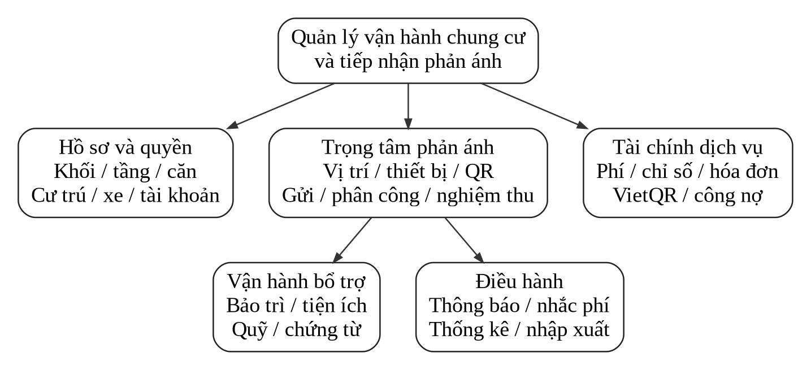

Nguồn: thiết kế theo các module hiện thực của dự án, phiên bản 56ebfe8.

## 2.2. Mô hình Use Case và đặc tả chức năng cốt lõi

### 2.2.1. Các sơ đồ Use Case

Hình 2.2 thể hiện các mục tiêu chính trong ranh giới ứng dụng. Các đường nối là quan hệ tham gia, không biểu diễn thứ tự thao tác. Hình 2.3 phân rã nhóm tác vụ của Ban quản lý; Hình 2.4 làm rõ sự khác biệt giữa người gửi công khai, cư dân đã đăng nhập và kỹ thuật viên. Đăng nhập là điều kiện của các chức năng riêng, không phải điều kiện bắt buộc của việc gửi phản ánh công khai.

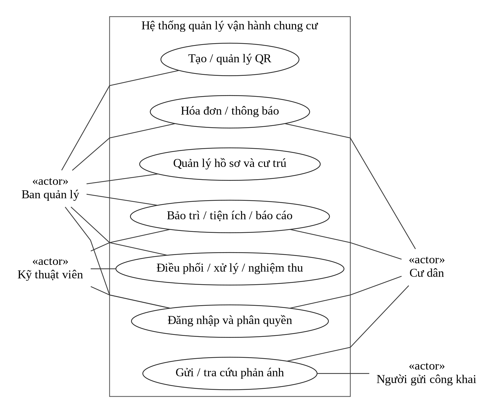

Nguồn: tổng hợp tác nhân và phạm vi quyền từ mã nguồn dự án; ký pháp Use Case tham chiếu UML [8].

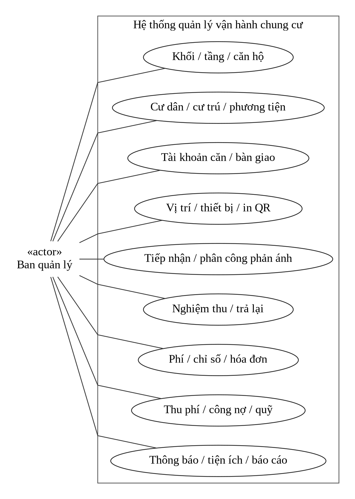

Nguồn: thiết kế theo router và service nghiệp vụ hiện tại.

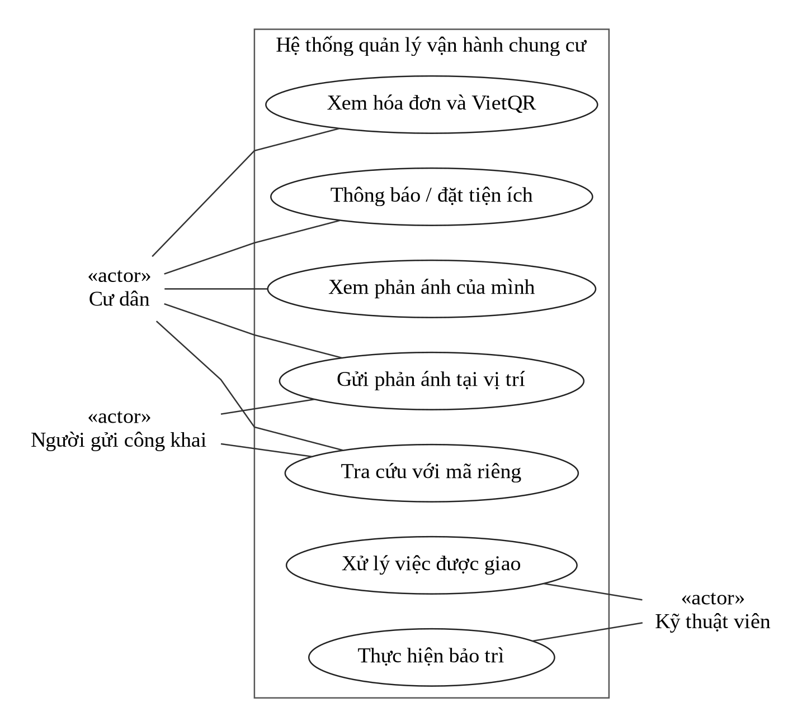

Nguồn: thiết kế theo phạm vi truy cập ở API hiện tại.

### 2.2.2. UC01 — Đăng nhập và phân quyền

Bảng 2.3. Đặc tả Use Case UC01

| Thành phần | Nội dung |
| --- | --- |
| Tác nhân | BQL, kỹ thuật viên, cư dân/tài khoản căn |
| Mục tiêu | Xác thực danh tính, nhận phiên và sử dụng đúng phạm vi |
| Tiền điều kiện | Tài khoản đã cấp, đang hoạt động, không thuộc thời gian khóa đăng nhập |
| Kích hoạt | Người dùng gửi định danh, loại tài khoản và mật khẩu |
| Luồng chính | 1. Nhập SĐT hoặc mã căn. 2. API kiểm tra dữ liệu và giới hạn. 3. Tìm đúng loại tài khoản. 4. So sánh mật khẩu bcrypt. 5. Cấp cookie session. 6. Giao diện điều hướng theo vai trò máy chủ trả về. |
| Luồng ngoại lệ | Sai thông tin: không cấp phiên. SĐT có cả tài khoản cá nhân và căn: yêu cầu chọn loại phù hợp. Tài khoản khóa/phiên cũ: từ chối truy cập. Sai nhiều lần: áp dụng khóa/giới hạn. |
| Hậu điều kiện | Người dùng có phiên hợp lệ hoặc nhận lỗi; không thay mật khẩu hay dữ liệu nghiệp vụ |

Nguồn: auth.service.js, auth.routes.js và auth.middleware.js.

Phiên dùng JWT ký HS256, có thời hạn và phiên bản tài khoản. API không lấy vai trò từ dữ liệu do frontend gửi lên để quyết định quyền. Khi đổi mật khẩu hoặc bàn giao tài khoản căn, phiên bản token tăng; token cũ mất hiệu lực dù chưa hết thời hạn. Với số điện thoại trùng giữa tài khoản cá nhân và tài khoản căn, việc chọn loại tài khoản giúp xác định đúng ngữ cảnh mà không gộp quyền của hai tài khoản.

### 2.2.3. UC02 — Tạo, liên kết và in QR vị trí

Bảng 2.4. Đặc tả Use Case UC02

| Thành phần | Nội dung |
| --- | --- |
| Tác nhân | BQL |
| Mục tiêu | Cung cấp điểm truy cập biểu mẫu phản ánh đúng vị trí/thiết bị |
| Tiền điều kiện | BQL có phiên; thiết bị được chọn tồn tại và còn phù hợp để liên kết |
| Luồng chính | 1. Nhập tên, loại, mô tả. 2. Chọn thiết bị nếu cần. 3. API kiểm tra và tạo token. 4. Lưu vị trí và lịch sử liên kết trong giao dịch. 5. Frontend tạo URL và ảnh QR. 6. BQL xem, tải PNG hoặc in mã. |
| Luồng ngoại lệ | Thiết bị sai/ngừng sử dụng: báo lỗi. Biểu mẫu liên kết cũ: yêu cầu tải lại. Thay mã: yêu cầu xác nhận vì tem cũ sẽ hết hiệu lực. |
| Hậu điều kiện | Vị trí có token; liên kết thiết bị hiện tại và lịch sử tương ứng được lưu |

Nguồn: qr.service.js, qr.routes.js, Locations.jsx và QrPreview.jsx.

QR không chứa ID cư dân hoặc mã thanh toán. Vị trí loại khu vực không bắt buộc có thiết bị. Việc thay thiết bị liên kết không tự sửa thiết bị trong những phản ánh đã gửi. Trước khi in, BQL cần mở ứng dụng bằng origin điện thoại truy cập được; mã sinh từ localhost trên laptop sẽ dẫn điện thoại về localhost của chính điện thoại.

### 2.2.4. UC03 — Quét QR và gửi phản ánh

Bảng 2.5. Đặc tả Use Case UC03

| Thành phần | Nội dung |
| --- | --- |
| Tác nhân | Cư dân hoặc người gửi công khai |
| Mục tiêu | Gửi phản ánh kèm vị trí xác định và ảnh hiện trường tùy chọn |
| Tiền điều kiện | QR còn hoạt động; API có thể truy cập; trường bắt buộc hợp lệ |
| Luồng chính | 1. Quét hoặc mở URL. 2. API trả vị trí/phiên bản. 3. Người gửi nhập thông tin và chọn/chụp ảnh. 4. Gửi multipart kèm khóa yêu cầu. 5. API kiểm tra QR, chống gửi lặp và ảnh. 6. Lưu phản ánh MOI, snapshot và lịch sử. 7. Trả mã tra cứu riêng. |
| Luồng ngoại lệ | QR hết hiệu lực: không tạo phản ánh. Có phản ánh tương tự: hỏi xác nhận gửi riêng. Cùng khóa nhưng khác nội dung: báo xung đột. Ảnh lỗi hoặc quá giới hạn: từ chối; không để lại phản ánh dở dang. |
| Hậu điều kiện | Có một phản ánh hợp lệ hoặc không có thay đổi; phát lại cùng yêu cầu thành công trả biên nhận cũ |

Nguồn: PublicReports.jsx, incidents.service.js, incidents.validation.js và lib/images.js.

Mã tra cứu là thông tin riêng của một phản ánh, không phải token trên tem QR. Người gửi cần giữ mã và thông tin xác minh tương ứng. Bản nháp nội dung có thể được khôi phục trong phạm vi hỗ trợ, nhưng tệp ảnh không được coi là đã lưu vĩnh viễn chỉ vì đã chọn trên trình duyệt. Nếu trang tải lại và ảnh không còn, người dùng phải chọn lại trước khi gửi.

### 2.2.5. UC04 — Phân công, xử lý và nghiệm thu

Bảng 2.6. Đặc tả Use Case UC04

| Thành phần | Nội dung |
| --- | --- |
| Tác nhân | BQL và kỹ thuật viên được giao |
| Mục tiêu | Xử lý đúng người, đúng trạng thái và có căn cứ nghiệm thu |
| Tiền điều kiện | Phản ánh tồn tại; tác nhân có quyền; phiên bản dữ liệu còn mới |
| Luồng chính | 1. BQL đọc phản ánh MOI và phân công. 2. Trạng thái thành DA_PHAN_CONG. 3. KTV bắt đầu, thành DANG_XU_LY. 4. KTV nộp kết quả và ảnh mới, thành DA_XU_LY. 5. BQL nghiệm thu, thành DA_DONG. |
| Luồng ngoại lệ | BQL trả lại có lý do: quay về DANG_XU_LY, tăng lượt. Đổi KTV: người cũ mất quyền. Từ chối/gộp chỉ áp dụng khi đủ điều kiện. Biểu mẫu cũ hoặc ghi nhật ký lỗi: không lưu một phần. |
| Hậu điều kiện | Trạng thái và nhật ký nhất quán; ảnh và kết quả gắn đúng lượt xử lý |

Nguồn: incidents.service.js, incidents.repository.js và lịch sử nghiệp vụ liên quan.

KTV không tự nghiệm thu công việc do mình thực hiện. Yêu cầu ảnh mới ở lượt xử lý sau giúp tránh sử dụng lại bằng chứng của lần đã bị trả lại. Gộp phản ánh phải cùng vị trí và cùng thiết bị lúc gửi, đồng thời tránh vòng hoặc chuỗi gộp không phù hợp. Mô hình này phục vụ truy vết trách nhiệm; chưa phải hệ thống cam kết mức dịch vụ với thuật toán tự động phân công.

### 2.2.6. UC05 — Lập, duyệt, gửi và tra cứu hóa đơn

Bảng 2.7. Đặc tả Use Case UC05

| Thành phần | Nội dung |
| --- | --- |
| Tác nhân | BQL; cư dân/tài khoản căn được phép xem |
| Mục tiêu | Hình thành khoản thu có nguồn rõ ràng và thông tin thanh toán phù hợp |
| Tiền điều kiện | Căn, kỳ, ngày chốt, biểu phí/chỉ số hợp lệ; không trùng hóa đơn còn hiệu lực |
| Luồng chính | 1. BQL chọn căn/kỳ. 2. Lập NHAP từ dữ liệu nguồn. 3. Kiểm tra và duyệt thành DA_DUYET. 4. Điền ngân hàng, người nhận, hạn trả và gửi thành DA_GUI. 5. Cư dân xem chi tiết/VietQR. 6. BQL đối soát, xác nhận đủ tiền thành DA_THANH_TOAN. |
| Luồng ngoại lệ | Thiếu nguồn: không lập. Nguồn đổi trước duyệt: tính lại nháp. Lô có dòng lỗi: hoàn tác toàn bộ. Hóa đơn đã thu: không sửa/hủy qua luồng trước thu. Quét QR: không tự đổi trạng thái. |
| Hậu điều kiện | Lưu hóa đơn và các khoản snapshot; lịch sử chỉ rõ quyết định của BQL |

Nguồn: billing.service.js, billing.electricity.js, billing-batch.service.js và billing.qr.js.

VietQR sử dụng thông tin chuyển khoản được chốt khi gửi hóa đơn. Hệ thống chưa nối webhook ngân hàng và chưa hỗ trợ xác nhận thu một phần trong luồng này. Nhắc phí là thông báo trong web, không phải SMS hoặc thư điện tử tự động. Cần trình bày đúng giới hạn này để kết quả không bị hiểu thành đã tích hợp cổng thanh toán trực tuyến.

## 2.3. Mô hình hóa hoạt động, trình tự và trạng thái

### 2.3.1. Sơ đồ hoạt động

Bốn sơ đồ hoạt động mô tả quy trình từ góc nhìn nghiệp vụ. Mỗi sơ đồ thể hiện đường đi chính, một số nhánh lỗi và kết quả kết thúc. Các bước ghi cơ sở dữ liệu là nhóm thao tác thuộc giao dịch; thao tác in, camera và lựa chọn ảnh xảy ra ở trình duyệt nên không nằm trong giao dịch MySQL.

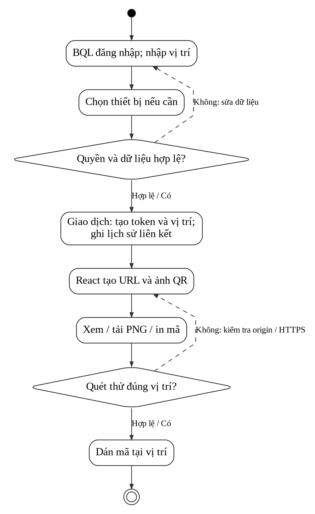

Nguồn: mô hình hóa từ qr.service.js và giao diện Vị trí & QR.

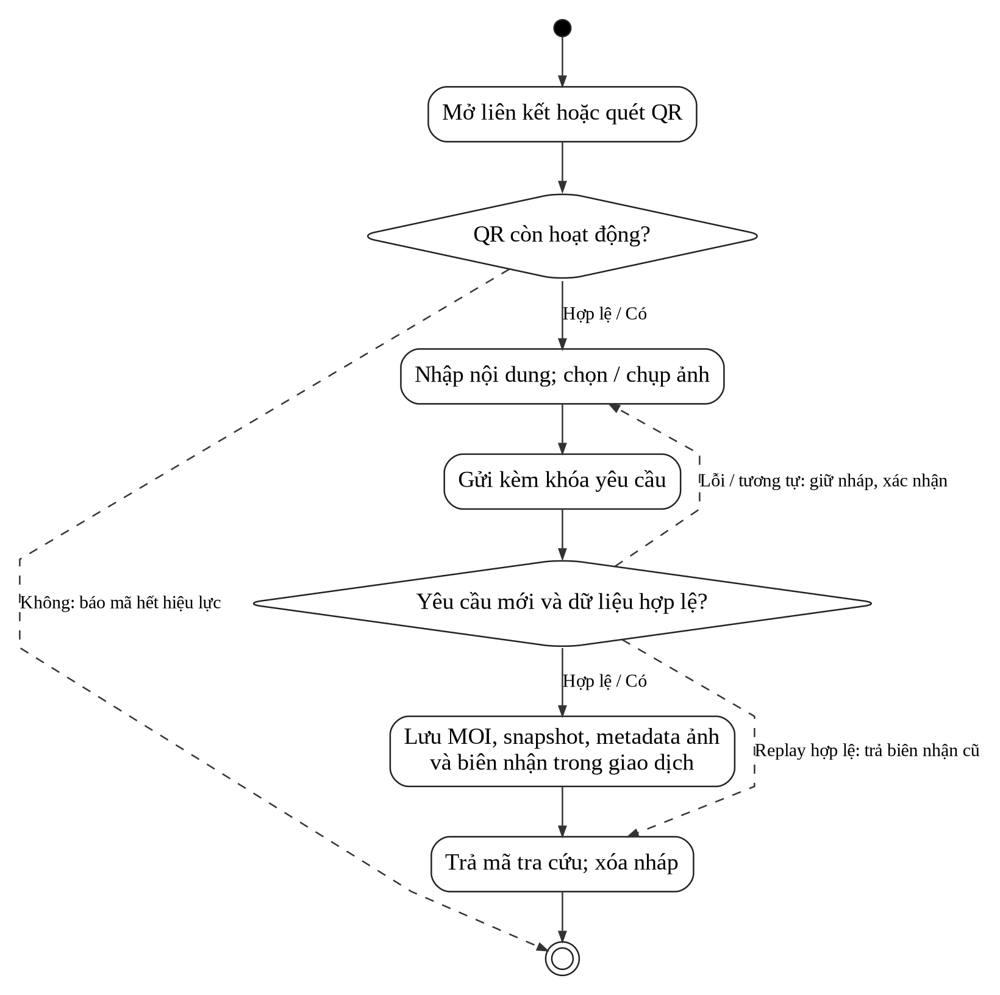

Nguồn: mô hình hóa từ PublicReports.jsx và incidents.service.js.

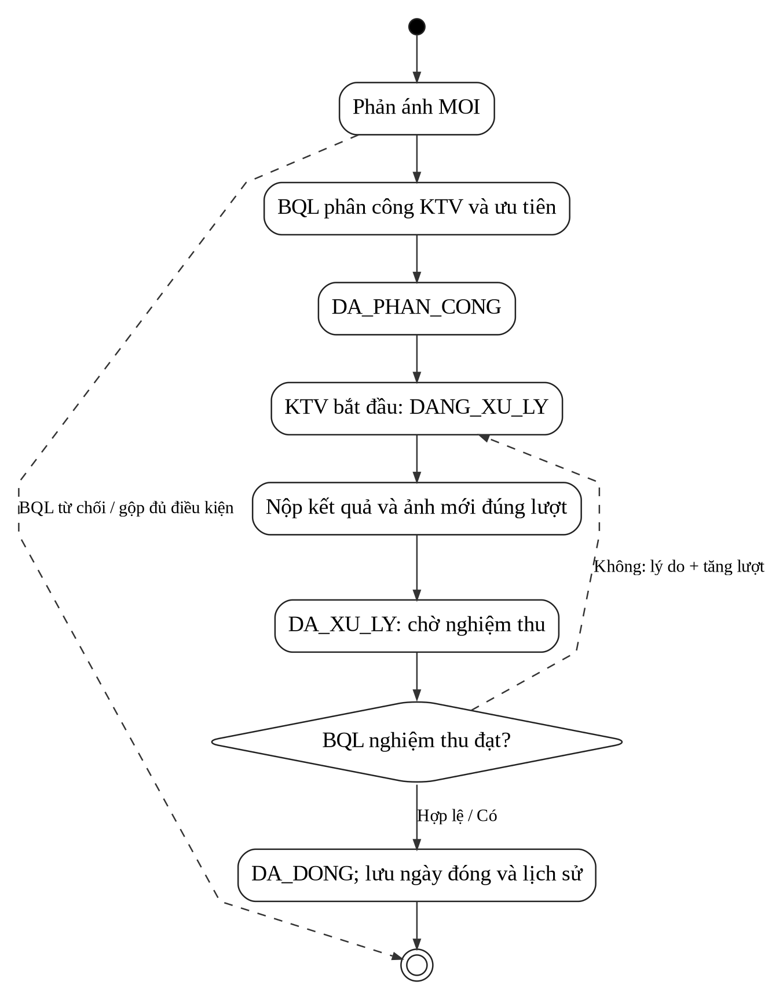

Nguồn: mô hình hóa từ các quy tắc chuyển trạng thái phản ánh.

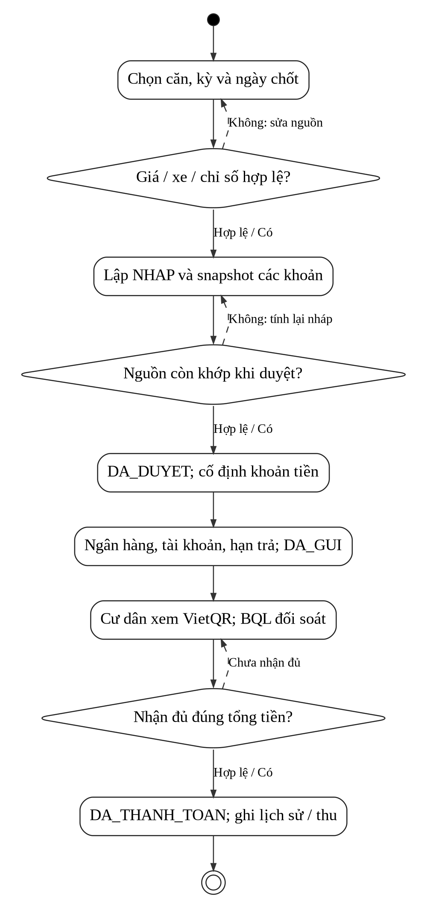

Nguồn: mô hình hóa từ billing.service.js và các service xử lý lô.

### 2.3.2. Sơ đồ tuần tự

Các sơ đồ tuần tự phân biệt người sử dụng, React, API/service và tầng lưu trữ. Khi gửi ảnh, hệ thống có thêm kho tệp; cơ sở dữ liệu chỉ lưu metadata ảnh. Bản vẽ chọn những thông điệp quyết định để đảm bảo đọc được trên trang A4. Kiểm tra dữ liệu, xử lý lỗi và dọn ảnh là một phần của hiện thực, dù không lặp lại đầy đủ trên mọi hình.

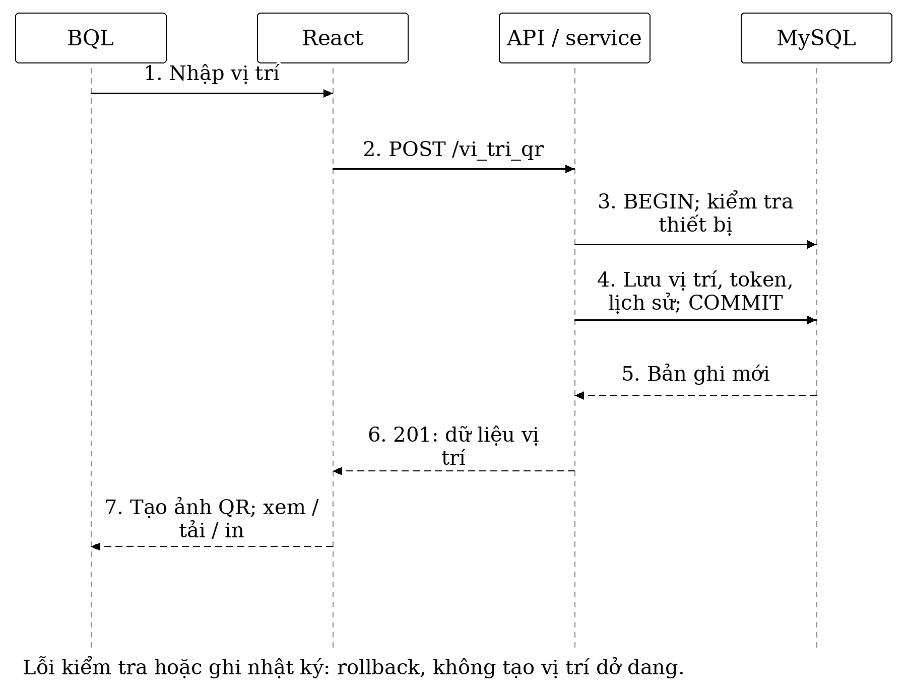

Nguồn: mô hình hóa theo API POST /api/vi_tri_qr và QrPreview.jsx.

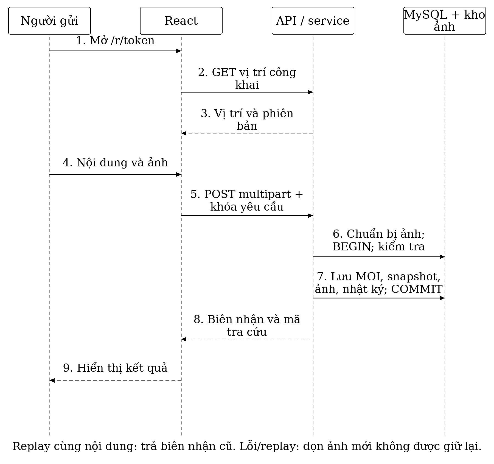

Nguồn: mô hình hóa theo API QR công khai, service gửi phản ánh và kho ảnh.

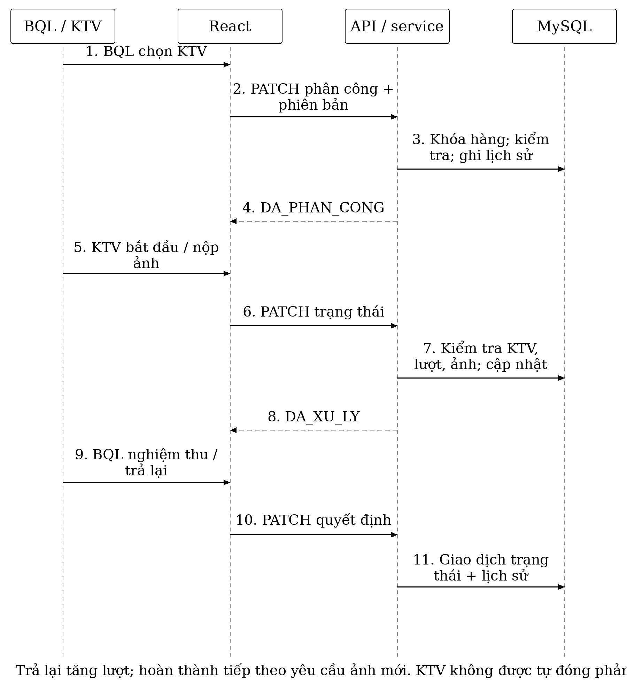

Nguồn: mô hình hóa theo API phân công và chuyển trạng thái; thông điệp trả lại/ảnh lượt mới được giải thích trong UC04.

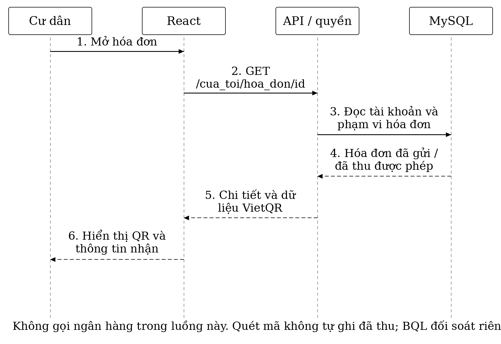

Nguồn: mô hình hóa theo API hóa đơn của cư dân và billing.qr.js; không có thông điệp xác nhận từ ngân hàng.

### 2.3.3. Trạng thái phản ánh và hóa đơn

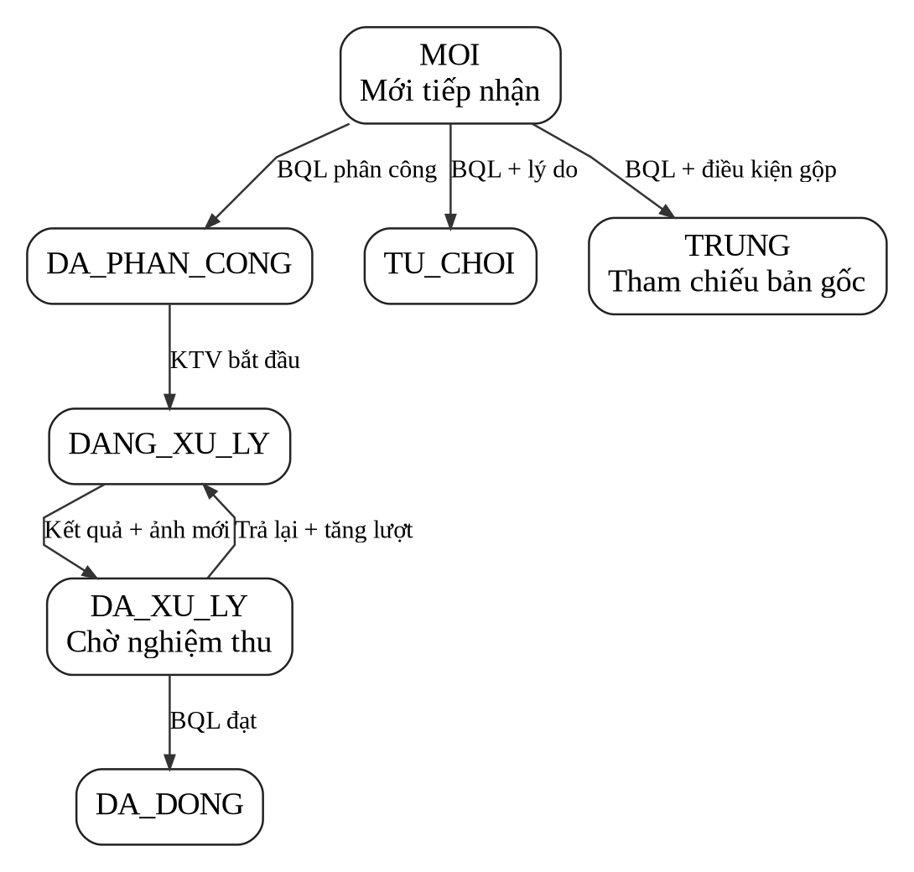

Nguồn: incidents.service.js. Nhãn hiển thị được diễn giải từ các mã trạng thái của ứng dụng.

Bảng 2.8. Quy tắc chuyển trạng thái quan trọng

| Nghiệp vụ | Chuyển trạng thái | Điều kiện chính |
| --- | --- | --- |
| Phân công | MOI → DA_PHAN_CONG | BQL chọn KTV đang hoạt động; ghi người được giao và ưu tiên |
| Bắt đầu xử lý | DA_PHAN_CONG → DANG_XU_LY | Đúng KTV hiện được giao |
| Báo hoàn thành | DANG_XU_LY → DA_XU_LY | Có nội dung kết quả và ảnh mới của lượt hiện tại |
| Nghiệm thu | DA_XU_LY → DA_DONG | BQL kiểm tra; KTV không tự đóng |
| Trả lại | DA_XU_LY → DANG_XU_LY | BQL nhập lý do; tăng lượt xử lý |
| Từ chối/gộp | MOI → TU_CHOI/TRUNG | Có lý do và các điều kiện liên quan đến bản gốc |
| Hóa đơn | NHAP → DA_DUYET → DA_GUI → DA_THANH_TOAN | Kiểm tra nguồn, thông tin thanh toán và đối soát theo từng bước |

Nguồn: service phản ánh và hóa đơn. Các lối hủy hóa đơn và phân công lại được kiểm soát riêng, không phải quyền chuyển tùy ý giữa mọi trạng thái.

## 2.4. Thiết kế cấu trúc tĩnh và cơ sở dữ liệu

### 2.4.1. Sơ đồ lớp phân tích

Các lớp phân tích thể hiện thực thể và năng lực xử lý: căn hộ, cư dân, đợt cư trú, thiết bị, vị trí QR, phản ánh, hóa đơn và module nghiệp vụ. Phương thức trên các module là cách biểu diễn trách nhiệm trong mô hình. Hiện thực sử dụng hàm export và SQL qua mysql2, không sử dụng lớp ORM tương ứng một–một với mỗi bảng.

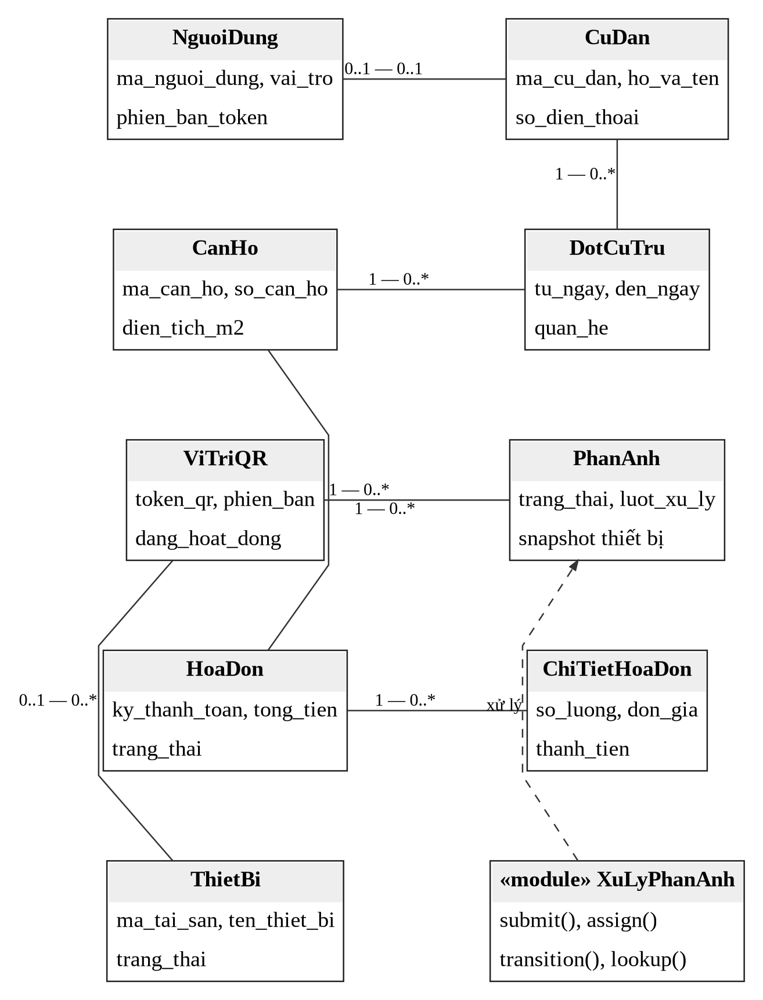

Nguồn: thiết kế theo mô hình nghiệp vụ và cấu trúc service hiện tại; tham chiếu UML [8].

### 2.4.2. Phân nhóm dữ liệu và lựa chọn số lượng bảng

Schema hiện tại gồm 31 bảng vật lý, 362 cột và 81 ràng buộc khóa ngoại theo hồ sơ metadata đã lưu. Tám view phục vụ đọc lịch sử là phép chiếu từ nhật ký dùng chung, không phải tám bảng vật lý bổ sung. Báo cáo sử dụng thiết kế MySQL mới; các ERD 38 bảng của những phiên bản cũ chỉ có giá trị lịch sử phát triển.

Bảng 2.9. Phân nhóm 31 bảng vật lý

| Nhóm | Số bảng | Phạm vi |
| --- | ---: | --- |
| Nghiệp vụ trọng tâm | 18 | Tài khoản, nhà ở/cư trú/xe, QR/phản ánh/ảnh, phí/chỉ số/hóa đơn và thông báo |
| Nghiệp vụ mở rộng | 6 | Phiếu bảo trì, tiện ích/đặt lịch, quỹ/thu chi/chứng từ |
| Nhật ký dùng chung | 1 | Sự kiện có loại, tác nhân, đối tượng và payload được ràng buộc |
| Hỗ trợ kỹ thuật | 6 | Chống gửi lặp, giới hạn gửi, đợt nhập/lập/xử lý hóa đơn và migration |
| Tổng | 31 | Không tính 8 view lịch sử |

Nguồn: database/thesis-mysql/001_thesis_schema.sql; docs/csdl-do-an và từ điển dữ liệu xuất từ metadata MySQL.

Giảm số bảng không phải mục tiêu độc lập. Thiết kế giữ các quan hệ quyết định quyền và số tiền ở bảng có kiểu dữ liệu rõ ràng. Tám nhóm nhật ký cùng dạng sự kiện được đưa về một bảng chung, có khóa ngoại tới các đối tượng thật và quy tắc CHECK/JSON Schema. Lịch sử cư trú vẫn là bảng riêng vì nó quyết định thời gian ở, đăng ký xe và bối cảnh truy cập; các khoản hóa đơn cũng không bị chuyển thành một JSON chung để làm sơ đồ ngắn hơn.

### 2.4.3. ERD logic và ERD vật lý rút gọn

ERD được chia thành các hình theo luồng nghiệp vụ để tránh thu nhỏ toàn bộ schema vào một trang. Hình chỉ chọn các thuộc tính và quan hệ cần giải thích; số bảng trên hình không được dùng thay cho số bảng vật lý toàn hệ thống. Vai trò người gửi và kỹ thuật viên là các quan hệ khác nhau dù cùng tham chiếu bảng người dùng.

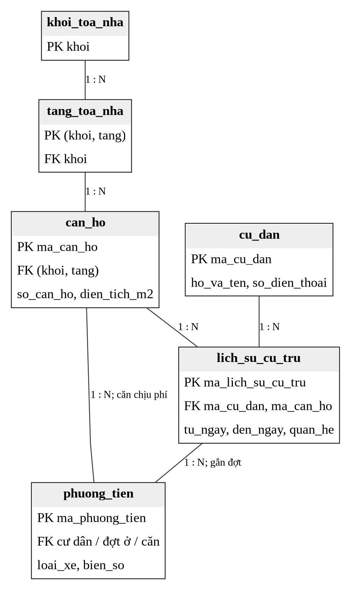

Nguồn: các khóa và quan hệ được chọn từ schema MySQL hiện tại.

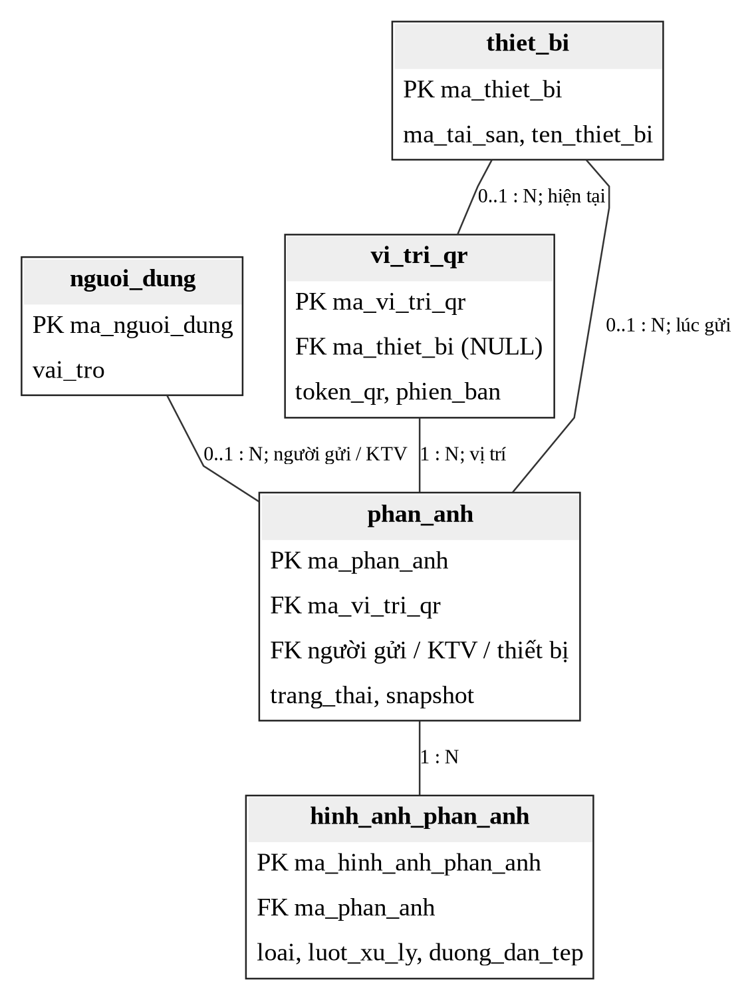

Nguồn: schema MySQL hiện tại; các liên kết người tạo, người gửi và KTV được ghi nhãn riêng.

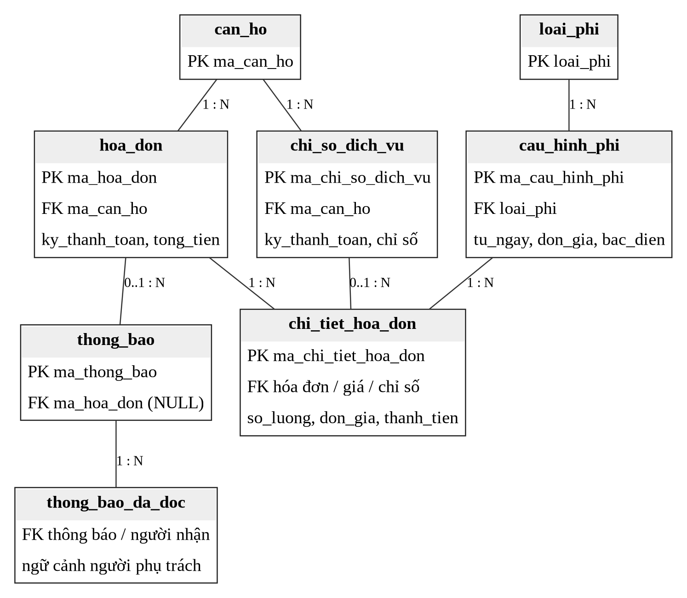

Nguồn: schema MySQL hiện tại; thể hiện các quan hệ nghiệp vụ được chọn, không liệt kê mọi FK hỗ trợ.

Các trường snapshot của phản ánh lưu tên, mã và vị trí thiết bị lúc gửi. Liên kết QR hiện tại có thể đổi trong khi những trường này được giữ nguyên. Tài khoản căn gắn với căn hộ và người phụ trách hiện tại; khi đổi chủ hộ, chủ mới kế thừa quyền xem hóa đơn theo căn nhưng không tự nhận phản ánh riêng của người phụ trách trước. Đây là sự phân biệt giữa trách nhiệm thanh toán và quyền sở hữu dữ liệu cá nhân.

Các hình 2.18–2.19 bổ sung góc nhìn vật lý cho hai luồng trọng tâm: tên trường và kiểu dữ liệu được lấy trực tiếp từ baseline SQL. Hình chỉ chọn các cột cần theo dõi để giữ kích thước chữ đọc được; không loại bỏ các cột/FK còn lại khỏi database. Khóa và khả năng NULL đầy đủ được liệt kê tại Phụ lục A.

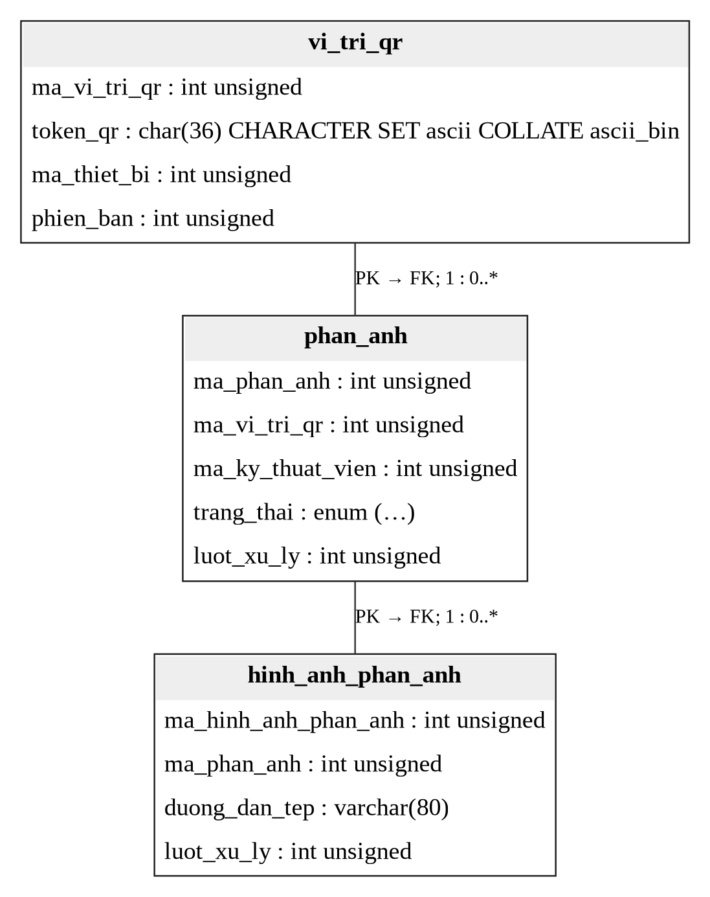

Nguồn: trích tên cột và kiểu từ database/thesis-mysql/001_thesis_schema.sql; các cạnh chỉ rõ chiều PK đến FK.

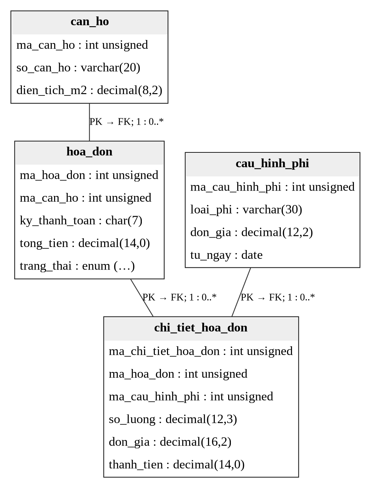

Nguồn: trích tên cột và kiểu từ baseline SQL hiện hành; ẩn cột hỗ trợ để trình bày trên A4.

### 2.4.4. Từ điển dữ liệu và ràng buộc

Phụ lục A liệt kê đủ 31 bảng, trường, kiểu, khóa và khả năng NULL, trích từ từ điển metadata của schema hiện hành. Các view lịch sử được liệt kê riêng để tránh nhầm với bảng thật. Phần này giải thích những ràng buộc tác động trực tiếp đến nghiệp vụ.

Bảng 2.10. Ràng buộc và ý nghĩa nghiệp vụ

| Đối tượng | Ràng buộc/giải pháp | Ý nghĩa |
| --- | --- | --- |
| Căn hộ | Số căn duy nhất; FK ghép khối/tầng | Không tồn tại căn thuộc tổ hợp tầng không có thật |
| Cư trú | Ngày kết thúc không trước ngày bắt đầu; giới hạn đợt đang mở | Hỗ trợ chuyển trong ngày và giữ căn cũ trong lịch sử |
| Phương tiện | Gắn cư dân, đợt ở và căn chịu phí | Thống kê xe và tính phí theo đúng loại, đúng thời điểm |
| Chỉ số | Duy nhất căn–dịch vụ–kỳ; chỉ số mới không nhỏ hơn cũ | Tránh hai bản ghi cạnh tranh và lượng dùng âm |
| Hóa đơn | Snapshot các khoản; kiểm tra nguồn trước duyệt | Đổi đơn giá sau này không làm thay tổng tiền đã gửi |
| Nhật ký | FK theo đối tượng; loại sự kiện và JSON Schema | Không dùng ID đa hình không có ràng buộc để giảm bảng |
| Biểu mẫu | phien_ban và khóa hàng trong giao dịch | Biểu mẫu cũ nhận lỗi xung đột thay vì ghi đè dữ liệu mới |

Nguồn: baseline SQL, service nghiệp vụ và tài liệu kiểm chứng schema.

## 2.5. Thiết kế kiến trúc và luồng dữ liệu

### 2.5.1. Kiến trúc tổng thể

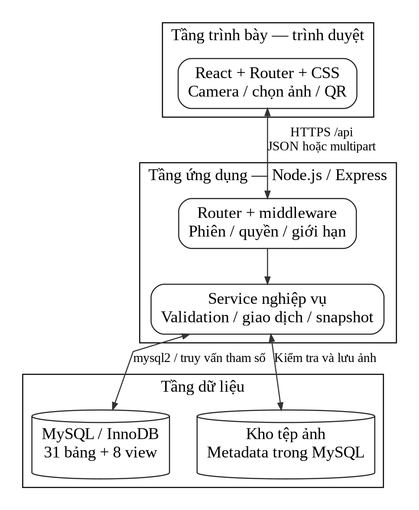

Nguồn: cấu trúc frontend, backend và lib/db.js, lib/images.js của dự án.

Tầng React chứa các màn hình theo phân hệ và thành phần dùng chung như nhãn trường, thông báo lỗi, chọn ảnh và điều hướng. Tầng Express tách router, middleware xác thực/quyền, service và truy vấn dữ liệu. Cơ sở dữ liệu MySQL lưu bảng nghiệp vụ, nhật ký và biên nhận kỹ thuật. Ảnh phản ánh được lưu ở kho tệp với metadata trong bảng; chứng từ thu chi có cơ chế lưu binary trong cơ sở dữ liệu riêng của phân hệ.

Ở môi trường phát triển, frontend và API có thể chạy trên hai cổng nhưng được truy cập qua cùng origin nhờ proxy /api của Vite. Điện thoại chỉ cần truy cập cổng frontend HTTPS mà máy tính cung cấp trong mạng. Việc sử dụng proxy giảm cấu hình khác nguồn ở trình duyệt, nhưng không loại bỏ nhu cầu kiểm tra backend đang chạy và kết nối MySQL sẵn sàng. Khi triển khai, cần đặt frontend/API sau cấu hình phục vụ phù hợp, không mặc định coi Vite dev server là máy chủ sản xuất.

### 2.5.2. Luồng dữ liệu vào–ra

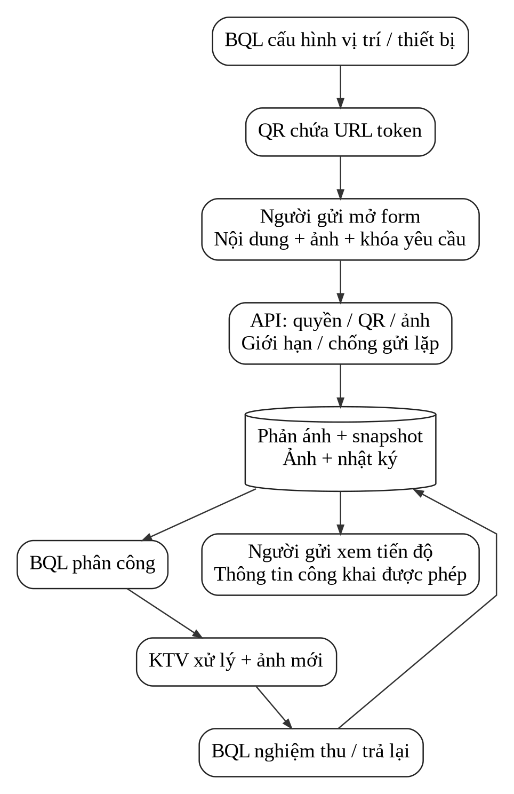

Nguồn: tổng hợp đường đi dữ liệu ở các API QR, phản ánh và phân công.

Dữ liệu đầu vào gồm cấu hình vị trí, hồ sơ thiết bị, nội dung phản ánh, ảnh và quyết định xử lý. Kết quả đầu ra gồm mã tra cứu, trạng thái công việc, phản hồi công khai và bằng chứng nghiệm thu. API công khai chỉ trả các trường cần thiết; API nội bộ có thể trả thông tin phục vụ điều phối theo quyền. Một bản ghi lịch sử có thể đồng thời có ghi chú nội bộ và phản hồi công khai, vì vậy không được trả nguyên bản toàn bộ nhật ký qua endpoint tra cứu công khai.

### 2.5.3. Lựa chọn công nghệ theo hiện thực

Bảng 2.11. Công nghệ đang sử dụng và lý do lựa chọn

| Thành phần | Công nghệ | Vai trò và lý do |
| --- | --- | --- |
| Giao diện | React 19, React Router 7, CSS | Tổ chức thành phần, route theo vai trò; CSS tùy chỉnh phù hợp giao diện hiện có |
| Công cụ frontend | Vite 7 | Chạy phát triển, proxy API, đóng gói production [13] |
| Máy chủ | Node.js 24 khi kiểm chứng; Express 5 | Mô hình module JavaScript, middleware và xử lý API [3], [7] |
| Dữ liệu | MySQL 8.0.21+ hoặc 8.4; mysql2 | Quan hệ nghiệp vụ, FK, giao dịch và truy vấn có tham số |
| Mật khẩu và phiên | bcryptjs, jose | Băm mật khẩu và ký/kiểm tra JWT; thu hồi qua phiên bản |
| QR | qrcode, html5-qrcode | Sinh ảnh URL và đọc QR qua camera [6], [12] |
| Ảnh | multer, Sharp | Nhận multipart, giải mã/chuẩn hóa và giới hạn ảnh |
| Báo cáo | ExcelJS, pdfmake | Nhập/xuất bảng tính, xuất PDF theo phân hệ |
| Kiểm tra | Node test runner, Playwright | Kiểm tra helper/API và tương tác trình duyệt |

Nguồn: package.json, lockfile và mã nguồn dự án tại phiên bản đối chiếu. CSS hiện tại không dùng TailwindCSS/Bootstrap; JWT hiện dùng jose, không phải jsonwebtoken như phương án dự kiến trong đề cương.

Yêu cầu runtime trong repository là Node.js từ 22.12 trở lên, khuyến nghị Node 24. Việc chọn một bộ công nghệ đồng nhất JavaScript giúp chia sẻ kỹ năng phát triển giữa hai tầng, nhưng không tự bảo đảm API nhanh hơn công nghệ khác. Báo cáo không dùng tốc độ xử lý làm kết luận khi chưa có phép đo đối chứng.

## 2.6. Thách thức kỹ thuật và thuật toán xử lý

### 2.6.1. Kiểm soát QR, HTTPS và thay đổi địa chỉ mạng

Token QR là định danh ngẫu nhiên do máy chủ tạo. URL hoàn chỉnh phụ thuộc origin tại nơi sinh ảnh. Khi địa chỉ IP của laptop thay đổi, tem QR đã in vẫn chứa địa chỉ cũ dù laptop kết nối cùng tên Wi-Fi. Đây là hệ quả của việc sử dụng IP được cấp động, không phải do thuật toán QR tự thay đổi. Với môi trường thử nghiệm, cần cập nhật chứng chỉ và in lại mã theo origin mới; với môi trường ổn định, nên sử dụng tên miền và cấu hình địa chỉ phù hợp.

Người dùng có thể dùng camera ứng dụng điện thoại để mở URL hoặc dùng màn quét trong web. Ứng dụng kiểm tra ngữ cảnh an toàn trước khi xin quyền camera, báo lỗi khi quyền bị từ chối và cung cấp cách dán liên kết. Khẳng định thư viện hỗ trợ một trình duyệt không thay cho kết quả quét trên phiên bản trình duyệt và thiết bị cụ thể. README của Html5-qrcode cũng cần được theo dõi về trạng thái bảo trì khi phát triển lâu dài [6].

### 2.6.2. Chống tạo phản ánh lặp và phát lại yêu cầu

Mạng di động có thể ngắt sau khi máy chủ đã lưu phản ánh nhưng trước khi trình duyệt nhận biên nhận. Nếu gửi lại như một yêu cầu mới, hệ thống có thể tạo hai phản ánh giống nhau. Ứng dụng sử dụng khóa yêu cầu và dấu vân tay nội dung: cùng khóa, cùng nội dung và đã thành công thì trả biên nhận cũ; cùng khóa nhưng nội dung khác là xung đột. Cách làm này khác với phát hiện hai người cùng phản ánh một sự cố.

Quy trình xử lý gồm chuẩn bị ảnh, bắt đầu giao dịch, khóa bản ghi yêu cầu, kiểm tra kết quả trước đó, xác minh QR/phiên bản/giới hạn, lưu phản ánh–metadata–nhật ký–biên nhận và commit. Nếu yêu cầu là phát lại hoặc giao dịch không thành công, tệp ảnh vừa chuẩn bị phải được dọn. MySQL và filesystem không có giao dịch chung trong kiến trúc hiện tại; vì vậy cần xử lý bù khi lỗi và cần xét cả hai loại dữ liệu trong kế hoạch sao lưu.

Đối với phản ánh tương tự đang mở tại cùng vị trí, cùng thiết bị lúc gửi và loại sự cố, ứng dụng yêu cầu người gửi xác nhận gửi riêng. Đây là kiểm tra theo điều kiện nghiệp vụ, không phải mô hình trí tuệ nhân tạo hoặc so khớp ngữ nghĩa văn bản. BQL chỉ gộp các phản ánh thỏa điều kiện; lịch sử bản gốc và bản bị gộp vẫn phải giải thích được.

### 2.6.3. Ảnh hiện trường và bằng chứng nghiệm thu

API nhận tối đa năm ảnh mỗi lần với giới hạn kích thước tệp. Máy chủ kiểm tra bằng cách giải mã ảnh, không chỉ dựa vào tên hoặc MIME do client khai. Ảnh JPEG, PNG, WebP tĩnh hợp lệ được chuẩn hóa về JPEG, xoay theo hướng, thu kích thước nếu cần và loại bỏ metadata trong quá trình mã hóa lại. Mã nguồn đặt giới hạn điểm ảnh để tránh ảnh nén nhỏ nhưng có kích thước giải mã quá lớn.

Ảnh hiện trường và ảnh nghiệm thu có vai trò khác nhau. Bằng chứng hoàn thành gắn với lượt xử lý hiện hành. Khi BQL trả lại, lượt mới đòi hỏi ảnh mới; không sử dụng sự tồn tại của ảnh cũ làm điều kiện đủ. Endpoint ảnh kiểm tra quyền đối với phản ánh trước khi trả tệp. Kho ảnh không được mở thành một thư mục tĩnh công khai cho mọi người đoán đường dẫn.

### 2.6.4. Chuyển căn trong ngày và bàn giao chủ hộ

Khoảng cư trú được diễn giải theo ngày: ngày kết thúc không thuộc đợt cũ; đợt mới có thể bắt đầu đúng ngày đó. Cho phép ngày chuyển bằng ngày bắt đầu hỗ trợ tình huống vừa lập hồ sơ đã phải đổi căn. Ứng dụng giữ bản ghi kết thúc và bắt đầu cùng ngày để lưu dấu sự kiện, nhưng không phân chia thời điểm trong ngày theo giờ. Các quy tắc sử dụng ngày phải nhất quán khi đối chiếu phương tiện và quyền.

Tài khoản thanh toán theo căn hộ được tách khỏi tài khoản cá nhân. SĐT chủ hộ hiện tại có thể là định danh đăng nhập tài khoản căn, nhưng vẫn dùng mật khẩu của chính tài khoản căn. Khi bàn giao, cần cập nhật người phụ trách và thu hồi phiên cũ. Chủ mới được xem hóa đơn theo trách nhiệm căn hộ; phản ánh riêng và nháp của chủ cũ không được mặc nhiên chuyển cho chủ mới.

### 2.6.5. Tính điện bậc thang và xử lý tiền chính xác

Với lượng điện tiêu thụ Q và ngưỡng tăng dần bậc i, lượng tính ở một bậc bằng phần Q nằm giữa ngưỡng dưới và ngưỡng trên của bậc đó. Tiền trước thuế là tổng lượng từng bậc nhân đơn giá tương ứng. Thuế được tính theo cấu hình và quy tắc làm tròn của ứng dụng. Ngưỡng và giá được lưu theo cấu hình có hiệu lực; báo cáo không khẳng định bộ giá ví dụ là biểu giá pháp lý đang áp dụng tại ngày nộp.

Bảng 2.12. Ví dụ tính 215 kWh với bộ giá dùng để kiểm tra

| Khoản | Lượng | Đơn giá (đồng/kWh) | Thành tiền (đồng) |
| --- | ---: | ---: | ---: |
| Bậc 1, đến 50 kWh | 50 | 1.984 | 99.200 |
| Bậc 2, đến 100 kWh | 50 | 2.050 | 102.500 |
| Bậc 3, đến 200 kWh | 100 | 2.380 | 238.000 |
| Bậc 4, phần còn lại | 15 | 2.998 | 44.970 |
| Cộng trước thuế | | | 484.670 |
| Thuế giả định 8%, làm tròn đồng | | | 38.774 |
| Tổng tiền điện trong ví dụ | | | 523.444 |

Nguồn: tính minh họa theo cấu hình do người dùng đề xuất và quy tắc billing.electricity.js. Đây là dữ liệu kiểm tra thuật toán, không phải xác nhận giá điện hiện hành.

Mã nguồn sử dụng số nguyên có tỷ lệ và BigInt khi tính tiền để hạn chế sai số số thực. Số lượng có ba chữ số thập phân, đơn giá có hai chữ số, thành tiền lưu theo đồng. Từng dòng được chốt và tổng hóa đơn là tổng các dòng. Với phí gửi xe, số lượng phải đếm riêng ô tô, xe máy và xe đạp theo đăng ký còn hiệu lực tại ngày chốt; không lấy một tổng xe chung rồi áp cho mọi loại phí.

### 2.6.6. Tính nhất quán khi duyệt lô và nhập Excel

Xem trước không phải cam kết dữ liệu sẽ còn nguyên khi xác nhận. Sau bước xem trước, nguồn có thể đã được người khác sửa. Do đó, API kiểm tra lại trong giao dịch và so sánh dấu vân tay/phiên bản phù hợp. Nếu một căn trong lô không hợp lệ, ứng dụng không được để lại các hóa đơn trước đó đã ghi một phần. Cơ chế này cũng được áp dụng cho các thao tác theo lô có yêu cầu nguyên khối.

Chức năng nhập hiện nhận Excel .xlsx theo mẫu, có giới hạn số dòng và kích thước, hiển thị lỗi theo dòng và xác nhận sau khi hợp lệ. PDF được dùng để xuất báo cáo; không mô tả là định dạng nhập dữ liệu nghiệp vụ. Mã cư dân là mã định danh trong hồ sơ, khác mã tài khoản căn CH...; việc nhầm hai mã làm dữ liệu phương tiện không thể liên kết đúng. Xuất Excel cần đọc đúng sheet Chi tiết bên cạnh sheet Tổng hợp, giữ mã và SĐT ở dạng văn bản.

## 2.7. Thiết kế giao diện và trải nghiệm sử dụng

Giao diện được tổ chức thành cổng dịch vụ công khai và không gian làm việc theo vai trò. Cổng cư dân có tìm kiếm dịch vụ, nhóm danh mục và các lối vào tác vụ thường dùng. Không gian BQL có điều hướng theo nhóm nhà ở, vận hành và tài chính; tiêu đề, bộ lọc và hành động đặt theo thứ tự đọc. Giao diện KTV ưu tiên công việc được giao, còn cư dân ưu tiên hóa đơn, thông báo và theo dõi phản ánh.

Các quyết định giao diện gắn với vấn đề sử dụng thực tế: ẩn biểu đồ khi chưa cần để giảm cuộn; căn chỉnh ô thống kê; xem QR trong ô nhỏ cạnh nút, chỉ chứa mã; cung cấp nút chọn ảnh và chụp ảnh; hiển thị tiến trình xử lý ảnh và giữ nội dung nháp khi phù hợp. Hành động có hậu quả như thay QR, bàn giao tài khoản hoặc xác nhận thu cần diễn đạt rõ trước khi thực hiện.

Đề cương dự kiến mockup Figma, nhưng repository chưa cung cấp bằng chứng để kết luận đã hoàn thành bộ Figma. Các hình giao diện tại Chương 3 là ảnh chụp từ ứng dụng hiện có với phạm vi dữ liệu được ghi rõ. Khi hoàn thiện báo cáo nộp, cần bổ sung đường dẫn hoặc hình mockup được GVHD chấp thuận nếu vẫn giữ yêu cầu Figma trong đề cương.

# CHƯƠNG 3. CÀI ĐẶT THỬ NGHIỆM, KẾT QUẢ VÀ ĐÁNH GIÁ

## 3.1. Môi trường phát triển và dữ liệu kiểm tra

### 3.1.1. Môi trường phần cứng, hệ điều hành và phần mềm

Bảng 3.1. Môi trường kiểm chứng và thông tin cần bổ sung

| Hạng mục | Môi trường đã có bằng chứng | Thông tin cần bổ sung khi nộp |
| --- | --- | --- |
| Máy phát triển của sinh viên | Người dùng đã chạy dự án bằng PowerShell/VS Code, Node 24.14.1 và MySQL cục bộ | CPU, RAM, phiên bản Windows và phiên bản MySQL của máy nghiệm thu |
| Môi trường kiểm tra repository | Linux; Node 24.19.0; MySQL 8.4 và 8.0.46 trong các lượt kiểm chứng lưu ngày 05–06/11/2026 | Không thay bằng cấu hình laptop nếu chưa đo ở laptop |
| Trình duyệt tự động | Chromium qua Playwright; có bài kiểm tra 1440 px và 375 px | Phiên bản Chrome/Edge/Cốc Cốc trên điện thoại thật |
| Công cụ triển khai | Git, npm workspaces, Vite; MySQL riêng hoặc Docker trong kiểm thử | Chọn một cách chạy khi nghiệm thu và ghi đúng cổng |
| Camera và mạng LAN | Đã có hướng dẫn HTTPS, chứng chỉ và proxy | Mẫu điện thoại, phiên bản hệ điều hành, quyền camera và điều kiện quét |

Nguồn: các phiên làm việc của người dùng và hồ sơ kiểm chứng trong repository. Ô cần bổ sung không được hiểu là đã đo.

### 3.1.2. Bộ dữ liệu mô phỏng

Tài liệu kiểm chứng ngày 06/11/2026 ghi nhận bộ cấu hình mặc định có 47.765 dòng trong 31 bảng thật; 25 bảng đạt ít nhất 100 dòng và tám view lịch sử có ít nhất 100 dòng. Các view không được cộng thêm vào tổng dòng bảng thật. Các danh mục như loại phí, khối, quỹ và tiện ích không được nhân bản vô nghĩa để đủ số lượng.

Bảng 3.2. Một số quy mô của bộ dữ liệu kiểm tra đã lưu

| Nhóm dữ liệu | Số lượng | Vai trò kiểm tra |
| --- | ---: | --- |
| Khối/tầng/căn hộ | 4 / 100 / 200 | Cấu trúc nhà ở, phân trang và lọc |
| Cư dân/đợt cư trú | 400 / 412 | Chủ hộ, chuyển căn và lịch sử |
| Phương tiện | 324 | Loại xe, lịch sử đăng ký và phí |
| Chỉ số/hóa đơn | 5.200 / 2.604 | Chuỗi 13 kỳ, hóa đơn và báo cáo |
| Vị trí QR/phản ánh | 180 / 240 | Mã hoạt động, trạng thái và quyền |
| Thiết bị/phiếu bảo trì | 160 / 160 | Danh mục và vòng đời bảo trì |
| Thông báo/đặt tiện ích | 160 / 160 | Phát hành, quyền nhận và lịch |

Nguồn: docs/kiem-chung-du-lieu-mo-phong.md. Đây là số liệu của lượt sinh đã kiểm chứng, không phải số đếm trực tiếp database hiện tại của laptop.

Tên, SĐT, nội dung phản ánh, hóa đơn, giao dịch và chứng từ trong bộ này đều được sinh bằng thuật toán. Ảnh dùng thử là hình minh họa; tài khoản ngân hàng mô phỏng không dùng để chuyển tiền. Dữ liệu đủ để thực hiện nhiều tình huống nghiệp vụ nhưng không chứng minh tính đại diện thống kê của hoạt động tại một chung cư thật.

## 3.2. Hiện thực hệ thống

### 3.2.1. Cơ sở dữ liệu và migration

Baseline 001_thesis_schema.sql khởi tạo schema MySQL hiện tại. Runner kiểm tra migration và checksum để phát hiện cấu hình/schema không phù hợp. Endpoint /api/health kiểm tra tiến trình HTTP; /api/ready kiểm tra điều kiện dữ liệu. Vì vậy, health trả 200 không đồng nghĩa kết nối MySQL đã sẵn sàng.

Công cụ cài mới tạo cấu hình và tên database mới, không tự sử dụng lại dữ liệu cũ. Chức năng sửa cấu hình có sao lưu và chỉ phục hồi các khóa cần thiết theo quy tắc, thay vì yêu cầu thay cả tệp .env bằng cấu hình mẫu làm mất JWT hoặc trỏ nhầm database. Tệp .env, chứng chỉ, tài khoản sinh riêng và ảnh tải lên không thuộc nội dung cần công khai trong Git.

### 3.2.2. Backend và các API tiêu biểu

Router nhận HTTP, middleware kiểm tra phiên/quyền, service áp dụng nghiệp vụ và lớp truy vấn đọc/ghi dữ liệu. Lỗi ứng dụng được trả với mã, thông báo và request ID phù hợp. Các câu lệnh có tham số được dùng cho dữ liệu người dùng; định danh động cần nằm trong danh mục cho phép. Kiểm tra phía client không thay cho kiểm tra này.

Bảng 3.3. API tiêu biểu của luồng trọng tâm

| Phương thức và đường dẫn | Vai trò | Mục đích |
| --- | --- | --- |
| POST /api/xac_thuc/dang_nhap | Công khai có giới hạn | Nhận phiên sau khi xác thực |
| GET /api/xac_thuc/toi | Có phiên | Đọc danh tính và vai trò hiện tại |
| POST /api/vi_tri_qr | BQL | Tạo vị trí/token; liên kết thiết bị tùy chọn |
| POST /api/vi_tri_qr/:id/sinh_lai_qr | BQL | Thay token có kiểm tra phiên bản |
| GET /api/cong_khai/vi_tri_qr/:token | Công khai | Đọc vị trí đang hoạt động và phiên bản form |
| POST /api/cong_khai/phan_anh | Công khai/tùy chọn phiên | Nhận multipart, chống lặp và tạo phản ánh |
| POST /api/cong_khai/phan_anh/tra_cuu | Công khai có xác minh | Tra cứu phần thông tin được phép |
| GET /api/phan_anh/:id | Theo phạm vi | Đọc chi tiết nội bộ hoặc phản ánh của người dùng |
| PATCH /api/phan_anh/:id/phan_cong | BQL | Giao/đổi kỹ thuật viên |
| PATCH /api/phan_anh/:id/trang_thai | BQL/KTV theo quy tắc | Thực hiện, hoàn thành, nghiệm thu hoặc trả lại |
| POST /api/hoa_don/lap | BQL | Tạo bản nháp từ nguồn tính |
| POST /api/hoa_don/:id/duyet | BQL | Duyệt sau khi kiểm tra nguồn |
| POST /api/hoa_don/:id/gui | BQL | Chốt thông tin nhận tiền và gửi |
| POST /api/hoa_don/:id/xac_nhan_thanh_toan | BQL | Xác nhận đối soát đủ tiền |
| GET /api/cua_toi/hoa_don/:id | Cư dân được phép | Xem chi tiết và dữ liệu VietQR |

Nguồn: app.js và các router auth, QR, incidents, billing. Bảng chọn các API điển hình; không phải toàn bộ endpoint.

Đoạn mã kiểm tra vai trò dưới đây được trích từ auth.middleware.js. Middleware xác thực được chạy trước để xác định req.user; bước kiểm tra vai trò này tiếp tục giới hạn tác nhân. Quyền đối với từng phản ánh hoặc hóa đơn còn được kiểm tra trong service/lớp truy vấn, không dừng ở việc so sánh vai trò.

```javascript
export const roles =
  (...allowed) =>
  (req, res, next) => {
    if (!allowed.includes(req.user?.vai_tro))
      fail(403, "FORBIDDEN", "Bạn không có quyền thực hiện thao tác này.");
    next();
  };
```

### 3.2.3. Frontend, camera và ảnh

Các route công khai gồm cổng dịch vụ, đăng nhập, quét QR, form theo token và tra cứu. Các route quản trị, kỹ thuật và cư dân được bọc kiểm tra vai trò. Bộ API client đọc phản hồi có kiểm tra kiểu nội dung để không biến một lỗi proxy HTML thành thông báo sai mật khẩu. Phiên hết hạn cần xóa trạng thái dữ liệu riêng và yêu cầu đăng nhập lại theo luồng ứng dụng.

Màn quét sử dụng html5-qrcode và kiểm tra HTTPS trước khi xin camera. Nội dung QR sau khi đọc được phải được xác minh là đường dẫn phản ánh phù hợp thay vì mở tùy ý một URL bên ngoài. Màn gửi phản ánh phối hợp trạng thái xử lý ảnh và trạng thái gửi để tránh bấm gửi khi ảnh chưa sẵn sàng. Khi trang được khôi phục, giao diện thông báo trường hợp ảnh phải chọn lại.

Ảnh chuẩn bị ở client nhằm cải thiện trải nghiệm, còn server vẫn giải mã và kiểm tra lại. Hiện trường, kết quả xử lý, lượt xử lý và phân quyền ảnh được bảo toàn ở máy chủ. Hệ thống không dựa trên việc ẩn nút tải ảnh để bảo vệ ảnh; đường đọc tệp cũng phải kiểm tra quyền tương ứng.

Đoạn sinh ảnh QR trong QrPreview.jsx sử dụng origin trình duyệt và token máy chủ cấp. Thư viện tạo ảnh ở độ phân giải 512 px; kích thước ô xem được giới hạn riêng trong CSS để mã vẫn rõ khi tải hoặc in.

```javascript
export const qrUrl = (location) =>
  `${window.location.origin}/r/${location.token_qr}`;
export const qrImage = (location) =>
  QRCode.toDataURL(qrUrl(location), {
    width: 512,
    margin: 3,
    errorCorrectionLevel: "M",
  });
```

Đường chuẩn hóa ảnh sau khi đã kiểm tra định dạng và giới hạn điểm ảnh được trích lược từ lib/images.js. Biến img là đối tượng Sharp được tạo từ buffer tải lên; phần kiểm tra và dọn tệp khi lỗi nằm trong hàm saveImages đầy đủ.

```javascript
buffer = await img
  .rotate()
  .resize({
    width: 2400,
    height: 2400,
    fit: "inside",
    withoutEnlargement: true,
  })
  .jpeg({ quality: 85 })
  .toBuffer();
```

### 3.2.4. Các phân hệ hỗ trợ vận hành

Nhà ở/cư trú cung cấp sơ đồ khối–tầng–căn, hồ sơ và lịch sử. Phương tiện gắn với đợt ở và căn chịu phí. Tài khoản căn có danh sách riêng, định danh ổn định theo căn và alias SĐT người phụ trách. Phí/chỉ số/hóa đơn chốt dữ liệu để lập và theo dõi khoản phải thu. Thông báo hỗ trợ phát hành, thu hồi và nhắc phí trong web.

Bảo trì có vòng đời phiếu riêng, không tự đồng nhất một phản ánh QR với một phiếu bảo trì. Đặt tiện ích quản lý yêu cầu và duyệt trong khung thời gian. Quỹ/thu chi có chứng từ, ghi sổ và thao tác đảo theo quy tắc. Dashboard tổng hợp công nợ, phản ánh, bảo trì và tiện ích; biểu đồ có lựa chọn khoảng ngày, tuần, tháng, quý, năm tùy nhóm thống kê.

Nhập dữ liệu sử dụng Excel theo mẫu. Khi xuất Excel, sheet Tổng hợp chỉ là một phần; thông tin từng dòng nằm ở sheet Chi tiết. Xuất PDF phục vụ đọc/in báo cáo, không thay cơ chế nhập. Các tệp xuất không chứa mật khẩu hoặc thông tin phiên; mã và SĐT được giữ ở kiểu văn bản để không mất số 0 đầu.

## 3.3. Kết quả giao diện và luồng sử dụng

### 3.3.1. Các màn hình đã hiện thực

Các hình 3.1–3.4 được chụp từ frontend của phiên bản đối chiếu trong trình duyệt kiểm tra. Dữ liệu API của những hình này được giả lập và ghi rõ trong hồ sơ tạo ảnh; chúng minh họa giao diện hiện thực, không được dùng làm bằng chứng đã ghi dữ liệu thành công vào MySQL hoặc đã quét bằng điện thoại vật lý. Trước khi nộp, sinh viên cần thay/bổ sung bộ ảnh nghiệm thu có mã kịch bản và môi trường thực tế.

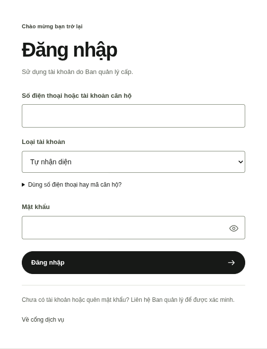

Nguồn: ảnh chụp frontend hiện tại trong Chromium; trạng thái chưa đăng nhập, không dùng tài khoản thật.

Màn hình cho phép nhập SĐT hoặc tài khoản căn và lựa chọn loại tài khoản khi cần. Phần giới thiệu ở bên cạnh hỗ trợ nhận biết dịch vụ; biểu mẫu vẫn là điểm thao tác chính. Lỗi máy chủ, hết phiên và sai thông tin đăng nhập cần được phân biệt theo phản hồi thực tế.

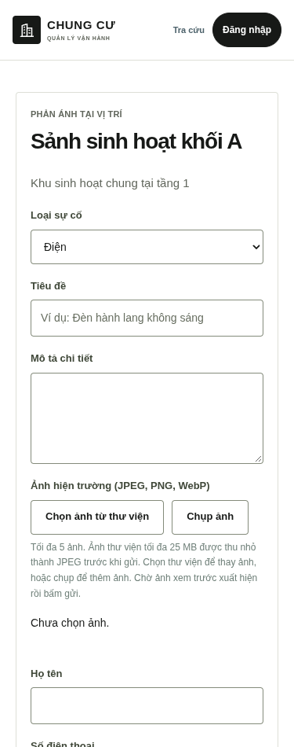

Nguồn: frontend hiện tại ở viewport điện thoại, vị trí do API giả lập trả về. Chưa phải bằng chứng camera trên điện thoại thật.

Vị trí được hiển thị từ dữ liệu máy chủ; người gửi nhập loại sự cố, nội dung, thông tin liên hệ và ảnh. Ảnh hiện trường là đầu vào hỗ trợ mô tả, không phải cơ sở tự động phân loại mức độ nguy hiểm. Ứng dụng không thay thế kênh liên hệ khẩn cấp khi có tình huống cần xử lý ngay.

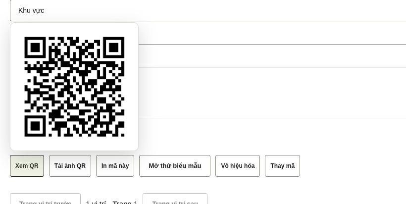

Nguồn: frontend hiện tại; danh sách vị trí là fixture. Ảnh thể hiện thành phần QR-only đã có kiểm tra ở 1440 px và 375 px.

Ô xem chỉ chứa QR, được đặt cạnh nút và tự điều chỉnh khi gần mép màn hình. Người dùng đóng bằng Esc, bấm ra ngoài hoặc bấm lại nút; tải ảnh và in là các thao tác riêng trong dòng vị trí. Cách trình bày này giảm phần thông tin cố định chiếm chỗ khi chỉ cần nhìn mã.

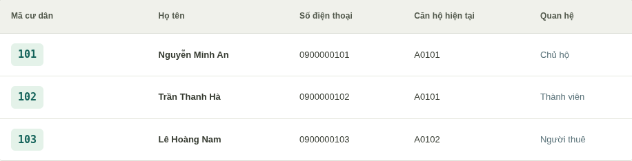

Nguồn: frontend hiện tại; thông tin trong ảnh là dữ liệu giả lập dành riêng cho bản thảo.

Mã hồ sơ và tài khoản thanh toán căn là hai khái niệm riêng. Danh sách cư dân hiển thị mã để tra cứu/liên kết và thông tin hiện tại; việc sử dụng mã đúng quan trọng đối với nhập phương tiện bằng Excel. Hồ sơ chi tiết là nơi xem lịch sử cư trú, không thay lịch sử bằng một dòng căn hộ hiện tại.

### 3.3.2. Bộ ảnh nghiệm thu cần bổ sung

Bảng 3.4. Minh chứng cần chụp từ lần chạy nghiệm thu thực tế

| Mã ảnh | Nội dung phải thể hiện | Liên kết kịch bản |
| --- | --- | --- |
| MC01 | QR in thật, URL truy cập và tên vị trí nhận diện | NT04–NT06 |
| MC02 | Chọn/chụp ảnh, gửi thành công và nhận mã tra cứu đã che bớt | NT07–NT09 |
| MC03 | BQL phân công; KTV bắt đầu và nộp ảnh; BQL nghiệm thu | NT10–NT13 |
| MC04 | Tra cứu công khai chỉ thấy phản hồi được phép | NT14–NT15 |
| MC05 | Hóa đơn chi tiết, VietQR, BQL xác nhận thu sau đối soát | NT20–NT23 |
| MC06 | Bàn giao chủ hộ, phiên cũ bị thu hồi và quyền phản ánh riêng | NT17–NT18 |

Nguồn: kế hoạch nghiệm thu của bản thảo. Tránh đưa mật khẩu, mã tra cứu đầy đủ, khóa cấu hình hoặc dữ liệu cá nhân thật vào hình nộp công khai.

## 3.4. Kiểm thử và kết quả đã có bằng chứng

### 3.4.1. Chiến lược kiểm thử

Nhóm kiểm tra tĩnh/công cụ kiểm tra import, cấu hình, ràng buộc schema, đường dẫn QR, client API và cách sinh dữ liệu. Nhóm API dùng database thử nghiệm riêng để kiểm tra quyền, trạng thái, giao dịch và số tiền. Nhóm trình duyệt kiểm tra tương tác người dùng, trạng thái lỗi/rỗng, điều hướng và bố cục. Nhóm thiết bị thật đo camera và khả năng quét trong điều kiện cụ thể.

Mỗi kết quả cần kèm phiên bản, ngày, môi trường, lệnh và phạm vi. Các con số ở các nhóm không được cộng thành một tỷ lệ hoàn thành chung vì số lượng và cách tổ chức test khác nhau. Bài được bỏ qua do thiếu môi trường không được tính là đạt. Kết quả của một phiên bản cũ cũng không được trình bày như đã chạy lại toàn bộ ở phiên bản mới nhất.

### 3.4.2. Hồ sơ kiểm chứng trong repository

Bảng 3.5. Kết quả kiểm chứng lịch sử và phạm vi diễn giải

| Hồ sơ | Kết quả đã ghi nhận | Phạm vi và giới hạn |
| --- | --- | --- |
| CSDL MySQL, 05/11/2026 | 227 test backend đạt trên từng MySQL 8.4/8.0.46; 73 test giao diện với MySQL 8.4 | Lượt kiểm chứng của thay đổi schema; không phải một lần chạy lại toàn bộ tại thời điểm viết mọi câu của báo cáo |
| Chuyển dữ liệu schema | Đối chiếu 37 tập/1.756 dòng; 17 kiểm tra HTTP trên bộ đã chuyển | Database thử nghiệm riêng; không chứng minh đã chuyển dữ liệu laptop |
| Dữ liệu mô phỏng, 06/11/2026 | 112 kiểm tra mỗi lượt trên hai phiên bản MySQL; 47.765 dòng | Dữ liệu mô phỏng, không phải dữ liệu khảo sát chung cư |
| Ô QR, phiên bản 56ebfe8 | 4 kiểm tra trình duyệt đạt; 1440/375 px; build đạt | Fixture API; xem/đóng/chuyển mã, tải và in; chưa đo khả năng quét camera thật |

Nguồn: docs/csdl-do-an/kiem-chung.md; docs/kiem-chung-du-lieu-mo-phong.md; e2e/qr-preview.spec.js và kết quả lượt kiểm tra thành phần QR.

### 3.4.3. Kiểm tra bổ sung khi soạn bản thảo

Bảng 3.6. Kiểm tra được chạy khi biên soạn bản thảo

| Kiểm tra | Kết quả | Bằng chứng và phạm vi |
| --- | --- | --- |
| Helper/CLI không dùng database thật | 62 đạt, 0 lỗi; 4 bỏ qua | node --test scripts/*.test.js; tắt hai cờ kiểm tra DB tích hợp; không tính bỏ qua là đạt |
| Kiểm tra file/dependency | 0 lỗi | node scripts/check-local.js; chỉ kiểm tra sự tồn tại .env, không đọc nội dung |
| Đóng gói frontend | Thành công | npm run build; còn cảnh báo dependency/chunk lớn, không kết luận đã đo hiệu năng |
| Chụp giao diện hiện tại | 4 hình, không có pageerror | Chromium, fixture API; không sử dụng tài khoản hay database thật |

Nguồn: thư mục kiem-chung kèm bản thảo, ngày 06/11/2026.

Các kiểm tra bổ sung được thực hiện không tải cấu hình .env thật và không kết nối database của người dùng. Hồ sơ lệnh và kết quả được lưu cùng bản thảo. Không lấy các kết quả này để thay số đo thiết bị thật hoặc kết luận đã chạy lại tất cả API trên MySQL.

### 3.4.4. Kịch bản nghiệm thu chức năng

Phụ lục B cung cấp các ca kiểm tra với tiền điều kiện, dữ liệu/thao tác, kết quả mong đợi và ô ghi kết quả thực tế. Các ca được chọn theo rủi ro của đề tài, bao gồm sai tài khoản, thiếu quyền, mã QR hết hiệu lực, gửi lặp, ảnh không hợp lệ, phân công lại, trả nghiệm thu, chuyển căn trong ngày, bàn giao chủ hộ, số xe theo loại và tiền điện bậc thang.

Phần kết quả thực tế được để “Chưa ghi nhận trên máy nghiệm thu” khi chưa có log hoặc minh chứng gắn đúng ca. Việc một tính năng có mã nguồn và test tự động liên quan không đủ để tự điền Pass cho lần thử thủ công. Sinh viên có thể cập nhật trạng thái sau khi chạy, lưu ảnh/log và ghi ngày thử.

### 3.4.5. Thực nghiệm QR trên thiết bị thật

Bảng 3.7. Biểu mẫu ghi kết quả quét trên Android

| Thiết bị/trình duyệt | Số lần thử | Số lần thành công | Thời gian trung vị | Kết quả hiện tại |
| --- | --- | --- | --- | --- |
| [Mẫu máy] / Chrome [phiên bản] | Chưa đo | Chưa đo | Chưa đo | Chưa nghiệm thu |
| [Mẫu máy] / Edge [phiên bản] | Chưa đo | Chưa đo | Chưa đo | Chưa nghiệm thu |
| [Mẫu máy] / Cốc Cốc [phiên bản] | Chưa đo | Chưa đo | Chưa đo | Chưa nghiệm thu |

Nguồn: biểu mẫu thực nghiệm của bản thảo; không phải kết quả đã chạy.

Mỗi lượt cần ghi riêng thời gian từ bấm mở camera đến khi có hình, thời gian từ lúc mã nằm trong khung đến khi đọc được và thời gian mở biểu mẫu. Nên cố định kích thước mã, khoảng cách, ánh sáng và mạng cho một nhóm thử; sau đó thay từng điều kiện để quan sát ảnh hưởng. Tỷ lệ thành công được tính bằng số lượt đọc đúng và mở đúng vị trí chia cho tổng lượt thử đã định nghĩa, không tính lại chỉ các lượt thuận lợi. Có thể bổ sung iOS hoặc trình duyệt trong ứng dụng nếu đã thử và có ghi nhận riêng.

## 3.5. Đánh giá mức độ đáp ứng

Bảng 3.8. Đối chiếu mục tiêu và mức bằng chứng hiện có

| Mục tiêu | Kết quả có thể kết luận | Phần cần hoàn thiện |
| --- | --- | --- |
| Tiếp nhận đúng vị trí qua QR | Đã có API, giao diện, token, trạng thái và test liên quan | Quét mã in trên thiết bị thật trong điều kiện ghi rõ |
| Quy trình phản ánh có trách nhiệm | Có phân công, kiểm tra quyền, ảnh theo lượt và nghiệm thu | Nghiệm thu kịch bản liên tục với ba tác nhân |
| Dữ liệu vận hành nhất quán | Có ràng buộc, lịch sử cư trú và snapshot hóa đơn | Kiểm tra backup/khôi phục và vận hành dài hạn |
| Web phù hợp nhiều kích thước | Có bộ kiểm tra bố cục và tương tác trình duyệt | Bổ sung ảnh/mô tả thiết bị thật, yêu cầu Figma nếu còn áp dụng |
| Hỗ trợ thanh toán và báo cáo | Có VietQR, BQL đối soát, công nợ, Excel/PDF | Không kết luận đã tích hợp xác nhận ngân hàng tự động |

Nguồn: đối chiếu mã nguồn, hồ sơ kiểm thử và đề cương [2].

Kết quả cho thấy ứng dụng đã hình thành các thành phần cần thiết cho bài toán: có dữ liệu nền, có điểm tiếp nhận tại vị trí, có vòng đời công việc và có liên kết với nghiệp vụ thu phí/thông báo. Giá trị của thiết kế nằm ở sự liên tục giữa các bước và việc giữ bối cảnh lịch sử, không chỉ ở số lượng màn hình hoặc bảng dữ liệu. Tuy nhiên, chưa đủ cơ sở kết luận hệ thống đã đạt mọi yêu cầu vận hành sản xuất khi chưa có nghiệm thu dài hạn và phép đo tải.

## 3.6. Hạn chế của phiên bản hiện tại

Thứ nhất, kết quả tự động phần lớn được tạo trong môi trường kiểm thử Linux/Chromium; khả năng camera và thao tác chọn ảnh trên từng điện thoại vẫn cần xác nhận. Thứ hai, tên miền ổn định, chứng chỉ sản xuất, giám sát và phục hồi dữ liệu chưa được chứng minh bằng một đợt vận hành thực tế. Thứ ba, VietQR mới hỗ trợ thông tin chuyển khoản và xác nhận thủ công sau đối soát.

Thứ tư, thông báo hiện nằm trong web, chưa có tích hợp gửi tin nhắn hay thư điện tử nền. Thứ năm, dữ liệu mô phỏng không thay thế phỏng vấn, khảo sát hoặc dữ liệu đã được phép thu thập từ một chung cư. Cuối cùng, việc sử dụng thư viện mã nguồn mở đòi hỏi theo dõi phiên bản, tình trạng bảo trì và kiểm tra thay đổi; điều này đặc biệt liên quan đến thành phần camera trên trình duyệt.

# KẾT LUẬN VÀ HƯỚNG PHÁT TRIỂN

## Kết quả đạt được

Đề tài đã xây dựng được ứng dụng web tổ chức dữ liệu và quy trình cho một chung cư, trong đó trọng tâm là tiếp nhận phản ánh tại vị trí thông qua QR. Luồng nghiệp vụ kết nối người gửi, Ban quản lý và kỹ thuật viên; có phân công, chuyển trạng thái, ảnh theo lượt và bước nghiệm thu. Các phân hệ căn hộ/cư trú, phương tiện, phí/chỉ số/hóa đơn và thông báo cung cấp thông tin nền cần thiết cho hoạt động này.

Về thiết kế dữ liệu, hệ thống dùng MySQL với 31 bảng vật lý và tám view lịch sử, giữ các quan hệ và snapshot quan trọng. Việc gom các nhóm sự kiện vào nhật ký chung giúp tổ chức lịch sử mà không xóa quan hệ cư trú hoặc cấu trúc hóa đơn. Về kỹ thuật, ứng dụng đã xử lý nhiều tình huống dễ gây sai lệch: gửi lặp khi mạng không ổn định, biểu mẫu cũ, phân công lại, trả nghiệm thu, bàn giao chủ hộ và xác nhận thu hóa đơn.

Quá trình thực hiện củng cố kiến thức phân tích yêu cầu, mô hình hóa UML/ERD, thiết kế giao dịch và kiểm soát truy cập. Kỹ năng thực hành gồm phát triển frontend/backend, tổ chức SQL và migration, xử lý ảnh/camera, kiểm thử trình duyệt, quản lý cấu hình và đối chiếu kết quả. Nội dung này cần được sinh viên rà soát để phản ánh đúng đóng góp cá nhân, nguồn tham khảo và công cụ hỗ trợ đã sử dụng.

## Những vấn đề chưa giải quyết và hướng phát triển

Kết quả hiện có đáp ứng các luồng nghiệp vụ chủ yếu ở mức ứng dụng thử nghiệm, nhưng chưa đủ để khẳng định triển khai sản xuất hoàn chỉnh. Cần hoàn tất thực nghiệm QR/ảnh trên thiết bị thật, ảnh minh chứng liên tục của quy trình, thông tin môi trường và các mục xác nhận trong bản thảo. Việc kiểm tra hiệu năng, sao lưu/khôi phục và giám sát cần có kế hoạch và số đo riêng.

Hướng phát triển ưu tiên là ổn định triển khai với tên miền/HTTPS, hoàn thiện quy trình sao lưu cả MySQL và kho ảnh, bổ sung giám sát lỗi và đo tải theo tình huống vận hành. Sau đó có thể xem xét thông báo đa kênh, quy tắc nhắc việc theo thời hạn và đối soát ngân hàng tự động nếu được cấp tích hợp. Các mở rộng này cần tiếp tục bảo vệ dữ liệu cá nhân và giữ dấu vết quyết định; không nên chỉ thêm chức năng mà bỏ qua trách nhiệm xử lý và khả năng giải thích lịch sử.

# PHỤ LỤC

## Phụ lục A. Từ điển dữ liệu của 31 bảng và tám view

Từ điển dưới đây được sinh từ tài liệu metadata MySQL đã lưu trong repository, không đọc hồ sơ cư dân hoặc dữ liệu đăng nhập. Bảng liệt kê trường vật lý; FK chỉ quan hệ tham chiếu, UNIQUE là giới hạn duy nhất và NULL cho biết trường có thể không có giá trị. UQ có thể thuộc một ràng buộc ghép, không có nghĩa mỗi cột trong tổ hợp đều duy nhất riêng lẻ. Với cột sinh dùng để giới hạn bản ghi đang hoạt động, cần đọc thêm biểu thức trong baseline SQL.

### A.1. can_ho

Căn hộ, cấu trúc tầng và diện tích phục vụ tính phí.

Bảng A.1. Cấu trúc bảng can_ho

| Trường | Kiểu MySQL | Khóa | NULL |

| --- | --- | --- | --- |

| ma_can_ho | int unsigned | PK | Không |

| so_can_ho | varchar(20) | UQ | Không |

| khoi | varchar(10) | FK | Không |

| tang | smallint unsigned | FK | Không |

| dien_tich_m2 | decimal(8,2) | — | Không |

| tinh_phi_dich_vu | tinyint(1) | — | Không |

| phien_ban | int unsigned | — | Không |

| ngay_tao | datetime | — | Không |

Nguồn: từ điển metadata MySQL hiện hành; mặc định, biểu thức cột sinh và CHECK chi tiết xem baseline SQL đi kèm dự án.

Quan hệ FK: khoi, tang → tang_toa_nha (khoi, tang); UPDATE CASCADE, DELETE NO ACTION.

### A.2. cau_hinh_phi

Phiên bản đơn giá và cấu hình điện/thuế theo thời gian hiệu lực.

Bảng A.2. Cấu trúc bảng cau_hinh_phi

| Trường | Kiểu MySQL | Khóa | NULL |

| --- | --- | --- | --- |

| ma_cau_hinh_phi | int unsigned | PK | Không |

| loai_phi | varchar(30) | FK, UQ | Không |

| don_gia | decimal(12,2) | — | Không |

| tu_ngay | date | UQ | Không |

| den_ngay | date | — | Có |

| ma_nguoi_tao | int unsigned | FK | Không |

| ngay_tao | datetime | — | Không |

| cach_tinh | enum('DON_GIA','BAC_THANG') | — | Không |

| thue_gtgt | decimal(5,2) | — | Không |

| bac_dien | json | — | Có |

Nguồn: từ điển metadata MySQL hiện hành; mặc định, biểu thức cột sinh và CHECK chi tiết xem baseline SQL đi kèm dự án.

Quan hệ FK: loai_phi → loai_phi (loai_phi); UPDATE NO ACTION, DELETE NO ACTION.; ma_nguoi_tao → nguoi_dung (ma_nguoi_dung); UPDATE NO ACTION, DELETE NO ACTION.

### A.3. chi_so_dich_vu

Chỉ số điện/nước theo căn và kỳ.

Bảng A.3. Cấu trúc bảng chi_so_dich_vu

| Trường | Kiểu MySQL | Khóa | NULL |

| --- | --- | --- | --- |

| ma_chi_so_dich_vu | int unsigned | PK | Không |

| ma_can_ho | int unsigned | FK, UQ | Không |

| loai_dich_vu | enum('DIEN','NUOC') | UQ | Không |

| ky_thanh_toan | char(7) | UQ | Không |

| chi_so_cu | decimal(12,3) | — | Không |

| chi_so_moi | decimal(12,3) | — | Không |

| ngay_chot | date | — | Không |

| ghi_chu | varchar(255) | — | Không |

| ma_nguoi_ghi | int unsigned | FK | Không |

| phien_ban | int unsigned | — | Không |

| ngay_ghi | datetime | — | Không |

Nguồn: từ điển metadata MySQL hiện hành; mặc định, biểu thức cột sinh và CHECK chi tiết xem baseline SQL đi kèm dự án.

Quan hệ FK: ma_can_ho → can_ho (ma_can_ho); UPDATE NO ACTION, DELETE NO ACTION.; ma_nguoi_ghi → nguoi_dung (ma_nguoi_dung); UPDATE NO ACTION, DELETE NO ACTION.

### A.4. chi_tiet_hoa_don

Các khoản thu đã chốt cùng số lượng, đơn giá và nguồn tính.

Bảng A.4. Cấu trúc bảng chi_tiet_hoa_don

| Trường | Kiểu MySQL | Khóa | NULL |

| --- | --- | --- | --- |

| ma_chi_tiet_hoa_don | int unsigned | PK | Không |

| ma_hoa_don | int unsigned | FK | Không |

| ma_cau_hinh_phi | int unsigned | FK | Không |

| ma_chi_so_dich_vu | int unsigned | FK | Có |

| loai_phi | varchar(30) | — | Không |

| dien_giai | varchar(255) | — | Không |

| don_vi_tinh | varchar(20) | — | Không |

| so_luong | decimal(12,3) | — | Không |

| don_gia | decimal(16,2) | — | Không |

| thanh_tien | decimal(14,0) | — | Không |

| du_lieu_nguon | json | — | Không |

Nguồn: từ điển metadata MySQL hiện hành; mặc định, biểu thức cột sinh và CHECK chi tiết xem baseline SQL đi kèm dự án.

Quan hệ FK: ma_hoa_don → hoa_don (ma_hoa_don); UPDATE NO ACTION, DELETE NO ACTION.; ma_cau_hinh_phi → cau_hinh_phi (ma_cau_hinh_phi); UPDATE NO ACTION, DELETE NO ACTION.; ma_chi_so_dich_vu → chi_so_dich_vu (ma_chi_so_dich_vu); UPDATE NO ACTION, DELETE NO ACTION.

### A.5. chung_tu_thu_chi

Tệp chứng từ thu/chi, định dạng và kiểm tra tính toàn vẹn.

Bảng A.5. Cấu trúc bảng chung_tu_thu_chi

| Trường | Kiểu MySQL | Khóa | NULL |

| --- | --- | --- | --- |

| ma_chung_tu | int unsigned | PK | Không |

| ma_phieu | int unsigned | FK, UQ | Không |

| ten_tep | varchar(120) | — | Không |

| loai_tep | enum('image/jpeg','application/pdf') | — | Không |

| kich_thuoc | int unsigned | — | Không |

| bam_sha256 | char(64) | UQ | Không |

| noi_dung | mediumblob | — | Không |

| ma_nguoi_tai | int unsigned | FK | Không |

| ngay_tao | datetime(6) | — | Không |

Nguồn: từ điển metadata MySQL hiện hành; mặc định, biểu thức cột sinh và CHECK chi tiết xem baseline SQL đi kèm dự án.

Quan hệ FK: ma_phieu → phieu_thu_chi (ma_phieu); UPDATE NO ACTION, DELETE CASCADE.; ma_nguoi_tai → nguoi_dung (ma_nguoi_dung); UPDATE NO ACTION, DELETE NO ACTION.

### A.6. cu_dan

Hồ sơ cư dân; tài khoản cá nhân liên kết nếu có.

Bảng A.6. Cấu trúc bảng cu_dan

| Trường | Kiểu MySQL | Khóa | NULL |

| --- | --- | --- | --- |

| ma_cu_dan | int unsigned | PK | Không |

| ho_va_ten | varchar(100) | — | Không |

| so_dien_thoai | varchar(15) | — | Không |

| ma_nguoi_dung | int unsigned | FK, UQ | Có |

| phien_ban | int unsigned | — | Không |

| ngay_tao | datetime | — | Không |

Nguồn: từ điển metadata MySQL hiện hành; mặc định, biểu thức cột sinh và CHECK chi tiết xem baseline SQL đi kèm dự án.

Quan hệ FK: ma_nguoi_dung → nguoi_dung (ma_nguoi_dung); UPDATE NO ACTION, DELETE NO ACTION.

### A.7. dat_lich_tien_ich

Yêu cầu sử dụng tiện ích và các quyết định xử lý.

Bảng A.7. Cấu trúc bảng dat_lich_tien_ich

| Trường | Kiểu MySQL | Khóa | NULL |

| --- | --- | --- | --- |

| ma_dat_lich | int unsigned | PK | Không |

| ma_tien_ich | int unsigned | FK | Không |

| ma_can_ho | int unsigned | FK | Không |

| ma_nguoi_dat | int unsigned | FK | Không |

| ma_cu_dan | int unsigned | FK | Không |

| ma_lich_su_cu_tru | int unsigned | FK | Không |

| ten_tien_ich | varchar(120) | — | Không |

| vi_tri | varchar(160) | — | Không |

| ten_nguoi_dat | varchar(100) | — | Không |

| bat_dau | datetime | — | Không |

| ket_thuc | datetime | — | Không |

| so_nguoi | smallint unsigned | — | Không |

| ghi_chu | varchar(1000) | — | Không |

| trang_thai | enum('CHO_DUYET','DA_DUYET','TU_CHOI','DA_HUY') | — | Không |

| phien_ban | int unsigned | — | Không |

| khoa_yeu_cau | char(36) | UQ | Không |

| van_tay | char(64) | — | Không |

| ngay_tao | datetime(6) | — | Không |

Nguồn: từ điển metadata MySQL hiện hành; mặc định, biểu thức cột sinh và CHECK chi tiết xem baseline SQL đi kèm dự án.

Quan hệ FK: ma_tien_ich → tien_ich (ma_tien_ich); UPDATE NO ACTION, DELETE NO ACTION.; ma_can_ho → can_ho (ma_can_ho); UPDATE NO ACTION, DELETE NO ACTION.; ma_nguoi_dat → nguoi_dung (ma_nguoi_dung); UPDATE NO ACTION, DELETE NO ACTION.; ma_cu_dan → cu_dan (ma_cu_dan); UPDATE NO ACTION, DELETE NO ACTION.; ma_lich_su_cu_tru → lich_su_cu_tru (ma_lich_su_cu_tru); UPDATE NO ACTION, DELETE NO ACTION.

### A.8. dot_lap_hoa_don

Biên nhận kỹ thuật cho một yêu cầu lập hóa đơn theo lô.

Bảng A.8. Cấu trúc bảng dot_lap_hoa_don

| Trường | Kiểu MySQL | Khóa | NULL |

| --- | --- | --- | --- |

| ma_dot_lap | int unsigned | PK | Không |

| ma_nguoi_lap | int unsigned | FK, UQ | Không |

| khoa_yeu_cau | char(36) | UQ | Không |

| dau_vao_sha256 | char(64) | — | Không |

| ket_qua | json | — | Có |

| ngay_tao | datetime(6) | — | Không |

Nguồn: từ điển metadata MySQL hiện hành; mặc định, biểu thức cột sinh và CHECK chi tiết xem baseline SQL đi kèm dự án.

Quan hệ FK: ma_nguoi_lap → nguoi_dung (ma_nguoi_dung); UPDATE NO ACTION, DELETE NO ACTION.

### A.9. dot_nhap_du_lieu

Thông tin lần nhập tệp và người nhập.

Bảng A.9. Cấu trúc bảng dot_nhap_du_lieu

| Trường | Kiểu MySQL | Khóa | NULL |

| --- | --- | --- | --- |

| ma_dot_nhap | bigint unsigned | PK | Không |

| ma_nguoi_nhap | int unsigned | FK, UQ | Không |

| khoa_yeu_cau | char(36) | UQ | Không |

| phan_he | varchar(30) | UQ | Không |

| sha256 | char(64) | UQ | Không |

| so_dong | smallint unsigned | — | Không |

| ket_qua | json | — | Không |

| ngay_tao | datetime(6) | — | Không |

Nguồn: từ điển metadata MySQL hiện hành; mặc định, biểu thức cột sinh và CHECK chi tiết xem baseline SQL đi kèm dự án.

Quan hệ FK: ma_nguoi_nhap → nguoi_dung (ma_nguoi_dung); UPDATE NO ACTION, DELETE NO ACTION.

### A.10. dot_xu_ly_hoa_don

Biên nhận cho thao tác xử lý lô hóa đơn.

Bảng A.10. Cấu trúc bảng dot_xu_ly_hoa_don

| Trường | Kiểu MySQL | Khóa | NULL |

| --- | --- | --- | --- |

| ma_dot_xu_ly | int unsigned | PK | Không |

| ma_nguoi_thuc_hien | int unsigned | FK, UQ | Không |

| khoa_yeu_cau | char(36) | UQ | Không |

| thao_tac | enum('DUYET','GUI') | — | Không |

| dau_vao_sha256 | char(64) | — | Không |

| ket_qua | json | — | Có |

| ngay_tao | datetime(6) | — | Không |

Nguồn: từ điển metadata MySQL hiện hành; mặc định, biểu thức cột sinh và CHECK chi tiết xem baseline SQL đi kèm dự án.

Quan hệ FK: ma_nguoi_thuc_hien → nguoi_dung (ma_nguoi_dung); UPDATE NO ACTION, DELETE NO ACTION.

### A.11. gioi_han_gui

Bộ đếm/phạm vi giới hạn gửi phản ánh.

Bảng A.11. Cấu trúc bảng gioi_han_gui

| Trường | Kiểu MySQL | Khóa | NULL |

| --- | --- | --- | --- |

| khoa | char(64) | PK | Không |

| cac_moc_thoi_gian | json | — | Không |

Nguồn: từ điển metadata MySQL hiện hành; mặc định, biểu thức cột sinh và CHECK chi tiết xem baseline SQL đi kèm dự án.

### A.12. hinh_anh_phan_anh

Metadata tệp ảnh; loại ảnh và lượt xử lý.

Bảng A.12. Cấu trúc bảng hinh_anh_phan_anh

| Trường | Kiểu MySQL | Khóa | NULL |

| --- | --- | --- | --- |

| ma_hinh_anh_phan_anh | int unsigned | PK | Không |

| ma_phan_anh | int unsigned | FK | Không |

| duong_dan_tep | varchar(80) | UQ | Không |

| loai | enum('PHAN_ANH','NGHIEM_THU') | — | Không |

| luot_xu_ly | int unsigned | — | Không |

| ma_nguoi_tai_len | int unsigned | FK | Có |

| ngay_tai_len | datetime | — | Không |

Nguồn: từ điển metadata MySQL hiện hành; mặc định, biểu thức cột sinh và CHECK chi tiết xem baseline SQL đi kèm dự án.

Quan hệ FK: ma_phan_anh → phan_anh (ma_phan_anh); UPDATE NO ACTION, DELETE NO ACTION.; ma_nguoi_tai_len → nguoi_dung (ma_nguoi_dung); UPDATE NO ACTION, DELETE NO ACTION.

### A.13. hoa_don

Hóa đơn theo căn/kỳ, tổng tiền, trạng thái và thông tin thanh toán.

Bảng A.13. Cấu trúc bảng hoa_don

| Trường | Kiểu MySQL | Khóa | NULL |

| --- | --- | --- | --- |

| ma_hoa_don | int unsigned | PK | Không |

| so_hoa_don | varchar(25) | UQ | Không |

| ma_can_ho | int unsigned | FK, UQ | Không |

| ky_thanh_toan | char(7) | UQ | Không |

| ngay_chot_phi | date | — | Không |

| lan_lap | int unsigned | UQ | Không |

| phien_ban | int unsigned | — | Không |

| trang_thai | enum('NHAP','DA_DUYET','DA_GUI','DA_THANH_TOAN','HUY') | — | Không |

| tinh_nuoc | tinyint(1) | — | Không |

| tinh_dien | tinyint(1) | — | Không |

| tinh_xe | tinyint(1) | — | Không |

| tong_tien | decimal(14,0) | — | Không |

| loi_du_lieu | json | — | Không |

| dau_van_tay | char(64) | — | Không |

| han_thanh_toan | date | — | Có |

| ma_ngan_hang | char(6) | — | Không |

| so_tai_khoan | varchar(30) | — | Không |

| ten_nguoi_nhan | varchar(100) | — | Không |

| ma_hoa_don_thay_the_cho | int unsigned | FK, UQ | Có |

| ma_nguoi_lap | int unsigned | FK | Không |

| ma_nguoi_duyet | int unsigned | FK | Có |

| ma_nguoi_gui | int unsigned | FK | Có |

| ma_nguoi_huy | int unsigned | FK | Có |

| ma_nguoi_xac_nhan | int unsigned | FK | Có |

| ngay_tao | datetime | — | Không |

| ngay_duyet | datetime | — | Có |

| ngay_gui | datetime | — | Có |

| ngay_huy | datetime | — | Có |

| ngay_thanh_toan | datetime | — | Có |

| ly_do_huy | varchar(255) | — | Không |

| so_tien_da_thu | decimal(14,0) | — | Không |

| ma_tham_chieu | varchar(100) | UQ | Có |

| hieu_luc | tinyint | UQ, Sinh | Có |

Nguồn: từ điển metadata MySQL hiện hành; mặc định, biểu thức cột sinh và CHECK chi tiết xem baseline SQL đi kèm dự án.

Quan hệ FK: ma_can_ho → can_ho (ma_can_ho); UPDATE NO ACTION, DELETE NO ACTION.; ma_hoa_don_thay_the_cho → hoa_don (ma_hoa_don); UPDATE NO ACTION, DELETE NO ACTION.; ma_nguoi_lap → nguoi_dung (ma_nguoi_dung); UPDATE NO ACTION, DELETE NO ACTION.; ma_nguoi_duyet → nguoi_dung (ma_nguoi_dung); UPDATE NO ACTION, DELETE NO ACTION.; ma_nguoi_gui → nguoi_dung (ma_nguoi_dung); UPDATE NO ACTION, DELETE NO ACTION.; ma_nguoi_huy → nguoi_dung (ma_nguoi_dung); UPDATE NO ACTION, DELETE NO ACTION.; ma_nguoi_xac_nhan → nguoi_dung (ma_nguoi_dung); UPDATE NO ACTION, DELETE NO ACTION.

### A.14. khoi_toa_nha

Danh mục khối của một chung cư.

Bảng A.14. Cấu trúc bảng khoi_toa_nha

| Trường | Kiểu MySQL | Khóa | NULL |

| --- | --- | --- | --- |

| khoi | varchar(10) | PK | Không |

| ten_khoi | varchar(100) | — | Không |

| mo_ta | varchar(255) | — | Không |

| giu_khi_trong | tinyint(1) | — | Không |

| phien_ban | int unsigned | — | Không |

| ngay_tao | datetime | — | Không |

Nguồn: từ điển metadata MySQL hiện hành; mặc định, biểu thức cột sinh và CHECK chi tiết xem baseline SQL đi kèm dự án.

### A.15. lich_su_cu_tru

Các đợt ở của cư dân, quan hệ với căn và khoảng thời gian.

Bảng A.15. Cấu trúc bảng lich_su_cu_tru

| Trường | Kiểu MySQL | Khóa | NULL |

| --- | --- | --- | --- |

| ma_lich_su_cu_tru | int unsigned | PK | Không |

| ma_cu_dan | int unsigned | FK | Không |

| ma_can_ho | int unsigned | FK | Không |

| quan_he | enum('CHU_HO','THANH_VIEN','NGUOI_THUE') | — | Không |

| tu_ngay | date | — | Không |

| den_ngay | date | — | Có |

| ma_nguoi_ghi_nhan | int unsigned | FK | Không |

| ngay_tao | datetime | — | Không |

| cu_dan_dang_o | int unsigned | UQ, Sinh | Có |

Nguồn: từ điển metadata MySQL hiện hành; mặc định, biểu thức cột sinh và CHECK chi tiết xem baseline SQL đi kèm dự án.

Quan hệ FK: ma_cu_dan → cu_dan (ma_cu_dan); UPDATE NO ACTION, DELETE NO ACTION.; ma_can_ho → can_ho (ma_can_ho); UPDATE NO ACTION, DELETE NO ACTION.; ma_nguoi_ghi_nhan → nguoi_dung (ma_nguoi_dung); UPDATE NO ACTION, DELETE NO ACTION.

### A.16. loai_phi

Danh mục loại phí ứng dụng hỗ trợ.

Bảng A.16. Cấu trúc bảng loai_phi

| Trường | Kiểu MySQL | Khóa | NULL |

| --- | --- | --- | --- |

| loai_phi | varchar(30) | PK | Không |

| ten_phi | varchar(80) | — | Không |

| don_vi_tinh | varchar(20) | — | Không |

Nguồn: từ điển metadata MySQL hiện hành; mặc định, biểu thức cột sinh và CHECK chi tiết xem baseline SQL đi kèm dự án.

### A.17. nguoi_dung

Thông tin tài khoản, vai trò, trạng thái và phiên bản phiên.

Bảng A.17. Cấu trúc bảng nguoi_dung

| Trường | Kiểu MySQL | Khóa | NULL |

| --- | --- | --- | --- |

| ma_nguoi_dung | int unsigned | PK | Không |

| ho_va_ten | varchar(100) | — | Không |

| so_dien_thoai | varchar(15) | UQ | Có |

| mat_khau_ma_hoa | varchar(255) | — | Không |

| vai_tro | enum('QUAN_TRI_VIEN','KY_THUAT_VIEN','CU_DAN') | — | Không |

| chuyen_mon | varchar(100) | — | Không |

| dang_hoat_dong | tinyint(1) | — | Không |

| phien_ban_token | int unsigned | — | Không |

| so_lan_dang_nhap_sai | int unsigned | — | Không |

| khoa_den_luc | datetime | — | Có |

| ngay_tao | datetime | — | Không |

| ten_dang_nhap | varchar(30) | UQ | Có |

| ma_can_ho_thanh_toan | int unsigned | FK, UQ | Có |

| ma_cu_dan_phu_trach | int unsigned | FK, UQ | Có |

| phien_ban_ban_giao | int unsigned | — | Không |

Nguồn: từ điển metadata MySQL hiện hành; mặc định, biểu thức cột sinh và CHECK chi tiết xem baseline SQL đi kèm dự án.

Quan hệ FK: ma_can_ho_thanh_toan → can_ho (ma_can_ho); UPDATE NO ACTION, DELETE CASCADE.; ma_cu_dan_phu_trach → cu_dan (ma_cu_dan); UPDATE NO ACTION, DELETE SET NULL.

### A.18. nhat_ky_nghiep_vu

Nhật ký dùng chung có FK và payload riêng theo loại sự kiện.

Bảng A.18. Cấu trúc bảng nhat_ky_nghiep_vu

| Trường | Kiểu MySQL | Khóa | NULL |

| --- | --- | --- | --- |

| ma_nhat_ky | bigint unsigned | PK | Không |

| loai_nhat_ky | varchar(40) | UQ | Không |

| ma_goc | int unsigned | UQ | Có |

| ma_nguoi_thuc_hien | int unsigned | FK | Có |

| su_kien | varchar(40) | — | Không |

| ghi_chu | text | — | Có |

| chi_tiet | json | — | Không |

| ngay_tao | datetime(6) | — | Không |

| ma_phan_anh | int unsigned | FK | Có |

| ma_hoa_don | int unsigned | FK | Có |

| ma_can_ho | int unsigned | FK | Có |

| ma_thong_bao | int unsigned | FK | Có |

| ma_thiet_bi | int unsigned | FK | Có |

| ma_phieu_bao_tri | int unsigned | FK | Có |

| ma_dat_lich | int unsigned | FK | Có |

| ma_phieu | int unsigned | FK | Có |

| ma_vi_tri_qr | int unsigned | FK | Có |

| ma_ky_thuat_vien_cu | int unsigned | FK | Có |

| ma_ky_thuat_vien_moi | int unsigned | FK | Có |

| ma_thiet_bi_cu | int unsigned | FK | Có |

| ma_thiet_bi_moi | int unsigned | FK | Có |

Nguồn: từ điển metadata MySQL hiện hành; mặc định, biểu thức cột sinh và CHECK chi tiết xem baseline SQL đi kèm dự án.

Quan hệ FK: ma_nguoi_thuc_hien → nguoi_dung (ma_nguoi_dung); UPDATE NO ACTION, DELETE NO ACTION.; ma_can_ho → can_ho (ma_can_ho); UPDATE NO ACTION, DELETE CASCADE.; ma_dat_lich → dat_lich_tien_ich (ma_dat_lich); UPDATE NO ACTION, DELETE CASCADE.; ma_hoa_don → hoa_don (ma_hoa_don); UPDATE NO ACTION, DELETE RESTRICT.; ma_ky_thuat_vien_cu → nguoi_dung (ma_nguoi_dung); UPDATE NO ACTION, DELETE RESTRICT.; ma_ky_thuat_vien_moi → nguoi_dung (ma_nguoi_dung); UPDATE NO ACTION, DELETE RESTRICT.; ma_phan_anh → phan_anh (ma_phan_anh); UPDATE NO ACTION, DELETE RESTRICT.; ma_phieu → phieu_thu_chi (ma_phieu); UPDATE NO ACTION, DELETE CASCADE.; ma_phieu_bao_tri → phieu_bao_tri (ma_phieu_bao_tri); UPDATE NO ACTION, DELETE CASCADE.; ma_thiet_bi → thiet_bi (ma_thiet_bi); UPDATE NO ACTION, DELETE CASCADE.; ma_thiet_bi_cu → thiet_bi (ma_thiet_bi); UPDATE NO ACTION, DELETE RESTRICT.; ma_thiet_bi_moi → thiet_bi (ma_thiet_bi); UPDATE NO ACTION, DELETE RESTRICT.; ma_thong_bao → thong_bao (ma_thong_bao); UPDATE NO ACTION, DELETE CASCADE.; ma_vi_tri_qr → vi_tri_qr (ma_vi_tri_qr); UPDATE NO ACTION, DELETE CASCADE.

### A.19. phan_anh

Nội dung, vị trí, snapshot thiết bị, phân công và trạng thái phản ánh.

Bảng A.19. Cấu trúc bảng phan_anh

| Trường | Kiểu MySQL | Khóa | NULL |

| --- | --- | --- | --- |

| ma_phan_anh | int unsigned | PK | Không |

| ma_tra_cuu | char(64) | UQ | Không |

| khoa_yeu_cau | char(36) | UQ | Không |

| ma_vi_tri_qr | int unsigned | FK | Không |

| ma_nguoi_gui | int unsigned | FK | Có |

| ten_nguoi_gui | varchar(100) | — | Không |

| so_dien_thoai_nguoi_gui | varchar(15) | — | Không |

| can_ho_khai_bao | varchar(40) | — | Không |

| tieu_de | varchar(150) | — | Không |

| noi_dung | text | — | Không |

| loai_su_co | enum('DIEN','NUOC','THANG_MAY','VE_SINH','AN_NINH','KHAC') | — | Không |

| do_uu_tien | enum('THAP','TRUNG_BINH','CAO','KHAN_CAP') | — | Không |

| trang_thai | enum('MOI','DA_PHAN_CONG','DANG_XU_LY','DA_XU_LY','DA_DONG','TU_CHOI','TRUNG') | — | Không |

| ma_ky_thuat_vien | int unsigned | FK | Có |

| ma_phan_anh_goc | int unsigned | FK | Có |

| phien_ban | int unsigned | — | Không |

| luot_xu_ly | int unsigned | — | Không |

| ngay_tao | datetime | — | Không |

| ngay_dong | datetime | — | Có |

| ma_thiet_bi | int unsigned | FK | Có |

| ma_tai_san_luc_gui | varchar(30) | — | Có |

| ten_thiet_bi_luc_gui | varchar(150) | — | Có |

| vi_tri_thiet_bi_luc_gui | varchar(160) | — | Có |

| ma_cu_dan_nguoi_gui | int unsigned | FK | Có |

| gui_tu_tai_khoan_can_ho | tinyint(1) | — | Không |

Nguồn: từ điển metadata MySQL hiện hành; mặc định, biểu thức cột sinh và CHECK chi tiết xem baseline SQL đi kèm dự án.

Quan hệ FK: ma_thiet_bi → thiet_bi (ma_thiet_bi); UPDATE NO ACTION, DELETE NO ACTION.; ma_cu_dan_nguoi_gui → cu_dan (ma_cu_dan); UPDATE NO ACTION, DELETE NO ACTION.; ma_vi_tri_qr → vi_tri_qr (ma_vi_tri_qr); UPDATE NO ACTION, DELETE NO ACTION.; ma_nguoi_gui → nguoi_dung (ma_nguoi_dung); UPDATE NO ACTION, DELETE NO ACTION.; ma_ky_thuat_vien → nguoi_dung (ma_nguoi_dung); UPDATE NO ACTION, DELETE NO ACTION.; ma_phan_anh_goc → phan_anh (ma_phan_anh); UPDATE NO ACTION, DELETE NO ACTION.

### A.20. phieu_bao_tri

Phiếu thực hiện/kiểm tra bảo trì thiết bị.

Bảng A.20. Cấu trúc bảng phieu_bao_tri

| Trường | Kiểu MySQL | Khóa | NULL |

| --- | --- | --- | --- |

| ma_phieu_bao_tri | int unsigned | PK | Không |

| ma_thiet_bi | int unsigned | FK | Không |

| loai | enum('DINH_KY','DOT_XUAT') | — | Không |

| tieu_de | varchar(180) | — | Không |

| noi_dung | varchar(2000) | — | Không |

| ten_thiet_bi_luc_lap | varchar(150) | — | Không |

| vi_tri_luc_lap | varchar(160) | — | Không |

| ngay_lap | date | — | Không |

| ngay_den_han | date | — | Không |

| chu_ky_ngay | smallint unsigned | — | Có |

| do_uu_tien | enum('THUONG','CAO','KHAN_CAP') | — | Không |

| trang_thai | enum('MOI','DA_PHAN_CONG','DANG_THUC_HIEN','CHO_NGHIEM_THU','HOAN_THANH','HUY') | — | Không |

| ma_ky_thuat_vien | int unsigned | FK | Có |

| ma_nguoi_lap | int unsigned | FK | Không |

| ma_nguoi_nghiem_thu | int unsigned | FK | Có |

| ma_nguoi_huy | int unsigned | FK | Có |

| phien_ban | int unsigned | — | Không |

| luot_thuc_hien | int unsigned | — | Không |

| ngay_thuc_hien | date | — | Có |

| ket_qua | text | — | Không |

| nhan_xet_nghiem_thu | varchar(1000) | — | Không |

| ly_do_huy | varchar(500) | — | Không |

| ngay_tao | datetime(6) | — | Không |

| ngay_bat_dau | datetime(6) | — | Có |

| ngay_bao_cao | datetime(6) | — | Có |

| ngay_nghiem_thu | datetime(6) | — | Có |

| ngay_huy | datetime(6) | — | Có |

| khoa_yeu_cau | char(36) | UQ | Không |

| van_tay | char(64) | — | Không |

| dinh_ky_dang_mo | int unsigned | UQ, Sinh | Có |

Nguồn: từ điển metadata MySQL hiện hành; mặc định, biểu thức cột sinh và CHECK chi tiết xem baseline SQL đi kèm dự án.

Quan hệ FK: ma_thiet_bi → thiet_bi (ma_thiet_bi); UPDATE NO ACTION, DELETE NO ACTION.; ma_ky_thuat_vien → nguoi_dung (ma_nguoi_dung); UPDATE NO ACTION, DELETE NO ACTION.; ma_nguoi_lap → nguoi_dung (ma_nguoi_dung); UPDATE NO ACTION, DELETE NO ACTION.; ma_nguoi_nghiem_thu → nguoi_dung (ma_nguoi_dung); UPDATE NO ACTION, DELETE NO ACTION.; ma_nguoi_huy → nguoi_dung (ma_nguoi_dung); UPDATE NO ACTION, DELETE NO ACTION.

### A.21. phieu_thu_chi

Phiếu quỹ, quyết định ghi sổ và quan hệ đảo phiếu.

Bảng A.21. Cấu trúc bảng phieu_thu_chi

| Trường | Kiểu MySQL | Khóa | NULL |

| --- | --- | --- | --- |

| ma_phieu | int unsigned | PK | Không |

| ma_quy | int unsigned | FK | Không |

| loai | enum('THU','CHI') | — | Không |

| nhom | varchar(30) | — | Không |

| ngay_hach_toan | date | — | Không |

| so_tien | decimal(14,0) | — | Không |

| doi_tac | varchar(150) | — | Không |

| dien_giai | varchar(1000) | — | Không |

| trang_thai | enum('NHAP','DA_GHI_SO','HUY') | — | Không |

| phien_ban | int unsigned | — | Không |

| ma_nguoi_lap | int unsigned | FK | Không |

| ma_nguoi_duyet | int unsigned | FK | Có |

| ngay_duyet | datetime(6) | — | Có |

| ngay_tao | datetime(6) | — | Không |

| ma_phieu_goc | int unsigned | FK, UQ | Có |

| khoa_yeu_cau | char(36) | UQ | Có |

| van_tay | char(64) | — | Có |

Nguồn: từ điển metadata MySQL hiện hành; mặc định, biểu thức cột sinh và CHECK chi tiết xem baseline SQL đi kèm dự án.

Quan hệ FK: ma_quy → quy_tai_chinh (ma_quy); UPDATE NO ACTION, DELETE NO ACTION.; ma_nguoi_lap → nguoi_dung (ma_nguoi_dung); UPDATE NO ACTION, DELETE NO ACTION.; ma_nguoi_duyet → nguoi_dung (ma_nguoi_dung); UPDATE NO ACTION, DELETE NO ACTION.; ma_phieu_goc → phieu_thu_chi (ma_phieu); UPDATE NO ACTION, DELETE NO ACTION.

### A.22. phuong_tien

Đăng ký phương tiện theo cư dân, đợt ở và căn chịu phí.

Bảng A.22. Cấu trúc bảng phuong_tien

| Trường | Kiểu MySQL | Khóa | NULL |

| --- | --- | --- | --- |

| ma_phuong_tien | int unsigned | PK | Không |

| ma_dang_ky | varchar(20) | UQ | Không |

| ma_cu_dan | int unsigned | FK | Không |

| ma_can_ho | int unsigned | FK | Không |

| ma_lich_su_cu_tru | int unsigned | FK | Không |

| ma_dang_ky_truoc | int unsigned | FK, UQ | Có |

| loai_xe | enum('O_TO','XE_MAY','XE_DAP') | — | Không |

| bien_so | varchar(15) | — | Có |

| hang_xe | varchar(50) | — | Không |

| mau_sac | varchar(50) | — | Không |

| ngay_dang_ky | date | — | Không |

| ngay_ket_thuc | date | — | Có |

| ly_do_ket_thuc | varchar(255) | — | Không |

| ma_nguoi_tao | int unsigned | FK | Không |

| ma_nguoi_ket_thuc | int unsigned | FK | Có |

| phien_ban | int unsigned | — | Không |

| ngay_tao | datetime(6) | — | Không |

| bien_so_dang_hoat_dong | varchar(15) | UQ, Sinh | Có |

Nguồn: từ điển metadata MySQL hiện hành; mặc định, biểu thức cột sinh và CHECK chi tiết xem baseline SQL đi kèm dự án.

Quan hệ FK: ma_cu_dan → cu_dan (ma_cu_dan); UPDATE NO ACTION, DELETE NO ACTION.; ma_can_ho → can_ho (ma_can_ho); UPDATE NO ACTION, DELETE NO ACTION.; ma_lich_su_cu_tru → lich_su_cu_tru (ma_lich_su_cu_tru); UPDATE NO ACTION, DELETE NO ACTION.; ma_dang_ky_truoc → phuong_tien (ma_phuong_tien); UPDATE NO ACTION, DELETE NO ACTION.; ma_nguoi_tao → nguoi_dung (ma_nguoi_dung); UPDATE NO ACTION, DELETE NO ACTION.; ma_nguoi_ket_thuc → nguoi_dung (ma_nguoi_dung); UPDATE NO ACTION, DELETE NO ACTION.

### A.23. quy_tai_chinh

Danh mục quỹ và dữ liệu phục vụ tính sổ quỹ.

Bảng A.23. Cấu trúc bảng quy_tai_chinh

| Trường | Kiểu MySQL | Khóa | NULL |

| --- | --- | --- | --- |

| ma_quy | int unsigned | PK | Không |

| ten_quy | varchar(120) | — | Không |

| mo_ta | varchar(1000) | — | Không |

| dang_hoat_dong | tinyint(1) | — | Không |

| nhan_thu_hoa_don | tinyint(1) | — | Không |

| quy_hoa_don | tinyint | UQ, Sinh | Có |

| phien_ban | int unsigned | — | Không |

| ngay_tao | datetime(6) | — | Không |

Nguồn: từ điển metadata MySQL hiện hành; mặc định, biểu thức cột sinh và CHECK chi tiết xem baseline SQL đi kèm dự án.

### A.24. schema_migrations

Tên/checksum schema đã áp dụng; do runner quản lý.

Bảng A.24. Cấu trúc bảng schema_migrations

| Trường | Kiểu MySQL | Khóa | NULL |

| --- | --- | --- | --- |

| name | varchar(100) | PK | Không |

| checksum | char(64) | — | Không |

Nguồn: từ điển metadata MySQL hiện hành; mặc định, biểu thức cột sinh và CHECK chi tiết xem baseline SQL đi kèm dự án.

### A.25. tang_toa_nha

Danh mục tầng thuộc khối với khóa ghép.

Bảng A.25. Cấu trúc bảng tang_toa_nha

| Trường | Kiểu MySQL | Khóa | NULL |

| --- | --- | --- | --- |

| khoi | varchar(10) | PK, FK | Không |

| tang | smallint unsigned | PK | Không |

| ten_tang | varchar(100) | — | Không |

| mo_ta | varchar(255) | — | Không |

| giu_khi_trong | tinyint(1) | — | Không |

| phien_ban | int unsigned | — | Không |

| ngay_tao | datetime | — | Không |

Nguồn: từ điển metadata MySQL hiện hành; mặc định, biểu thức cột sinh và CHECK chi tiết xem baseline SQL đi kèm dự án.

Quan hệ FK: khoi → khoi_toa_nha (khoi); UPDATE CASCADE, DELETE NO ACTION.

### A.26. thiet_bi

Hồ sơ tài sản/thiết bị và thông tin bảo trì.

Bảng A.26. Cấu trúc bảng thiet_bi

| Trường | Kiểu MySQL | Khóa | NULL |

| --- | --- | --- | --- |

| ma_thiet_bi | int unsigned | PK | Không |

| ma_tai_san | varchar(30) | UQ | Không |

| ten_thiet_bi | varchar(150) | — | Không |

| loai | enum('THANG_MAY','MAY_BOM','PCCC','DIEN','NUOC','CAMERA','KHAC') | — | Không |

| vi_tri | varchar(160) | — | Không |

| so_serial | varchar(100) | — | Không |

| ngay_lap_dat | date | — | Có |

| ghi_chu | varchar(1000) | — | Không |

| trang_thai | enum('DANG_SU_DUNG','TAM_DUNG','NGUNG_SU_DUNG') | — | Không |

| chu_ky_ngay | smallint unsigned | — | Có |

| ngay_bao_tri_tiep_theo | date | — | Có |

| nhac_truoc_ngay | tinyint unsigned | — | Không |

| phien_ban | int unsigned | — | Không |

| ma_nguoi_tao | int unsigned | FK | Không |

| ngay_tao | datetime(6) | — | Không |

| ngay_cap_nhat | datetime(6) | — | Không |

Nguồn: từ điển metadata MySQL hiện hành; mặc định, biểu thức cột sinh và CHECK chi tiết xem baseline SQL đi kèm dự án.

Quan hệ FK: ma_nguoi_tao → nguoi_dung (ma_nguoi_dung); UPDATE NO ACTION, DELETE NO ACTION.

### A.27. thong_bao

Thông báo, phạm vi phát hành và liên kết nhắc hóa đơn nếu có.

Bảng A.27. Cấu trúc bảng thong_bao

| Trường | Kiểu MySQL | Khóa | NULL |

| --- | --- | --- | --- |

| ma_thong_bao | int unsigned | PK | Không |

| loai | enum('THONG_BAO','NHAC_PHI') | — | Không |

| tieu_de | varchar(160) | — | Không |

| noi_dung | text | — | Không |

| pham_vi | enum('TOAN_BO','KHOI','CAN_HO') | — | Không |

| khoi | varchar(10) | — | Có |

| ma_can_ho | int unsigned | FK | Có |

| muc_do | enum('THUONG','QUAN_TRONG') | — | Không |

| trang_thai | enum('NHAP','DA_GUI','THU_HOI') | — | Không |

| phien_ban | int unsigned | — | Không |

| ma_hoa_don | int unsigned | FK, UQ | Có |

| ngay_nhac | date | UQ | Có |

| ma_nguoi_tao | int unsigned | FK | Không |

| ma_nguoi_gui | int unsigned | FK | Có |

| ma_nguoi_thu_hoi | int unsigned | FK | Có |

| ngay_tao | datetime(6) | — | Không |

| ngay_gui | datetime(6) | — | Có |

| ngay_thu_hoi | datetime(6) | — | Có |

| ly_do_thu_hoi | varchar(255) | — | Có |

Nguồn: từ điển metadata MySQL hiện hành; mặc định, biểu thức cột sinh và CHECK chi tiết xem baseline SQL đi kèm dự án.

Quan hệ FK: ma_can_ho → can_ho (ma_can_ho); UPDATE NO ACTION, DELETE NO ACTION.; ma_hoa_don → hoa_don (ma_hoa_don); UPDATE NO ACTION, DELETE NO ACTION.; ma_nguoi_tao → nguoi_dung (ma_nguoi_dung); UPDATE NO ACTION, DELETE NO ACTION.; ma_nguoi_gui → nguoi_dung (ma_nguoi_dung); UPDATE NO ACTION, DELETE NO ACTION.; ma_nguoi_thu_hoi → nguoi_dung (ma_nguoi_dung); UPDATE NO ACTION, DELETE NO ACTION.

### A.28. thong_bao_da_doc

Biên nhận đọc theo tài khoản và ngữ cảnh người phụ trách.

Bảng A.28. Cấu trúc bảng thong_bao_da_doc

| Trường | Kiểu MySQL | Khóa | NULL |

| --- | --- | --- | --- |

| ma_thong_bao | int unsigned | PK, FK | Không |

| ma_nguoi_dung | int unsigned | PK, FK | Không |

| nguoi_tiep_nhan | int unsigned | PK | Không |

| ngay_doc | datetime(6) | — | Không |

Nguồn: từ điển metadata MySQL hiện hành; mặc định, biểu thức cột sinh và CHECK chi tiết xem baseline SQL đi kèm dự án.

Quan hệ FK: ma_thong_bao → thong_bao (ma_thong_bao); UPDATE NO ACTION, DELETE CASCADE.; ma_nguoi_dung → nguoi_dung (ma_nguoi_dung); UPDATE NO ACTION, DELETE CASCADE.

### A.29. tien_ich

Danh mục tiện ích và quy tắc phục vụ đặt lịch.

Bảng A.29. Cấu trúc bảng tien_ich

| Trường | Kiểu MySQL | Khóa | NULL |

| --- | --- | --- | --- |

| ma_tien_ich | int unsigned | PK | Không |

| ten_tien_ich | varchar(120) | — | Không |

| vi_tri | varchar(160) | — | Không |

| mo_ta | text | — | Không |

| suc_chua | smallint unsigned | — | Không |

| gio_mo | time | — | Không |

| gio_dong | time | — | Không |

| toi_da_phut | smallint unsigned | — | Không |

| dat_truoc_ngay | smallint unsigned | — | Không |

| dang_mo | tinyint(1) | — | Không |

| phien_ban | int unsigned | — | Không |

| ma_nguoi_tao | int unsigned | FK | Không |

| ngay_tao | datetime(6) | — | Không |

Nguồn: từ điển metadata MySQL hiện hành; mặc định, biểu thức cột sinh và CHECK chi tiết xem baseline SQL đi kèm dự án.

Quan hệ FK: ma_nguoi_tao → nguoi_dung (ma_nguoi_dung); UPDATE NO ACTION, DELETE NO ACTION.

### A.30. vi_tri_qr

Vị trí công khai, token, phiên bản và thiết bị hiện được liên kết.

Bảng A.30. Cấu trúc bảng vi_tri_qr

| Trường | Kiểu MySQL | Khóa | NULL |

| --- | --- | --- | --- |

| ma_vi_tri_qr | int unsigned | PK | Không |

| ten_vi_tri | varchar(100) | — | Không |

| loai | enum('KHU_VUC','THIET_BI') | — | Không |

| mo_ta | varchar(255) | — | Không |

| token_qr | char(36) | UQ | Không |

| dang_hoat_dong | tinyint(1) | — | Không |

| ma_nguoi_tao | int unsigned | FK | Không |

| ngay_tao | datetime | — | Không |

| ma_thiet_bi | int unsigned | FK | Có |

| phien_ban | int unsigned | — | Không |

Nguồn: từ điển metadata MySQL hiện hành; mặc định, biểu thức cột sinh và CHECK chi tiết xem baseline SQL đi kèm dự án.

Quan hệ FK: ma_thiet_bi → thiet_bi (ma_thiet_bi); UPDATE NO ACTION, DELETE NO ACTION.; ma_nguoi_tao → nguoi_dung (ma_nguoi_dung); UPDATE NO ACTION, DELETE NO ACTION.

### A.31. yeu_cau_gui

Khóa yêu cầu, dấu vân tay và biên nhận chống gửi lặp.

Bảng A.31. Cấu trúc bảng yeu_cau_gui

| Trường | Kiểu MySQL | Khóa | NULL |

| --- | --- | --- | --- |

| khoa | char(36) | PK | Không |

| van_tay | char(64) | — | Không |

| ma_phan_anh | int unsigned | FK | Có |

Nguồn: từ điển metadata MySQL hiện hành; mặc định, biểu thức cột sinh và CHECK chi tiết xem baseline SQL đi kèm dự án.

Quan hệ FK: ma_phan_anh → phan_anh (ma_phan_anh); UPDATE NO ACTION, DELETE NO ACTION.

### A.32. Tám view lịch sử

Các view sau đọc từ nhat_ky_nghiep_vu; không tạo thêm tám bản sao của dữ liệu lịch sử.

Bảng A.32. View lịch sử và ý nghĩa

| View | Nội dung |

| --- | --- |

| lich_su_phan_anh | Các sự kiện phân công, xử lý, phản hồi và nghiệm thu. |

| lich_su_hoa_don | Lập, duyệt, gửi, hủy và xác nhận thu hóa đơn. |

| lich_su_ban_giao_can_ho | Bàn giao trách nhiệm căn hộ và cấp lại mật khẩu. |

| lich_su_thong_bao | Tạo, sửa, phát hành và thu hồi thông báo. |

| lich_su_bao_tri | Lập, thực hiện và nghiệm thu phiếu bảo trì. |

| lich_su_dat_lich | Yêu cầu, duyệt, từ chối hoặc hủy đặt tiện ích. |

| lich_su_thu_chi | Ghi sổ và đảo phiếu quỹ. |

| lich_su_lien_ket_qr | Đổi hoặc tháo liên kết QR–thiết bị. |

Nguồn: schema MySQL và lib/history.js.

## Phụ lục B. Kịch bản nghiệm thu chức năng

Tiền điều kiện chung: dùng bộ dữ liệu nghiệm thu riêng; BQL/KTV/cư dân có tài khoản phù hợp. Ghi ngày, người thử và file minh chứng khi hoàn tất; không sử dụng tài khoản ngân hàng thử để chuyển tiền.
Bảng B.1. Kịch bản nghiệm thu và ô ghi nhận kết quả
| Mã/chức năng | Dữ liệu và thao tác | Kết quả mong đợi | Thực tế / trạng thái |
| --- | --- | --- | --- |
| NT01 — Đăng nhập hợp lệ | BQL đang hoạt động; nhập đúng định danh, loại và mật khẩu của bộ nghiệm thu. | Nhận phiên; mở đúng workspace BQL; không lộ token/mật khẩu trong nội dung trả về. | Chưa ghi nhận trên máy nghiệm thu. |
| NT02 — Sai thông tin và giới hạn | Thử sai mật khẩu; kiểm tra tình huống khóa theo giới hạn rồi chờ/đặt lại theo quy trình thử. | Không cấp phiên khi sai; có thông báo phù hợp và giới hạn theo cấu hình. | Chưa ghi nhận trên máy nghiệm thu. |
| NT03 — Phân quyền API | Dùng tài khoản cư dân/KTV gọi API quản trị ngoài quyền. | Máy chủ từ chối; không chỉ ẩn menu ở frontend. | Chưa ghi nhận trên máy nghiệm thu. |
| NT04 — Tạo QR vị trí | BQL tạo khu vực và một QR liên kết thiết bị hợp lệ; tải/in mã. | Mỗi vị trí có token riêng; mở đúng vị trí/thiết bị; ảnh tải và in mang đúng URL. | Chưa ghi nhận trên máy nghiệm thu. |
| NT05 — Mã hết hiệu lực | Vô hiệu mã rồi mở lại; thay mã và thử token trước khi thay. | Mã vô hiệu/token cũ không nhận phản ánh mới; mã mới còn hoạt động. | Chưa ghi nhận trên máy nghiệm thu. |
| NT06 — Camera, origin và HTTPS | Truy cập origin điện thoại mở được; cho/từ chối camera; kiểm tra IP khác origin tem cũ. | Xin quyền đúng điều kiện; báo lỗi rõ khi thiếu quyền/HTTPS; không tự sửa URL trên tem đã in. | Chưa ghi nhận trên máy nghiệm thu. |
| NT07 — Gửi ảnh hiện trường | Nhập form QR; lần lượt chụp ảnh và chọn ảnh thư viện; chờ xử lý rồi gửi. | Ảnh xem trước đúng; giữ nội dung; tạo một phản ánh và trả mã tra cứu riêng. | Chưa ghi nhận trên máy nghiệm thu. |
| NT08 — Ảnh không hợp lệ | Thử tệp không phải ảnh, ảnh quá giới hạn hoặc nhiều hơn số được phép. | Từ chối phù hợp; không tạo phản ánh/ảnh dở dang. | Chưa ghi nhận trên máy nghiệm thu. |
| NT09 — Phát lại yêu cầu | Gửi lại cùng khóa/cùng nội dung; sau đó thử cùng khóa nhưng nội dung khác. | Lần giống trả biên nhận cũ; lần khác báo xung đột; không tăng phản ánh trùng. | Chưa ghi nhận trên máy nghiệm thu. |
| NT10 — Phân công lại | BQL giao KTV A rồi đổi sang KTV B khi còn trạng thái cho phép. | Ghi lịch sử; A mất quyền; B có quyền theo phân công mới. | Chưa ghi nhận trên máy nghiệm thu. |
| NT11 — KTV hoàn thành | KTV được giao bắt đầu và nộp kết quả với ảnh mới. | Chuyển đúng DANG_XU_LY → DA_XU_LY; không cho thiếu bằng chứng bắt buộc. | Chưa ghi nhận trên máy nghiệm thu. |
| NT12 — Trả nghiệm thu | BQL trả lại kết quả có lý do; thử hoàn thành lại không có ảnh lượt mới. | Tăng lượt; quay lại xử lý; ảnh cũ không đủ để hoàn thành lần mới. | Chưa ghi nhận trên máy nghiệm thu. |
| NT13 — Đóng phản ánh | BQL nghiệm thu đạt; thử để KTV tự đóng. | Chỉ BQL được đóng; ghi thời điểm/lịch sử; KTV bị từ chối. | Chưa ghi nhận trên máy nghiệm thu. |
| NT14 — Tra cứu hợp lệ | Nhập mã tra cứu và thông tin xác minh đúng của phản ánh. | Thấy đúng tiến độ/phản hồi được công khai, không trả dữ liệu nội bộ. | Chưa ghi nhận trên máy nghiệm thu. |
| NT15 — Quyền ảnh và ghi chú | Sai mã/SĐT; tài khoản khác thử đọc ảnh hoặc chi tiết phản ánh không thuộc quyền. | Bị từ chối; không lộ ảnh, ghi chú nội bộ hoặc phản ánh người khác. | Chưa ghi nhận trên máy nghiệm thu. |
| NT16 — Chuyển căn cùng ngày | Tạo đợt ở bắt đầu hôm nay; chuyển sang căn khác ngay cùng ngày. | Giữ đợt cũ kết thúc và đợt mới bắt đầu cùng ngày; không còn hai đợt đang mở. | Chưa ghi nhận trên máy nghiệm thu. |
| NT17 — Tạo căn và chủ hộ | Tạo căn; thêm cư dân chủ hộ; xem danh sách tài khoản căn. | Có tài khoản theo căn, đúng người phụ trách; đăng nhập bằng mã căn/alias hiện tại với đúng mật khẩu căn. | Chưa ghi nhận trên máy nghiệm thu. |
| NT18 — Bàn giao và riêng tư | Bàn giao chủ mới; thử lại phiên và SĐT chủ cũ; kiểm tra phản ánh riêng. | Thu hồi phiên cũ; alias theo chủ mới; kế thừa hóa đơn nhưng không kế thừa phản ánh/nháp riêng của chủ cũ. | Chưa ghi nhận trên máy nghiệm thu. |
| NT19 — Số xe theo loại | Một căn có ô tô, xe máy, xe đạp; thêm đăng ký đã kết thúc trước ngày chốt. | Mỗi dòng phí có số lượng đúng loại còn hiệu lực; không đếm lại xe đã kết thúc. | Chưa ghi nhận trên máy nghiệm thu. |
| NT20 — Điện bậc thang | Cấu hình bộ giá ví dụ và VAT 8%; dùng 215 kWh. | Tiền trước thuế 484.670 đồng; thuế 38.774 đồng; tổng 523.444 đồng theo quy tắc ví dụ. | Chưa ghi nhận trên máy nghiệm thu. |
| NT21 — Snapshot và lô | Lập nháp; thay nguồn trước duyệt; thử lô có một căn lỗi. | Duyệt nhận biết nguồn đổi; yêu cầu tính lại; lô lỗi không để lại hóa đơn một phần. | Chưa ghi nhận trên máy nghiệm thu. |
| NT22 — VietQR hóa đơn | Gửi hóa đơn với ngân hàng/tài khoản nhận thử nghiệm; cư dân mở chi tiết. | QR và thông tin khớp snapshot; quét không tự đổi trạng thái đã thu; không chuyển tiền thật khi thử. | Chưa ghi nhận trên máy nghiệm thu. |
| NT23 — Xác nhận thu | BQL đối soát ngoài hệ thống, xác nhận đúng tổng và mã tham chiếu; thử thu lặp/sai tổng. | Ghi đã thu một lần đúng điều kiện; công nợ/thu/quỹ liên quan nhất quán; từ chối đầu vào sai. | Chưa ghi nhận trên máy nghiệm thu. |
| NT24 — Tổng quan và biểu đồ | Đổi bộ lọc ngày/tuần/tháng/quý/năm; hiện/ẩn biểu đồ; mở danh sách từ chỉ số. | Số liệu và điều hướng khớp phạm vi; ẩn biểu đồ không mất quyền/chức năng khác. | Chưa ghi nhận trên máy nghiệm thu. |
| NT25 — Thông báo và nhắc phí | BQL phát hành, cư dân đọc, BQL thu hồi; tạo nhắc phí theo hóa đơn. | Chỉ người trong phạm vi nhận được; biên nhận đọc đúng ngữ cảnh; không giả định đã gửi SMS/email. | Chưa ghi nhận trên máy nghiệm thu. |
| NT26 — Bảo trì thiết bị | Lập phiếu, phân công, thực hiện và nghiệm thu; thử KTV ngoài phân công. | Đúng vòng đời và quyền; giữ lịch sử; không tự biến phản ánh QR thành phiếu bảo trì. | Chưa ghi nhận trên máy nghiệm thu. |
| NT27 — Đặt tiện ích | Cư dân yêu cầu lịch, BQL duyệt; thử lịch xung đột/hủy theo quy tắc. | Chặn xung đột theo quy tắc; trạng thái và quyền hủy/duyệt phù hợp. | Chưa ghi nhận trên máy nghiệm thu. |
| NT28 — Quỹ và chứng từ | Lập thu/chi có chứng từ; ghi sổ; đảo phiếu theo luồng hợp lệ. | Số dư và lịch sử khớp; không sửa trực tiếp khoản đã ghi sổ để xóa dấu vết. | Chưa ghi nhận trên máy nghiệm thu. |
| NT29 — Nhập Excel | Tải mẫu mới; nhập đúng mã cư dân; thử dòng sai và xác nhận sau xem trước. | Báo rõ dòng lỗi; không dùng CH... làm mã cư dân; chỉ lưu khi lô hợp lệ. | Chưa ghi nhận trên máy nghiệm thu. |
| NT30 — Xuất Excel/PDF | Xuất theo bộ lọc; mở sheet Chi tiết và PDF. | Có dòng chi tiết/đúng tổng; giữ số 0 đầu của mã/SĐT; không xuất mật khẩu/phiên; PDF đọc và in được. | Chưa ghi nhận trên máy nghiệm thu. |
| NT31 — Phiên hết hạn | Hết hạn/thu hồi phiên khi đang mở trang; thử xem lại dữ liệu riêng. | Yêu cầu đăng nhập lại, không dùng phiên cũ; không giữ dữ liệu riêng ngoài phạm vi. | Chưa ghi nhận trên máy nghiệm thu. |
| NT32 — Sẵn sàng và xung đột | Thử form phiên bản cũ; kiểm tra health/ready khi database không sẵn sàng. | Không ghi đè form mới; health không che ready lỗi; không báo nhầm mọi lỗi thành sai mật khẩu. | Chưa ghi nhận trên máy nghiệm thu. |
Nguồn: biên soạn theo các quy tắc service và test liên quan; chưa tự đánh dấu Pass cho nghiệm thu thủ công.

## Phụ lục C. Chạy và sử dụng đồ án trên Windows

Các lệnh sau dành cho thư mục dự án mới; không dùng để reset database đang sử dụng. Với bản đang chạy, chỉ cập nhật Git và kiểm tra theo hướng dẫn tương ứng. Cần MySQL đang chạy, Node từ 22.12 trở lên (khuyến nghị 24), Git và npm.

```powershell
git clone --branch codex/thesis-mysql-database https://github.com/tunato2807-del/chung-cu-starter.git chung-cu-starter-fresh
cd chung-cu-starter-fresh
npm.cmd ci --include=dev --workspaces --include-workspace-root --bin-links=true
npm.cmd run init:fresh
code .env
```

Điền cấu hình kết nối MySQL trên máy vào .env; giữ tên database mới, FRESH_INSTALL và JWT_SECRET mà công cụ đã tạo. Không chép cấu hình cũ vào quy trình cài mới. Tệp chứa mật khẩu không được đưa vào báo cáo hoặc gửi công khai.

```powershell
npm.cmd run config:check
npm.cmd run db:realistic:fresh -- --origin=https://192.168.1.15:5173
```

Địa chỉ 192.168.1.15 là IP laptop người dùng đã cung cấp, không phải địa chỉ cố định cho mọi mạng. Chỉ chạy tạo bộ dữ liệu một lần trên database mới; chờ Hoàn tất và mở hướng dẫn/tài khoản ở thư mục công cụ báo ra. Nếu bộ đã có dữ liệu, công cụ dừng để tránh ghi đè. Khi lỗi .env/JWT, dùng config:check và hướng dẫn sửa có sao lưu, không tự tạo lại dữ liệu để chữa lỗi đăng nhập.

Mở hai terminal. Terminal thứ nhất chạy backend; terminal thứ hai chạy frontend. Nếu chưa cấu hình chứng chỉ thì chỉ dùng HTTP localhost cho kiểm tra máy tính. Để camera trong web hoạt động trên điện thoại, thực hiện hướng dẫn HTTPS của dự án, cài chứng chỉ gốc do mình tạo và dùng đúng IP/tên nằm trong chứng chỉ.

```powershell
# Terminal 1
npm.cmd run dev:backend
# Terminal 2, sau khi đã cấu hình chứng chỉ
npm.cmd run dev:frontend:https
# Terminal kiểm tra
node scripts/check-local.js --api http://127.0.0.1:3000
```

Laptop và điện thoại cần cùng mạng truy cập được, firewall cho phép cổng frontend theo cấu hình và không có tiến trình khác chiếm cổng. Không cần mở MySQL ra điện thoại. Trên điện thoại mở HTTPS frontend, thử API health qua cùng origin, rồi đăng nhập/quét. Nếu Vite báo lỗi proxy, kiểm tra backend và /api/ready trước khi kết luận tài khoản sai mật khẩu.

BQL nên chạy thử liên tục một phản ánh từ QR đến nghiệm thu và một hóa đơn từ nháp đến xác nhận thu. KTV chỉ dùng tài khoản kỹ thuật được giao. Cư dân/tài khoản căn sử dụng thông tin do công cụ hoặc BQL cấp; SĐT alias của chủ hộ vẫn dùng mật khẩu tài khoản căn, không mặc nhiên là mật khẩu tài khoản cá nhân. Các hướng dẫn chi tiết được duy trì ở docs/huong-dan-chay-do-an-windows.md, docs/cai-moi-hoan-toan-vscode.md và docs/https-local.md.

## Phụ lục D. Nguồn mã và nội dung cần xác nhận

Báo cáo đối chiếu repository tunato2807-del/chung-cu-starter, nhánh codex/thesis-mysql-database, mã nguồn 56ebfe8. Đề cương cá nhân cung cấp tên đề tài, tên sinh viên, mã số, lớp, khóa và GVHD; các thông tin này cần được sinh viên xác nhận. Hướng dẫn của khoa và GVHD là căn cứ trình bày, không được dùng để tự điền kết quả kiểm thử hoặc nhận xét của giảng viên.

Trước khi nộp cần điền tháng/năm; đối chiếu lịch làm việc với thực tế; để giảng viên nhận xét và ký; rà soát lời cam đoan, nguồn hình, thư viện và công cụ hỗ trợ; bổ sung cấu hình máy, Figma nếu yêu cầu, kết quả nghiệm thu thủ công và thực nghiệm QR. Không ký thay người khác và không đổi các ô “Chưa đo/Chưa nghiệm thu” thành kết quả đạt nếu chưa thực hiện.

# DANH MỤC TÀI LIỆU THAM KHẢO

Tài liệu tiếng Việt được xếp theo tên tác giả/đơn vị; tài liệu tiếng Anh theo tác giả hoặc tổ chức. Số trong ngoặc vuông dùng để trích dẫn trong nội dung. Tài liệu trực tuyến có phiên bản thay đổi cần được đối chiếu lại khi chốt báo cáo.

[1] Khoa Công nghệ Thông tin, Trường Đại học Tài nguyên và Môi trường TP.HCM. Hướng dẫn trình bày đồ án chuyên ngành đại học, năm học 2026–2027. Tài liệu Word do sinh viên cung cấp.

[2] Tô Hoàng Tuấn. Đề cương đồ án chuyên ngành: Xây dựng hệ thống quản lý vận hành chung cư và tiếp nhận phản ánh cư dân. MSSV 1250080221, 2026. Tệp 1250080221_To_Hoang_Tuan.docx do sinh viên cung cấp.

[3] Express contributors. Express — Fast, unopinionated, minimalist web framework for Node.js. Tài liệu dự án. https://github.com/expressjs/express. Đối chiếu README ngày 06/11/2026.

[4] Frappe Technologies and contributors. ERPNext — Open-source ERP. Tài liệu dự án. https://github.com/frappe/erpnext. Đối chiếu README ngày 06/11/2026.

[5] M. Jones, J. Bradley, and N. Sakimura. JSON Web Token (JWT). RFC 7519, IETF, May 2015. DOI: 10.17487/RFC7519. https://www.rfc-editor.org/rfc/rfc7519.

[6] Minhaz and contributors. Html5-qrcode — A cross-platform HTML5 QR code reader. Tài liệu dự án. https://github.com/mebjas/html5-qrcode. Đối chiếu README ngày 06/11/2026.

[7] Node.js contributors. HTTPS — Node.js documentation, nhánh v24.x. https://github.com/nodejs/node/blob/v24.x/doc/api/https.md. Đối chiếu ngày 06/11/2026.

[8] Object Management Group. OMG Unified Modeling Language (OMG UML), Version 2.5.1. December 2017. https://www.omg.org/spec/UML/2.5.1.

[9] Oracle. MySQL 8.4 Reference Manual, các mục InnoDB, constraints và transactions. https://dev.mysql.com/doc/refman/8.4/en/.

[10] OWASP Foundation. Authorization Cheat Sheet. OWASP Cheat Sheet Series. https://github.com/OWASP/CheatSheetSeries/blob/master/cheatsheets/Authorization_Cheat_Sheet.md. Đối chiếu ngày 06/11/2026.

[11] React contributors. React — A JavaScript library for building user interfaces. Tài liệu dự án. https://github.com/facebook/react. Đối chiếu README ngày 06/11/2026.

[12] Soldair and contributors. Node-qrcode — QR code/2D barcode generator. Tài liệu dự án. https://github.com/soldair/node-qrcode. Đối chiếu README ngày 06/11/2026.

[13] Vite contributors. Getting Started — Vite Guide. https://github.com/vitejs/vite/blob/main/docs/guide/index.md. Đối chiếu ngày 06/11/2026.

[14] World Wide Web Consortium. Media Capture and Streams, các mục MediaDevices/getUserMedia và secure context. https://www.w3.org/TR/mediacapture-streams/.
