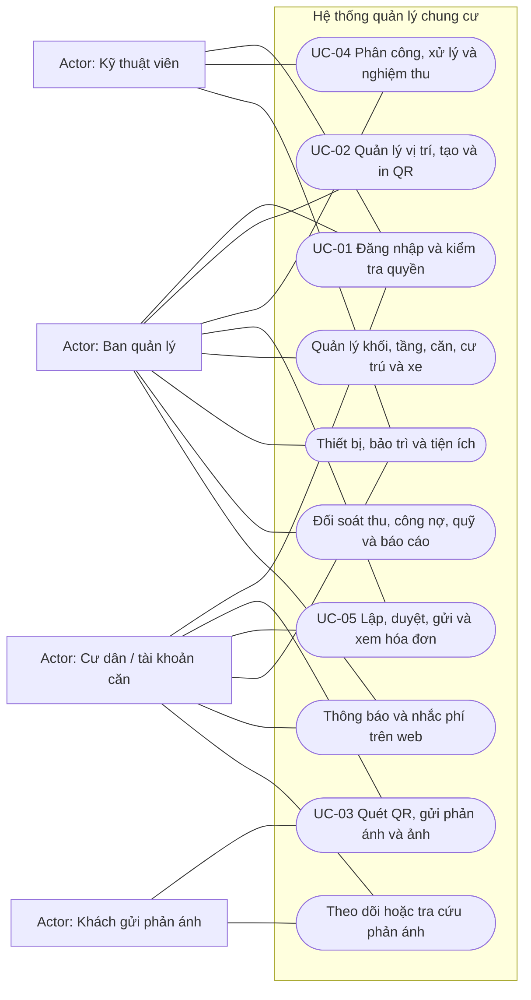
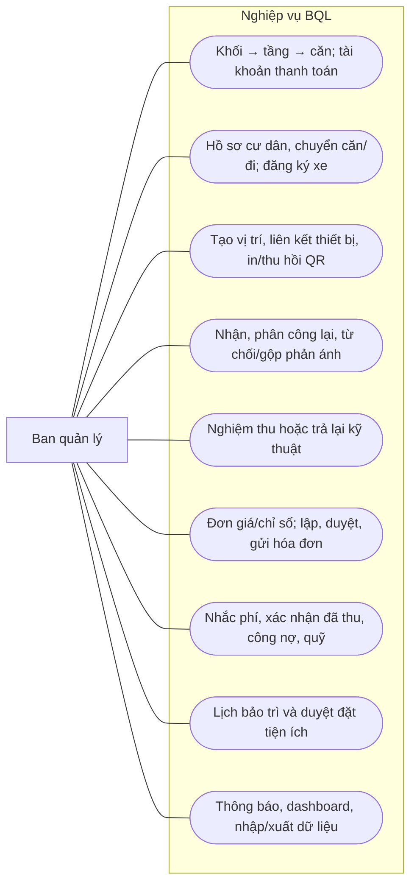
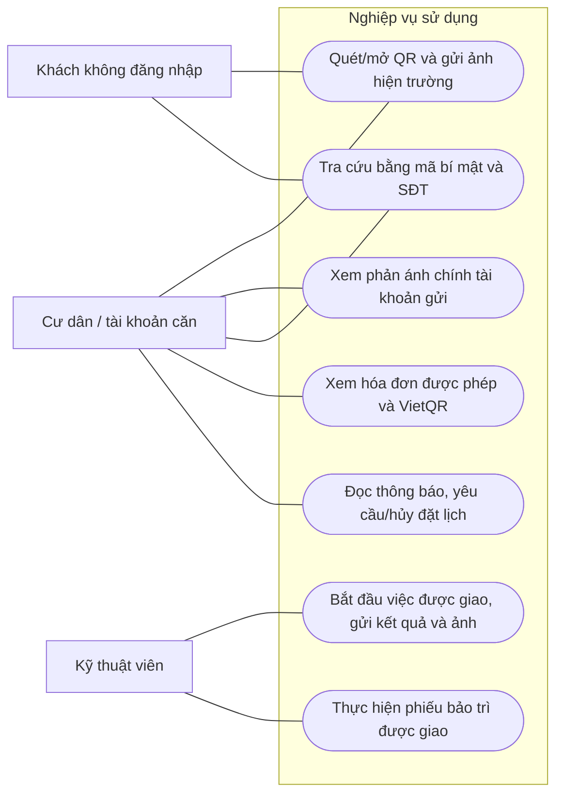

# Use Case và năm đặc tả cốt lõi

Nguồn thực thi: [API](../api.md), [quy tắc nghiệp vụ](../architecture.md), các module trong `backend/src/modules`. Phạm vi một chung cư. BQL là `QUAN_TRI_VIEN`, kỹ thuật là `KY_THUAT_VIEN`, cư dân/tài khoản căn là `CU_DAN`; khách gửi QR không cần tài khoản.

## Sơ đồ tổng thể

Ellipse biểu diễn Use Case; actor nằm ngoài khung hệ thống. Các đường là quyền tham gia, không mô tả thứ tự thực hiện. Mũi tên thứ tự chỉ xuất hiện trong Activity/Sequence ở tài liệu riêng.

## Phân rã Ban quản lý

## Phân rã cư dân và kỹ thuật

Kỹ thuật không được đọc mọi phản ánh hoặc tự nghiệm thu; cư dân không được truy cập danh bạ nhân sự/tài sản, tự duyệt hóa đơn hay sửa trạng thái đã thu. API kiểm tra quyền độc lập với menu giao diện.

## UC-01 — Đăng nhập và quyền truy cập

| Thuộc tính | Đặc tả |
|---|---|
| Actor | BQL, kỹ thuật viên, cư dân/tài khoản căn |
| Mục tiêu | Xác định tài khoản thật và truy cập đúng phạm vi |
| Tiền điều kiện | Tài khoản đã cấp, đang hoạt động, không trong thời gian khóa đăng nhập |
| Kích hoạt | Người dùng mở trang đăng nhập và gửi định danh/mật khẩu |
| Hậu điều kiện thành công | Cookie `session` HttpOnly chứa JWT; giao diện điều hướng theo vai trò API trả về |
| Bảo toàn khi lỗi | Không cấp phiên hoặc làm lộ mật khẩu; sai nhiều lần chịu khóa/giới hạn |

Luồng chính:

1. Nhập số điện thoại tài khoản cá nhân, hoặc tên đăng nhập căn `CH...`/SĐT chủ hộ phụ trách hiện tại và loại tài khoản phù hợp.
2. API kiểm tra dữ liệu, giới hạn request, trạng thái tài khoản và mật khẩu bcrypt.
3. API cấp JWT HS256 hạn 8 giờ, chứa phiên bản tài khoản; đặt cookie SameSite=Strict, Secure khi cấu hình HTTPS.
4. Frontend đọc người dùng và mở workspace đúng vai trò.
5. Mỗi request sau kiểm tra lại trạng thái, vai trò, phiên bản token và quyền bản ghi trong DB.

Ngoại lệ: sai mật khẩu không cấp cookie; 5 lần sai khóa 15 phút. Tài khoản khóa/phiên bị thu hồi phải đăng nhập lại. SĐT có cả tài khoản cá nhân/căn phải chọn đúng loại; không gộp quyền. Bàn giao chủ hộ/cấp lại mật khẩu làm phiên cũ mất hiệu lực. Đăng xuất hoặc đổi mật khẩu tăng phiên bản, không chỉ xóa giao diện phía client.

Nguồn: `auth.routes.js`, `auth.service.js`, `auth.middleware.js`; API `POST /api/xac_thuc/dang_nhap`, `GET /api/xac_thuc/toi`. Kiểm thử: `workflow.test.js`, `apartment-phone-login.test.js`, `e2e/apartment-accounts.spec.js`.

## UC-02 — Tạo, liên kết và in QR

| Thuộc tính | Đặc tả |
|---|---|
| Actor | BQL |
| Mục tiêu | Gắn đường dẫn phản ánh đúng vị trí/thiết bị |
| Tiền điều kiện | Phiên BQL hợp lệ; nếu chọn thiết bị thì hồ sơ tồn tại và chưa ngừng sử dụng |
| Kích hoạt | BQL chọn thêm vị trí tại Vị trí & QR |
| Hậu điều kiện | Vị trí có token riêng; nếu gắn thiết bị có lịch sử liên kết; tải PNG/in được |
| Bảo toàn khi lỗi | Không tạo liên kết dở dang; không đổi snapshot phản ánh cũ |

Luồng chính:

1. BQL nhập tên, loại KHU_VUC/THIET_BI và mô tả; loại thiết bị có thể chọn hồ sơ tài sản.
2. API kiểm tra quyền, trường nhập, khóa/kiểm tra thiết bị trong transaction.
3. Tạo token UUID và vị trí; lưu lịch sử nếu có liên kết.
4. Frontend dựng URL `/r/:token` theo origin đang mở và sinh ảnh QR bằng `qrcode`.
5. BQL tải PNG hoặc in qua trình duyệt, thử quét tại vị trí lắp đặt.

Ngoại lệ: loại KHU_VUC không nhận thiết bị; hồ sơ ngừng sử dụng không được liên kết mới. Đổi/bỏ liên kết cần xác nhận và phiên bản, không tự đổi token. Thay mã thu hồi token cũ; vô hiệu hóa làm form công khai không dùng được. Dùng localhost trong QR thì điện thoại khác không mở được; phải tạo/in từ origin HTTPS truy cập được ở điện thoại.

Nguồn: `qr.service.js:create/link/rotate`, `frontend/src/features/qr/Locations.jsx`; API `/api/vi_tri_qr`. Kiểm thử: `equipment-qr.test.js`, `e2e/equipment-qr.spec.js`, `e2e/workflow.spec.js`.

## UC-03 — Quét QR, gửi phản ánh và ảnh

| Thuộc tính | Đặc tả |
|---|---|
| Actor | Khách hoặc cư dân đã đăng nhập |
| Mục tiêu | Báo sự cố kèm ảnh, không cần cài app |
| Tiền điều kiện | QR còn hoạt động; kết nối API; camera trong web cần HTTPS tin cậy/quyền camera |
| Kích hoạt | Camera native mở link, hoặc trang quét đọc mã cùng hệ thống |
| Hậu điều kiện | Một phản ánh MOI với lịch sử, metadata ảnh, snapshot thiết bị và mã tra cứu bí mật |
| Bảo toàn khi lỗi | Không lưu nửa phản ánh; dọn ảnh mới không được commit, giữ nội dung nháp để sửa/thử lại |

Luồng chính:

1. Trang `/r/:token` lấy tên vị trí, thông tin thiết bị công khai và `phien_ban_qr` từ API.
2. Nhập tên/SĐT, loại sự cố, tiêu đề/nội dung, căn khai báo tùy chọn. Chọn ảnh thư viện hoặc chụp; chờ preview. Ảnh không bắt buộc ở phản ánh ban đầu.
3. Frontend nén ảnh, gửi multipart cùng token/phiên bản và khóa yêu cầu UUID; không gửi thông tin thiết bị để quyết định snapshot.
4. Backend kiểm tra dữ liệu/ảnh, khóa yêu cầu chống trùng, kiểm tra QR/phiên bản và giới hạn gửi. Nếu đã có phản ánh tương tự, yêu cầu xác nhận gửi riêng.
5. Transaction lưu phản ánh, snapshot thiết bị từ DB, metadata ảnh, lịch sử tiếp nhận và biên nhận chống trùng.
6. Trả mã tra cứu, xóa nháp. Khách dùng mã bí mật + SĐT để xem tiến độ; cư dân có thể xem phản ánh chính tài khoản đã gửi.

Ngoại lệ: QR đổi/thu hồi → tải lại, không tự gán thiết bị mới; `QR_CHANGED`/`QR_INVALID`. Cùng khóa+cùng nội dung trả biên nhận cũ, không tạo lần hai; đổi nội dung dùng khóa cũ bị 409. Quá giới hạn 5 phản ánh/SĐT+IP/giờ bị 429, ngoài rate limit tuyến API. JPEG/PNG/WebP có xử lý frontend/backend; HEIC chưa hỗ trợ. Tải lại trang chỉ khôi phục nội dung nháp trong tab, không giữ quyền truy cập file ảnh; phải chọn lại ảnh. Không tự gắn phản ánh khách vào tài khoản dựa SĐT.

Nguồn: `PublicReports.jsx`, `incidents.service.js:submit/lookup`, `lib/images.js`; `POST /api/cong_khai/phan_anh`. Kiểm thử: `workflow.test.js`, `equipment-qr.test.js`, `gallery-upload.spec.js`, `in-page-photo.spec.js`, `report-draft.spec.js`.

## UC-04 — Phân công, xử lý và nghiệm thu phản ánh

| Thuộc tính | Đặc tả |
|---|---|
| Actor | BQL (phân công/nghiệm thu); kỹ thuật viên được giao (thực hiện) |
| Mục tiêu | Theo dõi đúng người, tiến độ và bằng chứng hoàn thành |
| Tiền điều kiện | Phản ánh tồn tại, actor có quyền, phiên bản form còn hiện hành |
| Kích hoạt | BQL mở phản ánh MOI |
| Hậu điều kiện | DA_DONG khi BQL nghiệm thu; giữ lịch sử và ảnh từng lượt |
| Bảo toàn khi lỗi | Không đổi một phần trạng thái/lịch sử; ảnh không commit được dọn |

Luồng chính:

1. BQL đọc nội dung/ảnh, chọn kỹ thuật viên đang hoạt động và mức ưu tiên → DA_PHAN_CONG.
2. Kỹ thuật viên mở việc đang được giao, bắt đầu → DANG_XU_LY.
3. Kỹ thuật ghi kết quả và ít nhất một ảnh nghiệm thu mới → DA_XU_LY.
4. BQL kiểm tra, nghiệm thu đạt → DA_DONG; hệ thống ghi ngày đóng/lịch sử.
5. Người gửi theo dõi được tiến độ và phản hồi công khai trong phạm vi cho phép.

Ngoại lệ: BQL trả lại từ DA_XU_LY → DANG_XU_LY kèm lý do, tăng lượt xử lý, yêu cầu ảnh mới cho lần hoàn thành kế tiếp. Có thể phân công lại khi MOI/DA_PHAN_CONG/DANG_XU_LY; người cũ mất quyền. BQL từ chối/gộp chỉ khi MOI và có lý do; gộp cần cùng vị trí, cùng thiết bị snapshot (kể cả NULL), bản gốc đang mở, không tạo chuỗi/vòng gộp. Kỹ thuật không tự đóng/từ chối/gộp. Form cũ nhận 409 thay vì ghi đè. Ghi chú nội bộ không xuất qua tra cứu công khai.

Nguồn: `incidents.service.js:assign/transition`, `incidents.repository.js`; `PATCH /api/phan_anh/:id/phan_cong`, `PATCH /api/phan_anh/:id/trang_thai`. Kiểm thử: `workflow.test.js`, `equipment-qr.test.js`, `e2e/workflow.spec.js`.

## UC-05 — Lập, duyệt, gửi và tra cứu hóa đơn

| Thuộc tính | Đặc tả |
|---|---|
| Actor | BQL; cư dân hoặc tài khoản thanh toán căn được quyền |
| Mục tiêu | Công khai khoản phải trả đúng nguồn và thông tin VietQR |
| Tiền điều kiện | Căn tồn tại; cấu hình phí/chỉ số hợp lệ tại ngày chốt; không có hóa đơn còn hiệu lực cùng căn/kỳ |
| Kích hoạt | BQL chọn kỳ/ngày chốt và căn hoặc lô căn |
| Hậu điều kiện | Hóa đơn DA_GUI có chi tiết đã duyệt, hạn trả và thông tin nhận tiền; cư dân được phép xem |
| Bảo toàn khi lỗi | Không sửa tiền hóa đơn cố định; lô lỗi không lưu một phần |

Luồng chính:

1. BQL nhập/kiểm tra chỉ số và đơn giá có hiệu lực, chọn các khoản tính.
2. API lập NHAP từ diện tích, đăng ký xe theo loại tại ngày chốt, chỉ số nước/điện, biểu giá điện bậc thang và thuế cấu hình; giữ snapshot chi tiết.
3. BQL xem lại và duyệt → DA_DUYET; API kiểm tra số liệu không thay đổi so với snapshot.
4. BQL chọn ngân hàng, nhập tài khoản/tên nhận và hạn thanh toán, gửi → DA_GUI.
5. Cư dân/tài khoản căn đăng nhập, API kiểm tra phạm vi rồi trả hóa đơn đã gửi/đã thanh toán; frontend hiển thị VietQR đúng thông tin snapshot.
6. BQL đối soát bên ngoài, xác nhận đủ đúng tổng tiền và mã tham chiếu → DA_THANH_TOAN; ghi nhận vào báo cáo thu/quỹ vận hành.

Ngoại lệ: chưa đủ chỉ số/cấu hình → báo lỗi; dữ liệu đổi trước duyệt → tính lại NHAP. NHAP/DA_DUYET/DA_GUI được hủy có lý do, hóa đơn hủy có thể lập thay thế với ID mới. Không hủy/sửa hóa đơn đã thu qua luồng này. Tài khoản căn theo quyền hiện tại; tài khoản cá nhân phải đáp ứng điều kiện cư trú tại ngày chốt. QR chỉ hỗ trợ chuyển khoản, **không gọi API ngân hàng, không tự xác nhận tiền và không nhận thu một phần**. Nhắc phí là thông báo trong web, không SMS/email.

Nguồn: `billing.service.js`, `billing.electricity.js`, `billing-batch*.service.js`, `billing.qr.js`; API dưới `/api/hoa_don`, `/api/cua_toi/hoa_don`. Kiểm thử: `billing.test.js`, `electricity.test.js`, `billing-batch-actions.test.js`, `e2e/billing.spec.js`.
