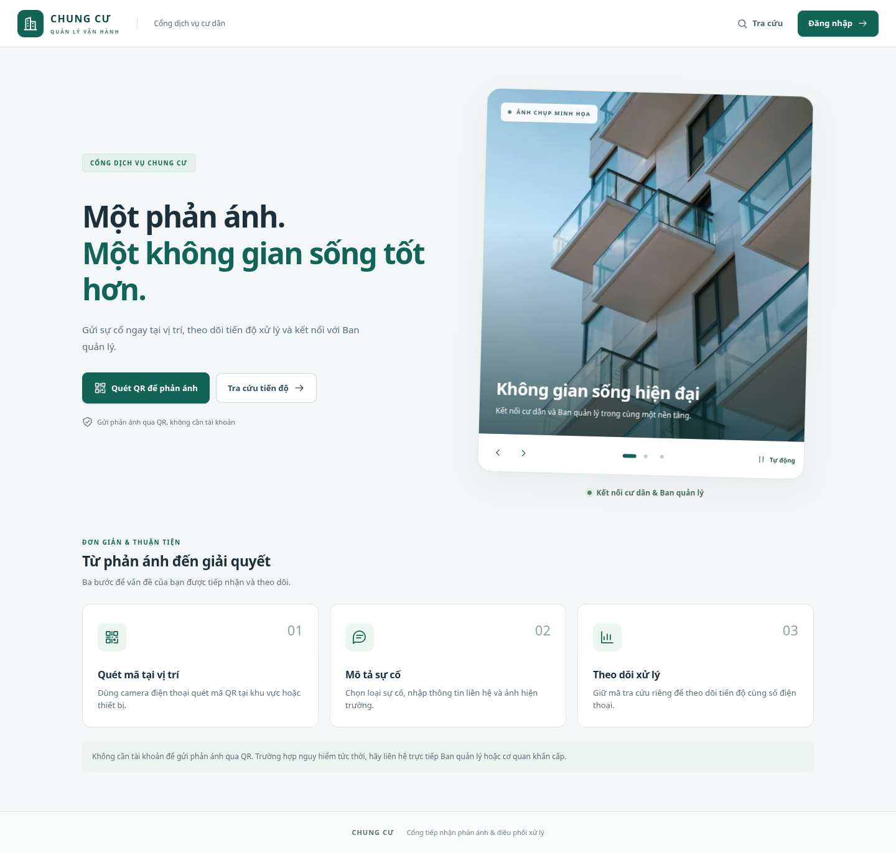
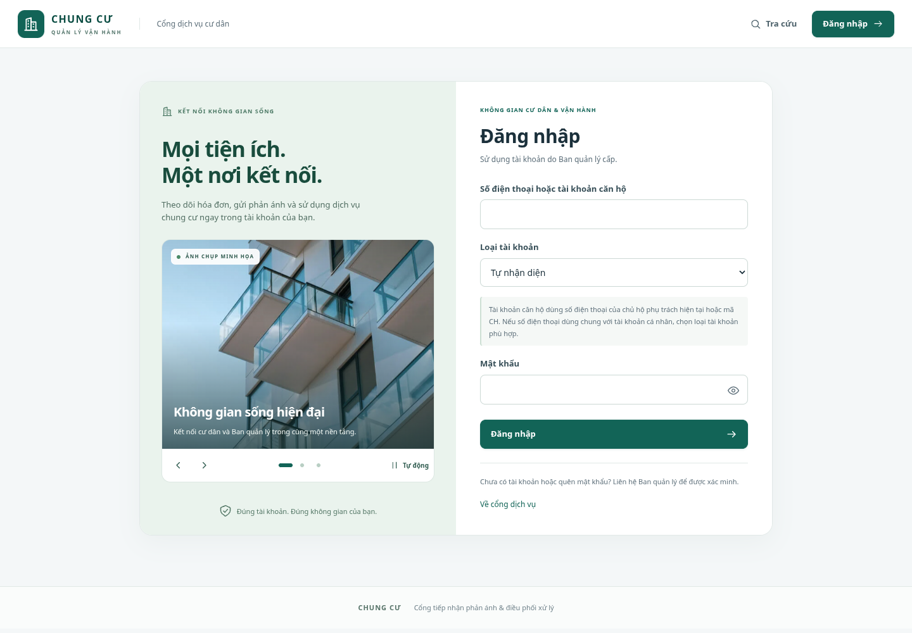
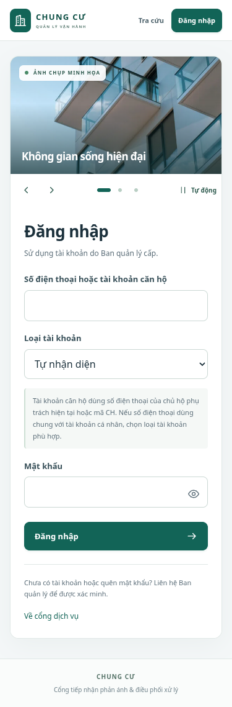

# Excel chi tiết và ảnh chụp tự động chuyển — code đầy đủ cho VS Code

## 1. Vì sao file Excel chỉ hiện tổng hợp?

Ảnh bạn gửi đang ở trang **Tổng hợp**. Bản cũ tạo hai trang **Tổng hợp** và **Chi tiết**, nhưng mở Tổng hợp trước, nên dễ tưởng chưa xuất dữ liệu.

**Dùng file cũ ngay:** bấm **Ctrl + PageDown** trong Excel để chuyển sang trang **Chi tiết**, hoặc chọn tab **Chi tiết** ở mép dưới cửa sổ.

Bản cập nhật này đưa **Chi tiết** lên đầu và chọn sẵn khi mở, cố định hàng tiêu đề, giữ bộ lọc cột và thêm liên kết từ Tổng hợp sang danh sách. Danh sách vẫn lấy toàn bộ kết quả theo bộ lọc, kể cả những dòng nằm ở các trang sau trên web. Ví dụ xuất căn hộ có mã căn, số căn, khối, tầng, diện tích, số cư dân đang ở và tình trạng tính phí dịch vụ. Phần xuất PDF giữ báo cáo theo bộ lọc hiện có.

[**Tải Excel mẫu gồm 19 căn hộ để xem cách mở mới**](https://raw.githubusercontent.com/tunato2807-del/chung-cu-starter/codex/auth-qr-incidents/docs/anh-that/mau-danh-sach-can-ho.xlsx). Tệp này dùng dữ liệu nghiệm thu giả lập trong workspace, không thay dữ liệu trên máy bạn.

**Sau khi cập nhật code, khởi động lại backend và bấm Xuất Excel lần nữa.** Các file đã tải trước đó giữ cấu trúc cũ.

## 2. Ảnh chụp và trình chiếu

Cổng cư dân và đăng nhập dùng ba ảnh chụp kiến trúc nhà ở minh họa, lưu ngay trong dự án. Ảnh tự chuyển mỗi **6 giây**, chuyển cảnh mượt và có chuyển động phóng nhẹ; bạn có thể dừng, chuyển ảnh hoặc chọn bằng các chấm tròn.

Trình chiếu tạm dừng khi trỏ chuột lên ảnh, thao tác bàn phím bên trong, ảnh ra khỏi màn hình hoặc tab bị ẩn. Khi chọn ảnh thủ công, bấm nút **Bật tự động chuyển ảnh** để chạy tiếp. Khi hệ điều hành bật giảm chuyển động, ảnh đứng yên và vẫn chọn ảnh bằng tay được. Chuyển ảnh giữ nguyên nội dung biểu mẫu.

Ảnh là minh họa kiến trúc, có nhãn ngay trên khung. Để dùng ảnh chung cư của bạn, thay ba tệp ảnh cục bộ hoặc chỉnh `src`/`alt`/chú thích trong `PhotoCarousel.jsx`. Nguồn ảnh được ghi ở [README của bộ ảnh](../frontend/public/images/residences/README.md).

### Cổng cư dân



### Đăng nhập



### Điện thoại

| Cổng cư dân | Đăng nhập |
| --- | --- |
|  |  |

## 3. Cách cập nhật từng file

Áp dụng sau [bản giao diện chuyên nghiệp](cap-nhat-giao-dien-chuyen-nghiep-vscode.md), commit nền `3a88b1d`. Dự án giữ cấu hình database và các migration hiện tại; không thêm thư viện.

Trong VS Code, mở thư mục gốc:

```text
D:\DO_AN\chung-cu-starter-codex-auth-qr-incidents
```

Dừng terminal Vite trong khi chép file. Chép đủ **7 file code** ở mục 4, lưu UTF-8. File `report-files.js` nằm trong **backend/src/modules/report-exports**, các file giao diện nằm trong frontend.

### Tạo ba tệp ảnh cục bộ

Tại PowerShell ở thư mục gốc, chạy một lần:

```powershell
$photoDirectory = Join-Path (Get-Location) "frontend\public\images\residences"
New-Item -ItemType Directory -Force $photoDirectory | Out-Null
$photoBase = "https://raw.githubusercontent.com/tunato2807-del/chung-cu-starter/codex/auth-qr-incidents/frontend/public/images/residences"
foreach ($photoFile in @("apartment-balconies.webp", "residential-building.webp", "modern-residence.webp")) {
    Invoke-WebRequest -UseBasicParsing -Uri "$photoBase/$photoFile" -OutFile (Join-Path $photoDirectory $photoFile)
}
```

Chỉ cần tải ba ảnh nhỏ này; các phần code đều được chép từ hướng dẫn. Khi web chạy, ảnh được đọc từ máy chủ frontend của bạn, kể cả khi không truy cập Internet.

### Khởi động lại

Ở terminal **backend đang dùng**, bấm `Ctrl+C` rồi chạy lại để giữ lựa chọn `DB_NAME` trong terminal đó:

```powershell
npm run start -w backend
```

Ở terminal thứ hai:

```powershell
npm run build
npm run dev:frontend:https
```

Dùng địa chỉ HTTPS đang hoạt động và tải lại trang bằng `Ctrl+F5`. Nếu dùng HTTP trên chính máy tính, chạy `npm run dev:frontend` thay cho lệnh HTTPS. Dừng Vite cũ trước khi chạy để dùng lại cổng 5173.

| File | Thao tác | Chức năng |
| --- | --- | --- |
| `frontend/src/shared/Icon.jsx` | Thay toàn bộ | Bổ sung biểu tượng điều khiển trình chiếu. |
| `frontend/src/shared/PhotoCarousel.jsx` | Tạo mới | Trình chiếu ảnh thật, điều khiển và tạm dừng theo ngữ cảnh. |
| `frontend/src/shared/PhotoCarousel.css` | Tạo mới | Khung ảnh, chuyển cảnh, chuyển động nhẹ và responsive. |
| `frontend/src/features/auth/Auth.jsx` | Thay toàn bộ | Ảnh chụp trên trang đăng nhập. |
| `frontend/src/features/incidents/PublicReports.jsx` | Thay toàn bộ | Ảnh chụp trên cổng cư dân; giữ luồng phản ánh và ảnh hiện trường. |
| `frontend/src/shared/ReportExport.jsx` | Thay toàn bộ | Hướng dẫn tìm trang chi tiết khi xuất Excel. |
| `backend/src/modules/report-exports/report-files.js` | Thay toàn bộ | Mọi Excel danh sách/báo cáo mở trực tiếp tại Chi tiết. |

## 4. Code đầy đủ 7 file

### File 1: `frontend/src/shared/Icon.jsx`

**Thay toàn bộ.**

```jsx
import React from "react";

const paths = {
  building: "M3 21h18M5 21V5l7-2v18M12 9h7v12M8 7v1m0 3v1m0 3v1m7-4h1m-1 4h1",
  dashboard: "M3 3h7v7H3zM14 3h7v7h-7zM3 14h7v7H3zM14 14h7v7h-7z",
  message:
    "M21 11.5a8.5 8.5 0 0 1-8.5 8.5H4l-2 2V11.5a9.5 9.5 0 0 1 19 0ZM7 9h10M7 13h7",
  home: "m3 10 9-7 9 7M5 9v12h14V9M9 21v-7h6v7",
  map: "m3 6 6-3 6 3 6-3v15l-6 3-6-3-6 3V6Zm6-3v15m6-12v15",
  layers: "m12 3 10 5-10 5L2 8l10-5ZM2 12l10 5 10-5M2 16l10 5 10-5",
  key: "M15 13a5 5 0 1 0-4-4L3 17v4h4v-3h3l5-5Z",
  users:
    "M16 21v-2a4 4 0 0 0-4-4H6a4 4 0 0 0-4 4v2m20 0v-2a4 4 0 0 0-3-3.9M9 11a4 4 0 1 0 0-8 4 4 0 0 0 0 8Zm8-7a4 4 0 0 1 0 8",
  car: "m5 7 2-4h10l2 4m-16 9V9l2-2h14l2 2v7H3Zm2 0v4m14-4v4M6 11h2m8 0h2",
  tool: "m14 6 4 4 3-3a7 7 0 0 1-9 9l-6 6-4-4 6-6a7 7 0 0 1 9-9l-3 3Z",
  calendar: "M4 5h16v16H4zM4 10h16M8 3v4m8-4v4M8 14h2m4 0h2m-8 3h2",
  receipt: "M5 3h14v19l-3-2-4 2-4-2-3 2V3Zm3 5h8m-8 4h8m-8 4h4",
  meter: "M4 18a9 9 0 1 1 16 0H4Zm8-5 4-5M7 9l1 1m9 4h1m-12 0h1m5-9v1",
  chart: "M3 3v18h18M7 16v-5m5 5V7m5 9v-8",
  wallet:
    "M20 8H5a2 2 0 0 1 0-4h13v4M3 6v13a2 2 0 0 0 2 2h15V8Zm17 5h-5v4h5m-2-2h.01",
  file: "M14 2H5v20h14V7l-5-5Zm0 0v6h5M8 12h8m-8 4h8",
  bell: "M18 8a6 6 0 0 0-12 0c0 7-3 7-3 9h18c0-2-3-2-3-9ZM10 21h4",
  qr: "M3 3h6v6H3zM15 3h6v6h-6zM3 15h6v6H3zM15 15h2v2h-2zM21 15v6h-6m-3-9h1M3 12h6m3-9v6m0 6v6m6-9h3",
  user: "M20 21v-2a6 6 0 0 0-6-6h-4a6 6 0 0 0-6 6v2M12 9a4 4 0 1 0 0-8 4 4 0 0 0 0 8Z",
  search: "M11 18a7 7 0 1 0 0-14 7 7 0 0 0 0 14Zm5-2 5 5",
  arrow: "M4 12h16m-6-6 6 6-6 6",
  external: "M14 3h7v7m0-7L10 14M10 3H3v18h18v-7",
  logout: "M9 3H3v18h6m-1-9h13m-5-5 5 5-5 5",
  menu: "M4 6h16M4 12h16M4 18h16",
  chevron: "m6 9 6 6 6-6",
  eye: "M2 12s4-7 10-7 10 7 10 7-4 7-10 7S2 12 2 12Zm10 3a3 3 0 1 0 0-6 3 3 0 0 0 0 6Z",
  eyeOff:
    "m3 3 18 18M9 5.5a11 11 0 0 1 3-.5c6 0 10 7 10 7a22 22 0 0 1-3 3.8M6 6.3A23 23 0 0 0 2 12s4 7 10 7a11 11 0 0 0 5-1.3M10 10a3 3 0 0 0 4 4",
  shield: "m12 2 9 4v6c0 5-9 10-9 10S3 17 3 12V6l9-4Zm-4 10 3 3 5-6",
  refresh:
    "M20 7V3m0 4h-4M4 17v4m0-4h4M4 9a8 8 0 0 1 14-5l2 3M4 17l2 3a8 8 0 0 0 14-5",
  previous: "m14 6-6 6 6 6",
  next: "m10 6 6 6-6 6",
  pause: "M8 5v14M16 5v14",
  play: "m8 4 12 8-12 8V4Z",
};

export default function Icon({ name, size = 20, className = "" }) {
  return (
    <svg
      className={`icon ${className}`}
      width={size}
      height={size}
      viewBox="0 0 24 24"
      fill="none"
      stroke="currentColor"
      strokeWidth="1.7"
      strokeLinecap="round"
      strokeLinejoin="round"
      aria-hidden="true"
      focusable="false"
    >
      <path d={paths[name] || paths.building} />
    </svg>
  );
}
```

### File 2: `frontend/src/shared/PhotoCarousel.jsx`

**Tạo mới.**

```jsx
import React, { useEffect, useRef, useState } from "react";
import Icon from "./Icon.jsx";
import "./PhotoCarousel.css";

const slides = [
  {
    src: "/images/residences/apartment-balconies.webp",
    alt: "Các ban công kính của một tòa căn hộ dưới bầu trời xanh",
    title: "Không gian sống hiện đại",
    description: "Kết nối cư dân và Ban quản lý trong cùng một nền tảng.",
    position: "50% 48%",
  },
  {
    src: "/images/residences/residential-building.webp",
    alt: "Mặt ngoài tòa nhà nhiều tầng với các ô cửa và ban công",
    title: "An tâm trong từng trải nghiệm",
    description:
      "Gửi phản ánh, theo dõi tiến độ và sử dụng dịch vụ thuận tiện.",
    position: "50% 48%",
  },
  {
    src: "/images/residences/modern-residence.webp",
    alt: "Cận cảnh ban công và mặt ngoài một khu nhà ở hiện đại",
    title: "Kết nối từ những điều nhỏ",
    description: "Thông tin rõ ràng để mỗi ngày sống thêm thuận tiện.",
    position: "50% 52%",
  },
];
const interval = 6000;

export default function PhotoCarousel({ variant = "portal" }) {
  const [index, setIndex] = useState(0);
  const [paused, setPaused] = useState(false);
  const [hovered, setHovered] = useState(false);
  const [reducedMotion, setReducedMotion] = useState(
    () => window.matchMedia("(prefers-reduced-motion: reduce)").matches,
  );
  const [visible, setVisible] = useState(
    () => document.visibilityState !== "hidden",
  );
  const [inView, setInView] = useState(false);
  const [failed, setFailed] = useState([]);
  const root = useRef(null);
  const enabled = !paused && !reducedMotion;
  const running =
    enabled && !hovered && visible && inView && failed.length < slides.length;

  useEffect(() => {
    const preference = window.matchMedia("(prefers-reduced-motion: reduce)");
    const updatePreference = () => setReducedMotion(preference.matches);
    const updateVisibility = () =>
      setVisible(document.visibilityState !== "hidden");
    preference.addEventListener("change", updatePreference);
    document.addEventListener("visibilitychange", updateVisibility);
    const observer = new IntersectionObserver(
      ([entry]) => setInView(entry.isIntersecting),
      { threshold: 0.15 },
    );
    observer.observe(root.current);
    return () => {
      preference.removeEventListener("change", updatePreference);
      document.removeEventListener("visibilitychange", updateVisibility);
      observer.disconnect();
    };
  }, []);

  useEffect(() => {
    if (!running) return;
    const timer = window.setInterval(
      () => setIndex((current) => (current + 1) % slides.length),
      interval,
    );
    return () => window.clearInterval(timer);
  }, [running, index]);

  function select(next) {
    setPaused(true);
    setIndex((next + slides.length) % slides.length);
  }

  return (
    <section
      ref={root}
      className={`photo-carousel photo-carousel--${variant}`}
      aria-label="Ảnh minh họa không gian sống"
      aria-roledescription="trình chiếu"
      data-slide={index + 1}
      data-playing={running}
      onPointerEnter={(event) => {
        if (event.pointerType === "mouse") setHovered(true);
      }}
      onPointerLeave={() => setHovered(false)}
      onFocusCapture={(event) => {
        if (!event.target.closest("[data-rotation]")) setPaused(true);
      }}
    >
      <div className="photo-carousel-viewport">
        {slides.map((slide, number) => (
          <div
            className={`photo-slide${number === index ? " is-current" : ""}`}
            key={slide.src}
            aria-hidden={number !== index}
          >
            
                setFailed((current) =>
                  current.includes(number) ? current : [...current, number],
                )
              }
            />
            {failed.includes(number) && (
              <div className="photo-fallback">
                <Icon name="building" size={42} />
                <span>Ảnh minh họa chưa tải được</span>
              </div>
            )}
          </div>
        ))}
        <span className="photo-carousel-label">
          <span className="live-dot" />
          ẢNH CHỤP MINH HỌA
        </span>
        <div
          className="photo-carousel-caption"
          aria-live={enabled ? "off" : "polite"}
          aria-atomic="true"
        >
          <p>{slides[index].title}</p>
          <span>{slides[index].description}</span>
        </div>
      </div>
      <div className="photo-carousel-toolbar">
        <div className="photo-carousel-arrows">
          <button
            type="button"
            aria-label="Ảnh trước"
            onClick={() => select(index - 1)}
          >
            <Icon name="previous" size={18} />
          </button>
          <button
            type="button"
            aria-label="Ảnh tiếp theo"
            onClick={() => select(index + 1)}
          >
            <Icon name="next" size={18} />
          </button>
        </div>
        <div className="photo-carousel-dots" role="group" aria-label="Chọn ảnh">
          {slides.map((slide, number) => (
            <button
              type="button"
              key={slide.src}
              aria-label={`Xem ảnh ${number + 1}`}
              aria-current={number === index ? "true" : undefined}
              onClick={() => select(number)}
            >
              <span />
            </button>
          ))}
        </div>
        <button
          className="photo-carousel-rotation"
          type="button"
          data-rotation="true"
          disabled={reducedMotion}
          aria-label={
            reducedMotion
              ? "Tự chuyển ảnh tắt theo cài đặt giảm chuyển động"
              : paused
                ? "Bật tự động chuyển ảnh"
                : "Dừng tự động chuyển ảnh"
          }
          aria-pressed={enabled}
          onClick={() => setPaused((value) => !value)}
        >
          <Icon name={enabled ? "pause" : "play"} size={16} />
          <span>{enabled ? "Tự động" : "Đã dừng"}</span>
        </button>
      </div>
    </section>
  );
}
```

### File 3: `frontend/src/shared/PhotoCarousel.css`

**Tạo mới.**

```css
.photo-carousel {
  min-width: 0;
  overflow: hidden;
  background: white;
  border: 1px solid #dce7e2;
  border-radius: 22px;
  box-shadow: 0 16px 48px #183c3b12;
}
.photo-carousel-viewport {
  position: relative;
  aspect-ratio: 1 / 1.06;
  isolation: isolate;
  overflow: hidden;
  background: #c3dcd2;
}
.photo-slide {
  position: absolute;
  inset: 0;
  opacity: 0;
  transition: opacity 900ms ease;
  pointer-events: none;
}
.photo-slide.is-current {
  opacity: 1;
}
.photo-slide img {
  width: 100%;
  height: 100%;
  display: block;
  object-fit: cover;
}
.photo-slide.is-current img {
  animation: photo-drift 12s linear both;
  animation-play-state: paused;
}
.photo-carousel[data-playing="true"] .photo-slide.is-current img {
  animation-play-state: running;
}
@keyframes photo-drift {
  from {
    transform: scale(1);
  }
  to {
    transform: scale(1.07) translateY(-1%);
  }
}
.photo-carousel-viewport::after {
  content: "";
  position: absolute;
  inset: 0;
  background: linear-gradient(
    180deg,
    #102e301f 0%,
    transparent 40%,
    #102e30b8 100%
  );
  pointer-events: none;
}
.photo-carousel-label {
  position: absolute;
  top: 22px;
  left: 22px;
  z-index: 1;
  display: flex;
  align-items: center;
  gap: 8px;
  padding: 7px 10px;
  background: #ffffffed;
  color: #315c50;
  border: 1px solid #ffffff88;
  border-radius: 7px;
  font-size: 9px;
  font-weight: 700;
  letter-spacing: 1.2px;
}
.photo-carousel-label .live-dot {
  width: 6px;
  height: 6px;
  box-shadow: none;
}
.photo-carousel-caption {
  position: absolute;
  bottom: 26px;
  left: 26px;
  right: 26px;
  z-index: 1;
  color: white;
}
.photo-carousel-caption p {
  color: white;
  font-size: clamp(20px, 2vw, 27px);
  font-weight: 650;
  line-height: 1.25;
  letter-spacing: -0.6px;
  margin: 0 0 10px;
}
.photo-carousel-caption > span {
  display: block;
  font-size: 12px;
  line-height: 1.7;
  color: #f3f9f5;
  max-width: 340px;
}
.photo-carousel-toolbar {
  display: flex;
  align-items: center;
  justify-content: space-between;
  gap: 8px;
  padding: 10px 14px;
  min-height: 60px;
}
.photo-carousel-toolbar button {
  min-height: 40px;
  height: 40px;
  padding: 0;
  border: 0;
  background: transparent;
  color: #315d51;
  box-shadow: none;
}
.photo-carousel-toolbar button:hover:not(:disabled) {
  background: #edf5ef;
  border-color: transparent;
}
.photo-carousel-arrows {
  display: flex;
  gap: 4px;
}
.photo-carousel-arrows button {
  width: 36px;
  border-radius: 50%;
}
.photo-carousel-dots {
  display: flex;
  gap: 0;
}
.photo-carousel-dots button {
  width: 26px;
}
.photo-carousel-dots span {
  display: block;
  width: 6px;
  height: 6px;
  border-radius: 10px;
  background: #b9cfc4;
  transition:
    width 0.2s,
    background 0.2s;
}
.photo-carousel-dots [aria-current="true"] span {
  width: 22px;
  background: #126457;
}
.photo-carousel-rotation {
  gap: 5px;
  font-size: 10px;
  padding: 0 8px;
  white-space: nowrap;
}
.photo-fallback {
  position: absolute;
  inset: 0;
  display: flex;
  align-items: center;
  justify-content: center;
  flex-direction: column;
  gap: 12px;
  color: #2c5a4c;
  font-size: 12px;
  background: #dcece3;
}
.portal-illustration .photo-carousel {
  transform: rotate(1.5deg);
}
.portal-illustration {
  padding: 4px 8px 8px;
}
.portal-hero .portal-art-caption {
  margin-top: 18px;
}
.auth-story .photo-carousel {
  margin: 24px 0 20px;
  border-radius: 14px;
  box-shadow: none;
  flex-shrink: 0;
}
.auth-story .photo-carousel-viewport {
  aspect-ratio: 1.3;
}
.auth-story .photo-carousel-caption {
  left: 18px;
  right: 18px;
  bottom: 18px;
}
.auth-story .photo-carousel-caption p {
  font-size: 20px;
}
.auth-story .photo-carousel-caption > span {
  font-size: 11px;
}
.auth-story .photo-carousel-label {
  top: 14px;
  left: 14px;
  font-size: 8px;
  padding: 5px 8px;
}
.auth-story .photo-carousel-toolbar {
  padding: 6px 8px;
  min-height: 52px;
}
@media (max-width: 900px) {
  .photo-carousel-label {
    left: 16px;
    top: 16px;
    font-size: 8px;
  }
  .photo-carousel-caption {
    left: 20px;
    right: 20px;
    bottom: 20px;
  }
  .photo-carousel-caption p {
    font-size: 22px;
  }
}
@media (max-width: 650px) {
  .portal-hero .portal-illustration {
    width: 100%;
    padding: 0;
  }
  .portal-illustration .photo-carousel {
    transform: none;
    border-radius: 16px;
  }
  .photo-carousel-viewport {
    aspect-ratio: 1.25;
  }
  .photo-carousel-caption p {
    font-size: 22px;
  }
  .photo-carousel-caption > span {
    font-size: 11px;
  }
  .photo-carousel-label {
    top: 16px;
    left: 18px;
  }
  .photo-carousel-toolbar {
    padding: 7px 10px;
    min-height: 54px;
  }
  .auth-story .photo-carousel {
    margin: 18px 0 0;
  }
  .auth-story .photo-carousel-viewport {
    aspect-ratio: 1.8;
  }
  .auth-layout .auth-story {
    padding: 0;
  }
  .auth-layout .auth-story > .auth-story-label,
  .auth-layout .auth-story > h2,
  .auth-layout .auth-story > p {
    display: none;
  }
  .auth-layout .auth-story .photo-carousel {
    border: 0;
    border-radius: 0;
    margin: 0;
  }
  .auth-story .photo-carousel-caption p {
    font-size: 17px;
    margin-bottom: 0;
  }
  .auth-story .photo-carousel-caption > span {
    display: none;
  }
}
@media (prefers-reduced-motion: reduce) {
  .photo-slide,
  .photo-carousel-dots span {
    transition: none;
  }
  .photo-slide.is-current img {
    animation: none;
    transform: none;
  }
}
```

### File 4: `frontend/src/features/auth/Auth.jsx`

**Thay toàn bộ.**

```jsx
import React, { createContext, useContext, useEffect, useState } from "react";
import { Link, Navigate, useNavigate } from "react-router-dom";
import { getJson } from "../../shared/api/client.js";
import Icon from "../../shared/Icon.jsx";
import PhotoCarousel from "../../shared/PhotoCarousel.jsx";
import {
  ErrorBox,
  Field,
  Loading,
  homeFor,
  roleNames,
} from "../../shared/ui.jsx";
const Context = createContext(null);
export const useAuth = () => useContext(Context);
export function AuthProvider({ children }) {
  const [user, setUser] = useState(null),
    [loading, setLoading] = useState(true);
  useEffect(() => {
    getJson("/xac_thuc/toi")
      .then((r) => setUser(r.data))
      .catch(() => {})
      .finally(() => setLoading(false));
  }, []);
  const logout = async () => {
    await getJson("/xac_thuc/dang_xuat", { method: "POST" });
    setUser(null);
  };
  return (
    <Context.Provider value={{ user, setUser, loading, logout }}>
      {children}
    </Context.Provider>
  );
}
export function Protected({ roles, children }) {
  const { user, loading } = useAuth();
  if (loading) return <Loading />;
  if (!user) return <Navigate to="/dang-nhap" replace />;
  if (roles && !roles.includes(user.vai_tro))
    return (
      <div className="card">
        <h1>Bạn không có quyền mở trang này</h1>
        <Link to={homeFor(user)}>Về không gian của tôi</Link>
      </div>
    );
  return children;
}
export function Login() {
  const { user, setUser } = useAuth(),
    navigate = useNavigate();
  const [error, setError] = useState(),
    [pending, setPending] = useState(false),
    [showPassword, setShowPassword] = useState(false);
  if (user) return <Navigate to={homeFor(user)} replace />;
  return (
    <div className="auth-layout">
      <aside className="auth-story">
        <span className="auth-story-label">
          <Icon name="building" size={18} />
          KẾT NỐI KHÔNG GIAN SỐNG
        </span>
        <h2>
          Mọi tiện ích.
          <br />
          Một nơi kết nối.
        </h2>
        <p>
          Theo dõi hóa đơn, gửi phản ánh và sử dụng dịch vụ chung cư ngay trong
          tài khoản của bạn.
        </p>
        <PhotoCarousel variant="auth" />
        <div className="auth-trust">
          <Icon name="shield" />
          <span>Đúng tài khoản. Đúng không gian của bạn.</span>
        </div>
      </aside>
      <section className="card auth-form">
        <p className="eyebrow">KHÔNG GIAN CƯ DÂN & VẬN HÀNH</p>
        <h1>Đăng nhập</h1>
        <p className="muted">Sử dụng tài khoản do Ban quản lý cấp.</p>
        <form
          onSubmit={async (e) => {
            e.preventDefault();
            setPending(true);
            setError(null);
            try {
              const result = await getJson("/xac_thuc/dang_nhap", {
                method: "POST",
                body: Object.fromEntries(new FormData(e.currentTarget)),
              });
              setUser(result.data);
              navigate(homeFor(result.data));
            } catch (err) {
              setError(err);
            } finally {
              setPending(false);
            }
          }}
        >
          <Field
            label="Số điện thoại hoặc tài khoản căn hộ"
            name="so_dien_thoai"
            type="text"
            required
            autoComplete="username"
          />
          <Field label="Loại tài khoản">
            <select name="loai_tai_khoan" defaultValue="TU_DONG">
              <option value="TU_DONG">Tự nhận diện</option>
              <option value="CAN_HO">Tài khoản căn hộ</option>
              <option value="CA_NHAN">Tài khoản cá nhân / Ban quản lý</option>
            </select>
          </Field>
          <p className="note">
            Tài khoản căn hộ dùng số điện thoại của chủ hộ phụ trách hiện tại
            hoặc mã CH. Nếu số điện thoại dùng chung với tài khoản cá nhân, chọn
            loại tài khoản phù hợp.
          </p>
          <div className="password-field">
            <Field
              label="Mật khẩu"
              name="mat_khau"
              type={showPassword ? "text" : "password"}
              required
              autoComplete="current-password"
            />
            <button
              type="button"
              className="password-toggle"
              aria-label={showPassword ? "Ẩn mật khẩu" : "Hiện mật khẩu"}
              aria-pressed={showPassword}
              onClick={() => setShowPassword((value) => !value)}
            >
              <Icon name={showPassword ? "eyeOff" : "eye"} />
            </button>
          </div>
          <ErrorBox error={error} />
          <button className="primary auth-submit" disabled={pending}>
            {pending ? "Đang đăng nhập…" : "Đăng nhập"}
            <Icon name="arrow" size={18} />
          </button>
        </form>
        <p className="muted">
          Chưa có tài khoản hoặc quên mật khẩu? Liên hệ Ban quản lý để được xác
          minh.
        </p>
        <Link to="/">Về cổng dịch vụ</Link>
      </section>
    </div>
  );
}
export function Account() {
  const { user, setUser } = useAuth();
  const [error, setError] = useState(),
    [pending, setPending] = useState(false),
    [done, setDone] = useState(false);
  if (done)
    return (
      <div className="card">
        <h1>Đã đổi mật khẩu</h1>
        <p>Tất cả phiên cũ đã kết thúc.</p>
        <Link to="/dang-nhap" onClick={() => setUser(null)}>
          Đăng nhập lại
        </Link>
      </div>
    );
  return (
    <section className="card narrow">
      <h1>Tài khoản</h1>
      <p>
        {user.ho_va_ten} · {roleNames[user.vai_tro]}
      </p>
      <p>{user.ten_dang_nhap || user.so_dien_thoai}</p>
      {user.ma_can_ho_thanh_toan && (
        <p>
          Số điện thoại đăng nhập:{" "}
          {user.dien_thoai_dang_nhap || "Chưa gắn chủ hộ"}
        </p>
      )}
      <h2>Đổi mật khẩu</h2>
      <form
        onSubmit={async (e) => {
          e.preventDefault();
          const form = new FormData(e.currentTarget);
          setError(null);
          if (form.get("mat_khau_moi") !== form.get("xac_nhan")) {
            setError(new Error("Mật khẩu xác nhận không khớp."));
            return;
          }
          setPending(true);
          try {
            await getJson("/xac_thuc/doi_mat_khau", {
              method: "POST",
              body: Object.fromEntries(form),
            });
            setDone(true);
          } catch (err) {
            setError(err);
          } finally {
            setPending(false);
          }
        }}
      >
        <Field
          label="Mật khẩu hiện tại"
          name="mat_khau_cu"
          type="password"
          required
          autoComplete="current-password"
        />
        <Field
          label="Mật khẩu mới (ít nhất 10 ký tự)"
          name="mat_khau_moi"
          type="password"
          minLength={10}
          required
          autoComplete="new-password"
        />
        <Field
          label="Nhập lại mật khẩu mới"
          name="xac_nhan"
          type="password"
          minLength={10}
          required
          autoComplete="new-password"
        />
        <ErrorBox error={error} />
        <button className="primary" disabled={pending}>
          Đổi mật khẩu và kết thúc mọi phiên
        </button>
      </form>
    </section>
  );
}
```

### File 5: `frontend/src/features/incidents/PublicReports.jsx`

**Thay toàn bộ.**

```jsx
import React, { useEffect, useRef, useState } from "react";
import { Link, useNavigate, useParams } from "react-router-dom";
import { getJson } from "../../shared/api/client.js";
import { useReportDraft } from "../../shared/use-report-draft.js";
import { useAuth } from "../auth/Auth.jsx";
import Icon from "../../shared/Icon.jsx";
import PhotoCarousel from "../../shared/PhotoCarousel.jsx";
import {
  Badge,
  categories,
  ErrorBox,
  Field,
  ImagesInput,
  Loading,
  Options,
  Timeline,
  useResource,
} from "../../shared/ui.jsx";
export function Portal() {
  return (
    <>
      <section className="portal-hero">
        <div className="hero">
          <p className="eyebrow">CỔNG DỊCH VỤ CHUNG CƯ</p>
          <h1>
            Một phản ánh.
            <br />
            <span>Một không gian sống tốt hơn.</span>
          </h1>
          <p>
            Gửi sự cố ngay tại vị trí, theo dõi tiến độ xử lý và kết nối với Ban
            quản lý.
          </p>
          <div className="actions">
            <Link className="button primary" to="/quet-qr">
              <Icon name="qr" />
              Quét QR để phản ánh
            </Link>
            <Link className="button" to="/tra-cuu">
              Tra cứu tiến độ
              <Icon name="arrow" size={18} />
            </Link>
          </div>
          <p className="hero-footnote">
            <Icon name="shield" size={17} />
            Gửi phản ánh qua QR, không cần tài khoản
          </p>
        </div>
        <div className="portal-illustration">
          <PhotoCarousel />
          <div className="portal-art-caption">
            <span className="live-dot" />
            Kết nối cư dân & Ban quản lý
          </div>
        </div>
      </section>
      <div className="portal-section-heading">
        <p className="eyebrow">ĐƠN GIẢN & THUẬN TIỆN</p>
        <h2>Từ phản ánh đến giải quyết</h2>
        <p className="muted">
          Ba bước để vấn đề của bạn được tiếp nhận và theo dõi.
        </p>
      </div>
      <div className="three-columns">
        {[
          [
            "01",
            "Quét mã tại vị trí",
            "Dùng camera điện thoại quét mã QR tại khu vực hoặc thiết bị.",
          ],
          [
            "02",
            "Mô tả sự cố",
            "Chọn loại sự cố, nhập thông tin liên hệ và ảnh hiện trường.",
          ],
          [
            "03",
            "Theo dõi xử lý",
            "Giữ mã tra cứu riêng để theo dõi tiến độ cùng số điện thoại.",
          ],
        ].map(([n, t, d]) => (
          <article className="card" key={n}>
            <div className="portal-step-top">
              <Icon
                name={n === "01" ? "qr" : n === "02" ? "message" : "chart"}
                size={24}
              />
              <span className="step">{n}</span>
            </div>
            <h2>{t}</h2>
            <p className="muted">{d}</p>
          </article>
        ))}
      </div>
      <p className="note">
        Không cần tài khoản để gửi phản ánh qua QR. Trường hợp nguy hiểm tức
        thời, hãy liên hệ trực tiếp Ban quản lý hoặc cơ quan khẩn cấp.
      </p>
    </>
  );
}
export function Scanner() {
  const navigate = useNavigate(),
    [error, setError] = useState(),
    [running, setRunning] = useState(false);
  const scanner = useRef(),
    mounted = useRef(true);
  function open(value) {
    const url = new URL(value, window.location.origin);
    if (
      url.origin !== window.location.origin ||
      !/^\/r\/[0-9a-f-]{36}$/i.test(url.pathname)
    )
      throw new Error("Mã QR không thuộc hệ thống này.");
    navigate(url.pathname);
  }
  useEffect(() => {
    mounted.current = true;
    return () => {
      mounted.current = false;
      if (scanner.current?.isScanning) scanner.current.stop().catch(() => {});
    };
  }, []);
  async function start() {
    setError(null);
    if (!window.isSecureContext) {
      setError(
        new Error(
          "Không mở được camera vì địa chỉ HTTP qua IP mạng nội bộ chưa có kết nối bảo mật. Hãy dùng HTTPS đã được thiết bị tin cậy, hoặc dùng ứng dụng Camera điện thoại quét mã QR đang hiển thị trên máy tính.",
        ),
      );
      return;
    }
    setRunning(true);
    try {
      const { Html5Qrcode } = await import("html5-qrcode");
      if (!mounted.current) return;
      scanner.current = new Html5Qrcode("qr-reader");
      await scanner.current.start(
        { facingMode: "environment" },
        { fps: 8, qrbox: 220 },
        (value) => {
          try {
            open(value);
          } catch (err) {
            if (mounted.current) setError(err);
          }
        },
        () => {},
      );
      if (!mounted.current && scanner.current.isScanning)
        await scanner.current.stop();
    } catch {
      if (mounted.current) {
        setRunning(false);
        setError(
          new Error(
            "Không mở được camera. Hãy cấp quyền và dùng HTTPS, hoặc quét mã bằng camera điện thoại rồi mở liên kết.",
          ),
        );
      }
    }
  }
  return (
    <section className="card narrow">
      <h1>Quét mã QR</h1>
      <p>Đưa camera hướng về mã QR của vị trí cần phản ánh.</p>
      <div id="qr-reader" />
      {!running && (
        <button className="primary" onClick={start}>
          Mở camera
        </button>
      )}
      <ErrorBox error={error} />
      <hr />
      <form
        onSubmit={(e) => {
          e.preventDefault();
          try {
            open(new FormData(e.currentTarget).get("url"));
          } catch (err) {
            setError(err);
          }
        }}
      >
        <Field
          label="Hoặc dán liên kết QR của tòa nhà"
          name="url"
          type="text"
          required
          placeholder="/r/…"
        />
        <button>Mở biểu mẫu</button>
      </form>
    </section>
  );
}
export function SubmitReport() {
  const { token } = useParams(),
    { user, loading: authLoading } = useAuth(),
    resource = useResource(`/cong_khai/vi_tri_qr/${encodeURIComponent(token)}`);
  const form = useRef(null);
  const draft = useReportDraft(token, user?.ma_nguoi_dung);
  const [error, setError] = useState(),
    [pending, setPending] = useState(false),
    [receipt, setReceipt] = useState(),
    [confirmed, setConfirmed] = useState(false),
    [copy, setCopy] = useState("");
  if (resource.loading || authLoading) return <Loading />;
  if (resource.error)
    return (
      <div className="card">
        <h1>Không mở được vị trí</h1>
        <ErrorBox error={resource.error} />
        <Link to="/quet-qr">Quét mã khác</Link>
      </div>
    );
  if (receipt)
    return (
      <section className="card narrow">
        <p className="eyebrow">ĐÃ TIẾP NHẬN</p>
        <h1>Cảm ơn bạn đã phản ánh</h1>
        <p>Ban quản lý sẽ kiểm tra và phân công xử lý.</p>
        <Field label="Mã tra cứu riêng">
          <textarea readOnly value={receipt.ma_tra_cuu} rows={3} />
        </Field>
        <p className="muted">
          Lưu mã này và dùng cùng số điện thoại đã nhập. Không chia sẻ mã công
          khai.
        </p>
        <button
          onClick={async () => {
            try {
              await navigator.clipboard.writeText(receipt.ma_tra_cuu);
              setCopy("Đã sao chép mã.");
            } catch {
              setCopy("Hãy chọn và sao chép mã trong ô phía trên.");
            }
          }}
        >
          Sao chép mã
        </button>
        <p role="status">{copy}</p>
        <Link
          className="button primary"
          to="/tra-cuu"
          state={{ code: receipt.ma_tra_cuu }}
        >
          Tra cứu tiến độ
        </Link>
      </section>
    );
  return (
    <section className="card narrow">
      <p className="eyebrow">PHẢN ÁNH TẠI VỊ TRÍ</p>
      <h1>{resource.result.data.ten_vi_tri}</h1>
      {resource.result.data.thiet_bi && (
        <p className="note">
          Thiết bị: {resource.result.data.thiet_bi.ma_tai_san} ·{" "}
          {resource.result.data.thiet_bi.ten_thiet_bi}
        </p>
      )}
      <p className="muted">{resource.result.data.mo_ta}</p>
      {draft.restored && (
        <p className="note" role="status">
          Đã khôi phục nội dung bản nháp. Nếu trước đó đã chọn ảnh, hãy chọn lại
          ảnh trước khi gửi.
        </p>
      )}
      {draft.warning && (
        <p className="note" role="status">
          {draft.warning}
        </p>
      )}
      <form
        ref={form}
        onInput={(event) => draft.save(event.currentTarget)}
        onSubmit={async (e) => {
          e.preventDefault();
          draft.save(e.currentTarget);
          const data = new FormData(e.currentTarget);
          data.set("token_qr", token);
          if (resource.result.data.phien_ban_qr !== undefined)
            data.set("phien_ban_qr", String(resource.result.data.phien_ban_qr));
          data.set("khoa_yeu_cau", draft.requestKey);
          if (confirmed) data.set("xac_nhan_gui", "true");
          setPending(true);
          setError(null);
          try {
            const result = await getJson("/cong_khai/phan_anh", {
              method: "POST",
              body: data,
            });
            draft.clear();
            setReceipt(result.data);
          } catch (err) {
            setError(err);
          } finally {
            setPending(false);
          }
        }}
      >
        <Field label="Loại sự cố">
          <select
            name="loai_su_co"
            required
            defaultValue={draft.values.loai_su_co || "DIEN"}
          >
            <Options values={categories} />
          </select>
        </Field>
        <Field
          label="Tiêu đề"
          name="tieu_de"
          defaultValue={draft.values.tieu_de || ""}
          required
          minLength={3}
          maxLength={150}
          placeholder="Ví dụ: Đèn hành lang không sáng"
        />
        <Field label="Mô tả chi tiết">
          <textarea
            name="noi_dung"
            defaultValue={draft.values.noi_dung || ""}
            required
            minLength={10}
            maxLength={5000}
            rows={4}
          />
        </Field>
        <ImagesInput
          disabled={pending}
          onBeforeChoose={() => draft.save(form.current)}
        />
        <div className="form-grid">
          <Field
            label="Họ tên"
            name="ten_nguoi_gui"
            defaultValue={draft.values.ten_nguoi_gui ?? user?.ho_va_ten ?? ""}
            required
            minLength={2}
            maxLength={100}
            autoComplete="name"
          />
          <Field
            label="Số điện thoại"
            name="so_dien_thoai"
            type="tel"
            defaultValue={
              draft.values.so_dien_thoai ?? user?.so_dien_thoai ?? ""
            }
            required
            autoComplete="tel"
          />
        </div>
        <Field
          label="Căn hộ (tùy chọn)"
          name="can_ho_khai_bao"
          defaultValue={draft.values.can_ho_khai_bao || ""}
          maxLength={40}
        />
        <small className="muted">
          Thông tin căn hộ do người gửi khai báo, chưa được xác minh.
        </small>
        <ErrorBox error={error} />
        {error?.code === "SIMILAR_REPORT" && (
          <label className="checkbox">
            <input
              type="checkbox"
              checked={confirmed}
              onChange={(e) => setConfirmed(e.target.checked)}
            />
            Tôi vẫn muốn gửi phản ánh riêng
          </label>
        )}
        <button
          className="primary full"
          disabled={pending || (error?.code === "SIMILAR_REPORT" && !confirmed)}
        >
          {pending ? "Đang gửi…" : "Gửi phản ánh"}
        </button>
      </form>
    </section>
  );
}
export function LookupReport({ initialCode = "" }) {
  const [result, setResult] = useState(),
    [error, setError] = useState(),
    [pending, setPending] = useState(false);
  return (
    <section className="card narrow">
      <p className="eyebrow">THEO DÕI TIẾN ĐỘ</p>
      <h1>Tra cứu phản ánh</h1>
      <p className="muted">
        Nhập mã được cấp khi gửi và số điện thoại tương ứng.
      </p>
      <form
        onSubmit={async (e) => {
          e.preventDefault();
          setPending(true);
          setError(null);
          setResult(null);
          try {
            setResult(
              (
                await getJson("/cong_khai/phan_anh/tra_cuu", {
                  method: "POST",
                  body: Object.fromEntries(new FormData(e.currentTarget)),
                })
              ).data,
            );
          } catch (err) {
            setError(err);
          } finally {
            setPending(false);
          }
        }}
      >
        <Field label="Mã tra cứu">
          <textarea
            name="ma_tra_cuu"
            defaultValue={initialCode}
            required
            minLength={64}
            maxLength={64}
            rows={3}
            autoComplete="off"
            spellCheck={false}
          />
        </Field>
        <Field
          label="Số điện thoại"
          name="so_dien_thoai"
          type="tel"
          required
          autoComplete="tel"
        />
        <ErrorBox error={error} />
        <button className="primary" disabled={pending}>
          {pending ? "Đang tra cứu…" : "Tra cứu"}
        </button>
      </form>
      {result && (
        <div className="lookup-result">
          <h2>{result.ten_vi_tri}</h2>
          <Badge status={result.trang_thai} />
          <Timeline items={result.lich_su} />
        </div>
      )}
    </section>
  );
}
```

### File 6: `frontend/src/shared/ReportExport.jsx`

**Thay toàn bộ.**

```jsx
import React, { useEffect, useRef, useState } from "react";
import { ErrorBox } from "./ui.jsx";
export default function ReportExport({
  path,
  disabled = false,
  template = false,
  templateRows = 3,
}) {
  const [pending, setPending] = useState(""),
    [error, setError] = useState(null),
    [notice, setNotice] = useState(""),
    active = useRef(null),
    currentPath = useRef(path);
  currentPath.current = path;
  useEffect(() => {
    active.current?.abort();
    active.current = null;
    setPending("");
    setError(null);
    setNotice("");
    return () => active.current?.abort();
  }, [path]);
  async function download(format) {
    const controller = new AbortController(),
      requestPath = path;
    active.current = controller;
    setPending(format);
    setError(null);
    setNotice("");
    try {
      const url = new URL("/api" + path, window.location.origin);
      url.searchParams.set("dinh_dang", format);
      const r = await fetch(url, {
        credentials: "same-origin",
        headers: { "X-App-Request": "1" },
        signal: controller.signal,
      });
      if (!r.ok) {
        const data = await r.json().catch(() => ({}));
        throw new Error(
          data.error?.message || `Không tải được báo cáo (${r.status}).`,
        );
      }
      const mime =
        format === "xlsx"
          ? "application/vnd.openxmlformats-officedocument.spreadsheetml.sheet"
          : "application/pdf";
      if (!r.headers.get("Content-Type")?.startsWith(mime))
        throw new Error("Máy chủ trả tệp không đúng định dạng. Hãy thử lại.");
      const blob = await r.blob();
      if (controller.signal.aborted || currentPath.current !== requestPath)
        return;
      const file =
        r.headers
          .get("Content-Disposition")
          ?.match(/filename="([a-zA-Z0-9_.-]+)"/)?.[1] || `bao-cao.${format}`;
      const link = document.createElement("a"),
        objectURL = URL.createObjectURL(blob);
      link.href = objectURL;
      link.download = file;
      document.body.append(link);
      link.click();
      link.remove();
      setTimeout(() => URL.revokeObjectURL(objectURL), 60000);
      setNotice(
        template
          ? "Đã tải mẫu. Điền dữ liệu rồi chọn tệp để xem trước."
          : `Đã tạo tệp ${format === "xlsx" ? "Excel" : "PDF"} gồm ${Number(r.headers.get("X-Export-Rows") || 0).toLocaleString("vi-VN")} dòng. ${format === "xlsx" ? "Excel mở tại trang Chi tiết; bộ lọc và số liệu chung nằm ở trang Tổng hợp. " : ""}Kiểm tra mục Tệp đã tải xuống của trình duyệt.`,
      );
    } catch (e) {
      if (!controller.signal.aborted && currentPath.current === requestPath)
        setError(
          e.name === "TypeError"
            ? new Error(
                "Không kết nối được máy chủ để tải báo cáo. Hãy thử lại.",
              )
            : e,
        );
    } finally {
      if (active.current === controller) {
        active.current = null;
        setPending("");
      }
    }
  }
  return (
    <section className="report-export" aria-label="Xuất báo cáo">
      <div className="actions">
        <button
          type="button"
          disabled={disabled || !!pending}
          onClick={() => download("xlsx")}
        >
          {pending === "xlsx"
            ? "Đang tạo Excel…"
            : template
              ? "Tải mẫu Excel"
              : "Xuất Excel"}
        </button>
        <button
          type="button"
          disabled={disabled || !!pending}
          onClick={() => download("pdf")}
        >
          {pending === "pdf"
            ? "Đang tạo PDF…"
            : template
              ? "Tải mẫu PDF"
              : "Xuất PDF"}
        </button>
        <small>
          {template
            ? `Mẫu Excel tối đa 100 dòng. Mẫu PDF có ${templateRows} trang, mỗi trang một hồ sơ.`
            : "Xuất toàn bộ kết quả theo bộ lọc. Excel có trang Chi tiết và Tổng hợp; mở trực tiếp danh sách chi tiết."}
        </small>
      </div>
      {notice && (
        <p className="note" role="status">
          {notice}
        </p>
      )}
      <ErrorBox error={error} />
    </section>
  );
}
```

### File 7: `backend/src/modules/report-exports/report-files.js`

**Thay toàn bộ.**

```javascript
import { choice, fail } from "../../lib/http.js";
import { pagination } from "../billing/billing.validation.js";
export const limits = { xlsx: 10000, pdf: 1000 };
export const format = (query) =>
  choice(query.dinh_dang || "xlsx", "dinh_dang", ["xlsx", "pdf"]);
export function reportPage(query, exportFormat) {
  const { page, offset } = pagination(exportFormat ? { page: 1 } : query);
  const limit = exportFormat
    ? limits[choice(exportFormat, "dinh_dang", ["xlsx", "pdf"])]
    : 20;
  return {
    page,
    offset,
    limit,
    check(total) {
      if (exportFormat && BigInt(total) > BigInt(limit))
        fail(
          422,
          "EXPORT_TOO_LARGE",
          `Báo cáo có ${Number(total).toLocaleString("vi-VN")} dòng, vượt giới hạn ${limit.toLocaleString("vi-VN")} dòng cho ${exportFormat === "pdf" ? "PDF" : "Excel"}. Hãy thu hẹp bộ lọc${exportFormat === "pdf" ? " hoặc chọn Excel" : ""}. Không có dữ liệu nào bị cắt bớt.`,
        );
    },
  };
}
// Two file renderers at a time, at most one per account, with bounded output rows.
// Load font/renderer code only when an export is requested; ordinary reads stay light.
const active = new Set();
export function reserve(userId) {
  if (active.has(userId) || active.size >= 2)
    fail(
      429,
      "EXPORT_BUSY",
      "Đang tạo báo cáo. Vui lòng chờ tải xong rồi thử lại.",
    );
  active.add(userId);
  return () => active.delete(userId);
}
export const clean = (value) =>
  String(value ?? "").replace(
    /[\u0000-\u0008\u000b\u000c\u000e-\u001f\ufffe\uffff]/g,
    "",
  );
export const date = (value) =>
  value ? String(value).split("-").reverse().join("/") : "—";
export const money = (value) =>
  `${BigInt(value || 0).toLocaleString("vi-VN")} đ`;
export function time(value) {
  return value
    ? new Intl.DateTimeFormat("vi-VN", {
        timeZone: "Asia/Ho_Chi_Minh",
        year: "numeric",
        month: "2-digit",
        day: "2-digit",
        hour: "2-digit",
        minute: "2-digit",
        second: "2-digit",
        hourCycle: "h23",
      }).format(new Date(value.replace(" ", "T") + "Z"))
    : "—";
}
function cellValue(value, type) {
  if (type === "money") {
    const n = BigInt(value || 0),
      digits = (n < 0n ? -n : n).toString().length;
    // Excel stores only 15 significant decimal digits, even when JS Number is safe.
    return digits <= 15 ? Number(n) : n.toString();
  }
  if (type === "count") return Number(value || 0);
  return clean(value);
}
export async function excel(report) {
  const { default: ExcelJS } = await import("exceljs"),
    wb = new ExcelJS.Workbook();
  wb.creator = "Quản lý chung cư";
  wb.created = new Date();
  // Mở danh sách ngay cả trong ứng dụng bỏ qua activeTab của workbook.
  const data = wb.addWorksheet("Chi tiết", {
      properties: { tabColor: { argb: "FF14635A" } },
    }),
    meta = wb.addWorksheet("Tổng hợp");
  wb.views = [{ activeTab: 0, firstSheet: 0, visibility: "visible" }];
  meta.columns = [{ width: 38 }, { width: 75 }];
  meta.addRow(["CHUNG CƯ · QUẢN LÝ VẬN HÀNH"]);
  meta.mergeCells("A1:B1");
  meta.addRow([report.title]);
  meta.mergeCells("A2:B2");
  meta.addRow(["Thời điểm dữ liệu (Việt Nam)", time(report.at)]);
  meta.addRow(["Số dòng chi tiết", report.rows.length]);
  const detailLink = meta.addRow([
    {
      text: `Xem danh sách ${report.rows.length.toLocaleString("vi-VN")} dòng tại trang Chi tiết →`,
      hyperlink: "#'Chi tiết'!A1",
      tooltip: "Mở danh sách đầy đủ theo bộ lọc đã áp dụng",
    },
  ]);
  meta.mergeCells(detailLink.number, 1, detailLink.number, 2);
  for (const [label, value] of report.filters)
    meta.addRow([label, clean(value)]);
  meta.addRow([]);
  meta.addRow(["TỔNG HỢP", "Số tiền / số lượng"]);
  const summaryHeader = meta.rowCount;
  for (const s of report.summary) {
    const row = meta.addRow([s.label, cellValue(s.value, s.type)]);
    if (s.type === "money") row.getCell(2).numFmt = '#,##0" đ";[Red]-#,##0" đ"';
  }
  meta.addRow([]);
  for (const note of [
    ...report.notes,
    ...(report.currency === false
      ? [
          "Các mã và số điện thoại được lưu dạng văn bản để giữ nguyên số 0 đầu.",
        ]
      : [
          "Tiền trên 15 chữ số được lưu dạng văn bản để giữ nguyên giá trị; các mã và số điện thoại luôn là văn bản.",
        ]),
  ]) {
    const row = meta.addRow([clean(note)]);
    meta.mergeCells(row.number, 1, row.number, 2);
    row.height = 42;
  }
  meta.eachRow((row) => {
    row.font = { name: "Calibri", size: 11, color: { argb: "FF183C3B" } };
    row.alignment = { vertical: "top", wrapText: true };
  });
  detailLink.getCell(1).font = {
    name: "Calibri",
    size: 12,
    bold: true,
    underline: true,
    color: { argb: "FF14635A" },
  };
  detailLink.height = 30;
  meta.views = [{ showGridLines: false, tabSelected: false }];
  for (const n of [1, 2, summaryHeader]) {
    const row = meta.getRow(n);
    row.font = {
      name: "Calibri",
      size: n === 2 ? 16 : 11,
      bold: true,
      color: { argb: "FFFFFFFF" },
    };
    row.fill = {
      type: "pattern",
      pattern: "solid",
      fgColor: { argb: "FF14635A" },
    };
    row.height = n === 2 ? 36 : 26;
  }
  data.columns = report.columns.map((c) => ({
    header: c.title,
    width: c.width || 20,
  }));
  for (const item of report.rows) {
    const row = data.addRow(
      report.columns.map((c) => cellValue(c.value(item), c.type)),
    );
    row.alignment = { vertical: "top", wrapText: true };
    row.font = { name: "Calibri", size: 10 };
    report.columns.forEach((c, i) => {
      if (c.type === "money")
        row.getCell(i + 1).numFmt = '#,##0" đ";[Red]-#,##0" đ"';
    });
    if (row.number % 2 === 0)
      row.fill = {
        type: "pattern",
        pattern: "solid",
        fgColor: { argb: "FFF2F6F4" },
      };
  }
  data.getRow(1).height = 30;
  data.getRow(1).font = {
    name: "Calibri",
    size: 10,
    bold: true,
    color: { argb: "FFFFFFFF" },
  };
  data.getRow(1).fill = {
    type: "pattern",
    pattern: "solid",
    fgColor: { argb: "FF14635A" },
  };
  data.getRow(1).alignment = { vertical: "middle", wrapText: true };
  data.views = [
    { state: "frozen", ySplit: 1, activeCell: "A2", tabSelected: true },
  ];
  data.getCell("A1").note =
    `${clean(report.title)}\nCó ${report.rows.length.toLocaleString("vi-VN")} dòng dữ liệu. Bộ lọc và số liệu tổng hợp nằm ở trang Tổng hợp.`;
  data.autoFilter = {
    from: { row: 1, column: 1 },
    to: { row: Math.max(1, data.rowCount), column: report.columns.length },
  };
  data.pageSetup = {
    paperSize: 9,
    orientation: "landscape",
    fitToPage: true,
    fitToWidth: 1,
    fitToHeight: 0,
    printTitlesRow: "1:1",
  };
  data.headerFooter.oddFooter = `&LQuản lý chung cư&CTrang &P / &N${report.currency === false ? "" : "&RĐơn vị: đồng"}`;
  return Buffer.from(await wb.xlsx.writeBuffer());
}
let printerPromise;
async function printer() {
  if (!printerPromise)
    printerPromise = Promise.all([
      import("pdfmake"),
      import("pdfmake/build/vfs_fonts.js"),
    ])
      .then(
        ([{ default: PdfPrinter }, { default: vfs }]) =>
          new PdfPrinter({
            Roboto: {
              normal: Buffer.from(vfs["Roboto-Regular.ttf"], "base64"),
              bold: Buffer.from(vfs["Roboto-Medium.ttf"], "base64"),
              italics: Buffer.from(vfs["Roboto-Italic.ttf"], "base64"),
              bolditalics: Buffer.from(
                vfs["Roboto-MediumItalic.ttf"],
                "base64",
              ),
            },
          }),
      )
      .catch((error) => {
        printerPromise = undefined;
        throw error;
      });
  return printerPromise;
}
export async function pdf(report) {
  const render = await printer(),
    wide = report.columns.length >= 9,
    pageWidth = 841.89,
    usable = pageWidth - 64;
  const weights = report.columns.map((c) => c.pdfWidth || 1),
    sum = weights.reduce((a, b) => a + b, 0),
    tableWidths = weights.map(
      (n) => ((usable - report.columns.length * 9) * n) / sum,
    );
  const definition = {
    pageSize: "A4",
    pageOrientation: "landscape",
    pageMargins: [32, 30, 32, 38],
    info: {
      title: report.title,
      author: "Quản lý chung cư",
      subject: "Báo cáo theo dữ liệu đã ghi nhận",
    },
    defaultStyle: { font: "Roboto", fontSize: wide ? 7 : 8, color: "#183c3b" },
    footer: (current, total) => ({
      margin: [32, 12, 32, 0],
      columns: [
        { text: "CHUNG CƯ · QUẢN LÝ VẬN HÀNH", fontSize: 7, color: "#627c73" },
        {
          text: `Trang ${current} / ${total}${report.currency === false ? "" : " · Đơn vị: đồng"}`,
          alignment: "right",
          fontSize: 7,
          color: "#627c73",
        },
      ],
    }),
    content: [
      {
        text: "CHUNG CƯ · QUẢN LÝ VẬN HÀNH",
        fontSize: 9,
        color: "#14635a",
        bold: true,
        margin: [0, 0, 0, 6],
      },
      {
        text: clean(report.title),
        fontSize: 18,
        bold: true,
        margin: [0, 0, 0, 8],
      },
      {
        text: `Dữ liệu lúc ${time(report.at)} (Việt Nam) · ${report.rows.length.toLocaleString("vi-VN")} dòng chi tiết`,
        color: "#627c73",
        margin: [0, 0, 0, 6],
      },
      {
        text: report.filters.map(([k, v]) => `${k}: ${clean(v)}`).join("  ·  "),
        margin: [0, 0, 0, 10],
      },
      {
        table: {
          widths: ["*", "*"],
          body: report.summary.map((s) => [
            { text: s.label, bold: true },
            {
              text: s.type === "money" ? money(s.value) : clean(s.value),
              alignment: "right",
              bold: true,
            },
          ]),
        },
        layout: {
          hLineWidth: () => 0.4,
          vLineWidth: () => 0,
          hLineColor: () => "#dce5df",
          fillColor: (i) => (i % 2 === 0 ? "#f2f6f4" : null),
          paddingTop: () => 5,
          paddingBottom: () => 5,
        },
        margin: [0, 0, 0, 10],
      },
      ...report.notes.map((note) => ({
        text: clean(note),
        color: "#627c73",
        fontSize: 7,
        margin: [0, 0, 0, 4],
      })),
      {
        text: "CHI TIẾT BÁO CÁO",
        bold: true,
        color: "#14635a",
        margin: [0, 10, 0, 6],
      },
      {
        table: {
          headerRows: 1,
          widths: tableWidths,
          body: [
            report.columns.map((c) => ({
              text: c.title,
              bold: true,
              color: "white",
            })),
            ...report.rows.map((r) =>
              report.columns.map((c) => ({
                text:
                  c.type === "money" ? money(c.value(r)) : clean(c.value(r)),
                alignment: ["money", "count"].includes(c.type)
                  ? "right"
                  : "left",
              })),
            ),
          ],
        },
        layout: {
          fillColor: (i) =>
            i === 0 ? "#14635a" : i % 2 === 0 ? "#f2f6f4" : null,
          hLineWidth: () => 0.4,
          vLineWidth: () => 0,
          hLineColor: () => "#dce5df",
          paddingLeft: () => 4,
          paddingRight: () => 4,
          paddingTop: () => 5,
          paddingBottom: () => 5,
        },
      },
      ...(!report.rows.length
        ? [
            {
              text: "Không có dữ liệu phù hợp với bộ lọc.",
              margin: [0, 12, 0, 0],
            },
          ]
        : []),
    ],
  };
  const doc = render.createPdfKitDocument(definition);
  return new Promise((resolve, reject) => {
    const chunks = [];
    doc.on("data", (x) => chunks.push(x));
    doc.on("end", () => resolve(Buffer.concat(chunks)));
    doc.on("error", reject);
    doc.end();
  });
}
export async function send(res, report, exportFormat) {
  const body = await (exportFormat === "xlsx" ? excel(report) : pdf(report));
  res.set(
    "Content-Type",
    exportFormat === "xlsx"
      ? "application/vnd.openxmlformats-officedocument.spreadsheetml.sheet"
      : "application/pdf",
  );
  res.set(
    "Content-Disposition",
    `attachment; filename="${report.file}-${report.day}.${exportFormat}"`,
  );
  res.set("X-Export-Rows", String(report.rows.length));
  res.set("Content-Security-Policy", "sandbox; default-src 'none'");
  res.send(body);
}
```

## 5. Kiểm tra sau khi cập nhật

Workspace đã build thành công, kiểm tra import/dependency 0 lỗi; **215 kiểm thử backend và 54 kiểm thử trình duyệt đều đạt**.

- Xuất Excel ở Căn hộ, Cư dân, Phương tiện, Chỉ số, Thiết bị, Bảo trì, Hóa đơn, Đặt lịch hoặc báo cáo tài chính. File mới mở tại Chi tiết; Tổng hợp có liên kết để quay lại danh sách.
- Thử bộ lọc và danh sách có nhiều trang: số dòng Excel phải bằng số bản ghi theo bộ lọc, không chỉ số dòng đang thấy trên web.
- Mở cổng cư dân và đăng nhập trên máy tính/điện thoại, chờ 6 giây, thử dừng và chuyển ảnh. Khi đang nhập thông tin, đổi ảnh giữ nguyên dữ liệu.

Các file kiểm thử bên dưới là tùy chọn, không cần chép để chạy chức năng. Bộ kiểm thử dùng `chung_cu_test` theo cấu hình test của dự án, chạy tuần tự:

```powershell
npm test
npm run test:e2e
```

## 6. Code kiểm thử tùy chọn

### `e2e/photo-carousel.spec.js`

```javascript
import { test, expect } from "@playwright/test";

for (const width of [1440, 375]) {
  test(`photo carousel: local photographs, autoplay, pause, manual navigation and offscreen at ${width}px`, async ({
    browser,
  }) => {
    const context = await browser.newContext({
      viewport: { width, height: 900 },
      hasTouch: width === 375,
    });
    const page = await context.newPage();
    const errors = [];
    page.on("pageerror", (error) => errors.push(error.message));
    try {
      await page.clock.install();
      await page.goto("/");
      const gallery = page.getByRole("region", {
        name: "Ảnh minh họa không gian sống",
      });
      await expect(gallery).toHaveAttribute("data-playing", "true");
      await expect
        .poll(() =>
          gallery
            .locator("img")
            .evaluateAll((images) =>
              images.every((img) => img.complete && img.naturalWidth > 0),
            ),
        )
        .toBe(true);
      await expect(gallery).toHaveAttribute("data-slide", "1");
      await page.clock.fastForward(6100);
      await expect(gallery).toHaveAttribute("data-slide", "2");
      if (width === 1440) {
        await gallery.locator(".photo-carousel-viewport").hover();
        await expect(gallery).toHaveAttribute("data-playing", "false");
        await page.clock.fastForward(13000);
        await expect(gallery).toHaveAttribute("data-slide", "2");
        await page.mouse.move(0, 0);
      }
      const activate = (locator) =>
        width === 375 ? locator.tap() : locator.click();
      await activate(
        gallery.getByRole("button", {
          name: "Dừng tự động chuyển ảnh",
          exact: true,
        }),
      );
      await page.mouse.move(0, 0);
      await page.clock.fastForward(13000);
      await expect(gallery).toHaveAttribute("data-slide", "2");
      await activate(
        gallery.getByRole("button", { name: "Ảnh tiếp theo", exact: true }),
      );
      await expect(gallery).toHaveAttribute("data-slide", "3");
      await gallery
        .getByRole("button", { name: "Xem ảnh 1", exact: true })
        .focus();
      await page.keyboard.press("Enter");
      await expect(gallery).toHaveAttribute("data-slide", "1");
      await activate(
        gallery.getByRole("button", {
          name: "Bật tự động chuyển ảnh",
          exact: true,
        }),
      );
      await page.mouse.move(0, 0);
      await expect(gallery).toHaveAttribute("data-playing", "true");
      // Một trang desktop ngắn vẫn thấy ảnh khi footer vừa vào viewport cao.
      // Dùng cửa sổ thấp để thực sự cuộn toàn bộ khung ảnh ra ngoài màn hình.
      await page.setViewportSize({ width, height: 400 });
      await page.getByRole("contentinfo").scrollIntoViewIfNeeded();
      await expect(gallery).toHaveAttribute("data-playing", "false");
      await page.clock.fastForward(13000);
      await expect(gallery).toHaveAttribute("data-slide", "1");
      await page.setViewportSize({ width, height: 900 });
      await gallery.scrollIntoViewIfNeeded();
      await expect(gallery).toHaveAttribute("data-playing", "true");
      await page.clock.fastForward(6100);
      await expect(gallery).toHaveAttribute("data-slide", "2");
      expect(
        await page.evaluate(
          () => document.documentElement.scrollWidth <= innerWidth,
        ),
      ).toBe(true);
      expect(errors).toEqual([]);
    } finally {
      await context.close();
    }
  });
}

test("photo carousel respects reduced motion and changing photos never resets or submits the login form", async ({
  browser,
}) => {
  const context = await browser.newContext({
    viewport: { width: 375, height: 1000 },
    reducedMotion: "reduce",
  });
  const page = await context.newPage();
  let submissions = 0;
  page.on("request", (request) => {
    if (new URL(request.url()).pathname === "/api/xac_thuc/dang_nhap")
      submissions++;
  });
  try {
    await page.clock.install();
    await page.goto("/dang-nhap");
    const gallery = page.getByRole("region", {
      name: "Ảnh minh họa không gian sống",
    });
    await expect(gallery).toHaveAttribute("data-playing", "false");
    await expect(gallery.locator(".is-current img")).toHaveCSS(
      "animation-name",
      "none",
    );
    await page.clock.fastForward(30000);
    await expect(gallery).toHaveAttribute("data-slide", "1");
    const phone = page.getByLabel("Số điện thoại hoặc tài khoản căn hộ");
    const password = page.getByLabel("Mật khẩu", { exact: true });
    await phone.fill("0901234567");
    await password.fill("mat-khau-thu-khong-dang-nhap");
    await gallery
      .getByRole("button", { name: "Ảnh tiếp theo", exact: true })
      .click();
    await expect(gallery).toHaveAttribute("data-slide", "2");
    await expect(phone).toHaveValue("0901234567");
    await expect(password).toHaveValue("mat-khau-thu-khong-dang-nhap");
    await page.emulateMedia({ reducedMotion: "no-preference" });
    await gallery
      .getByRole("button", { name: "Bật tự động chuyển ảnh", exact: true })
      .click();
    await page.mouse.move(0, 0);
    await gallery.scrollIntoViewIfNeeded();
    await expect(gallery).toHaveAttribute("data-playing", "true");
    await page.clock.fastForward(6100);
    await expect(gallery).toHaveAttribute("data-slide", "3");
    await expect(phone).toHaveValue("0901234567");
    await expect(password).toHaveValue("mat-khau-thu-khong-dang-nhap");
    expect(submissions).toBe(0);
  } finally {
    await context.close();
  }
});

test("missing photo files show a fallback and leave the login form usable", async ({
  page,
}) => {
  await page.route("**/images/residences/*", (route) => route.abort());
  await page.goto("/dang-nhap");
  const gallery = page.getByRole("region", {
    name: "Ảnh minh họa không gian sống",
  });
  await expect(gallery.locator(".is-current .photo-fallback")).toBeVisible();
  await expect(gallery).toHaveAttribute("data-playing", "false");
  const phone = page.getByLabel("Số điện thoại hoặc tài khoản căn hộ");
  await phone.fill("0901234567");
  await gallery
    .getByRole("button", { name: "Ảnh tiếp theo", exact: true })
    .click();
  await expect(phone).toHaveValue("0901234567");
  await expect(
    page.getByRole("button", { name: "Đăng nhập", exact: true }),
  ).toBeEnabled();
});
```

### `backend/test/report-exports.test.js`

```javascript
import test from "node:test";
import assert from "node:assert/strict";
import { randomBytes, randomUUID } from "node:crypto";
import parsePdf from "pdf-parse/lib/pdf-parse.js";
import { writeFile, mkdtemp, rm } from "node:fs/promises";
import { tmpdir } from "node:os";
import path from "node:path";
import bcrypt from "bcryptjs";
import ExcelJS from "exceljs";
import { app } from "../src/app.js";
import { pool, rows } from "../src/lib/db.js";
import { login } from "../src/modules/auth/auth.service.js";
import { today } from "../src/modules/billing/billing.validation.js";
import * as financial from "../src/modules/financial-reports/financial-reports.service.js";
import * as treasury from "../src/modules/treasury/treasury.service.js";
import {
  reserve,
  reportPage,
} from "../src/modules/report-exports/report-files.js";

test("report exports: complete snapshot, real XLSX/PDF, exact money, filters and permissions", async (t) => {
  assert.equal(process.env.DB_NAME, "chung_cu_test");
  const suffix = randomBytes(4).toString("hex"),
    block = `X${suffix}`,
    secret = randomBytes(16).toString("hex"),
    hash = await bcrypt.hash(secret, 10),
    users = [],
    apartments = [],
    bills = [],
    funds = [],
    dir = await mkdtemp(path.join(tmpdir(), "condo-exports-")),
    day = today(),
    yesterday = new Date(new Date(`${day}T00:00:00Z`).getTime() - 86400000)
      .toISOString()
      .slice(0, 10),
    first = day.slice(0, 7) + "-01";
  const server = app.listen(0, "127.0.0.1");
  await new Promise((r) => server.once("listening", r));
  const base = `http://127.0.0.1:${server.address().port}/api`;
  let admin, resident, tech, fund, largeFund, owner;
  async function account(role) {
    const phone =
        "09" +
        String(randomBytes(4).readUInt32BE() % 100000000).padStart(8, "0"),
      r = await rows(
        pool,
        "INSERT INTO nguoi_dung (ho_va_ten,so_dien_thoai,mat_khau_ma_hoa,vai_tro) VALUES (?,?,?,?)",
        [`Nguyễn Thị Ánh ${suffix}`, phone, hash, role],
      );
    users.push(r.insertId);
    return {
      id: r.insertId,
      cookie:
        "session=" +
        (await login({ so_dien_thoai: phone, mat_khau: secret })).token,
    };
  }
  async function req(uri, cookie = admin?.cookie) {
    const r = await fetch(base + uri, {
      headers: cookie ? { Cookie: cookie } : {},
    });
    return {
      status: r.status,
      headers: r.headers,
      buffer: Buffer.from(await r.arrayBuffer()),
    };
  }
  async function workbook(uri) {
    const r = await req(uri);
    assert.equal(r.status, 200, r.buffer.toString());
    assert.match(r.headers.get("content-type"), /spreadsheetml/);
    assert.match(
      r.headers.get("content-disposition"),
      /attachment; filename="[a-z0-9_.-]+\.xlsx"/,
    );
    assert.equal(r.headers.get("cache-control"), "no-store");
    assert.equal(r.headers.get("x-content-type-options"), "nosniff");
    const wb = new ExcelJS.Workbook();
    await wb.xlsx.load(r.buffer);
    return {
      r,
      wb,
      data: wb.getWorksheet("Chi tiết"),
      meta: wb.getWorksheet("Tổng hợp"),
    };
  }
  function summary(sheet, label) {
    let value;
    sheet.eachRow((r) => {
      if (r.getCell(1).value === label) value = r.getCell(2).value;
    });
    return value;
  }
  async function textPDF(uri, name) {
    const r = await req(uri);
    assert.equal(r.status, 200, r.buffer.toString());
    assert.match(r.headers.get("content-type"), /application\/pdf/);
    assert.equal(r.buffer.subarray(0, 5).toString(), "%PDF-");
    const file = path.join(dir, name + ".pdf");
    await writeFile(file, r.buffer);
    return {
      r,
      file,
      text: (await parsePdf(r.buffer)).text,
    };
  }
  async function newFund(name) {
    const r = await rows(
      pool,
      "INSERT INTO quy_tai_chinh (ten_quy,mo_ta) VALUES (?,?)",
      [name, "Quỹ kiểm tra xuất file"],
    );
    funds.push(r.insertId);
    return r.insertId;
  }
  async function voucher(
    id,
    sum,
    desc = "Thu hoạt động cộng đồng",
    date = day,
  ) {
    const r = await rows(
      pool,
      "INSERT INTO phieu_thu_chi (ma_quy,loai,nhom,ngay_hach_toan,so_tien,doi_tac,dien_giai,trang_thai,ma_nguoi_lap,ma_nguoi_duyet,ngay_duyet,khoa_yeu_cau,van_tay) VALUES (?,'THU','THU_KHAC',?,?,?,?,'DA_GHI_SO',?,?,UTC_TIMESTAMP(6),?,?)",
      [
        id,
        date,
        sum,
        `Nguyễn Thị Ánh ${suffix}`,
        desc,
        admin.id,
        admin.id,
        randomUUID(),
        "b".repeat(64),
      ],
    );
    return r.insertId;
  }
  try {
    admin = await account("QUAN_TRI_VIEN");
    resident = await account("CU_DAN");
    tech = await account("KY_THUAT_VIEN");
    fund = await newFund(`Quỹ cộng đồng ${suffix}`);
    for (let i = 0; i < 50; i++) {
      const apt = await rows(
        pool,
        "INSERT INTO can_ho (so_can_ho,khoi,tang,dien_tich_m2) VALUES (?,?,1,50)",
        [`00${suffix}-${String(i).padStart(2, "0")}`, block],
      );
      apartments.push(apt.insertId);
      const paid = i % 2 === 0,
        status = paid ? "DA_THANH_TOAN" : "DA_GUI",
        sum = String(100000 + i),
        timestamp = new Date(`${day}T00:05:00+07:00`)
          .toISOString()
          .slice(0, 19)
          .replace("T", " ");
      const bill = await rows(
        pool,
        "INSERT INTO hoa_don (so_hoa_don,ma_can_ho,ky_thanh_toan,ngay_chot_phi,lan_lap,tinh_nuoc,tinh_dien,tinh_xe,tong_tien,loi_du_lieu,dau_van_tay,ma_nguoi_lap,trang_thai,han_thanh_toan,ngay_thanh_toan,so_tien_da_thu,ma_tham_chieu,ma_nguoi_xac_nhan) VALUES (?,?,?, ?,1,0,0,0,?,'[]',?,?,?,?,?,?,?,?)",
        [
          `EX-${suffix}-${i}`,
          apt.insertId,
          day.slice(0, 7),
          day,
          sum,
          "a".repeat(64),
          admin.id,
          status,
          i % 2 === 0 ? yesterday : day,
          paid ? timestamp : null,
          paid ? sum : "0",
          paid ? `000PAY-${suffix}-${i}` : null,
          paid ? admin.id : null,
        ],
      );
      bills.push(bill.insertId);
      await voucher(
        fund,
        String(200000 + i),
        i === 0
          ? '=HYPERLINK("https://example.invalid","Nguyễn Thị Ánh")'
          : `Nội dung ${suffix} ${i}`,
      );
    }
    const profile = await rows(
      pool,
      "INSERT INTO cu_dan (ho_va_ten,so_dien_thoai) VALUES (?,?)",
      [`Nguyễn Thị Ánh ${suffix}`, "0901234567"],
    );
    owner = profile.insertId;
    await rows(
      pool,
      "INSERT INTO lich_su_cu_tru (ma_cu_dan,ma_can_ho,quan_he,tu_ngay,ma_nguoi_ghi_nhan) VALUES (?,?,'CHU_HO',?,?)",
      [owner, apartments[1], day, admin.id],
    );
    await rows(
      pool,
      "INSERT INTO nguoi_dung (ho_va_ten,mat_khau_ma_hoa,vai_tro,dang_hoat_dong,ten_dang_nhap,ma_can_ho_thanh_toan,ma_cu_dan_phu_trach) VALUES (?,?,'CU_DAN',0,?,?,?)",
      ["Tài khoản xuất", hash, `EX${suffix}`, apartments[1], owner],
    );
    await t.test(
      "exports are management-only and validate format/date/scope",
      async () => {
        for (const uri of [
          "/bao_cao/cong_no/xuat",
          "/bao_cao/thu_phi/xuat",
          `/quy/${fund}/so_quy/xuat`,
        ]) {
          assert.equal((await req(uri, null)).status, 401);
          for (const u of [resident, tech])
            assert.equal((await req(uri, u.cookie)).status, 403);
          assert.equal((await req(uri + "?dinh_dang=csv")).status, 422);
        }
        assert.equal(
          (await req("/bao_cao/thu_phi/xuat?tu_ngay=2026-02-30")).status,
          422,
        );
        assert.equal((await req("/quy/999999999/so_quy/xuat")).status, 404);
      },
    );
    await t.test(
      "Excel exports every matching row across pages, retains codes/phones and neutralizes formulas",
      async () => {
        const r = await workbook(
            `/bao_cao/cong_no/xuat?dinh_dang=xlsx&khoi=${block}&page=2&che_do=CAN_HO`,
          ),
          normal = await financial.debts({ khoi: block, che_do: "CAN_HO" });
        assert.equal(r.data.rowCount - 1, normal.total);
        assert.equal(r.wb.worksheets[0].name, "Chi tiết");
        assert.equal(r.wb.views[0].activeTab, 0);
        assert.equal(r.data.views[0].state, "frozen");
        assert.equal(r.data.views[0].activeCell, "A2");
        assert.equal(r.meta.getCell("A5").value.hyperlink, "#'Chi tiết'!A1");
        assert.match(
          r.meta.getCell("A5").value.text,
          /dòng tại trang Chi tiết/,
        );
        assert.equal(Number(r.r.headers.get("x-export-rows")), normal.total);
        assert.equal(
          summary(r.meta, "Tổng hóa đơn đã gửi"),
          Number(normal.summary.tong_da_gui),
        );
        const codes = [];
        r.data.eachRow((row, index) => {
          if (index > 1) codes.push(row.getCell(1).value);
        });
        assert.ok(
          codes.every((x) => typeof x === "string" && x.startsWith("00")),
        );
        const ownerRow = r.data
          .getRows(2, r.data.rowCount - 1)
          .find((row) => row.getCell(3).value === `Nguyễn Thị Ánh ${suffix}`);
        assert.equal(ownerRow.getCell(4).value, "0901234567");
        const ledger = await workbook(
          `/quy/${fund}/so_quy/xuat?dinh_dang=xlsx&page=2`,
        );
        assert.equal(ledger.data.rowCount - 1, 50);
        assert.equal(ledger.data.autoFilter, "A1:H51");
        assert.equal(ledger.data.views[0].ySplit, 1);
        const malicious = ledger.data
          .getRows(2, 50)
          .find((row) => String(row.getCell(6).value).startsWith("="));
        assert.equal(typeof malicious.getCell(6).value, "string");
        assert.equal(malicious.getCell(6).type, ExcelJS.ValueType.String);
        for (const sheet of ledger.wb.worksheets)
          sheet.eachRow((row) =>
            row.eachCell((cell) =>
              assert.notEqual(cell.type, ExcelJS.ValueType.Formula),
            ),
          );
        assert.equal((await treasury.ledger(fund, {})).data.length, 20);
      },
    );
    await t.test(
      "all financial views keep exactly their JSON filters and summaries",
      async () => {
        for (const view of ["CAN_HO", "HOA_DON", "THEO_KY"]) {
          const query = {
              khoi: block,
              che_do: view,
              ...(view === "HOA_DON" ? { qua_han: "1" } : {}),
            },
            json = await financial.debts(query, "xlsx"),
            x = await workbook(
              "/bao_cao/cong_no/xuat?" +
                new URLSearchParams({ ...query, dinh_dang: "xlsx" }),
            );
          assert.equal(x.data.rowCount - 1, json.total);
          assert.equal(
            summary(x.meta, "Còn phải thu"),
            Number(json.summary.con_phai_thu),
          );
        }
        for (const view of ["GIAO_DICH", "THEO_NGAY"]) {
          const query = {
              khoi: block,
              che_do: view,
              tu_ngay: day,
              den_ngay: day,
            },
            json = await financial.collections(query, "xlsx"),
            x = await workbook(
              "/bao_cao/thu_phi/xuat?" +
                new URLSearchParams({ ...query, dinh_dang: "xlsx" }),
            );
          assert.equal(x.data.rowCount - 1, json.total);
          assert.equal(
            summary(x.meta, "Đã ghi nhận thu"),
            Number(json.summary.tong_da_thu),
          );
          if (view === "GIAO_DICH")
            assert.ok(
              x.data
                .getRows(2, json.total)
                .every((row) =>
                  String(row.getCell(6).value).startsWith("000PAY-"),
                ),
            );
        }
        const x = await workbook(
          `/quy/${fund}/so_quy/xuat?dinh_dang=xlsx&nguon=HOA_DON`,
        );
        assert.equal(x.data.rowCount, 1);
        assert.equal(summary(x.meta, "Thu trong kỳ"), 10001225);
        const month = await workbook(
          `/quy/${fund}/so_quy/xuat?dinh_dang=xlsx&che_do=THEO_THANG&q=ignored`,
        );
        assert.equal(month.data.rowCount, 2);
        assert.equal(month.data.getCell("B2").value, 10001225);
      },
    );
    await t.test(
      "real PDF embeds Vietnamese, exact text and repeated headers across pages",
      async () => {
        // More than one page, without truncating the long narrative or a later row.
        for (let i = 50; i < 90; i++)
          await voucher(
            fund,
            "1000",
            `Dòng ${String(i).padStart(3, "0")} · Nguyễn Thị Ánh · ${"Nội dung cần giữ đủ. ".repeat(10)}`,
          );
        const r = await textPDF(
          `/quy/${fund}/so_quy/xuat?dinh_dang=pdf&page=5`,
          "ledger",
        );
        assert.match(r.text, /Quỹ cộng đồng/);
        assert.match(r.text, /Nguyễn Thị Ánh/);
        assert.match(r.text, /Dòng 089/);
        assert.match(r.text, /90 dòng chi tiết/);
        assert.ok(r.text.split("Ngày hạch toán").length > 2);
        assert.match(r.text, /Trang 2/);
        assert.equal(Number(r.r.headers.get("x-export-rows")), 90);
        for (const [uri, name, needle] of [
          [
            `/bao_cao/cong_no/xuat?khoi=${block}&dinh_dang=pdf`,
            "debts",
            "Báo cáo công nợ",
          ],
          [
            `/bao_cao/thu_phi/xuat?khoi=${block}&tu_ngay=${day}&den_ngay=${day}&dinh_dang=pdf`,
            "collections",
            "Báo cáo thu phí",
          ],
        ]) {
          const p = await textPDF(uri, name);
          assert.ok(p.text.includes(needle));
          assert.ok(p.text.includes(block));
        }
        await writeFile(
          "/tmp/chung-cu-export-ledger.pdf",
          await (
            await req(`/quy/${fund}/so_quy/xuat?dinh_dang=pdf`)
          ).buffer,
        );
      },
    );
    await t.test(
      "amounts above Excel precision remain exact text and PDF never rounds them",
      async () => {
        const huge = "99999999999999",
          sum = (BigInt(huge) * 93n).toString(),
          id = await newFund(`Chính xác ${suffix}`);
        for (let i = 0; i < 93; i++) await voucher(id, huge);
        const x = await workbook(`/quy/${id}/so_quy/xuat?dinh_dang=xlsx`);
        assert.equal(summary(x.meta, "Cuối kỳ"), sum);
        assert.equal(typeof summary(x.meta, "Cuối kỳ"), "string");
        assert.equal(x.data.getCell("G2").value, Number(huge));
        const p = await textPDF(
          `/quy/${id}/so_quy/xuat?dinh_dang=pdf&che_do=THEO_THANG`,
          "huge",
        );
        assert.ok(p.text.includes(BigInt(sum).toLocaleString("vi-VN")));
      },
    );
    await t.test(
      "empty exports still have proper headers, summary and selected filters",
      async () => {
        const x = await workbook(
          `/bao_cao/cong_no/xuat?dinh_dang=xlsx&khoi=NONE${suffix.slice(0, 4)}`,
        );
        assert.equal(x.data.rowCount, 1);
        assert.equal(summary(x.meta, "Còn phải thu"), 0);
        const p = await textPDF(
          `/quy/${fund}/so_quy/xuat?dinh_dang=pdf&q=NO_MATCH_${suffix}`,
          "empty",
        );
        assert.match(p.text, /Không có dữ liệu phù hợp/);
        assert.match(p.text, /NO_MATCH_/);
      },
    );
    await t.test(
      "limits are checked before detail selection, never silently truncated; JSON remains paginated",
      async () => {
        largeFund = await newFund(`Giới hạn ${suffix}`);
        const common = [largeFund, day, admin.id, admin.id];
        for (let start = 0; start < 10001; start += 250) {
          const size = Math.min(250, 10001 - start),
            params = [];
          const groups = Array.from({ length: size }, () => {
            params.push(...common, randomUUID(), "c".repeat(64));
            return "(?,'THU','THU_KHAC',?,1,'Ban quản lý','Nội dung kiểm tra giới hạn','DA_GHI_SO',?,?,UTC_TIMESTAMP(6),?,?)";
          });
          await rows(
            pool,
            `INSERT INTO phieu_thu_chi (ma_quy,loai,nhom,ngay_hach_toan,so_tien,doi_tac,dien_giai,trang_thai,ma_nguoi_lap,ma_nguoi_duyet,ngay_duyet,khoa_yeu_cau,van_tay) VALUES ${groups.join(",")}`,
            params,
          );
        }
        for (const type of ["pdf", "xlsx"]) {
          const r = await req(
            `/quy/${largeFund}/so_quy/xuat?dinh_dang=${type}`,
          );
          assert.equal(r.status, 422);
          assert.equal(JSON.parse(r.buffer).error.code, "EXPORT_TOO_LARGE");
        }
        const normal = await treasury.ledger(largeFund, {});
        assert.equal(normal.total, 10001);
        assert.equal(normal.data.length, 20);
        // Export failure releases the account slot, so a narrowed request works immediately.
        const x = await workbook(
          `/quy/${largeFund}/so_quy/xuat?dinh_dang=xlsx&q=NOT_FOUND`,
        );
        assert.equal(x.data.rowCount, 1);
        assert.doesNotThrow(() => reportPage({}, "pdf").check(1000));
        assert.throws(
          () => reportPage({}, "pdf").check(1001),
          (e) => e.code === "EXPORT_TOO_LARGE",
        );
      },
    );
    await t.test(
      "summary/count/all rows use one consistent read-only snapshot during a concurrent posting",
      async () => {
        const id = await newFund(`Snapshot xuất ${suffix}`);
        await voucher(id, "100");
        const original = pool.getConnection;
        let interleaved = false;
        pool.getConnection = async function () {
          const db = await original.call(pool),
            execute = db.execute,
            release = db.release;
          db.execute = async function (sql, args) {
            const result = await execute.call(db, sql, args);
            if (!interleaved && sql.includes("AS dau_ky")) {
              interleaved = true;
              await voucher(id, "20");
            }
            return result;
          };
          db.release = function () {
            db.execute = execute;
            db.release = release;
            return release.call(db);
          };
          return db;
        };
        try {
          const x = await workbook(`/quy/${id}/so_quy/xuat?dinh_dang=xlsx`);
          assert.equal(interleaved, true);
          assert.equal(summary(x.meta, "Cuối kỳ"), 100);
          assert.equal(x.data.rowCount, 2);
        } finally {
          pool.getConnection = original;
        }
        assert.equal((await treasury.fundDetail(id)).so_du, "120");
      },
    );
    await t.test(
      "export concurrency is bounded and release is reliable",
      async () => {
        const a = reserve(admin.id),
          b = reserve(resident.id);
        try {
          assert.throws(
            () => reserve(admin.id),
            (e) => e.code === "EXPORT_BUSY",
          );
          const r = await req(`/quy/${fund}/so_quy/xuat`);
          assert.equal(r.status, 429);
          assert.equal(r.headers.get("retry-after"), "3");
          assert.throws(
            () => reserve(99999999),
            (e) => e.code === "EXPORT_BUSY",
          );
        } finally {
          a();
          b();
        }
        const r = await workbook(
          `/quy/${fund}/so_quy/xuat?dinh_dang=xlsx&q=none`,
        );
        assert.equal(r.data.rowCount, 1);
      },
    );
  } finally {
    server.closeAllConnections();
    await new Promise((r) => server.close(r));
    for (const id of funds) {
      await rows(pool, "DELETE FROM phieu_thu_chi WHERE ma_quy=?", [id]);
      await rows(pool, "DELETE FROM quy_tai_chinh WHERE ma_quy=?", [id]);
    }
    for (const id of bills)
      await rows(pool, "DELETE FROM hoa_don WHERE ma_hoa_don=?", [id]);
    if (owner) {
      await rows(pool, "DELETE FROM lich_su_cu_tru WHERE ma_cu_dan=?", [owner]);
      await rows(pool, "DELETE FROM cu_dan WHERE ma_cu_dan=?", [owner]);
    }
    for (const id of apartments)
      await rows(pool, "DELETE FROM can_ho WHERE ma_can_ho=?", [id]);
    for (const id of users)
      await rows(pool, "DELETE FROM nguoi_dung WHERE ma_nguoi_dung=?", [id]);
    await pool.end();
    await rm(dir, { recursive: true, force: true });
  }
});
```

### `backend/test/data-exchange.test.js`

```javascript
import test from "node:test";
import assert from "node:assert/strict";
import { randomBytes, randomUUID } from "node:crypto";
import { readFile } from "node:fs/promises";
import bcrypt from "bcryptjs";
import ExcelJS from "exceljs";
import { PDFDocument } from "pdf-lib";
import parsePdf from "pdf-parse/lib/pdf-parse.js";
import { app } from "../src/app.js";
import { pool, rows } from "../src/lib/db.js";
import { login } from "../src/modules/auth/auth.service.js";
import { today } from "../src/modules/billing/billing.validation.js";
import { catalog } from "../src/modules/data-exchange/catalog.js";

test("data exchange: bounded real files, preview rollback, atomic imports, domain guards and filtered exports", async (t) => {
  assert.equal(process.env.DB_NAME, "chung_cu_test");
  const suffix = randomBytes(4).toString("hex"),
    block = `I${suffix}`,
    day = today(),
    password = randomBytes(16).toString("hex"),
    hash = await bcrypt.hash(password, 10),
    users = [],
    apts = [];
  const server = app.listen(0, "127.0.0.1");
  await new Promise((r) => server.once("listening", r));
  const base = `http://127.0.0.1:${server.address().port}/api/trao_doi_du_lieu`;
  let admin, resident, tech, ownerId;
  const phone = () =>
    "09" + String(randomBytes(4).readUInt32BE() % 100000000).padStart(8, "0");
  async function account(role) {
    const p = phone(),
      result = await rows(
        pool,
        "INSERT INTO nguoi_dung (ho_va_ten,so_dien_thoai,mat_khau_ma_hoa,vai_tro) VALUES (?,?,?,?)",
        [`Nhập ${suffix}`, p, hash, role],
      );
    users.push(result.insertId);
    return {
      id: result.insertId,
      cookie:
        "session=" +
        (await login({ so_dien_thoai: p, mat_khau: password })).token,
    };
  }
  async function req(
    path,
    { cookie = admin?.cookie, method = "GET", body } = {},
  ) {
    const r = await fetch(base + path, {
      method,
      body,
      headers: { ...(cookie ? { Cookie: cookie } : {}), "X-App-Request": "1" },
    });
    const buffer = Buffer.from(await r.arrayBuffer());
    return {
      status: r.status,
      headers: r.headers,
      buffer,
      json: r.headers.get("content-type")?.includes("json")
        ? JSON.parse(buffer)
        : null,
    };
  }
  async function xlsx(kind, items, mutate) {
    const wb = new ExcelJS.Workbook(),
      sheet = wb.addWorksheet("Nhap");
    sheet.addRow(catalog[kind].fields.map((f) => f.key));
    for (const item of items)
      sheet.addRow(catalog[kind].fields.map((f) => item[f.key] ?? ""));
    mutate?.(sheet);
    return Buffer.from(await wb.xlsx.writeBuffer());
  }
  function form(bytes, name = "data.xlsx", extras = {}) {
    const body = new FormData();
    body.append("tep", new Blob([bytes]), name);
    for (const [k, v] of Object.entries(extras)) body.append(k, v);
    return body;
  }
  const preview = (kind, bytes, name = "data.xlsx") =>
    req(`/${kind}/xem_truoc`, { method: "POST", body: form(bytes, name) });
  const commit = (kind, bytes, token, name = "data.xlsx", key = randomUUID()) =>
    req(`/${kind}/nhap`, {
      method: "POST",
      body: form(bytes, name, { xac_nhan: token, khoa_yeu_cau: key }),
    });
  async function importGood(kind, bytes, name = "data.xlsx") {
    const p = await preview(kind, bytes, name);
    assert.equal(p.status, 200, p.buffer.toString());
    assert.equal(p.json.data.errors, 0, JSON.stringify(p.json));
    const r = await commit(kind, bytes, p.json.data.xac_nhan, name);
    assert.equal(r.status, 200, r.buffer.toString());
    return r.json.data;
  }
  const apt = (code) => ({
    so_can_ho: code,
    khoi: block,
    tang: "1",
    dien_tich_m2: "75.50",
    tinh_phi_dich_vu: "1",
  });
  const asset = (code) => ({
    ma_tai_san: code,
    ten_thiet_bi: `Máy bơm Nguyễn ${suffix}`,
    loai: "MAY_BOM",
    vi_tri: "Tầng hầm",
    trang_thai: "DANG_SU_DUNG",
    nhac_truoc_ngay: "7",
  });
  try {
    admin = await account("QUAN_TRI_VIEN");
    resident = await account("CU_DAN");
    tech = await account("KY_THUAT_VIEN");
    await t.test("all endpoints restrict personal data to BQL", async () => {
      for (const path of ["/", "/lich_su", "/can_ho/mau", "/can_ho/xuat"]) {
        assert.equal((await req(path, { cookie: null })).status, 401);
        assert.equal(
          (await req(path, { cookie: resident.cookie })).status,
          403,
        );
        assert.equal((await req(path, { cookie: tech.cookie })).status, 403);
      }
      for (const action of ["xem_truoc", "nhap"])
        assert.equal(
          (
            await req(`/can_ho/${action}`, {
              method: "POST",
              cookie: resident.cookie,
            })
          ).status,
          403,
        );
      assert.equal((await req("/hoa_don/mau")).status, 422);
      assert.equal(
        (await req("/can_ho/mau?so_dong=11&dinh_dang=pdf")).status,
        422,
      );
    });
    await t.test(
      "templates have blank Excel input and editable PDF fields with Vietnamese labels",
      async () => {
        for (const kind of Object.keys(catalog).filter(
          (k) => catalog[k].importable,
        )) {
          const r = await req(`/${kind}/mau`);
          assert.equal(r.status, 200);
          const wb = new ExcelJS.Workbook();
          await wb.xlsx.load(r.buffer);
          assert.equal(wb.getWorksheet("Nhap").rowCount, 1);
          assert.equal(wb.getWorksheet("Nhap").getColumn(1).numFmt, "@");
          const p = await req(`/${kind}/mau?dinh_dang=pdf&so_dong=1`);
          assert.equal(p.status, 200, p.buffer.toString());
          const pdf = await PDFDocument.load(p.buffer);
          assert.equal(pdf.getPageCount(), 1);
          assert.equal(
            pdf.getForm().getFields().length,
            catalog[kind].fields.length + 1,
          );
          assert.match((await parsePdf(p.buffer)).text, /MẪU NHẬP/);
        }
      },
    );
    await t.test(
      "preview performs no durable writes and returns each invalid row",
      async () => {
        const file = await xlsx("can_ho", [
          apt(`${suffix}-01`),
          { ...apt(`${suffix}-02`), dien_tich_m2: "-1" },
        ]);
        const r = await preview("can_ho", file);
        assert.equal(r.status, 200);
        assert.equal(r.json.data.errors, 1);
        assert.equal(r.json.data.rows[1].line, 3);
        assert.equal(r.json.data.xac_nhan, null);
        assert.equal(
          (
            await rows(pool, "SELECT ma_can_ho FROM can_ho WHERE khoi=?", [
              block,
            ])
          ).length,
          0,
        );
        assert.doesNotMatch(
          r.buffer.toString(),
          /mat_khau_tam_thoi|mat_khau_ma_hoa/,
        );
        assert.equal((await commit("can_ho", file, "not-signed")).status, 409);
        assert.equal(
          (await commit("can_ho", file, "x." + "é".repeat(43))).status,
          409,
        );
      },
    );
    await t.test(
      "valid batch creates apartments and accounts once; file-bound preview and replay",
      async () => {
        const file = await xlsx("can_ho", [
          apt(`${suffix}-01`),
          apt(`${suffix}-02`),
        ]);
        const p = await preview("can_ho", file);
        assert.equal(p.json.data.errors, 0);
        const changed = await xlsx("can_ho", [apt(`${suffix}-03`)]);
        assert.equal(
          (await commit("can_ho", changed, p.json.data.xac_nhan)).status,
          409,
        );
        const key = randomUUID(),
          result = await commit(
            "can_ho",
            file,
            p.json.data.xac_nhan,
            "data.xlsx",
            key,
          );
        assert.equal(result.status, 200, result.buffer.toString());
        assert.equal(result.json.data.so_dong, 2);
        assert.equal(result.json.data.tai_khoan_moi.length, 2);
        apts.push(...result.json.data.ket_qua.map((r) => r.ma_can_ho));
        for (const r of await Promise.all([
          commit("can_ho", file, p.json.data.xac_nhan, "data.xlsx", key),
          commit("can_ho", file, p.json.data.xac_nhan),
        ])) {
          if (r.status === 429) {
            assert.equal(r.json.error.code, "FILE_BUSY");
            continue;
          }
          assert.equal(r.status, 200, r.buffer.toString());
          assert.equal(r.json.data.da_nhap_truoc, true);
          assert.equal(r.json.data.tai_khoan_moi.length, 0);
        }
        const retry = await commit("can_ho", file, p.json.data.xac_nhan);
        assert.equal(retry.status, 200);
        assert.equal(retry.json.data.da_nhap_truoc, true);
        const history = await req("/lich_su");
        assert.equal(history.json.data.length, 1);
        const [stored] = await rows(
          pool,
          "SELECT ket_qua FROM dot_nhap_du_lieu WHERE ma_nguoi_nhap=?",
          [admin.id],
        );
        assert.doesNotMatch(JSON.stringify(stored), /mat_khau/);
      },
    );
    await t.test(
      "resident, current householder, vehicles and meter continuity reuse domain validation",
      async () => {
        const p = phone(),
          file = await xlsx("cu_dan", [
            {
              ho_va_ten: `Nguyễn Thị Ánh ${suffix}`,
              so_dien_thoai: p,
              so_can_ho: `${suffix}-01`,
              quan_he: "CHU_HO",
              ngay: day,
            },
          ]);
        const result = await importGood("cu_dan", file);
        ownerId = result.ket_qua[0].ma_cu_dan;
        const [owner] = await rows(
          pool,
          "SELECT ma_cu_dan_phu_trach FROM nguoi_dung WHERE ma_can_ho_thanh_toan=?",
          [apts[0]],
        );
        assert.equal(owner.ma_cu_dan_phu_trach, ownerId);
        const second = await preview(
          "cu_dan",
          await xlsx("cu_dan", [
            {
              ho_va_ten: "Chủ mới",
              so_dien_thoai: phone(),
              so_can_ho: `${suffix}-01`,
              quan_he: "CHU_HO",
              ngay: day,
            },
          ]),
        );
        assert.equal(second.json.data.errors, 1);
        assert.match(second.json.data.rows[0].error, /bàn giao/);
        const bike = {
          ma_cu_dan: String(ownerId),
          so_can_ho: `${suffix}-01`,
          loai_xe: "XE_MAY",
          bien_so: `59${suffix.toUpperCase()}1`,
          ngay_dang_ky: day,
        };
        const placeholder = await preview(
          "phuong_tien",
          await xlsx("phuong_tien", [
            { ...bike, ma_cu_dan: "THAY_MA_CU_DAN_1" },
          ]),
        );
        assert.equal(placeholder.json.data.errors, 1);
        assert.match(placeholder.json.data.rows[0].error, /Mở Cư dân/);
        assert.match(placeholder.json.data.rows[0].error, /THAY_MA_CU_DAN_1/);
        await importGood("phuong_tien", await xlsx("phuong_tien", [bike]));
        const duplicate = await preview(
          "phuong_tien",
          await xlsx("phuong_tien", [bike]),
        );
        assert.equal(duplicate.json.data.errors, 1);
        const wrong = await preview(
          "phuong_tien",
          await xlsx("phuong_tien", [{ ...bike, so_can_ho: `${suffix}-02` }]),
        );
        assert.equal(wrong.json.data.errors, 1);
        const meter = {
          so_can_ho: `${suffix}-01`,
          loai_dich_vu: "NUOC",
          ky_thanh_toan: day.slice(0, 7),
          chi_so_cu: "100",
          chi_so_moi: "105.125",
          ngay_chot: day,
          ky_dau: "1",
        };
        const noFirst = await preview(
          "chi_so",
          await xlsx("chi_so", [{ ...meter, ky_dau: "0" }]),
        );
        assert.equal(noFirst.json.data.errors, 1);
        await importGood("chi_so", await xlsx("chi_so", [meter]));
        const overwrite = await preview(
          "chi_so",
          await xlsx("chi_so", [{ ...meter, chi_so_moi: "999" }]),
        );
        assert.equal(overwrite.json.data.errors, 1);
        assert.match(overwrite.json.data.rows[0].error, /đã có/);
      },
    );
    await t.test(
      "stale preview fails the whole commit, including earlier valid rows and history",
      async () => {
        const codes = [`I-${suffix}-A`, `I-${suffix}-B`],
          file = await xlsx("thiet_bi", codes.map(asset)),
          p = await preview("thiet_bi", file);
        assert.equal(p.json.data.errors, 0);
        await rows(
          pool,
          "INSERT INTO thiet_bi (ma_tai_san,ten_thiet_bi,loai,vi_tri,ma_nguoi_tao) VALUES (?,?,'MAY_BOM','Hầm',?)",
          [codes[1], `Đã có ${suffix}`, admin.id],
        );
        const result = await commit("thiet_bi", file, p.json.data.xac_nhan);
        assert.equal(result.status, 409);
        assert.equal(result.json.error.code, "IMPORT_CHANGED");
        assert.equal(
          (
            await rows(
              pool,
              "SELECT ma_thiet_bi FROM thiet_bi WHERE ma_tai_san=?",
              [codes[0]],
            )
          ).length,
          0,
        );
        const p2 = await preview("thiet_bi", file);
        assert.equal(p2.json.data.errors, 1);
      },
    );
    await t.test(
      "resident PDF reports the wrong category and commits all four residents in the correct category",
      async () => {
        const source = await readFile(
          new URL("../../samples/nhap-du-lieu/02_cu_dan.pdf", import.meta.url),
        );
        const wrong = await preview("can_ho", source, "02_cu_dan.pdf");
        assert.equal(wrong.status, 422);
        assert.equal(wrong.json.error.code, "IMPORT_KIND_MISMATCH");
        assert.match(wrong.json.error.message, /Căn hộ.*Cư dân/);
        const doc = await PDFDocument.load(source);
        for (let n = 1; n <= 3; n++) {
          await rows(
            pool,
            "INSERT INTO can_ho (so_can_ho,khoi,tang,dien_tich_m2) VALUES (?,?,1,60)",
            [`${suffix}-P${n}`, block],
          );
        }
        for (let n = 1; n <= 4; n++) {
          doc
            .getForm()
            .getTextField(`r${n}.so_can_ho`)
            .setText(`${suffix}-P${n <= 2 ? 1 : n - 1}`);
          doc.getForm().getTextField(`r${n}.so_dien_thoai`).setText(phone());
          doc.getForm().getTextField(`r${n}.ngay`).setText(day);
        }
        const file = Buffer.from(
          await doc.save({ updateFieldAppearances: false }),
        );
        const result = await importGood("cu_dan", file, "02_cu_dan.pdf");
        assert.equal(result.so_dong, 4);
        for (const row of result.ket_qua) {
          const [person] = await rows(
            pool,
            "SELECT ho_va_ten FROM cu_dan WHERE ma_cu_dan=?",
            [row.ma_cu_dan],
          );
          assert.match(person.ho_va_ten, /TEST P/);
        }
      },
    );
    await t.test(
      "filled PDF imports Unicode fields, blank pages are ignored and duplicates fail",
      async () => {
        const r = await req("/thiet_bi/mau?dinh_dang=pdf&so_dong=3"),
          doc = await PDFDocument.load(r.buffer);
        const values = asset(`I-${suffix}-PDF`);
        for (const [key, value] of Object.entries(values))
          doc.getForm().getTextField(`r1.${key}`).setText(value);
        const file = Buffer.from(
          await doc.save({ updateFieldAppearances: false }),
        );
        const result = await importGood("thiet_bi", file, "data.pdf");
        assert.equal(result.so_dong, 1);
        const [equipment] = await rows(
          pool,
          "SELECT ten_thiet_bi FROM thiet_bi WHERE ma_thiet_bi=?",
          [result.ket_qua[0].ma_thiet_bi],
        );
        assert.equal(equipment.ten_thiet_bi, values.ten_thiet_bi);
        const p = await preview("thiet_bi", file, "data.pdf");
        assert.equal(p.json.data.errors, 1);
        assert.equal((await preview("can_ho", file, "data.pdf")).status, 422);
      },
    );
    await t.test(
      "malformed, oversized, formula cells and excessive rows cannot be applied",
      async () => {
        assert.equal((await preview("can_ho", Buffer.from("bad"))).status, 422);
        assert.equal(
          (await preview("can_ho", await xlsx("can_ho", []))).status,
          422,
        );
        assert.equal(
          (await preview("can_ho", Buffer.alloc(5 * 1024 * 1024 + 1))).status,
          413,
        );
        const file = await xlsx("can_ho", [apt("formula")], (s) => {
          s.getCell("A2").value = {
            formula: 'HYPERLINK("https://example.com")',
            result: "A999",
          };
        });
        const p = await preview("can_ho", file);
        assert.equal(p.json.data.errors, 1);
        assert.match(p.json.data.rows[0].error, /công thức/);
        const many = await xlsx(
          "can_ho",
          Array.from({ length: 101 }, (_, i) => apt(`many-${i}`)),
        );
        assert.equal((await preview("can_ho", many)).status, 422);
        const pdf = await PDFDocument.create();
        pdf.addPage();
        assert.equal(
          (await preview("can_ho", Buffer.from(await pdf.save()), "flat.pdf"))
            .status,
          422,
        );
      },
    );
    await t.test(
      "eight module exports produce real Excel/PDF, preserve leading zeroes and ignore page",
      async () => {
        for (let i = 0; i < 23; i++) {
          const r = await rows(
            pool,
            "INSERT INTO can_ho (so_can_ho,khoi,tang,dien_tich_m2) VALUES (?,?,1,50)",
            [`${suffix}-E${i}`, block],
          );
          apts.push(r.insertId);
        }
        const filters = {
          can_ho: `q=${block}`,
          cu_dan: `ma_cu_dan=${ownerId}`,
          phuong_tien: `ma_cu_dan=${ownerId}`,
          chi_so: `ma_can_ho=${apts[0]}`,
          thiet_bi: `q=${suffix}`,
          hoa_don: `ma_can_ho=${apts[0]}`,
          bao_tri: `q=${suffix}`,
          dat_lich: `q=${suffix}`,
        };
        for (const kind of Object.keys(catalog)) {
          const r = await req(`/${kind}/xuat?${filters[kind]}&page=2`);
          assert.equal(r.status, 200, r.buffer.toString());
          const wb = new ExcelJS.Workbook();
          await wb.xlsx.load(r.buffer);
          const sheet = wb.getWorksheet("Chi tiết");
          assert.ok(sheet);
          assert.equal(wb.worksheets[0].name, "Chi tiết");
          assert.equal(wb.views[0].activeTab, 0);
          assert.equal(sheet.views[0].activeCell, "A2");
          assert.equal(
            wb.getWorksheet("Tổng hợp").getCell("A5").value.hyperlink,
            "#'Chi tiết'!A1",
          );
          assert.doesNotMatch(
            sheet.getRow(1).values.join(" "),
            /mật khẩu|token/i,
          );
          if (kind === "can_ho") {
            assert.equal(sheet.rowCount, 29);
            assert.equal(sheet.getCell("E2").type, ExcelJS.ValueType.Number);
          }
          if (kind === "cu_dan") {
            assert.match(sheet.getCell("C2").value, /^0\d{9}$/);
            assert.equal(sheet.getCell("C2").type, ExcelJS.ValueType.String);
          }
          const pdf = await req(`/${kind}/xuat?${filters[kind]}&dinh_dang=pdf`);
          assert.equal(pdf.status, 200, pdf.buffer.toString());
          assert.ok((await parsePdf(pdf.buffer)).text.includes("Danh sách"));
        }
      },
    );
  } finally {
    server.closeAllConnections();
    await new Promise((r) => server.close(r));
    if (admin) {
      await rows(pool, "DELETE FROM dot_nhap_du_lieu WHERE ma_nguoi_nhap=?", [
        admin.id,
      ]);
      await rows(pool, "DELETE FROM thiet_bi WHERE ma_nguoi_tao=?", [admin.id]);
      const importedApts = await rows(
        pool,
        "SELECT ma_can_ho FROM can_ho WHERE khoi=?",
        [block],
      );
      for (const { ma_can_ho: id } of importedApts) {
        await rows(pool, "DELETE FROM phuong_tien WHERE ma_can_ho=?", [id]);
        await rows(pool, "DELETE FROM chi_so_dich_vu WHERE ma_can_ho=?", [id]);
        await rows(
          pool,
          "DELETE FROM lich_su_ban_giao_can_ho WHERE ma_can_ho=?",
          [id],
        );
        await rows(
          pool,
          "DELETE FROM nguoi_dung WHERE ma_can_ho_thanh_toan=?",
          [id],
        );
        const people = await rows(
          pool,
          "SELECT ma_cu_dan FROM lich_su_cu_tru WHERE ma_can_ho=?",
          [id],
        );
        await rows(pool, "DELETE FROM lich_su_cu_tru WHERE ma_can_ho=?", [id]);
        for (const person of people)
          await rows(pool, "DELETE FROM cu_dan WHERE ma_cu_dan=?", [
            person.ma_cu_dan,
          ]);
        await rows(pool, "DELETE FROM can_ho WHERE ma_can_ho=?", [id]);
      }
    }
    for (const id of users)
      await rows(pool, "DELETE FROM nguoi_dung WHERE ma_nguoi_dung=?", [id]);
    await pool.end();
  }
});
```

### `e2e/report-exports.spec.js`

```javascript
import { test, expect } from "@playwright/test";
import { randomBytes, randomUUID } from "node:crypto";
import { readFile, writeFile } from "node:fs/promises";
import parsePdf from "pdf-parse/lib/pdf-parse.js";
import bcrypt from "bcryptjs";
import ExcelJS from "exceljs";
import { pool, rows } from "../backend/src/lib/db.js";
import { login } from "../backend/src/modules/auth/auth.service.js";
import { today } from "../backend/src/modules/billing/billing.validation.js";

for (const width of [1440, 375])
  test(`download filtered Excel/PDF for debts, receipts and treasury across pages at ${width}px`, async ({
    browser,
  }) => {
    expect(process.env.DB_NAME).toBe("chung_cu_test");
    const suffix = randomBytes(4).toString("hex"),
      block = `E${suffix}`,
      password = randomBytes(16).toString("hex"),
      hash = await bcrypt.hash(password, 10),
      phone =
        "09" +
        String(randomBytes(4).readUInt32BE() % 100000000).padStart(8, "0"),
      apts = [],
      bills = [],
      errors = [],
      d = today(),
      month = d.slice(0, 7),
      prior = new Date(new Date(`${month}-01T00:00:00Z`).getTime() - 86400000)
        .toISOString()
        .slice(0, 7);
    let user, fund;
    const context = await browser.newContext({
        viewport: { width, height: 1000 },
        acceptDownloads: true,
      }),
      page = await context.newPage();
    page.on("pageerror", (e) => errors.push(e.message));
    async function download(name) {
      const waiting = page.waitForEvent("download");
      await page.getByRole("button", { name, exact: true }).click();
      const file = await waiting;
      expect(await file.failure()).toBeNull();
      return { file, buffer: await readFile(await file.path()) };
    }
    async function xlsx(name = "Xuất Excel") {
      const r = await download(name),
        wb = new ExcelJS.Workbook();
      await wb.xlsx.load(r.buffer);
      return { ...r, wb, data: wb.getWorksheet("Chi tiết") };
    }
    async function pdf() {
      const r = await download("Xuất PDF");
      expect(r.buffer.subarray(0, 5).toString()).toBe("%PDF-");
      return {
        ...r,
        text: (await parsePdf(r.buffer)).text,
      };
    }
    try {
      const u = await rows(
        pool,
        "INSERT INTO nguoi_dung (ho_va_ten,so_dien_thoai,mat_khau_ma_hoa,vai_tro) VALUES (?,?,?,'QUAN_TRI_VIEN')",
        [`Nguyễn Thị Ánh ${suffix}`, phone, hash],
      );
      user = u.insertId;
      await context.addCookies([
        {
          name: "session",
          value: (await login({ so_dien_thoai: phone, mat_khau: password }))
            .token,
          url: "http://127.0.0.1:5174",
          httpOnly: true,
          sameSite: "Strict",
        },
      ]);
      const f = await rows(
        pool,
        "INSERT INTO quy_tai_chinh (ten_quy,mo_ta) VALUES (?,?)",
        [`Quỹ xuất ${suffix}`, "Báo cáo tải xuống"],
      );
      fund = f.insertId;
      for (let i = 0; i < 25; i++) {
        const a = await rows(
          pool,
          "INSERT INTO can_ho (so_can_ho,khoi,tang,dien_tich_m2) VALUES (?,?,1,50)",
          [`00-${suffix}-${i}`, block],
        );
        apts.push(a.insertId);
        for (const paid of [false, true]) {
          const p = paid ? prior : month,
            sum = paid ? "200000" : "100000",
            r = await rows(
              pool,
              "INSERT INTO hoa_don (so_hoa_don,ma_can_ho,ky_thanh_toan,ngay_chot_phi,lan_lap,tinh_nuoc,tinh_dien,tinh_xe,tong_tien,loi_du_lieu,dau_van_tay,ma_nguoi_lap,trang_thai,han_thanh_toan,ngay_thanh_toan,so_tien_da_thu,ma_tham_chieu,ma_nguoi_xac_nhan) VALUES (?,?,?, ?,1,0,0,0,?,'[]',?,?,?,?,?,?,?,?)",
              [
                `E-${suffix}-${i}-${paid ? "P" : "U"}`,
                a.insertId,
                p,
                p + "-01",
                sum,
                "a".repeat(64),
                user,
                paid ? "DA_THANH_TOAN" : "DA_GUI",
                d,
                paid
                  ? new Date().toISOString().slice(0, 19).replace("T", " ")
                  : null,
                paid ? sum : "0",
                paid ? `000-${suffix}-${i}` : null,
                paid ? user : null,
              ],
            );
          bills.push(r.insertId);
        }
        await rows(
          pool,
          "INSERT INTO phieu_thu_chi (ma_quy,loai,nhom,ngay_hach_toan,so_tien,doi_tac,dien_giai,trang_thai,ma_nguoi_lap,ma_nguoi_duyet,ngay_duyet,khoa_yeu_cau,van_tay) VALUES (?,'THU','THU_KHAC',?,1000,?,?,'DA_GHI_SO',?,?,UTC_TIMESTAMP(6),?,?)",
          [
            fund,
            d,
            "Nguyễn Thị Ánh",
            `Thu ${suffix} ${i}`,
            user,
            user,
            randomUUID(),
            "b".repeat(64),
          ],
        );
      }
      await page.goto(`/quan-tri/bao-cao-tai-chinh?khoi=${block}`);
      await expect(
        page.getByRole("button", { name: "Xuất Excel", exact: true }),
      ).toBeEnabled();
      await page
        .getByRole("button", { name: "Trang sau", exact: true })
        .click();
      await expect(
        page.getByText("Trang 2 · 25 bản ghi", { exact: true }),
      ).toBeVisible();
      const debt = await xlsx();
      expect(debt.file.suggestedFilename()).toMatch(
        /^cong-no-can-ho-.*\.xlsx$/,
      );
      expect(debt.data.rowCount).toBe(26);
      await expect(
        page.getByRole("status").filter({ hasText: "25 dòng" }),
      ).toBeVisible();
      const debtPdf = await pdf();
      expect(debtPdf.text).toContain("Báo cáo công nợ");
      expect(debtPdf.text).toContain("25 dòng chi tiết");
      expect(debtPdf.text).toContain(block);
      await page
        .getByRole("button", {
          name: "Thu phí theo ngày xác nhận",
          exact: true,
        })
        .click();
      // Chờ chuyển loại báo cáo hoàn tất, thay vì thấy nút xuất của báo cáo
      // cũ còn bật trong khoảng chuyển trang rồi bấm vào yêu cầu bị hủy.
      await expect(page).toHaveURL(/[?&]bao_cao=THU_PHI(?:&|$)/);
      await expect(
        page.getByRole("button", { name: "Xuất Excel", exact: true }),
      ).toBeEnabled();
      const receipt = await xlsx();
      expect(receipt.data.rowCount).toBe(26);
      expect(receipt.data.getCell("F2").value).toMatch(/^000-/);
      const paidPdf = await pdf();
      expect(paidPdf.text).toContain("Báo cáo thu phí");
      expect(paidPdf.text).toContain("Nguyễn Thị Ánh");
      await page.goto(`/quan-tri/quy/${fund}?page=2`);
      await expect(
        page.getByText("Trang 2 · 25 bản ghi", { exact: true }),
      ).toBeVisible();
      const ledger = await xlsx();
      expect(ledger.data.rowCount).toBe(26);
      const cashPdf = await pdf();
      expect(cashPdf.text).toContain("Quỹ xuất");
      expect(cashPdf.text).toContain("25.000");
      await page.screenshot({
        path: `/tmp/chung-cu-export-controls-${width}.png`,
        fullPage: true,
      });
      if (width === 1440)
        await writeFile("/tmp/chung-cu-export-browser.pdf", cashPdf.buffer);
      await page.getByLabel("Cách xem sổ quỹ").selectOption("THEO_THANG");
      await page
        .getByRole("button", { name: "Lọc sổ quỹ", exact: true })
        .click();
      await expect(
        page.getByRole("columnheader", { name: "Chênh lệch", exact: true }),
      ).toBeVisible();
      expect((await xlsx()).data.rowCount).toBe(2);
      // An export error is presented in place and does not replace the report or its filters.
      await page.route("**/api/quy/*/so_quy/xuat*", (route) =>
        route.fulfill({
          status: 422,
          json: {
            error: {
              code: "EXPORT_TOO_LARGE",
              message:
                "Báo cáo vượt giới hạn PDF. Hãy thu hẹp bộ lọc hoặc chọn Excel.",
            },
          },
        }),
      );
      await page.getByRole("button", { name: "Xuất PDF", exact: true }).click();
      await expect(page.getByRole("alert")).toContainText("vượt giới hạn PDF");
      await expect(
        page.getByRole("heading", { name: `Quỹ xuất ${suffix}`, exact: true }),
      ).toBeVisible();
      await expect(page.getByLabel("Cách xem sổ quỹ")).toHaveValue(
        "THEO_THANG",
      );
      expect(
        await page.evaluate(
          () => document.documentElement.scrollWidth <= window.innerWidth,
        ),
      ).toBe(true);
      expect(errors).toEqual([]);
    } finally {
      await context.close();
      if (fund) {
        await rows(pool, "DELETE FROM phieu_thu_chi WHERE ma_quy=?", [fund]);
        await rows(pool, "DELETE FROM quy_tai_chinh WHERE ma_quy=?", [fund]);
      }
      for (const id of bills)
        await rows(pool, "DELETE FROM hoa_don WHERE ma_hoa_don=?", [id]);
      for (const id of apts)
        await rows(pool, "DELETE FROM can_ho WHERE ma_can_ho=?", [id]);
      if (user)
        await rows(pool, "DELETE FROM nguoi_dung WHERE ma_nguoi_dung=?", [
          user,
        ]);
    }
  });
```
