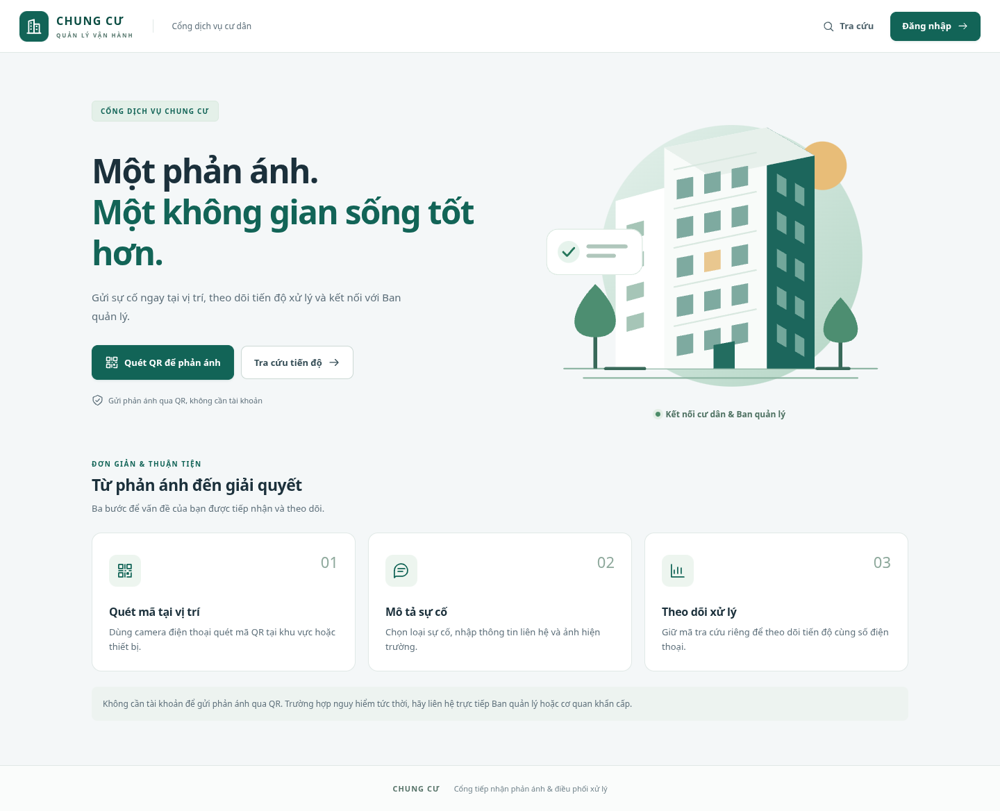
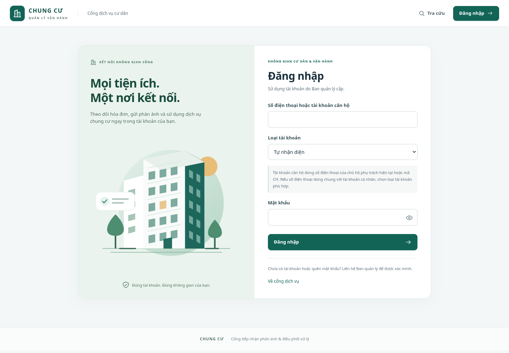
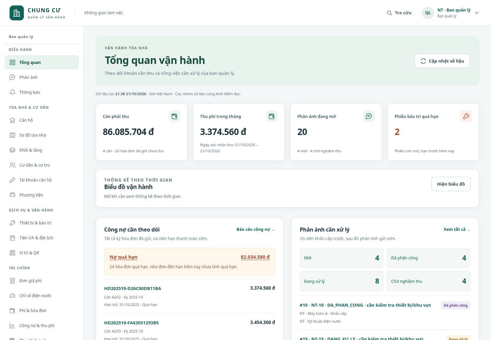
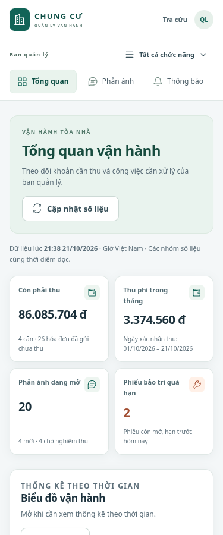
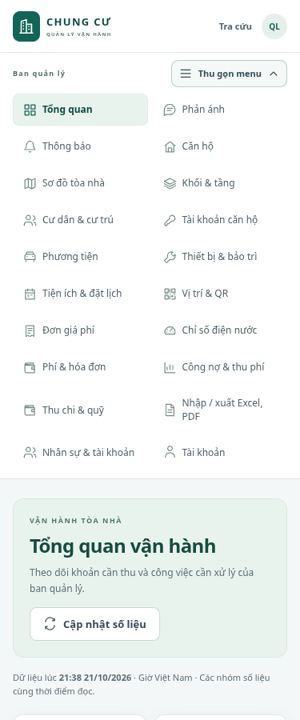
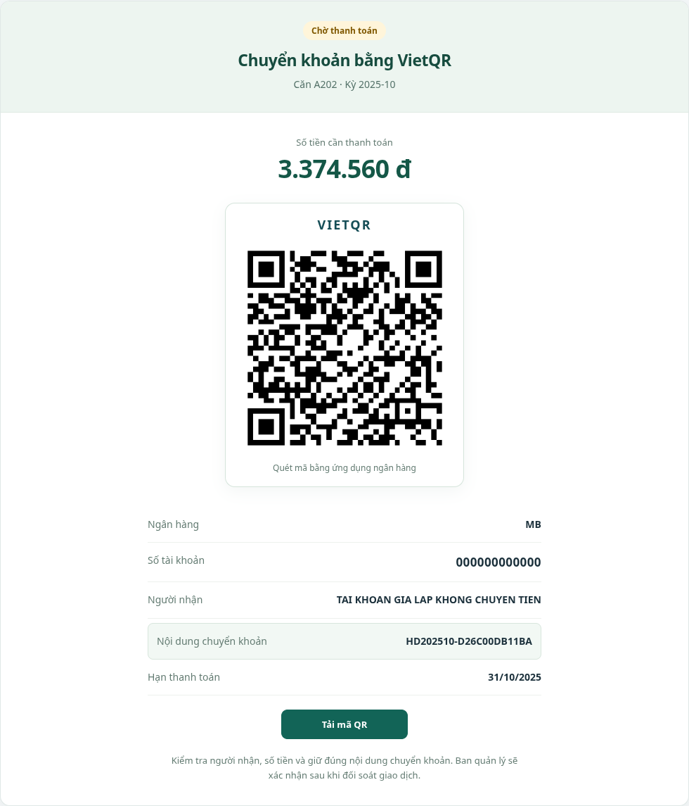

# Cải tiến toàn bộ giao diện — code đầy đủ từng file cho VS Code

Bản cập nhật giao diện dành cho dự án đã có các tính năng đến migration **018**. Áp dụng chung cho Ban quản lý, cư dân, tài khoản căn hộ và kỹ thuật viên. Database vẫn giữ 38 bảng; bản này chỉ sửa frontend, không thêm dependency.

## 1. Giao diện thay đổi những gì?

- Thanh đầu trang gọn, biểu tượng tòa nhà, ảnh đại diện bằng chữ và menu tài khoản.
- Menu BQL chia nhóm điều hành, tòa nhà/cư dân, dịch vụ, tài chính và quản trị. Trên điện thoại có thanh cuộn ngang và nút **Tất cả chức năng** để mở menu dạng lưới.
- Thống nhất kiểu chữ, bảng màu xanh/slate, thẻ nội dung, biểu mẫu, bảng dữ liệu, nút, bộ lọc, trạng thái và phần nhập/xuất báo cáo.
- Tổng quan có các thẻ số liệu rõ hơn; giữ lựa chọn hiện/ẩn và kiểu biểu đồ hiện tại.
- Khu vực VietQR nằm giữa, có phân cấp số tiền, mã QR và thông tin chuyển khoản.
- Cổng dịch vụ và đăng nhập có minh họa SVG cục bộ. Trang đăng nhập có nút hiện/ẩn mật khẩu.
- Hỗ trợ bàn phím, liên kết bỏ qua menu, phím Escape và chế độ giảm chuyển động.

Ảnh dưới đây chụp từ dữ liệu nghiệm thu giả lập trong workspace; dữ liệu hiển thị trên máy bạn phụ thuộc database đang mở.

### Cổng cư dân



### Đăng nhập



### Tổng quan Ban quản lý



### Điện thoại

| Tổng quan | Menu mở rộng |
| --- | --- |
|  |  |

### Thanh toán

Ảnh dùng tài khoản ngân hàng giả lập của bộ nghiệm thu.



## 2. Cách cập nhật trong VS Code

Mở thư mục gốc dự án của bạn:

```text
D:\DO_AN\chung-cu-starter-codex-auth-qr-incidents
```

1. Dừng terminal chạy **Vite/frontend** bằng `Ctrl+C` trong lúc chép file.
2. Tạo/thay đủ **13 file frontend** trong danh sách dưới đây. Mỗi mục có nguyên nội dung; chép từ đầu đến cuối khối code và lưu **UTF-8**.
3. Tạo đúng thư mục nếu chưa có, đặc biệt `frontend/public`. Các file `.jsx` thuộc frontend; giữ nguyên backend và các file CSS nghiệp vụ hiện có.
4. Chạy build, rồi mở lại frontend:

```powershell
npm run build
npm run dev:frontend:https
```

Lệnh HTTPS sử dụng cấu hình và chứng chỉ bạn đã tạo trước đó. Dùng địa chỉ HTTPS đang hoạt động trên máy bạn, ví dụ `https://192.168.1.208:5173`, và tải lại bằng `Ctrl+F5`. Backend tiếp tục chạy như trước; giữ lựa chọn database hiện tại. Nếu đang thử HTTP trên chính máy tính, có thể dùng `npm run dev:frontend` thay cho lệnh HTTPS.

CSS mới phải được import **sau** `global.css`, như file `main.jsx` bên dưới. Hãy chép đủ `Icon.jsx`, `BuildingArt.jsx`, `navigation.js` và `Layout.jsx` trước khi chạy frontend để các import có sẵn.

| File | Thao tác | Mục đích |
| --- | --- | --- |
| `frontend/src/shared/Icon.jsx` | Tạo mới | Bộ biểu tượng SVG dùng chung. |
| `frontend/src/shared/BuildingArt.jsx` | Tạo mới | Minh họa cho cổng dịch vụ và đăng nhập. |
| `frontend/src/app/navigation.js` | Thay toàn bộ | Danh mục menu theo nhóm và vai trò. |
| `frontend/src/app/Layout.jsx` | Tạo mới | Thanh đầu trang, menu, tài khoản và bố cục responsive. |
| `frontend/src/app/App.jsx` | Thay toàn bộ | Ghép bố cục mới vào đầy đủ route hiện có. |
| `frontend/src/styles/professional.css` | Tạo mới | Màu, chữ, khoảng cách và giao diện chung của các phân hệ. |
| `frontend/src/main.jsx` | Thay toàn bộ | Nạp CSS giao diện sau CSS hiện tại. |
| `frontend/src/features/auth/Auth.jsx` | Thay toàn bộ | Đăng nhập mới và nút hiện/ẩn mật khẩu. |
| `frontend/src/features/incidents/PublicReports.jsx` | Thay toàn bộ | Cổng cư dân mới, giữ luồng QR, ảnh và bản nháp. |
| `frontend/src/features/dashboard/Dashboard.jsx` | Thay toàn bộ | Các thẻ chỉ số và tiêu đề tổng quan. |
| `frontend/src/shared/ui.jsx` | Thay toàn bộ | Trạng thái tải dữ liệu dùng chung. |
| `frontend/public/favicon.svg` | Tạo mới | Biểu tượng tab trình duyệt. |
| `frontend/index.html` | Thay toàn bộ | Khai báo favicon và màu trình duyệt. |

## 3. Code đầy đủ 13 file frontend

### File 1: `frontend/src/shared/Icon.jsx`

**Tạo mới.**

```jsx
import React from "react";

const paths = {
  building: "M3 21h18M5 21V5l7-2v18M12 9h7v12M8 7v1m0 3v1m0 3v1m7-4h1m-1 4h1",
  dashboard: "M3 3h7v7H3zM14 3h7v7h-7zM3 14h7v7H3zM14 14h7v7h-7z",
  message:
    "M21 11.5a8.5 8.5 0 0 1-8.5 8.5H4l-2 2V11.5a9.5 9.5 0 0 1 19 0ZM7 9h10M7 13h7",
  home: "m3 10 9-7 9 7M5 9v12h14V9M9 21v-7h6v7",
  map: "m3 6 6-3 6 3 6-3v15l-6 3-6-3-6 3V6Zm6-3v15m6-12v15",
  layers: "m12 3 10 5-10 5L2 8l10-5ZM2 12l10 5 10-5M2 16l10 5 10-5",
  key: "M15 13a5 5 0 1 0-4-4L3 17v4h4v-3h3l5-5Z",
  users:
    "M16 21v-2a4 4 0 0 0-4-4H6a4 4 0 0 0-4 4v2m20 0v-2a4 4 0 0 0-3-3.9M9 11a4 4 0 1 0 0-8 4 4 0 0 0 0 8Zm8-7a4 4 0 0 1 0 8",
  car: "m5 7 2-4h10l2 4m-16 9V9l2-2h14l2 2v7H3Zm2 0v4m14-4v4M6 11h2m8 0h2",
  tool: "m14 6 4 4 3-3a7 7 0 0 1-9 9l-6 6-4-4 6-6a7 7 0 0 1 9-9l-3 3Z",
  calendar: "M4 5h16v16H4zM4 10h16M8 3v4m8-4v4M8 14h2m4 0h2m-8 3h2",
  receipt: "M5 3h14v19l-3-2-4 2-4-2-3 2V3Zm3 5h8m-8 4h8m-8 4h4",
  meter: "M4 18a9 9 0 1 1 16 0H4Zm8-5 4-5M7 9l1 1m9 4h1m-12 0h1m5-9v1",
  chart: "M3 3v18h18M7 16v-5m5 5V7m5 9v-8",
  wallet:
    "M20 8H5a2 2 0 0 1 0-4h13v4M3 6v13a2 2 0 0 0 2 2h15V8Zm17 5h-5v4h5m-2-2h.01",
  file: "M14 2H5v20h14V7l-5-5Zm0 0v6h5M8 12h8m-8 4h8",
  bell: "M18 8a6 6 0 0 0-12 0c0 7-3 7-3 9h18c0-2-3-2-3-9ZM10 21h4",
  qr: "M3 3h6v6H3zM15 3h6v6h-6zM3 15h6v6H3zM15 15h2v2h-2zM21 15v6h-6m-3-9h1M3 12h6m3-9v6m0 6v6m6-9h3",
  user: "M20 21v-2a6 6 0 0 0-6-6h-4a6 6 0 0 0-6 6v2M12 9a4 4 0 1 0 0-8 4 4 0 0 0 0 8Z",
  search: "M11 18a7 7 0 1 0 0-14 7 7 0 0 0 0 14Zm5-2 5 5",
  arrow: "M4 12h16m-6-6 6 6-6 6",
  external: "M14 3h7v7m0-7L10 14M10 3H3v18h18v-7",
  logout: "M9 3H3v18h6m-1-9h13m-5-5 5 5-5 5",
  menu: "M4 6h16M4 12h16M4 18h16",
  chevron: "m6 9 6 6 6-6",
  eye: "M2 12s4-7 10-7 10 7 10 7-4 7-10 7S2 12 2 12Zm10 3a3 3 0 1 0 0-6 3 3 0 0 0 0 6Z",
  eyeOff:
    "m3 3 18 18M9 5.5a11 11 0 0 1 3-.5c6 0 10 7 10 7a22 22 0 0 1-3 3.8M6 6.3A23 23 0 0 0 2 12s4 7 10 7a11 11 0 0 0 5-1.3M10 10a3 3 0 0 0 4 4",
  shield: "m12 2 9 4v6c0 5-9 10-9 10S3 17 3 12V6l9-4Zm-4 10 3 3 5-6",
  refresh:
    "M20 7V3m0 4h-4M4 17v4m0-4h4M4 9a8 8 0 0 1 14-5l2 3M4 17l2 3a8 8 0 0 0 14-5",
};

export default function Icon({ name, size = 20, className = "" }) {
  return (
    <svg
      className={`icon ${className}`}
      width={size}
      height={size}
      viewBox="0 0 24 24"
      fill="none"
      stroke="currentColor"
      strokeWidth="1.7"
      strokeLinecap="round"
      strokeLinejoin="round"
      aria-hidden="true"
      focusable="false"
    >
      <path d={paths[name] || paths.building} />
    </svg>
  );
}
```

### File 2: `frontend/src/shared/BuildingArt.jsx`

**Tạo mới.**

```jsx
import React, { useId } from "react";

// Minh họa trang trí bằng SVG, hoạt động cả khi không có kết nối Internet.
export default function BuildingArt() {
  const id = useId();
  return (
    <svg
      className="building-art"
      viewBox="0 0 480 400"
      fill="none"
      aria-hidden="true"
      focusable="false"
    >
      <defs>
        <linearGradient
          id={id}
          x1="100"
          y1="60"
          x2="400"
          y2="370"
          gradientUnits="userSpaceOnUse"
        >
          <stop stopColor="#e1efe9" />
          <stop offset="1" stopColor="#b5d6c6" />
        </linearGradient>
      </defs>
      <circle cx="254" cy="199" r="167" fill={`url(#${id})`} />
      <circle cx="370" cy="84" r="31" fill="#e8bd78" />
      <path
        d="M40 343h400M65 355h350"
        stroke="#8fb6a4"
        strokeWidth="2"
        strokeLinecap="round"
      />
      <path d="M106 343V129l126-34v248" fill="#fff" />
      <path d="m232 95 54 32v216h-54" fill="#c8dfd3" />
      <path d="M168 113V61l131-26v308H168" fill="#f8fbf9" />
      <path d="m299 35 61 36v272h-61" fill="#1c665c" />
      <path d="M168 61 299 35l61 36-132 27-60-37Z" fill="#e7f0eb" />
      <path
        d="m180 89 106-22M180 139l106-22M180 189l106-22M180 239l106-22M180 289l106-22"
        stroke="#d9e8e0"
        strokeWidth="2"
      />
      {[0, 1, 2, 3, 4].map((row) => (
        <g key={row}>
          {[0, 1, 2].map((column) => (
            <path
              key={column}
              d={`m${184 + column * 35} ${102 + row * 50 - column * 7} 21-4v25l-21 4v-25Z`}
              fill={row === 2 && column === 1 ? "#e9c78f" : "#7eaaa0"}
            />
          ))}
          {[0, 1].map((column) => (
            <path
              key={column}
              d={`m${312 + column * 23} ${94 + row * 48 + column * 12} 12 7v23l-12-7V${94 + row * 48 + column * 12}Z`}
              fill="#72a79b"
            />
          ))}
        </g>
      ))}
      <path d="M231 343v-30l27-5v35" fill="#236d60" />
      {[0, 1, 2, 3].map((row) => (
        <path
          key={row}
          d={`m120 ${160 + row * 39} 22-6v19l-22 6v-19Z`}
          fill="#a6c5b7"
        />
      ))}
      <path d="M80 343v-61m313 61v-48" stroke="#386959" strokeWidth="5" />
      <path
        d="M80 235c-34 35-37 68 0 68s33-36 0-68Zm313 17c-27 29-31 58 0 58s28-29 0-58Z"
        fill="#4d8e71"
      />
      <path
        d="M93 343h50m220 0h41"
        stroke="#386959"
        strokeWidth="4"
        strokeLinecap="round"
      />
      <rect
        x="18"
        y="165"
        width="122"
        height="58"
        rx="14"
        fill="white"
        stroke="#dbe9e1"
      />
      <circle cx="46" cy="194" r="14" fill="#e6f3ec" />
      <path
        d="m39 194 5 5 9-10"
        stroke="#25765b"
        strokeWidth="2.5"
        strokeLinecap="round"
        strokeLinejoin="round"
      />
      <path
        d="M71 187h48m-48 12h33"
        stroke="#b0c7bc"
        strokeWidth="5"
        strokeLinecap="round"
      />
    </svg>
  );
}
```

### File 3: `frontend/src/app/navigation.js`

**Thay toàn bộ.**

```javascript
// Nhãn, đường dẫn và nhóm menu. Phân quyền vẫn được kiểm tra tại route/API.
const account = {
  title: "Cá nhân",
  items: [["/tai-khoan", "Tài khoản", "user"]],
};
export const navigation = {
  QUAN_TRI_VIEN: [
    {
      title: "Điều hành",
      items: [
        ["/quan-tri", "Tổng quan", "dashboard"],
        ["/quan-tri/phan-anh", "Phản ánh", "message"],
        ["/quan-tri/thong-bao", "Thông báo", "bell"],
      ],
    },
    {
      title: "Tòa nhà & cư dân",
      items: [
        ["/quan-tri/can-ho", "Căn hộ", "home"],
        ["/quan-tri/so-do-toa-nha", "Sơ đồ tòa nhà", "map"],
        ["/quan-tri/cau-truc-toa-nha", "Khối & tầng", "layers"],
        ["/quan-tri/cu-dan", "Cư dân & cư trú", "users"],
        ["/quan-tri/tai-khoan-can-ho", "Tài khoản căn hộ", "key"],
        ["/quan-tri/phuong-tien", "Phương tiện", "car"],
      ],
    },
    {
      title: "Dịch vụ & vận hành",
      items: [
        ["/quan-tri/thiet-bi", "Thiết bị & bảo trì", "tool"],
        ["/quan-tri/tien-ich", "Tiện ích & đặt lịch", "calendar"],
        ["/quan-tri/vi-tri-qr", "Vị trí & QR", "qr"],
      ],
    },
    {
      title: "Tài chính",
      items: [
        ["/quan-tri/don-gia", "Đơn giá phí", "receipt"],
        ["/quan-tri/chi-so", "Chỉ số điện nước", "meter"],
        ["/quan-tri/hoa-don", "Phí & hóa đơn", "wallet"],
        ["/quan-tri/bao-cao-tai-chinh", "Công nợ & thu phí", "chart"],
        ["/quan-tri/quy", "Thu chi & quỹ", "wallet"],
      ],
    },
    {
      title: "Quản trị",
      items: [
        ["/quan-tri/nhap-xuat", "Nhập / xuất Excel, PDF", "file"],
        ["/quan-tri/nhan-su", "Nhân sự & tài khoản", "users"],
      ],
    },
    account,
  ],
  KY_THUAT_VIEN: [
    {
      title: "Nghiệp vụ kỹ thuật",
      items: [
        ["/ky-thuat/cong-viec", "Công việc", "message"],
        ["/ky-thuat/bao-tri", "Bảo trì thiết bị", "tool"],
      ],
    },
    account,
  ],
  CU_DAN: [
    {
      title: "Dịch vụ của bạn",
      items: [
        ["/cu-dan/phan-anh", "Phản ánh của tôi", "message"],
        ["/cu-dan/hoa-don", "Hóa đơn của tôi", "wallet"],
        ["/cu-dan/tien-ich", "Đặt lịch tiện ích", "calendar"],
        ["/cu-dan/thong-bao", "Thông báo", "bell"],
      ],
    },
    account,
  ],
};
```

### File 4: `frontend/src/app/Layout.jsx`

**Tạo mới.**

```jsx
import React, { useEffect, useRef, useState } from "react";
import { Link, NavLink, useLocation } from "react-router-dom";
import { useAuth } from "../features/auth/Auth.jsx";
import { useUnreadCount } from "../features/announcements/Announcements.jsx";
import { ErrorBox, homeFor, roleNames } from "../shared/ui.jsx";
import Icon from "../shared/Icon.jsx";
import { navigation } from "./navigation.js";

export default function Layout({ children }) {
  const { user, logout } = useAuth();
  const { pathname } = useLocation();
  const [error, setError] = useState();
  const [expanded, setExpanded] = useState(false);
  const menu = useRef(null);
  const profile = useRef(null);
  const unread = useUnreadCount(user, pathname);
  const workspace =
    !!user &&
    ["/quan-tri", "/ky-thuat", "/cu-dan", "/tai-khoan"].some((path) =>
      pathname.startsWith(path),
    );
  const groups = navigation[user?.vai_tro] || [];
  const initials =
    user?.ho_va_ten
      ?.trim()
      .split(/\s+/)
      .slice(-2)
      .map((word) => word[0])
      .join("") || "CC";

  useEffect(() => {
    const closeProfile = (event) => {
      if (profile.current && !profile.current.contains(event.target))
        profile.current.open = false;
    };
    document.addEventListener("pointerdown", closeProfile);
    return () => document.removeEventListener("pointerdown", closeProfile);
  }, []);

  useEffect(() => {
    setExpanded(false);
    if (profile.current) profile.current.open = false;
    window.scrollTo({ top: 0, left: 0, behavior: "instant" });
    const nav = menu.current;
    const active = nav?.querySelector('[aria-current="page"]');
    // Chỉ cuộn thanh menu ngang; không làm trang nội dung nhảy vị trí.
    if (nav && active && window.matchMedia("(max-width: 900px)").matches) {
      nav.scrollLeft = Math.max(0, active.offsetLeft - nav.offsetLeft - 16);
    }
  }, [pathname, user?.vai_tro]);

  return (
    <div className={`app-shell ${workspace ? "is-workspace" : "is-public"}`}>
      <a className="skip-link" href="#main-content">
        Đến nội dung chính
      </a>
      <header className="topbar">
        <Link to="/" className="brand">
          <span className="brand-icon">
            <Icon name="building" size={26} />
          </span>
          <span>
            CHUNG CƯ<small>QUẢN LÝ VẬN HÀNH</small>
          </span>
        </Link>
        <span className="topbar-context">
          {workspace ? "Không gian làm việc" : "Cổng dịch vụ cư dân"}
        </span>
        <div className="top-links">
          <Link className="lookup-link" to="/tra-cuu">
            <Icon name="search" size={18} />
            Tra cứu
          </Link>
          {user ? (
            <details
              className="profile-menu"
              ref={profile}
              onKeyDown={(event) => {
                if (event.key === "Escape") {
                  profile.current.open = false;
                  profile.current.querySelector("summary").focus();
                }
              }}
            >
              <summary aria-label={`Tùy chọn tài khoản ${user.ho_va_ten}`}>
                <span className="avatar" aria-hidden="true">
                  {initials}
                </span>
                <span className="profile-name">
                  {user.ho_va_ten}
                  <small>{roleNames[user.vai_tro]}</small>
                </span>
                <Icon name="chevron" size={16} />
              </summary>
              <div className="profile-dropdown">
                <p>
                  {user.ho_va_ten}
                  <small>{roleNames[user.vai_tro]}</small>
                </p>
                <Link to={homeFor(user)}>
                  <Icon name="dashboard" />
                  Không gian của tôi
                </Link>
                <Link to="/tai-khoan">
                  <Icon name="user" />
                  Cài đặt tài khoản
                </Link>
                <button type="button" onClick={() => logout().catch(setError)}>
                  <Icon name="logout" />
                  Đăng xuất
                </button>
              </div>
            </details>
          ) : (
            <Link className="button primary" to="/dang-nhap">
              Đăng nhập
              <Icon name="arrow" size={17} />
            </Link>
          )}
        </div>
      </header>
      <ErrorBox error={error} />
      <div className={workspace ? "workspace" : "public-space"}>
        {workspace && (
          <aside className={`sidebar${expanded ? " is-expanded" : ""}`}>
            <div className="sidebar-heading">
              <span className="eyebrow">{roleNames[user.vai_tro]}</span>
              <button
                className="mobile-menu-toggle"
                type="button"
                aria-controls="workspace-navigation"
                aria-expanded={expanded}
                onClick={() => setExpanded((value) => !value)}
              >
                <Icon name="menu" size={18} />
                {expanded ? "Thu gọn menu" : "Tất cả chức năng"}
                <Icon name="chevron" size={16} />
              </button>
            </div>
            <nav
              id="workspace-navigation"
              aria-label="Chức năng"
              ref={menu}
              onKeyDown={(event) => {
                if (event.key === "Escape" && expanded) {
                  setExpanded(false);
                  menu.current.previousElementSibling
                    .querySelector("button")
                    .focus();
                }
              }}
            >
              {groups.map((group) => (
                <div className="nav-group" key={group.title}>
                  <p className="nav-group-label">{group.title}</p>
                  {group.items.map(([path, label, icon]) => (
                    <NavLink
                      key={path}
                      end={path === "/quan-tri"}
                      to={path}
                      onClick={() => setExpanded(false)}
                    >
                      <Icon name={icon} size={19} />
                      <span>{label}</span>
                      {path === "/cu-dan/thong-bao" && unread > 0 && (
                        <span
                          className="notification-count"
                          aria-label={`${unread} chưa đọc`}
                        >
                          {unread > 99 ? "99+" : unread}
                        </span>
                      )}
                    </NavLink>
                  ))}
                </div>
              ))}
            </nav>
            <Link className="public-link" to="/">
              <Icon name="external" size={17} />
              Cổng dịch vụ<span aria-hidden="true">↗</span>
            </Link>
          </aside>
        )}
        <main id="main-content" tabIndex={-1} key={pathname}>
          {children}
        </main>
      </div>
      <footer>
        <span className="footer-brand">CHUNG CƯ</span>
        <span>Cổng tiếp nhận phản ánh & điều phối xử lý</span>
      </footer>
    </div>
  );
}
```

### File 5: `frontend/src/app/App.jsx`

**Thay toàn bộ.**

```jsx
import React from "react";
import {
  BrowserRouter,
  Link,
  Route,
  Routes,
  useLocation,
} from "react-router-dom";
import {
  AuthProvider,
  Protected,
  Login,
  Account,
} from "../features/auth/Auth.jsx";
import {
  Announcements,
  AnnouncementDetail,
} from "../features/announcements/Announcements.jsx";
import FinancialReports from "../features/financial-reports/FinancialReports.jsx";
import DataExchange from "../features/data-exchange/DataExchange.jsx";
import Dashboard from "../features/dashboard/Dashboard.jsx";
import {
  EquipmentList,
  EquipmentDetail,
  MaintenanceList,
  MaintenanceDetail,
} from "../features/maintenance/Maintenance.jsx";
import {
  Amenities,
  AmenityDetail,
  Bookings,
  BookingDetail,
} from "../features/amenities/Amenities.jsx";
import {
  Funds,
  FundDetail,
  Vouchers,
  VoucherNew,
  VoucherDetail,
} from "../features/treasury/Treasury.jsx";
import Users from "../features/auth/Users.jsx";
import ApartmentAccounts from "../features/residency/ApartmentAccounts.jsx";
import BuildingMap from "../features/residency/BuildingMap.jsx";
import BuildingStructure from "../features/residency/BuildingStructure.jsx";
import {
  Portal,
  Scanner,
  SubmitReport,
  LookupReport,
} from "../features/incidents/PublicReports.jsx";
import { ReportDetail, ReportList } from "../features/incidents/Reports.jsx";
import Locations from "../features/qr/Locations.jsx";
import Vehicles from "../features/vehicles/Vehicles.jsx";
import {
  Rates,
  Meters,
  Bills,
  BillDetail,
} from "../features/billing/Billing.jsx";
import {
  Apartments,
  Residents,
  ResidentDetail,
} from "../features/residency/Residency.jsx";
import Layout from "./Layout.jsx";
const admin = ["QUAN_TRI_VIEN"],
  technician = ["KY_THUAT_VIEN"],
  resident = ["CU_DAN"];
function Shell() {
  const location = useLocation();
  return (
    <Layout>
      <Routes>
        <Route path="/" element={<Portal />} />
        <Route path="/dang-nhap" element={<Login />} />
        <Route path="/quet-qr" element={<Scanner />} />
        <Route path="/r/:token" element={<SubmitReport />} />
        <Route
          path="/tra-cuu"
          element={<LookupReport initialCode={location.state?.code} />}
        />
        <Route
          path="/tai-khoan"
          element={
            <Protected>
              <Account />
            </Protected>
          }
        />
        <Route
          path="/quan-tri"
          element={
            <Protected roles={admin}>
              <Dashboard />
            </Protected>
          }
        />
        <Route
          path="/quan-tri/vi-tri-qr"
          element={
            <Protected roles={admin}>
              <Locations />
            </Protected>
          }
        />
        <Route
          path="/quan-tri/nhan-su"
          element={
            <Protected roles={admin}>
              <Users />
            </Protected>
          }
        />
        {[
          ["/quan-tri/can-ho", <Apartments />],
          ["/quan-tri/so-do-toa-nha", <BuildingMap />],
          ["/quan-tri/cau-truc-toa-nha", <BuildingStructure />],
          ["/quan-tri/tai-khoan-can-ho", <ApartmentAccounts />],
          ["/quan-tri/cu-dan", <Residents />],
          ["/quan-tri/cu-dan/:id", <ResidentDetail />],
          ["/quan-tri/phuong-tien", <Vehicles />],
          ["/quan-tri/quy", <Funds />],
          ["/quan-tri/quy/:id", <FundDetail />],
          ["/quan-tri/phieu-thu-chi", <Vouchers />],
          ["/quan-tri/phieu-thu-chi/moi", <VoucherNew />],
          ["/quan-tri/phieu-thu-chi/:id", <VoucherDetail />],
          ["/quan-tri/tien-ich", <Amenities />],
          ["/quan-tri/tien-ich/:id", <AmenityDetail />],
          ["/quan-tri/dat-lich", <Bookings />],
          ["/quan-tri/dat-lich/:id", <BookingDetail />],
          ["/quan-tri/thiet-bi", <EquipmentList />],
          ["/quan-tri/thiet-bi/:id", <EquipmentDetail />],
          ["/quan-tri/bao-tri", <MaintenanceList />],
          ["/quan-tri/bao-tri/:id", <MaintenanceDetail />],
          ["/quan-tri/don-gia", <Rates />],
          ["/quan-tri/chi-so", <Meters />],
          ["/quan-tri/hoa-don", <Bills />],
          ["/quan-tri/hoa-don/:id", <BillDetail />],
          ["/quan-tri/bao-cao-tai-chinh", <FinancialReports />],
          ["/quan-tri/nhap-xuat", <DataExchange />],
          ["/quan-tri/thong-bao", <Announcements />],
          ["/quan-tri/thong-bao/:id", <AnnouncementDetail />],
        ].map(([path, element]) => (
          <Route
            key={path}
            path={path}
            element={<Protected roles={admin}>{element}</Protected>}
          />
        ))}
        {[
          ["/quan-tri/phan-anh", admin],
          ["/ky-thuat/cong-viec", technician],
          ["/cu-dan/phan-anh", resident],
        ].map(([base, roles]) => (
          <React.Fragment key={base}>
            <Route
              path={base}
              element={
                <Protected roles={roles}>
                  <ReportList />
                </Protected>
              }
            />
            <Route
              path={`${base}/:id`}
              element={
                <Protected roles={roles}>
                  <ReportDetail />
                </Protected>
              }
            />
          </React.Fragment>
        ))}
        {[
          ["/cu-dan/tien-ich", <Amenities />],
          ["/cu-dan/tien-ich/:id", <AmenityDetail />],
          ["/cu-dan/dat-lich", <Bookings />],
          ["/cu-dan/dat-lich/:id", <BookingDetail />],
        ].map(([path, element]) => (
          <Route
            key={path}
            path={path}
            element={<Protected roles={resident}>{element}</Protected>}
          />
        ))}
        {["/ky-thuat/bao-tri", "/ky-thuat/bao-tri/:id"].map((path) => (
          <Route
            key={path}
            path={path}
            element={
              <Protected roles={technician}>
                {path.endsWith(":id") ? (
                  <MaintenanceDetail />
                ) : (
                  <MaintenanceList />
                )}
              </Protected>
            }
          />
        ))}
        {[
          "/cu-dan/hoa-don",
          "/cu-dan/hoa-don/:id",
          "/cu-dan/thong-bao",
          "/cu-dan/thong-bao/:id",
        ].map((path) => (
          <Route
            key={path}
            path={path}
            element={
              <Protected roles={resident}>
                {path.includes("thong-bao") ? (
                  path.endsWith(":id") ? (
                    <AnnouncementDetail />
                  ) : (
                    <Announcements />
                  )
                ) : path.endsWith(":id") ? (
                  <BillDetail />
                ) : (
                  <Bills />
                )}
              </Protected>
            }
          />
        ))}
        <Route
          path="*"
          element={
            <section className="card">
              <h1>Không tìm thấy trang</h1>
              <Link to="/">Về cổng dịch vụ</Link>
            </section>
          }
        />
      </Routes>
    </Layout>
  );
}
export default function App() {
  return (
    <BrowserRouter>
      <AuthProvider>
        <Shell />
      </AuthProvider>
    </BrowserRouter>
  );
}
```

### File 6: `frontend/src/styles/professional.css`

**Tạo mới.**

```css
/* Lớp giao diện chung, nạp sau CSS nghiệp vụ để giữ nguyên chức năng từng màn hình. */
:root {
  --ink: #1b303b;
  --muted: #5c6e79;
  --brand: #126457;
  --brand-deep: #0b4d43;
  --brand-soft: #eaf4ef;
  --line: #e0e8e6;
  --canvas: #f4f7f8;
  --surface: #fff;
  --shadow: 0 3px 16px #213d3910;
  font-family:
    "Segoe UI",
    system-ui,
    -apple-system,
    BlinkMacSystemFont,
    sans-serif;
  color: var(--ink);
  background: var(--canvas);
  font-size: 14px;
  line-height: 1.6;
  -webkit-font-smoothing: antialiased;
}
body {
  min-width: 320px;
}
::selection {
  background: #c9e6d9;
  color: #133e35;
}
a {
  color: var(--brand);
}
.icon {
  display: inline-block;
  flex: 0 0 auto;
  vertical-align: middle;
}
button,
.button {
  min-height: 42px;
  padding: 10px 16px;
  border: 1px solid #cbd8d4;
  border-radius: 9px;
  color: #354d56;
  font-size: 13px;
  font-weight: 600;
  transition:
    background 0.16s,
    border-color 0.16s,
    box-shadow 0.16s;
}
button:hover:not(:disabled),
.button:hover {
  background: #f0f6f3;
  border-color: #9fbeb1;
}
button:disabled,
.button[aria-disabled="true"] {
  opacity: 0.55;
}
.primary {
  color: white;
  background: var(--brand);
  border-color: var(--brand);
  box-shadow: 0 2px 3px #12594d14;
}
.primary:hover:not(:disabled),
.button.primary:hover {
  background: var(--brand-deep);
  color: white;
  border-color: var(--brand-deep);
}
.danger {
  background: #fff5f4;
  color: #a33335;
  border-color: #edccca;
}
:focus-visible {
  outline: 3px solid #368a75;
  outline-offset: 3px;
}
button:active:not(:disabled),
.button:active {
  transform: translateY(1px);
}
input,
select,
textarea {
  font-size: 14px;
  color: var(--ink);
  border: 1px solid #cbd8d4;
  border-radius: 8px;
  padding: 11px 12px;
  min-height: 44px;
  background: white;
}
input::placeholder,
textarea::placeholder {
  color: #7b8b94;
  opacity: 1;
}
input:focus,
select:focus,
textarea:focus {
  border-color: var(--brand);
  box-shadow: 0 0 0 3px #1264570d;
}
input:disabled,
select:disabled,
textarea:disabled,
input[readonly] {
  background: #f4f7f6;
  color: #5a6d75;
}
input[type="checkbox"],
input[type="radio"] {
  accent-color: var(--brand);
  flex-shrink: 0;
}
input[type="file"] {
  padding: 8px;
  background: #f8faf9;
  font-size: 13px;
}
input[type="file"]::file-selector-button {
  border: 1px solid var(--line);
  padding: 8px 12px;
  margin-right: 10px;
  border-radius: 6px;
  background: white;
  color: var(--brand);
  font-weight: 600;
  cursor: pointer;
}
textarea {
  min-height: 112px;
}
.field {
  gap: 7px;
  margin-bottom: 18px;
  min-width: 0;
}
.field > label {
  color: #374f58;
  font-size: 13px;
  font-weight: 600;
}
.form-grid {
  gap: 0 20px;
}
form {
  min-width: 0;
}
h1,
h2,
h3 {
  color: var(--ink);
  line-height: 1.3;
  letter-spacing: -0.02em;
}
h1 {
  font-size: clamp(24px, 2.2vw, 30px);
  font-weight: 700;
  margin: 0 0 22px;
}
h2 {
  font-size: 18px;
  font-weight: 650;
}
h3 {
  font-size: 15px;
}
.muted,
.note {
  color: var(--muted);
}
.note {
  font-size: 12px;
  line-height: 1.75;
}
.eyebrow {
  color: var(--brand);
  font-size: 10px;
  letter-spacing: 1.5px;
  font-weight: 750;
  margin: 0 0 8px;
}
.app-shell {
  min-height: 100vh;
}
.skip-link {
  position: fixed;
  top: -100px;
  left: 16px;
  padding: 12px 18px;
  background: var(--brand-deep);
  color: white;
  border-radius: 8px;
  z-index: 100;
}
.skip-link:focus {
  top: 12px;
}
.topbar {
  height: 76px;
  padding: 0 28px;
  gap: 28px;
  position: relative;
  z-index: 30;
  border-bottom: 1px solid var(--line);
  background: white;
}
.brand {
  gap: 11px;
  font-size: 16px;
  letter-spacing: 1.3px;
  color: var(--brand-deep);
  flex-shrink: 0;
}
.brand-icon {
  width: 42px;
  height: 44px;
  padding: 0;
  display: grid;
  place-items: center;
  border-radius: 11px;
  background: var(--brand);
  color: white;
}
.brand small {
  font-size: 8px;
  letter-spacing: 1.9px;
  margin-top: 3px;
  color: #58796f;
}
.topbar-context {
  font-size: 12px;
  color: var(--muted);
  padding-left: 26px;
  border-left: 1px solid var(--line);
  margin-right: auto;
}
.top-links {
  display: flex;
  align-items: center;
  gap: 24px;
  font-size: 13px;
}
.top-links .lookup-link {
  display: inline-flex;
  align-items: center;
  gap: 7px;
  text-decoration: none;
  font-weight: 600;
  color: #4d626b;
  min-height: 44px;
}
.top-links .lookup-link:hover {
  color: var(--brand);
}
.profile-menu {
  position: relative;
}
.profile-menu summary {
  display: flex;
  list-style: none;
  align-items: center;
  gap: 10px;
  cursor: pointer;
  border-radius: 9px;
  padding: 6px;
}
.profile-menu summary::-webkit-details-marker {
  display: none;
}
.profile-menu summary:hover {
  background: var(--brand-soft);
}
.avatar {
  text-transform: uppercase;
  width: 36px;
  height: 36px;
  display: grid;
  place-items: center;
  border-radius: 50%;
  background: #e6f0ea;
  color: var(--brand);
  font-size: 12px;
  font-weight: 750;
}
.profile-name {
  font-size: 12px;
  font-weight: 650;
  max-width: 200px;
  overflow: hidden;
  text-overflow: ellipsis;
  white-space: nowrap;
}
.profile-name small {
  display: block;
  font-size: 10px;
  font-weight: 400;
  color: var(--muted);
}
.profile-dropdown {
  position: absolute;
  right: 0;
  top: calc(100% + 10px);
  width: 260px;
  background: white;
  border: 1px solid var(--line);
  padding: 8px;
  box-shadow: 0 14px 40px #1b303b24;
  border-radius: 12px;
}
.profile-dropdown p {
  padding: 8px 10px 14px;
  margin: 0 0 6px;
  border-bottom: 1px solid var(--line);
  font-weight: 650;
  overflow-wrap: anywhere;
}
.profile-dropdown p small {
  display: block;
  color: var(--muted);
  font-weight: 400;
  font-size: 12px;
}
.profile-dropdown a,
.profile-dropdown button {
  width: 100%;
  display: flex;
  justify-content: start;
  align-items: center;
  gap: 10px;
  text-decoration: none;
  border: 0;
  padding: 10px;
  color: var(--ink);
  border-radius: 7px;
}
.profile-dropdown a:hover {
  background: var(--brand-soft);
}
.profile-dropdown button {
  color: #a33335;
}
.workspace {
  display: grid;
  grid-template-columns: 246px minmax(0, 1fr);
  max-width: 1920px;
  margin: 0 auto;
  align-items: start;
}
.sidebar {
  position: sticky;
  top: 0;
  height: 100dvh;
  max-height: 100dvh;
  overflow-y: auto;
  overscroll-behavior: contain;
  scrollbar-width: thin;
  scrollbar-color: #c5d5ce transparent;
  padding: 24px 14px 18px;
  border-right: 1px solid var(--line);
  background: white;
}
.sidebar-heading {
  padding: 0 12px 13px;
  margin-bottom: 8px;
  border-bottom: 1px solid var(--line);
}
.sidebar-heading .eyebrow {
  display: block;
  font-size: 10px;
  letter-spacing: 1.2px;
  color: #546e64;
  margin: 0;
}
.mobile-menu-toggle {
  display: none;
}
.sidebar nav {
  display: flex;
  flex-direction: column;
  gap: 16px;
}
.nav-group {
  display: flex;
  flex-direction: column;
  gap: 3px;
}
.nav-group-label {
  font-size: 10px;
  text-transform: uppercase;
  letter-spacing: 1.2px;
  font-weight: 650;
  color: #667c76;
  padding: 0 12px;
  margin: 0 0 6px;
}
.sidebar nav a {
  display: flex;
  align-items: center;
  gap: 11px;
  padding: 10px 12px;
  min-height: 40px;
  color: #50616b;
  border-radius: 8px;
  text-decoration: none;
  font-size: 12px;
  font-weight: 500;
  line-height: 1.45;
  border: 1px solid transparent;
}
.sidebar nav a .icon {
  color: #789087;
}
.sidebar nav a:hover {
  color: var(--brand);
  background: #f3f8f5;
}
.sidebar nav a.active {
  background: #e9f3ed;
  color: var(--brand-deep);
  border-color: #dfede5;
  font-weight: 700;
}
.sidebar nav a.active .icon {
  color: var(--brand);
}
.sidebar .public-link {
  display: flex;
  gap: 10px;
  align-items: center;
  padding: 15px 12px 0;
  border-top: 1px solid var(--line);
  margin-top: 22px;
  font-size: 12px;
  color: var(--muted);
  text-decoration: none;
}
.public-link > span:last-child {
  margin-left: auto;
}
.notification-count {
  display: inline-grid;
  place-items: center;
  min-width: 20px;
  height: 20px;
  margin-left: auto;
  background: var(--brand);
  color: white;
  font-size: 10px;
  border-radius: 6px;
  padding: 0 5px;
}
.workspace main {
  padding: 32px clamp(20px, 2.4vw, 40px) 48px;
  min-width: 0;
  min-height: calc(100vh - 76px);
}
main:focus {
  outline: none;
}
.public-space {
  max-width: 1240px;
  margin: 0 auto;
  padding: 40px 32px;
  min-height: calc(100vh - 150px);
}
.page-heading {
  align-items: center;
  gap: 18px;
  margin-bottom: 26px;
}
.page-heading h1 {
  margin-bottom: 0;
}
.page-heading .muted {
  margin-bottom: 0;
  margin-top: 9px;
  max-width: 750px;
  font-size: 13px;
}
.page-heading > .actions {
  margin: 0;
}
.card {
  background: white;
  padding: 24px;
  margin-bottom: 22px;
  border: 1px solid var(--line);
  border-radius: 14px;
  box-shadow: var(--shadow);
  min-width: 0;
}
.card > h2:first-child {
  margin-top: 0;
}
.card .card {
  box-shadow: none;
  border-color: #e6edeb;
  border-radius: 10px;
}
.detail-grid {
  align-items: start;
}
.narrow {
  max-width: 720px;
}
.actions {
  gap: 10px;
  flex-wrap: wrap;
}
.filters {
  gap: 12px 16px;
  padding-bottom: 16px;
  border-bottom: 1px solid var(--line);
  margin-bottom: 18px;
  align-items: end;
}
.filters .field {
  margin-bottom: 0;
}
.table-wrap {
  border: 1px solid var(--line);
  border-radius: 10px;
  overflow: auto;
  scrollbar-width: thin;
  scrollbar-color: #bdcfc6 #f4f7f5;
  overscroll-behavior-x: contain;
}
table {
  font-size: 13px;
  background: white;
}
th {
  font-size: 11px;
  font-weight: 650;
  color: #5a7079;
  background: #f5f8f8;
  letter-spacing: 0.15px;
  white-space: nowrap;
}
th,
td {
  padding: 14px 16px;
  border-bottom-color: #eaf0ed;
}
td {
  color: #3f5661;
  vertical-align: middle;
}
td:first-child {
  min-width: 140px;
}
td:last-child {
  color: #566f76;
}
td a:not(.button) {
  font-weight: 600;
  text-decoration: none;
}
td a:not(.button):hover {
  text-decoration: underline;
}
tbody tr:last-child td {
  border-bottom: 0;
}
tbody tr:hover {
  background: #f8fbf9;
}
td .button,
td button {
  min-height: 36px;
  padding: 7px 11px;
  font-size: 12px;
}
.pagination {
  padding-top: 18px;
  font-size: 12px;
  gap: 10px;
  flex-wrap: wrap;
}
.pagination button {
  min-height: 38px;
  font-size: 12px;
}
.badge {
  padding: 4px 9px;
  font-weight: 650;
  font-size: 10px;
  border-radius: 6px;
  white-space: nowrap;
  letter-spacing: 0.1px;
}
.status-MOI {
  color: #296794;
  background: #eaf3fc;
}
.status-DA_PHAN_CONG {
  color: #5d4c91;
  background: #f0ecfa;
}
.status-DANG_XU_LY {
  color: #98621e;
  background: #fff4de;
}
.status-DA_XU_LY {
  color: #146b62;
  background: #e2f3ee;
}
.status-DA_DONG {
  color: #396550;
  background: #eaf2ec;
}
.status-TU_CHOI {
  color: #a34543;
  background: #fceeee;
}
.error {
  border: 1px solid #f0d1cb;
  border-left: 3px solid #c95c4a;
  background: #fff6f3;
  color: #9b382e;
  font-size: 13px;
  border-radius: 9px;
  padding: 14px 16px;
  overflow-wrap: anywhere;
}
.error strong {
  font-weight: 600;
}
.success {
  padding: 14px 16px;
  border: 1px solid #b9dbc8;
  border-left: 3px solid #29845c;
  border-radius: 9px;
  color: #246446;
  background: #eff9f1;
}
.empty,
.overview-empty,
.trend-empty {
  background: #f7faf8;
  padding: 24px 18px;
  border: 1px dashed #d1dfd8;
  border-radius: 10px;
  color: var(--muted);
}
.loading-state {
  display: flex;
  align-items: center;
  justify-content: center;
  gap: 12px;
  min-height: 130px;
  font-size: 13px;
}
.loading-spinner {
  width: 22px;
  height: 22px;
  border: 2px solid #d9e8e0;
  border-top-color: var(--brand);
  border-radius: 50%;
  animation: loading-turn 0.8s linear infinite;
}
@keyframes loading-turn {
  to {
    transform: rotate(360deg);
  }
}
.metadata {
  gap: 14px 20px;
  font-size: 13px;
}
.metadata dt {
  color: var(--muted);
}
.timeline {
  border-left-color: #dbe8e1;
}
.timeline li {
  padding-bottom: 24px;
}
.timeline time {
  font-size: 11px;
  color: var(--muted);
}
.image-grid img {
  border-radius: 9px;
  border: 1px solid var(--line);
  object-fit: cover;
}
details > summary {
  cursor: pointer;
  color: var(--brand);
  font-weight: 600;
  padding: 8px 0;
}
.location-list li {
  border-bottom-color: var(--line);
  padding: 18px 0;
}
.stats,
.finance-stats,
.maintenance-stats,
.treasury-metrics {
  gap: 14px;
}
.stats .stat {
  border: 1px solid var(--line);
  background: white;
  border-radius: 12px;
  padding: 20px;
  box-shadow: var(--shadow);
}
.stats .stat strong {
  color: var(--ink);
  font-size: 32px;
}
.overview-page > .page-heading {
  padding: 24px 26px;
  background: #e9f3ee;
  border: 1px solid #dbe9e0;
  border-radius: 14px;
  margin-bottom: 16px;
}
.overview-page > .page-heading .eyebrow {
  color: #53796a;
}
.overview-page > .page-heading h1 {
  color: #174b3e;
}
.overview-page > .page-heading button {
  background: white;
  flex-shrink: 0;
}
.overview-stamp {
  font-size: 11px;
  margin: 0 0 20px;
  color: var(--muted);
}
.overview-metrics {
  gap: 16px;
}
.overview-metric {
  padding: 20px;
  border: 1px solid var(--line);
  border-radius: 12px;
  gap: 12px;
  box-shadow: var(--shadow);
  background: white;
  position: relative;
}
.overview-metric:hover {
  background: white;
  border-color: #94bba9;
  box-shadow: 0 5px 18px #125e5014;
}
.overview-metric > .metric-label {
  color: #526a72;
  display: flex;
  align-items: center;
  justify-content: space-between;
  gap: 8px;
  font-size: 12px;
}
.metric-icon {
  display: grid;
  place-items: center;
  width: 34px;
  height: 34px;
  background: #edf5f0;
  color: var(--brand);
  border-radius: 9px;
  flex: 0 0 auto;
}
.overview-metric > strong {
  font-size: clamp(22px, 1.8vw, 29px);
  font-weight: 700;
  letter-spacing: -0.6px;
  color: var(--ink);
}
.overview-metric > small {
  font-size: 11px;
  color: var(--muted);
}
.overview-alert .metric-icon {
  color: #ab5336;
  background: #fff0e7;
}
.overview-alert > strong {
  color: #a24e32;
}
.overview-panel-heading h2 {
  font-size: 16px;
}
.overview-panel-heading p,
.overview-panel-heading > a {
  font-size: 12px;
}
.overview-panel-heading > a {
  text-decoration: none;
}
.overview-mini {
  background: #f3f7f5;
  border: 1px solid #e8efea;
  border-radius: 8px;
  padding: 12px;
}
.overview-mini > span {
  font-size: 12px;
}
.overview-mini > strong {
  font-size: 21px;
}
.overview-queue a {
  font-size: 13px;
  text-decoration: none;
}
.overview-queue small {
  font-size: 11px;
  color: var(--muted);
}
.overview-debt {
  background: #fff7eb;
  border: 1px solid #f3e6d0;
  border-radius: 9px;
}
.trends {
  padding: 22px 24px;
  border: 1px solid var(--line);
  border-radius: 14px;
  background: white;
  box-shadow: var(--shadow);
}
.trends-heading h2 {
  font-size: 17px;
}
.trends-heading p {
  font-size: 12px;
  color: var(--muted);
  margin-bottom: 0;
}
.trends-filters {
  background: #f6f9f7;
  box-shadow: none;
  margin-top: 20px;
  border-color: var(--line);
}
.trends-visibility {
  background: #fafcfb;
  border-color: var(--line);
}
.trends-grid {
  gap: 16px;
}
.trend-card {
  box-shadow: none;
  border-radius: 10px;
  padding: 20px;
}
.trend-card h3 {
  font-size: 15px;
}
.trend-detail {
  background: #edf5f0;
}
.report-tabs,
.finance-tabs,
.maintenance-tabs,
.treasury-tabs {
  gap: 8px;
  flex-wrap: wrap;
}
.report-export {
  padding: 14px 16px;
  border: 1px solid #e3ece7;
  background: #f6f9f7;
  border-radius: 9px;
  gap: 10px;
}
.data-tools {
  gap: 12px;
}
.data-tools .button,
.report-export button {
  min-height: 36px;
  padding: 7px 12px;
  font-size: 12px;
}
.report-export small {
  font-size: 11px;
  color: var(--muted);
}
.import-help {
  background: #f2f7f4;
  border-radius: 10px;
  border: 1px solid var(--line);
}
.import-steps {
  font-size: 13px;
  gap: 12px 20px;
  color: var(--brand);
}
.maintenance-actions,
.treasury-actions {
  gap: 16px;
}
.amenity-card,
.fund-card,
.treasury-fund {
  border-color: var(--line);
  border-radius: 12px;
  box-shadow: var(--shadow);
}
.amenity-card h2,
.fund-card h2 {
  font-size: 17px;
}
.amenity-slot {
  border-radius: 8px;
}
.payment-card {
  padding: 0;
  max-width: 980px;
  margin: 24px auto;
  overflow: hidden;
}
.payment-header {
  text-align: center;
  padding: 28px;
  background: #edf5f0;
  border-bottom: 1px solid #dfeae3;
}
.payment-header h2 {
  font-size: 23px;
  color: #174c3f;
}
.payment-body {
  max-width: 720px;
  padding: 32px;
}
.payment-amount {
  color: #145747;
  letter-spacing: -0.7px;
}
.payment-qr-frame {
  border-radius: 14px;
  border-color: #d5e4db;
  box-shadow: 0 6px 22px #1a4d3a0d;
}
.payment-details > div {
  padding: 14px 0;
}
.payment-download {
  background: var(--brand);
  color: white;
  border-color: var(--brand);
}
.payment-download:hover {
  color: var(--brand);
}
.bank-picker {
  background: #f5f9f6;
  border-color: #dbe8df;
  border-radius: 10px;
}
.bill-total {
  padding-top: 18px;
  color: #164e40;
}
.qr-print {
  padding: 28px;
}
.qr-image {
  max-width: 100%;
  border-radius: 12px;
  border: 1px solid var(--line);
}
footer {
  display: flex;
  justify-content: center;
  flex-wrap: wrap;
  gap: 10px 20px;
  font-size: 11px;
  color: #70828a;
  padding: 24px;
  border-top: 1px solid var(--line);
  background: #fafcfb;
}
.footer-brand {
  font-weight: 750;
  letter-spacing: 1px;
  color: #567368;
}
/* Cổng cư dân */
.portal-hero {
  display: grid;
  grid-template-columns: 1.15fr 1fr;
  align-items: center;
  gap: 12px;
  padding: 28px 0 54px;
}
.hero {
  padding: 0;
  max-width: 620px;
}
.hero .eyebrow {
  display: inline-flex;
  padding: 6px 12px;
  background: #e4f0e9;
  border: 1px solid #d9e9de;
  border-radius: 6px;
  letter-spacing: 1.2px;
  font-size: 10px;
  margin-bottom: 24px;
}
.hero h1 {
  font-size: clamp(32px, 3.6vw, 48px);
  line-height: 1.22;
  font-weight: 700;
  letter-spacing: -1.8px;
  margin-bottom: 22px;
}
.hero h1 span {
  color: var(--brand);
}
.hero > p:not(.eyebrow) {
  max-width: 480px;
  font-size: 15px;
  line-height: 1.8;
  color: var(--muted);
}
.hero .actions {
  margin-top: 28px;
}
.hero .button {
  padding: 14px 18px;
  min-height: 48px;
  font-size: 13px;
}
.hero > p.hero-footnote {
  display: flex;
  gap: 7px;
  align-items: center;
  font-size: 11px;
  margin-top: 20px;
}
.building-art {
  display: block;
  width: 100%;
  height: auto;
}
.portal-illustration {
  min-width: 0;
  position: relative;
}
.portal-art-caption {
  display: flex;
  align-items: center;
  justify-content: center;
  gap: 8px;
  font-size: 12px;
  font-weight: 600;
  color: #4e7162;
  margin-top: -8px;
}
.live-dot {
  width: 7px;
  height: 7px;
  background: #4b8b68;
  border-radius: 50%;
  box-shadow: 0 0 0 4px #e4eee6;
}
.portal-section-heading {
  margin-bottom: 24px;
}
.portal-section-heading h2 {
  font-size: 23px;
  margin: 0;
}
.portal-section-heading .muted {
  margin: 8px 0 0;
  font-size: 13px;
}
.three-columns {
  gap: 18px;
}
.three-columns .card {
  margin: 0;
  padding: 24px;
  box-shadow: none;
}
.three-columns .card h2 {
  font-size: 16px;
  margin: 20px 0 8px;
}
.three-columns .card p {
  font-size: 13px;
  margin: 0;
}
.portal-step-top {
  display: flex;
  align-items: center;
  justify-content: space-between;
  color: var(--brand);
}
.portal-step-top > .icon {
  box-sizing: content-box;
  padding: 11px;
  background: #edf5ef;
  border-radius: 11px;
}
.portal-step-top .step {
  font-size: 22px;
  font-weight: 500;
  color: #8da89b;
  background: none;
  padding: 0;
}
.three-columns + .note {
  margin-top: 22px;
  padding: 14px 16px;
  background: #edf3f0;
  border-radius: 8px;
}
/* Đăng nhập */
.auth-layout {
  display: grid;
  grid-template-columns: 1fr 1fr;
  max-width: 1000px;
  margin: 12px auto 30px;
  background: white;
  border: 1px solid var(--line);
  border-radius: 20px;
  overflow: hidden;
  box-shadow: 0 12px 40px #213d390b;
}
.auth-story {
  background: #eaf3ed;
  padding: 38px 34px 28px;
  display: flex;
  flex-direction: column;
  min-width: 0;
}
.auth-story-label {
  display: flex;
  align-items: center;
  gap: 8px;
  font-size: 9px;
  letter-spacing: 1.1px;
  font-weight: 700;
  color: #4c7965;
}
.auth-story h2 {
  font-size: 34px;
  letter-spacing: -1px;
  line-height: 1.2;
  margin: 30px 0 16px;
  color: #194c3d;
}
.auth-story > p {
  font-size: 13px;
  color: #526f63;
  max-width: 330px;
  margin: 0;
}
.auth-story .building-art {
  margin: auto 0 0;
}
.auth-trust {
  display: flex;
  align-items: center;
  justify-content: center;
  gap: 8px;
  color: #517564;
  font-size: 11px;
  margin-top: auto;
}
.auth-form.card {
  padding: 38px;
  border: 0;
  border-radius: 0;
  box-shadow: none;
  margin: 0;
}
.auth-form h1 {
  font-size: 30px;
  margin: 0 0 8px;
}
.auth-form > .muted {
  font-size: 12px;
  margin-bottom: 26px;
}
.auth-form > .eyebrow {
  font-size: 9px;
  letter-spacing: 0.9px;
  margin-bottom: 14px;
}
.auth-form .note {
  font-size: 11px;
  padding: 10px 12px;
  background: #f5f8f6;
  border-left: 2px solid #ccdfd3;
  border-radius: 4px;
  margin: -2px 0 18px;
}
.password-field {
  position: relative;
}
.password-field input {
  padding-right: 48px;
}
.password-toggle {
  position: absolute;
  right: 3px;
  bottom: 3px;
  width: 40px;
  height: 38px;
  min-height: 38px;
  padding: 0;
  border: 0;
  background: transparent;
  color: var(--muted);
}
.auth-submit {
  width: 100%;
  min-height: 46px;
  justify-content: space-between;
  margin-top: 6px;
}
.auth-form > .muted:last-of-type {
  font-size: 11px;
  margin: 22px 0 16px;
  padding-top: 20px;
  border-top: 1px solid var(--line);
}
.auth-form > a {
  font-size: 12px;
  text-decoration: none;
}
@media (min-width: 1600px) {
  .overview-grid,
  .trends-grid {
    gap: 24px;
  }
}
@media (max-width: 1200px) {
  .workspace {
    grid-template-columns: 224px minmax(0, 1fr);
  }
  .sidebar {
    padding-left: 10px;
    padding-right: 10px;
  }
  .workspace main {
    padding: 26px 24px 40px;
  }
  .overview-metrics {
    grid-template-columns: repeat(2, minmax(0, 1fr));
  }
  .detail-grid {
    grid-template-columns: 1fr;
  }
  .portal-hero {
    grid-template-columns: 1.1fr 1fr;
  }
}
@media (max-width: 900px) {
  .topbar {
    height: 68px;
    padding: 0 20px;
  }
  .topbar-context {
    display: none;
  }
  .workspace {
    display: block;
  }
  .sidebar {
    position: relative;
    top: auto;
    height: auto;
    max-height: none;
    border-right: 0;
    border-bottom: 1px solid var(--line);
    padding: 12px 20px 10px;
    overflow: visible;
  }
  .sidebar-heading {
    display: flex;
    align-items: center;
    justify-content: space-between;
    padding: 0;
    margin: 0 0 8px;
    border: 0;
  }
  .sidebar-heading .eyebrow {
    display: block;
    font-size: 9px;
  }
  .mobile-menu-toggle {
    display: inline-flex;
    padding: 5px 8px;
    min-height: 34px;
    border-color: transparent;
    font-size: 11px;
    gap: 7px;
  }
  .sidebar nav {
    position: relative;
    flex-direction: row;
    gap: 6px;
    overflow-x: auto;
    overscroll-behavior-x: contain;
    scrollbar-width: thin;
    padding-bottom: 4px;
  }
  .nav-group {
    display: contents;
  }
  .nav-group-label {
    display: none;
  }
  .sidebar nav a {
    flex: 0 0 auto;
    min-height: 40px;
    padding: 9px 12px;
    gap: 7px;
    font-size: 12px;
    white-space: nowrap;
  }
  .sidebar nav a .icon {
    width: 17px;
    height: 17px;
  }
  .sidebar.is-expanded nav {
    display: grid;
    grid-template-columns: repeat(3, minmax(0, 1fr));
    max-height: 55dvh;
    overflow-y: auto;
    overflow-x: hidden;
  }
  .sidebar.is-expanded nav a {
    white-space: normal;
  }
  .sidebar.is-expanded .mobile-menu-toggle > .icon:last-child {
    transform: rotate(180deg);
  }
  .sidebar .public-link {
    display: none;
  }
  .workspace main {
    min-height: 65vh;
  }
  .public-space {
    padding: 32px 24px;
  }
  .portal-hero {
    padding-top: 12px;
  }
  .hero h1 {
    font-size: 36px;
    letter-spacing: -1.2px;
  }
  .hero > p:not(.eyebrow) {
    font-size: 13px;
  }
  .hero .actions {
    flex-direction: column;
    align-items: start;
  }
  .auth-form.card {
    padding: 30px;
  }
  .auth-story {
    padding: 30px 24px;
  }
  .auth-story h2 {
    font-size: 30px;
  }
}
@media (max-width: 650px) {
  :root {
    font-size: 14px;
  }
  .topbar {
    height: 66px;
    padding: 0 16px;
    align-items: center;
    gap: 12px;
  }
  .brand {
    font-size: 13px;
    gap: 8px;
  }
  .brand-icon {
    width: 34px;
    height: 38px;
    border-radius: 9px;
  }
  .brand-icon .icon {
    width: 22px;
    height: 22px;
  }
  .brand small {
    font-size: 6px;
    letter-spacing: 1.3px;
  }
  .top-links {
    gap: 12px;
    flex-wrap: nowrap;
    max-width: none;
    font-size: 12px;
  }
  .top-links .lookup-link {
    font-size: 11px;
    gap: 4px;
  }
  .top-links .lookup-link .icon {
    display: none;
  }
  .top-links .button {
    font-size: 11px;
    padding: 9px 10px;
    min-height: 38px;
  }
  .top-links .button .icon {
    display: none;
  }
  .profile-name {
    display: none;
  }
  .profile-menu summary {
    gap: 4px;
    padding: 0;
    min-height: 44px;
  }
  .profile-menu summary > .icon {
    display: none;
  }
  .avatar {
    width: 32px;
    height: 32px;
    font-size: 10px;
  }
  .sidebar {
    padding: 9px 16px 8px;
  }
  .sidebar.is-expanded nav {
    grid-template-columns: repeat(2, minmax(0, 1fr));
  }
  .workspace main {
    padding: 24px 16px 32px;
  }
  .public-space {
    padding: 24px 16px 32px;
  }
  h1 {
    font-size: 24px;
    letter-spacing: -0.6px;
    overflow-wrap: anywhere;
  }
  .page-heading {
    align-items: start;
    flex-wrap: wrap;
    gap: 14px;
    margin-bottom: 22px;
  }
  .page-heading > div:first-child {
    min-width: 0;
  }
  .page-heading > .actions {
    width: 100%;
  }
  .page-heading .muted {
    font-size: 12px;
  }
  .card {
    padding: 18px;
    border-radius: 12px;
    margin-bottom: 18px;
  }
  .filters {
    grid-template-columns: 1fr;
    gap: 12px;
  }
  .form-grid {
    grid-template-columns: 1fr;
  }
  input,
  select,
  textarea {
    font-size: 16px;
  }
  .field {
    margin-bottom: 17px;
  }
  th,
  td {
    padding: 12px;
  }
  table {
    font-size: 12px;
  }
  .table-wrap {
    border-radius: 8px;
  }
  td:first-child {
    min-width: 120px;
  }
  .overview-page > .page-heading {
    padding: 20px;
  }
  .overview-page > .page-heading h1 {
    font-size: 24px;
  }
  .overview-page > .page-heading .eyebrow {
    font-size: 9px;
  }
  .overview-metrics {
    grid-template-columns: repeat(2, minmax(0, 1fr));
    gap: 10px;
  }
  .overview-metric {
    padding: 14px;
    gap: 10px;
  }
  .overview-metric > .metric-label {
    align-items: start;
    font-size: 11px;
    gap: 5px;
  }
  .metric-icon {
    width: 26px;
    height: 26px;
    border-radius: 7px;
  }
  .metric-icon .icon {
    width: 16px;
    height: 16px;
  }
  .overview-metric > strong {
    font-size: 20px;
    line-height: 1.4;
    letter-spacing: -0.5px;
  }
  .overview-metric > small {
    font-size: 10px;
  }
  .overview-panel-heading {
    flex-direction: row;
    flex-wrap: wrap;
  }
  .overview-minis {
    grid-template-columns: repeat(2, minmax(0, 1fr));
  }
  .overview-mini {
    padding: 10px;
    gap: 6px;
  }
  .overview-mini > span {
    font-size: 11px;
  }
  .trends {
    padding: 18px;
  }
  .trends-heading {
    gap: 14px;
    margin-bottom: 0;
  }
  .trends-heading button {
    min-height: 38px;
  }
  .trends-filters {
    padding: 14px;
  }
  .trend-card {
    padding: 16px;
  }
  .report-export {
    padding: 12px;
  }
  .payment-card {
    padding: 0;
  }
  .payment-header {
    padding: 24px 18px;
  }
  .payment-header h2 {
    font-size: 21px;
  }
  .payment-body {
    padding: 26px 18px;
  }
  .payment-amount {
    font-size: 29px;
  }
  .payment-details {
    font-size: 12px;
  }
  .payment-details > div {
    gap: 12px;
  }
  .qr-print {
    padding: 18px;
  }
  .portal-hero {
    display: flex;
    flex-direction: column;
    gap: 16px;
    padding: 12px 0 32px;
  }
  .hero {
    max-width: 100%;
  }
  .hero .eyebrow {
    font-size: 9px;
    margin-bottom: 20px;
  }
  .hero h1 {
    font-size: 35px;
    line-height: 1.2;
    letter-spacing: -1.2px;
  }
  .hero > p:not(.eyebrow) {
    font-size: 14px;
  }
  .hero .actions {
    flex-direction: row;
    align-items: stretch;
    margin-top: 22px;
    gap: 10px;
  }
  .hero .button {
    font-size: 12px;
    padding: 12px 14px;
  }
  .hero > p.hero-footnote {
    font-size: 10px;
  }
  .portal-illustration {
    width: min(100%, 350px);
  }
  .portal-art-caption {
    font-size: 11px;
  }
  .portal-section-heading h2 {
    font-size: 22px;
  }
  .three-columns {
    grid-template-columns: 1fr;
    gap: 12px;
  }
  .three-columns .card {
    padding: 20px;
  }
  .three-columns .card h2 {
    margin-top: 15px;
  }
  .auth-layout {
    display: block;
    margin: 0 auto;
    border-radius: 14px;
    max-width: 480px;
  }
  .auth-story {
    padding: 22px;
  }
  .auth-story h2 {
    margin: 14px 0 10px;
    font-size: 26px;
  }
  .auth-story h2 br {
    display: none;
  }
  .auth-story > p {
    font-size: 12px;
    margin: 0;
  }
  .auth-story .building-art,
  .auth-trust {
    display: none;
  }
  .auth-form.card {
    padding: 24px 22px;
  }
  .auth-form > .eyebrow {
    display: none;
  }
  .auth-form h1 {
    font-size: 26px;
  }
  .auth-form > .muted {
    margin-bottom: 22px;
  }
  .auth-form .note {
    font-size: 11px;
  }
  footer {
    font-size: 10px;
    padding: 20px 16px;
    gap: 5px;
    flex-direction: column;
    align-items: center;
  }
}
@media (prefers-reduced-motion: reduce) {
  *,
  *::before,
  *::after {
    scroll-behavior: auto;
    transition: none;
    animation-duration: 0.01ms;
    animation-iteration-count: 1;
  }
  button,
  .button {
    transition: none;
  }
  .loading-spinner {
    animation: none;
  }
}
@media print {
  .topbar,
  .sidebar,
  footer,
  .skip-link {
    display: none;
  }
  .workspace {
    display: block;
  }
  .workspace main,
  .public-space {
    padding: 0;
  }
  .card {
    box-shadow: none;
  }
}
```

### File 7: `frontend/src/main.jsx`

**Thay toàn bộ.**

```jsx
import React from "react";
import { createRoot } from "react-dom/client";
import App from "./app/App.jsx";
import "./styles/global.css";
import "./styles/professional.css";
createRoot(document.getElementById("root")).render(
  <React.StrictMode>
    <App />
  </React.StrictMode>,
);
```

### File 8: `frontend/src/features/auth/Auth.jsx`

**Thay toàn bộ.**

```jsx
import React, { createContext, useContext, useEffect, useState } from "react";
import { Link, Navigate, useNavigate } from "react-router-dom";
import { getJson } from "../../shared/api/client.js";
import Icon from "../../shared/Icon.jsx";
import BuildingArt from "../../shared/BuildingArt.jsx";
import {
  ErrorBox,
  Field,
  Loading,
  homeFor,
  roleNames,
} from "../../shared/ui.jsx";
const Context = createContext(null);
export const useAuth = () => useContext(Context);
export function AuthProvider({ children }) {
  const [user, setUser] = useState(null),
    [loading, setLoading] = useState(true);
  useEffect(() => {
    getJson("/xac_thuc/toi")
      .then((r) => setUser(r.data))
      .catch(() => {})
      .finally(() => setLoading(false));
  }, []);
  const logout = async () => {
    await getJson("/xac_thuc/dang_xuat", { method: "POST" });
    setUser(null);
  };
  return (
    <Context.Provider value={{ user, setUser, loading, logout }}>
      {children}
    </Context.Provider>
  );
}
export function Protected({ roles, children }) {
  const { user, loading } = useAuth();
  if (loading) return <Loading />;
  if (!user) return <Navigate to="/dang-nhap" replace />;
  if (roles && !roles.includes(user.vai_tro))
    return (
      <div className="card">
        <h1>Bạn không có quyền mở trang này</h1>
        <Link to={homeFor(user)}>Về không gian của tôi</Link>
      </div>
    );
  return children;
}
export function Login() {
  const { user, setUser } = useAuth(),
    navigate = useNavigate();
  const [error, setError] = useState(),
    [pending, setPending] = useState(false),
    [showPassword, setShowPassword] = useState(false);
  if (user) return <Navigate to={homeFor(user)} replace />;
  return (
    <div className="auth-layout">
      <aside className="auth-story">
        <span className="auth-story-label">
          <Icon name="building" size={18} />
          KẾT NỐI KHÔNG GIAN SỐNG
        </span>
        <h2>
          Mọi tiện ích.
          <br />
          Một nơi kết nối.
        </h2>
        <p>
          Theo dõi hóa đơn, gửi phản ánh và sử dụng dịch vụ chung cư ngay trong
          tài khoản của bạn.
        </p>
        <BuildingArt />
        <div className="auth-trust">
          <Icon name="shield" />
          <span>Đúng tài khoản. Đúng không gian của bạn.</span>
        </div>
      </aside>
      <section className="card auth-form">
        <p className="eyebrow">KHÔNG GIAN CƯ DÂN & VẬN HÀNH</p>
        <h1>Đăng nhập</h1>
        <p className="muted">Sử dụng tài khoản do Ban quản lý cấp.</p>
        <form
          onSubmit={async (e) => {
            e.preventDefault();
            setPending(true);
            setError(null);
            try {
              const result = await getJson("/xac_thuc/dang_nhap", {
                method: "POST",
                body: Object.fromEntries(new FormData(e.currentTarget)),
              });
              setUser(result.data);
              navigate(homeFor(result.data));
            } catch (err) {
              setError(err);
            } finally {
              setPending(false);
            }
          }}
        >
          <Field
            label="Số điện thoại hoặc tài khoản căn hộ"
            name="so_dien_thoai"
            type="text"
            required
            autoComplete="username"
          />
          <Field label="Loại tài khoản">
            <select name="loai_tai_khoan" defaultValue="TU_DONG">
              <option value="TU_DONG">Tự nhận diện</option>
              <option value="CAN_HO">Tài khoản căn hộ</option>
              <option value="CA_NHAN">Tài khoản cá nhân / Ban quản lý</option>
            </select>
          </Field>
          <p className="note">
            Tài khoản căn hộ dùng số điện thoại của chủ hộ phụ trách hiện tại
            hoặc mã CH. Nếu số điện thoại dùng chung với tài khoản cá nhân, chọn
            loại tài khoản phù hợp.
          </p>
          <div className="password-field">
            <Field
              label="Mật khẩu"
              name="mat_khau"
              type={showPassword ? "text" : "password"}
              required
              autoComplete="current-password"
            />
            <button
              type="button"
              className="password-toggle"
              aria-label={showPassword ? "Ẩn mật khẩu" : "Hiện mật khẩu"}
              aria-pressed={showPassword}
              onClick={() => setShowPassword((value) => !value)}
            >
              <Icon name={showPassword ? "eyeOff" : "eye"} />
            </button>
          </div>
          <ErrorBox error={error} />
          <button className="primary auth-submit" disabled={pending}>
            {pending ? "Đang đăng nhập…" : "Đăng nhập"}
            <Icon name="arrow" size={18} />
          </button>
        </form>
        <p className="muted">
          Chưa có tài khoản hoặc quên mật khẩu? Liên hệ Ban quản lý để được xác
          minh.
        </p>
        <Link to="/">Về cổng dịch vụ</Link>
      </section>
    </div>
  );
}
export function Account() {
  const { user, setUser } = useAuth();
  const [error, setError] = useState(),
    [pending, setPending] = useState(false),
    [done, setDone] = useState(false);
  if (done)
    return (
      <div className="card">
        <h1>Đã đổi mật khẩu</h1>
        <p>Tất cả phiên cũ đã kết thúc.</p>
        <Link to="/dang-nhap" onClick={() => setUser(null)}>
          Đăng nhập lại
        </Link>
      </div>
    );
  return (
    <section className="card narrow">
      <h1>Tài khoản</h1>
      <p>
        {user.ho_va_ten} · {roleNames[user.vai_tro]}
      </p>
      <p>{user.ten_dang_nhap || user.so_dien_thoai}</p>
      {user.ma_can_ho_thanh_toan && (
        <p>
          Số điện thoại đăng nhập:{" "}
          {user.dien_thoai_dang_nhap || "Chưa gắn chủ hộ"}
        </p>
      )}
      <h2>Đổi mật khẩu</h2>
      <form
        onSubmit={async (e) => {
          e.preventDefault();
          const form = new FormData(e.currentTarget);
          setError(null);
          if (form.get("mat_khau_moi") !== form.get("xac_nhan")) {
            setError(new Error("Mật khẩu xác nhận không khớp."));
            return;
          }
          setPending(true);
          try {
            await getJson("/xac_thuc/doi_mat_khau", {
              method: "POST",
              body: Object.fromEntries(form),
            });
            setDone(true);
          } catch (err) {
            setError(err);
          } finally {
            setPending(false);
          }
        }}
      >
        <Field
          label="Mật khẩu hiện tại"
          name="mat_khau_cu"
          type="password"
          required
          autoComplete="current-password"
        />
        <Field
          label="Mật khẩu mới (ít nhất 10 ký tự)"
          name="mat_khau_moi"
          type="password"
          minLength={10}
          required
          autoComplete="new-password"
        />
        <Field
          label="Nhập lại mật khẩu mới"
          name="xac_nhan"
          type="password"
          minLength={10}
          required
          autoComplete="new-password"
        />
        <ErrorBox error={error} />
        <button className="primary" disabled={pending}>
          Đổi mật khẩu và kết thúc mọi phiên
        </button>
      </form>
    </section>
  );
}
```

### File 9: `frontend/src/features/incidents/PublicReports.jsx`

**Thay toàn bộ.**

```jsx
import React, { useEffect, useRef, useState } from "react";
import { Link, useNavigate, useParams } from "react-router-dom";
import { getJson } from "../../shared/api/client.js";
import { useReportDraft } from "../../shared/use-report-draft.js";
import { useAuth } from "../auth/Auth.jsx";
import Icon from "../../shared/Icon.jsx";
import BuildingArt from "../../shared/BuildingArt.jsx";
import {
  Badge,
  categories,
  ErrorBox,
  Field,
  ImagesInput,
  Loading,
  Options,
  Timeline,
  useResource,
} from "../../shared/ui.jsx";
export function Portal() {
  return (
    <>
      <section className="portal-hero">
        <div className="hero">
          <p className="eyebrow">CỔNG DỊCH VỤ CHUNG CƯ</p>
          <h1>
            Một phản ánh.
            <br />
            <span>Một không gian sống tốt hơn.</span>
          </h1>
          <p>
            Gửi sự cố ngay tại vị trí, theo dõi tiến độ xử lý và kết nối với Ban
            quản lý.
          </p>
          <div className="actions">
            <Link className="button primary" to="/quet-qr">
              <Icon name="qr" />
              Quét QR để phản ánh
            </Link>
            <Link className="button" to="/tra-cuu">
              Tra cứu tiến độ
              <Icon name="arrow" size={18} />
            </Link>
          </div>
          <p className="hero-footnote">
            <Icon name="shield" size={17} />
            Gửi phản ánh qua QR, không cần tài khoản
          </p>
        </div>
        <div className="portal-illustration">
          <BuildingArt />
          <div className="portal-art-caption">
            <span className="live-dot" />
            Kết nối cư dân & Ban quản lý
          </div>
        </div>
      </section>
      <div className="portal-section-heading">
        <p className="eyebrow">ĐƠN GIẢN & THUẬN TIỆN</p>
        <h2>Từ phản ánh đến giải quyết</h2>
        <p className="muted">
          Ba bước để vấn đề của bạn được tiếp nhận và theo dõi.
        </p>
      </div>
      <div className="three-columns">
        {[
          [
            "01",
            "Quét mã tại vị trí",
            "Dùng camera điện thoại quét mã QR tại khu vực hoặc thiết bị.",
          ],
          [
            "02",
            "Mô tả sự cố",
            "Chọn loại sự cố, nhập thông tin liên hệ và ảnh hiện trường.",
          ],
          [
            "03",
            "Theo dõi xử lý",
            "Giữ mã tra cứu riêng để theo dõi tiến độ cùng số điện thoại.",
          ],
        ].map(([n, t, d]) => (
          <article className="card" key={n}>
            <div className="portal-step-top">
              <Icon
                name={n === "01" ? "qr" : n === "02" ? "message" : "chart"}
                size={24}
              />
              <span className="step">{n}</span>
            </div>
            <h2>{t}</h2>
            <p className="muted">{d}</p>
          </article>
        ))}
      </div>
      <p className="note">
        Không cần tài khoản để gửi phản ánh qua QR. Trường hợp nguy hiểm tức
        thời, hãy liên hệ trực tiếp Ban quản lý hoặc cơ quan khẩn cấp.
      </p>
    </>
  );
}
export function Scanner() {
  const navigate = useNavigate(),
    [error, setError] = useState(),
    [running, setRunning] = useState(false);
  const scanner = useRef(),
    mounted = useRef(true);
  function open(value) {
    const url = new URL(value, window.location.origin);
    if (
      url.origin !== window.location.origin ||
      !/^\/r\/[0-9a-f-]{36}$/i.test(url.pathname)
    )
      throw new Error("Mã QR không thuộc hệ thống này.");
    navigate(url.pathname);
  }
  useEffect(() => {
    mounted.current = true;
    return () => {
      mounted.current = false;
      if (scanner.current?.isScanning) scanner.current.stop().catch(() => {});
    };
  }, []);
  async function start() {
    setError(null);
    if (!window.isSecureContext) {
      setError(
        new Error(
          "Không mở được camera vì địa chỉ HTTP qua IP mạng nội bộ chưa có kết nối bảo mật. Hãy dùng HTTPS đã được thiết bị tin cậy, hoặc dùng ứng dụng Camera điện thoại quét mã QR đang hiển thị trên máy tính.",
        ),
      );
      return;
    }
    setRunning(true);
    try {
      const { Html5Qrcode } = await import("html5-qrcode");
      if (!mounted.current) return;
      scanner.current = new Html5Qrcode("qr-reader");
      await scanner.current.start(
        { facingMode: "environment" },
        { fps: 8, qrbox: 220 },
        (value) => {
          try {
            open(value);
          } catch (err) {
            if (mounted.current) setError(err);
          }
        },
        () => {},
      );
      if (!mounted.current && scanner.current.isScanning)
        await scanner.current.stop();
    } catch {
      if (mounted.current) {
        setRunning(false);
        setError(
          new Error(
            "Không mở được camera. Hãy cấp quyền và dùng HTTPS, hoặc quét mã bằng camera điện thoại rồi mở liên kết.",
          ),
        );
      }
    }
  }
  return (
    <section className="card narrow">
      <h1>Quét mã QR</h1>
      <p>Đưa camera hướng về mã QR của vị trí cần phản ánh.</p>
      <div id="qr-reader" />
      {!running && (
        <button className="primary" onClick={start}>
          Mở camera
        </button>
      )}
      <ErrorBox error={error} />
      <hr />
      <form
        onSubmit={(e) => {
          e.preventDefault();
          try {
            open(new FormData(e.currentTarget).get("url"));
          } catch (err) {
            setError(err);
          }
        }}
      >
        <Field
          label="Hoặc dán liên kết QR của tòa nhà"
          name="url"
          type="text"
          required
          placeholder="/r/…"
        />
        <button>Mở biểu mẫu</button>
      </form>
    </section>
  );
}
export function SubmitReport() {
  const { token } = useParams(),
    { user, loading: authLoading } = useAuth(),
    resource = useResource(`/cong_khai/vi_tri_qr/${encodeURIComponent(token)}`);
  const form = useRef(null);
  const draft = useReportDraft(token, user?.ma_nguoi_dung);
  const [error, setError] = useState(),
    [pending, setPending] = useState(false),
    [receipt, setReceipt] = useState(),
    [confirmed, setConfirmed] = useState(false),
    [copy, setCopy] = useState("");
  if (resource.loading || authLoading) return <Loading />;
  if (resource.error)
    return (
      <div className="card">
        <h1>Không mở được vị trí</h1>
        <ErrorBox error={resource.error} />
        <Link to="/quet-qr">Quét mã khác</Link>
      </div>
    );
  if (receipt)
    return (
      <section className="card narrow">
        <p className="eyebrow">ĐÃ TIẾP NHẬN</p>
        <h1>Cảm ơn bạn đã phản ánh</h1>
        <p>Ban quản lý sẽ kiểm tra và phân công xử lý.</p>
        <Field label="Mã tra cứu riêng">
          <textarea readOnly value={receipt.ma_tra_cuu} rows={3} />
        </Field>
        <p className="muted">
          Lưu mã này và dùng cùng số điện thoại đã nhập. Không chia sẻ mã công
          khai.
        </p>
        <button
          onClick={async () => {
            try {
              await navigator.clipboard.writeText(receipt.ma_tra_cuu);
              setCopy("Đã sao chép mã.");
            } catch {
              setCopy("Hãy chọn và sao chép mã trong ô phía trên.");
            }
          }}
        >
          Sao chép mã
        </button>
        <p role="status">{copy}</p>
        <Link
          className="button primary"
          to="/tra-cuu"
          state={{ code: receipt.ma_tra_cuu }}
        >
          Tra cứu tiến độ
        </Link>
      </section>
    );
  return (
    <section className="card narrow">
      <p className="eyebrow">PHẢN ÁNH TẠI VỊ TRÍ</p>
      <h1>{resource.result.data.ten_vi_tri}</h1>
      {resource.result.data.thiet_bi && (
        <p className="note">
          Thiết bị: {resource.result.data.thiet_bi.ma_tai_san} ·{" "}
          {resource.result.data.thiet_bi.ten_thiet_bi}
        </p>
      )}
      <p className="muted">{resource.result.data.mo_ta}</p>
      {draft.restored && (
        <p className="note" role="status">
          Đã khôi phục nội dung bản nháp. Nếu trước đó đã chọn ảnh, hãy chọn lại
          ảnh trước khi gửi.
        </p>
      )}
      {draft.warning && (
        <p className="note" role="status">
          {draft.warning}
        </p>
      )}
      <form
        ref={form}
        onInput={(event) => draft.save(event.currentTarget)}
        onSubmit={async (e) => {
          e.preventDefault();
          draft.save(e.currentTarget);
          const data = new FormData(e.currentTarget);
          data.set("token_qr", token);
          if (resource.result.data.phien_ban_qr !== undefined)
            data.set("phien_ban_qr", String(resource.result.data.phien_ban_qr));
          data.set("khoa_yeu_cau", draft.requestKey);
          if (confirmed) data.set("xac_nhan_gui", "true");
          setPending(true);
          setError(null);
          try {
            const result = await getJson("/cong_khai/phan_anh", {
              method: "POST",
              body: data,
            });
            draft.clear();
            setReceipt(result.data);
          } catch (err) {
            setError(err);
          } finally {
            setPending(false);
          }
        }}
      >
        <Field label="Loại sự cố">
          <select
            name="loai_su_co"
            required
            defaultValue={draft.values.loai_su_co || "DIEN"}
          >
            <Options values={categories} />
          </select>
        </Field>
        <Field
          label="Tiêu đề"
          name="tieu_de"
          defaultValue={draft.values.tieu_de || ""}
          required
          minLength={3}
          maxLength={150}
          placeholder="Ví dụ: Đèn hành lang không sáng"
        />
        <Field label="Mô tả chi tiết">
          <textarea
            name="noi_dung"
            defaultValue={draft.values.noi_dung || ""}
            required
            minLength={10}
            maxLength={5000}
            rows={4}
          />
        </Field>
        <ImagesInput
          disabled={pending}
          onBeforeChoose={() => draft.save(form.current)}
        />
        <div className="form-grid">
          <Field
            label="Họ tên"
            name="ten_nguoi_gui"
            defaultValue={draft.values.ten_nguoi_gui ?? user?.ho_va_ten ?? ""}
            required
            minLength={2}
            maxLength={100}
            autoComplete="name"
          />
          <Field
            label="Số điện thoại"
            name="so_dien_thoai"
            type="tel"
            defaultValue={
              draft.values.so_dien_thoai ?? user?.so_dien_thoai ?? ""
            }
            required
            autoComplete="tel"
          />
        </div>
        <Field
          label="Căn hộ (tùy chọn)"
          name="can_ho_khai_bao"
          defaultValue={draft.values.can_ho_khai_bao || ""}
          maxLength={40}
        />
        <small className="muted">
          Thông tin căn hộ do người gửi khai báo, chưa được xác minh.
        </small>
        <ErrorBox error={error} />
        {error?.code === "SIMILAR_REPORT" && (
          <label className="checkbox">
            <input
              type="checkbox"
              checked={confirmed}
              onChange={(e) => setConfirmed(e.target.checked)}
            />
            Tôi vẫn muốn gửi phản ánh riêng
          </label>
        )}
        <button
          className="primary full"
          disabled={pending || (error?.code === "SIMILAR_REPORT" && !confirmed)}
        >
          {pending ? "Đang gửi…" : "Gửi phản ánh"}
        </button>
      </form>
    </section>
  );
}
export function LookupReport({ initialCode = "" }) {
  const [result, setResult] = useState(),
    [error, setError] = useState(),
    [pending, setPending] = useState(false);
  return (
    <section className="card narrow">
      <p className="eyebrow">THEO DÕI TIẾN ĐỘ</p>
      <h1>Tra cứu phản ánh</h1>
      <p className="muted">
        Nhập mã được cấp khi gửi và số điện thoại tương ứng.
      </p>
      <form
        onSubmit={async (e) => {
          e.preventDefault();
          setPending(true);
          setError(null);
          setResult(null);
          try {
            setResult(
              (
                await getJson("/cong_khai/phan_anh/tra_cuu", {
                  method: "POST",
                  body: Object.fromEntries(new FormData(e.currentTarget)),
                })
              ).data,
            );
          } catch (err) {
            setError(err);
          } finally {
            setPending(false);
          }
        }}
      >
        <Field label="Mã tra cứu">
          <textarea
            name="ma_tra_cuu"
            defaultValue={initialCode}
            required
            minLength={64}
            maxLength={64}
            rows={3}
            autoComplete="off"
            spellCheck={false}
          />
        </Field>
        <Field
          label="Số điện thoại"
          name="so_dien_thoai"
          type="tel"
          required
          autoComplete="tel"
        />
        <ErrorBox error={error} />
        <button className="primary" disabled={pending}>
          {pending ? "Đang tra cứu…" : "Tra cứu"}
        </button>
      </form>
      {result && (
        <div className="lookup-result">
          <h2>{result.ten_vi_tri}</h2>
          <Badge status={result.trang_thai} />
          <Timeline items={result.lich_su} />
        </div>
      )}
    </section>
  );
}
```

### File 10: `frontend/src/features/dashboard/Dashboard.jsx`

**Thay toàn bộ.**

```jsx
import React, { useEffect, useState } from "react";
import { Link } from "react-router-dom";
import { getJson } from "../../shared/api/client.js";
import { Badge, ErrorBox, Loading, priorities } from "../../shared/ui.jsx";
import "./Dashboard.css";
import DashboardCharts from "./DashboardCharts.jsx";
import Icon from "../../shared/Icon.jsx";

const amount = (value) => `${BigInt(value || 0).toLocaleString("vi-VN")} đ`;
const day = (value) =>
  value ? value.slice(0, 10).split("-").reverse().join("/") : "Chưa đặt hạn";
const clock = (value, utc = false) =>
  new Intl.DateTimeFormat("vi-VN", {
    timeZone: "Asia/Ho_Chi_Minh",
    year: "numeric",
    month: "2-digit",
    day: "2-digit",
    hour: "2-digit",
    minute: "2-digit",
    hourCycle: "h23",
  }).format(new Date(value.replace(" ", "T") + (utc ? "Z" : "+07:00")));
const jobs = {
  MOI: "Mới lập",
  DA_PHAN_CONG: "Đã phân công",
  DANG_THUC_HIEN: "Đang thực hiện",
  CHO_NGHIEM_THU: "Chờ nghiệm thu",
};
function useOverview() {
  const [revision, setRevision] = useState(0),
    [state, setState] = useState({ loading: true });
  useEffect(() => {
    const controller = new AbortController();
    setState({ revision, loading: true });
    getJson("/tong_quan", { signal: controller.signal })
      .then((result) => {
        if (!controller.signal.aborted)
          setState({ revision, data: result.data, loading: false });
      })
      .catch((error) => {
        if (!controller.signal.aborted)
          setState({ revision, error, loading: false });
      });
    return () => controller.abort();
  }, [revision]);
  return {
    ...(state.revision === revision ? state : { loading: true }),
    revision,
    reload: () => setRevision((n) => n + 1),
  };
}
function Metric({ title, value, hint, to, money = false, alert = false }) {
  return (
    <Link
      className={`overview-metric${alert ? " overview-alert" : ""}`}
      to={to}
    >
      <span className="metric-label">
        {title}
        <span className="metric-icon">
          <Icon
            name={
              money ? "wallet" : to.includes("bao-tri") ? "tool" : "message"
            }
          />
        </span>
      </span>
      <strong>
        {money ? amount(value) : Number(value).toLocaleString("vi-VN")}
      </strong>
      <small>{hint}</small>
    </Link>
  );
}
function Mini({ title, value, to }) {
  return (
    <Link className="overview-mini" to={to}>
      <span>{title}</span>
      <strong>{Number(value).toLocaleString("vi-VN")}</strong>
    </Link>
  );
}
function Panel({ title, hint, to, label, children }) {
  return (
    <section className="card overview-panel">
      <div className="overview-panel-heading">
        <div>
          <h2>{title}</h2>
          <p>{hint}</p>
        </div>
        <Link to={to}>{label || "Xem tất cả"} →</Link>
      </div>
      {children}
    </section>
  );
}
function Queue({ items, empty, render }) {
  return items.length ? (
    <ul className="overview-queue">{items.map(render)}</ul>
  ) : (
    <p className="overview-empty">{empty}</p>
  );
}
export default function Dashboard() {
  const resource = useOverview(),
    data = resource.data;
  const debt = "/quan-tri/bao-cao-tai-chinh?che_do=HOA_DON",
    overdue = `${debt}&qua_han=1`;
  const receipts = data
    ? `/quan-tri/bao-cao-tai-chinh?bao_cao=THU_PHI&tu_ngay=${data.tu_ngay_thu}&den_ngay=${data.den_ngay_thu}`
    : "";
  return (
    <div className="overview-page">
      <div className="page-heading">
        <div>
          <p className="eyebrow">VẬN HÀNH TÒA NHÀ</p>
          <h1>Tổng quan vận hành</h1>
          <p className="muted">
            Theo dõi khoản cần thu và công việc cần xử lý của ban quản lý.
          </p>
        </div>
        <button
          type="button"
          disabled={resource.loading}
          onClick={resource.reload}
        >
          <Icon name="refresh" size={17} />
          {resource.loading ? "Đang cập nhật…" : "Cập nhật số liệu"}
        </button>
      </div>
      <ErrorBox error={resource.error} />
      {resource.loading && <Loading />}
      {data && (
        <>
          <p className="overview-stamp">
            Dữ liệu lúc <strong>{clock(data.tai_luc, true)}</strong> · Giờ Việt
            Nam · Các nhóm số liệu cùng thời điểm đọc.
          </p>
          <section
            className="overview-metrics"
            aria-label="Chỉ số vận hành chính"
          >
            <Metric
              title="Còn phải thu"
              value={data.tai_chinh.con_phai_thu}
              money
              hint={`${data.tai_chinh.can_con_no} căn · ${data.tai_chinh.hoa_don_chua_thu} hóa đơn đã gửi chưa thu`}
              to={debt}
            />
            <Metric
              title="Thu phí trong tháng"
              value={data.tai_chinh.thu_trong_thang}
              money
              hint={`Ngày xác nhận thu: ${day(data.tu_ngay_thu)} – ${day(data.den_ngay_thu)}`}
              to={receipts}
            />
            <Metric
              title="Phản ánh đang mở"
              value={data.phan_anh.dang_mo}
              hint={`${data.phan_anh.moi} mới · ${data.phan_anh.cho_nghiem_thu} chờ nghiệm thu`}
              to="/quan-tri/phan-anh?trang_thai=DANG_MO"
            />
            <Metric
              title="Phiếu bảo trì quá hạn"
              value={data.bao_tri.phieu_qua_han}
              hint="Phiếu còn mở, hạn trước hôm nay"
              to="/quan-tri/bao-tri?qua_han=1"
              alert={data.bao_tri.phieu_qua_han > 0}
            />
          </section>
        </>
      )}
      <DashboardCharts refresh={resource.revision} />
      {data && (
        <>
          <div className="overview-grid">
            <Panel
              title="Công nợ cần theo dõi"
              hint="Tất cả kỳ hóa đơn đã gửi, ưu tiên hạn thanh toán sớm."
              to={debt}
              label="Báo cáo công nợ"
            >
              <div className="overview-debt">
                <Link to={overdue}>
                  <span>Nợ quá hạn</span>
                  <strong>{amount(data.tai_chinh.no_qua_han)}</strong>
                </Link>
                <p>
                  {data.tai_chinh.hoa_don_qua_han} hóa đơn quá hạn. Hóa đơn đến
                  hạn hôm nay chưa tính quá hạn.
                </p>
              </div>
              <Queue
                items={data.tai_chinh.hoa_don}
                empty="Không có hóa đơn đã gửi còn phải thu."
                render={(r) => (
                  <li key={r.ma_hoa_don}>
                    <div>
                      <Link to={`/quan-tri/hoa-don/${r.ma_hoa_don}`}>
                        {r.so_hoa_don}
                      </Link>
                      <small>
                        Căn {r.so_can_ho} · Kỳ {r.ky_thanh_toan}
                      </small>
                      <small>
                        Hạn trả: {day(r.han_thanh_toan)}{" "}
                        {r.qua_han ? "· Quá hạn" : ""}
                      </small>
                    </div>
                    <strong>{amount(r.tong_tien)}</strong>
                  </li>
                )}
              />
            </Panel>
            <Panel
              title="Phản ánh cần xử lý"
              hint="Ưu tiên khẩn cấp trước, sau đó phản ánh gửi sớm."
              to="/quan-tri/phan-anh"
            >
              <div className="overview-minis">
                {[
                  ["MOI", "Mới", "moi"],
                  ["DA_PHAN_CONG", "Đã phân công", "da_phan_cong"],
                  ["DANG_XU_LY", "Đang xử lý", "dang_xu_ly"],
                  ["DA_XU_LY", "Chờ nghiệm thu", "cho_nghiem_thu"],
                ].map(([state, title, key]) => (
                  <Mini
                    key={state}
                    title={title}
                    value={data.phan_anh[key]}
                    to={`/quan-tri/phan-anh?trang_thai=${state}`}
                  />
                ))}
              </div>
              <Queue
                items={data.phan_anh.danh_sach}
                empty="Không có phản ánh đang mở."
                render={(r) => (
                  <li key={r.ma_phan_anh}>
                    <div>
                      <Link to={`/quan-tri/phan-anh/${r.ma_phan_anh}`}>
                        #{r.ma_phan_anh} · {r.tieu_de}
                      </Link>
                      <small>
                        {r.ten_vi_tri} · {priorities[r.do_uu_tien]}
                      </small>
                      <small>{r.ky_thuat_vien || "Chưa phân công"}</small>
                    </div>
                    <Badge status={r.trang_thai} />
                  </li>
                )}
              />
            </Panel>
            <Panel
              title="Bảo trì thiết bị"
              hint="Theo dõi phiếu công việc và lịch bảo trì của thiết bị."
              to="/quan-tri/bao-tri"
              label="Phiếu bảo trì"
            >
              <div className="overview-minis">
                <Mini
                  title="Thiết bị quá hạn"
                  value={data.bao_tri.thiet_bi_qua_han}
                  to="/quan-tri/thiet-bi?lich=QUA_HAN"
                />
                <Mini
                  title="Thiết bị sắp đến hạn"
                  value={data.bao_tri.thiet_bi_sap_den_han}
                  to="/quan-tri/thiet-bi?lich=SAP_DEN_HAN"
                />
                <Mini
                  title="Chờ nghiệm thu"
                  value={data.bao_tri.cho_nghiem_thu}
                  to="/quan-tri/bao-tri?trang_thai=CHO_NGHIEM_THU"
                />
                <Mini
                  title="Phiếu quá hạn"
                  value={data.bao_tri.phieu_qua_han}
                  to="/quan-tri/bao-tri?qua_han=1"
                />
              </div>
              <Queue
                items={data.bao_tri.danh_sach}
                empty="Không có phiếu bảo trì đang mở."
                render={(r) => (
                  <li key={r.ma_phieu_bao_tri}>
                    <div>
                      <Link to={`/quan-tri/bao-tri/${r.ma_phieu_bao_tri}`}>
                        #{r.ma_phieu_bao_tri} · {r.tieu_de}
                      </Link>
                      <small>
                        {r.ten_thiet_bi_luc_lap} · Hạn {day(r.ngay_den_han)}
                      </small>
                      <small>{r.ky_thuat_vien || "Chưa phân công"}</small>
                    </div>
                    <span className="overview-pill">{jobs[r.trang_thai]}</span>
                  </li>
                )}
              />
            </Panel>
            <Panel
              title="Đặt lịch tiện ích"
              hint="Lượt đang diễn ra và sắp tới; lịch đã hủy/từ chối được bỏ qua."
              to="/quan-tri/dat-lich"
              label="Quản lý lượt đặt"
            >
              <div className="overview-minis">
                <Mini
                  title="Lượt chờ duyệt"
                  value={data.tien_ich.cho_duyet}
                  to="/quan-tri/dat-lich?trang_thai=CHO_DUYET"
                />
                <Mini
                  title="Đã duyệt hôm nay"
                  value={data.tien_ich.da_duyet_hom_nay}
                  to={`/quan-tri/dat-lich?trang_thai=DA_DUYET&ngay=${data.ngay_hien_tai}`}
                />
              </div>
              <p className="overview-note">
                Số chờ duyệt gồm cả lượt đã qua giờ. Mở danh sách để kiểm tra
                trạng thái từng lượt.
              </p>
              <Queue
                items={data.tien_ich.danh_sach}
                empty="Không có lượt đang diễn ra hoặc sắp tới."
                render={(r) => (
                  <li key={r.ma_dat_lich}>
                    <div>
                      <Link to={`/quan-tri/dat-lich/${r.ma_dat_lich}`}>
                        {r.ten_tien_ich}
                      </Link>
                      <small>
                        {clock(r.bat_dau)} – {r.ket_thuc.slice(11, 16)}
                      </small>
                      <small>
                        Căn {r.so_can_ho} · {r.ten_nguoi_dat} · {r.so_nguoi}{" "}
                        người
                      </small>
                    </div>
                    <span className="overview-pill">
                      {r.trang_thai === "DA_DUYET" ? "Đã duyệt" : "Chờ duyệt"}
                    </span>
                  </li>
                )}
              />
            </Panel>
          </div>
          <p className="overview-note">
            Mỗi nhóm hiển thị tối đa 5 mục. Số đếm tính trên toàn bộ dữ liệu; mở
            danh sách để xem đầy đủ. Thu phí dựa trên ngày xác nhận thu, công nợ
            dựa trên hóa đơn đã gửi chưa thu.
          </p>
        </>
      )}
    </div>
  );
}
```

### File 11: `frontend/src/shared/ui.jsx`

**Thay toàn bộ.**

```jsx
import React, { useEffect, useState, useId } from "react";
import { getJson } from "./api/client.js";
export const statuses = {
  MOI: "Mới tiếp nhận",
  DA_PHAN_CONG: "Đã phân công",
  DANG_XU_LY: "Đang xử lý",
  DA_XU_LY: "Chờ nghiệm thu",
  DA_DONG: "Đã đóng",
  TU_CHOI: "Từ chối",
  TRUNG: "Gộp trùng",
};
export const categories = {
  DIEN: "Điện",
  NUOC: "Nước",
  THANG_MAY: "Thang máy",
  VE_SINH: "Vệ sinh",
  AN_NINH: "An ninh",
  KHAC: "Khác",
};
export const priorities = {
  THAP: "Thấp",
  TRUNG_BINH: "Bình thường",
  CAO: "Cao",
  KHAN_CAP: "Khẩn cấp",
};
export const roleNames = {
  QUAN_TRI_VIEN: "Ban quản lý",
  KY_THUAT_VIEN: "Kỹ thuật viên",
  CU_DAN: "Cư dân",
};
export const homeFor = (u) =>
  u?.ma_can_ho_thanh_toan
    ? "/cu-dan/hoa-don"
    : u?.vai_tro === "QUAN_TRI_VIEN"
      ? "/quan-tri"
      : u?.vai_tro === "KY_THUAT_VIEN"
        ? "/ky-thuat/cong-viec"
        : "/cu-dan/phan-anh";
export const date = (value) =>
  value
    ? new Date(
        value.replace(" ", "T") + (value.endsWith("Z") ? "" : "Z"),
      ).toLocaleString("vi-VN")
    : "—";
export function Badge({ status }) {
  return (
    <span className={`badge status-${status}`}>
      {statuses[status] || status}
    </span>
  );
}
export function Options({ values, empty }) {
  return (
    <>
      {empty && <option value="">{empty}</option>}
      {Object.entries(values).map(([k, v]) => (
        <option key={k} value={k}>
          {v}
        </option>
      ))}
    </>
  );
}
export function ErrorBox({ error }) {
  return error ? (
    <div className="error" role="alert">
      <strong>{error.message}</strong>
      {error.field_errors && (
        <ul>
          {Object.entries(error.field_errors).map(([k, v]) => (
            <li key={k}>
              {fieldNames[k] || k}: {v}
            </li>
          ))}
        </ul>
      )}
    </div>
  ) : null;
}
const fieldNames = {
  so_dien_thoai: "Số điện thoại",
  tieu_de: "Tiêu đề",
  noi_dung: "Mô tả",
  ten_nguoi_gui: "Họ tên",
  ho_va_ten: "Họ tên",
  ghi_chu: "Ghi chú",
  mat_khau: "Mật khẩu",
  mat_khau_moi: "Mật khẩu mới",
  ten_vi_tri: "Tên vị trí",
};
export function Field({ label, name, children, ...props }) {
  const generatedId = useId();
  const id = props.id || children?.props?.id || generatedId;
  return (
    <div className="field">
      <label htmlFor={id}>{label}</label>
      {children ? (
        React.cloneElement(children, { id })
      ) : (
        <input name={name} {...props} id={id} />
      )}
    </div>
  );
}
export function useResource(path) {
  const [state, setState] = useState({ loading: true }),
    [revision, setRevision] = useState(0);
  useEffect(() => {
    const controller = new AbortController();
    setState({ loading: true });
    getJson(path, { signal: controller.signal })
      .then((result) => setState({ result, loading: false }))
      .catch((error) => {
        if (!controller.signal.aborted) setState({ error, loading: false });
      });
    return () => controller.abort();
  }, [path, revision]);
  return { ...state, reload: () => setRevision((n) => n + 1) };
}
export function Loading() {
  return (
    <p className="muted loading-state" role="status">
      <span className="loading-spinner" aria-hidden="true" />
      Đang tải dữ liệu…
    </p>
  );
}
export function Timeline({ items }) {
  return (
    <ol className="timeline">
      {items.map((item, index) => (
        <li key={item.ma_lich_su_phan_anh || index}>
          <div>
            <Badge status={item.trang_thai_moi} />
            <time>{date(item.ngay_tao)}</time>
          </div>
          {item.noi_dung_cong_khai && <p>{item.noi_dung_cong_khai}</p>}
          {item.ghi_chu && <p className="muted">Nội bộ: {item.ghi_chu}</p>}
          {item.nguoi_thuc_hien && <small>{item.nguoi_thuc_hien}</small>}
        </li>
      ))}
    </ol>
  );
}
export { default as ImagesInput } from "./ImagesInput.jsx";
```

### File 12: `frontend/public/favicon.svg`

**Tạo mới.**

```svg
<svg xmlns="http://www.w3.org/2000/svg" viewBox="0 0 48 48">
  <rect width="48" height="48" rx="12" fill="#126457"/>
  <g fill="none" stroke="white" stroke-width="2" stroke-linecap="round" stroke-linejoin="round">
    <path d="M11 36h26M15 36V13l12-3v26M27 21h7v15M20 17v2m0 4v2m0 4v2m10-5h1m-1 5h1"/>
  </g>
</svg>
```

### File 13: `frontend/index.html`

**Thay toàn bộ.**

```html
<!doctype html>
<html lang="vi">
  <head>
    <meta charset="UTF-8" />
    <meta name="viewport" content="width=device-width, initial-scale=1.0" />
    <meta name="theme-color" content="#126457" />
    <meta name="color-scheme" content="light" />
    <meta
      name="description"
      content="Cổng dịch vụ chung cư: tiếp nhận phản ánh qua QR và theo dõi xử lý."
    />
    <link rel="icon" type="image/svg+xml" href="/favicon.svg" />
    <title>Chung cư · Tiếp nhận phản ánh</title>
  </head>
  <body>
    <div id="root"></div>
    <script type="module" src="/src/main.jsx"></script>
  </body>
</html>
```

## 4. Kiểm tra sau khi chép

Đăng nhập lần lượt bằng tài khoản BQL, cư dân/tài khoản căn hộ và kỹ thuật viên hiện có. Kiểm tra menu, mở bảng và biểu mẫu, bật/tắt biểu đồ, xem hóa đơn/VietQR, chọn ảnh và gửi phản ánh. Trên điện thoại, bấm **Tất cả chức năng**, chọn một màn hình rồi thử quay lại menu. Menu tài khoản ở góc trên bên phải chứa thao tác đăng xuất.

Workspace đã build thành công, đạt toàn bộ **50 kiểm thử Playwright**, **215 kiểm thử backend** và kiểm tra bố cục ở các chiều rộng 320/375/768/1440 px. Thiết bị thật sử dụng cấu hình HTTPS/camera mà bạn đã cài.

Nếu muốn chạy thêm kiểm thử trên môi trường test có Docker của dự án, có thể tạo file tùy chọn dưới đây rồi chạy:

```powershell
npm run test:e2e
```

Lệnh này dùng database kiểm thử `chung_cu_test` theo cấu hình test của repository. Không cần chép file kiểm thử để sử dụng giao diện.

### File kiểm thử tùy chọn: `e2e/interface.spec.js`

```javascript
import { test, expect } from "@playwright/test";
import { randomBytes } from "node:crypto";
import bcrypt from "bcryptjs";
import { pool, rows } from "../backend/src/lib/db.js";
import { login } from "../backend/src/modules/auth/auth.service.js";

for (const width of [1440, 768, 320]) {
  test(`interface: keyboard access, password visibility, navigation and logout at ${width}px`, async ({
    browser,
  }) => {
    expect(process.env.DB_NAME).toBe("chung_cu_test");
    const suffix = randomBytes(4).toString("hex");
    const password = randomBytes(16).toString("hex");
    const phone =
      "09" + String(randomBytes(4).readUInt32BE() % 100000000).padStart(8, "0");
    const context = await browser.newContext({
      viewport: { width, height: 900 },
    });
    const page = await context.newPage();
    const errors = [];
    page.on("pageerror", (error) => errors.push(error.message));
    let id;
    const fit = async () =>
      expect(
        await page.evaluate(
          () => document.documentElement.scrollWidth <= innerWidth,
        ),
      ).toBe(true);
    try {
      id = (
        await rows(
          pool,
          "INSERT INTO nguoi_dung (ho_va_ten,so_dien_thoai,mat_khau_ma_hoa,vai_tro) VALUES (?,?,?,'QUAN_TRI_VIEN')",
          [`Giao diện ${suffix}`, phone, await bcrypt.hash(password, 10)],
        )
      ).insertId;
      await page.goto("/");
      await expect(
        page.getByRole("heading", { name: /Một phản ánh/ }),
      ).toBeVisible();
      await fit();
      await page.keyboard.press("Tab");
      await expect(
        page.getByRole("link", { name: "Đến nội dung chính" }),
      ).toBeFocused();
      await page.keyboard.press("Enter");
      await expect(page.getByRole("main")).toBeFocused();
      await page.goto("/dang-nhap");
      await page.getByLabel("Số điện thoại hoặc tài khoản căn hộ").fill(phone);
      const input = page.getByLabel("Mật khẩu", { exact: true });
      await input.fill(password);
      let loginRequests = 0;
      page.on("request", (request) => {
        if (new URL(request.url()).pathname === "/api/xac_thuc/dang_nhap")
          loginRequests++;
      });
      await page
        .getByRole("button", { name: "Hiện mật khẩu", exact: true })
        .click();
      await expect(input).toHaveAttribute("type", "text");
      await expect(input).toHaveValue(password);
      await page
        .getByRole("button", { name: "Ẩn mật khẩu", exact: true })
        .click();
      await expect(input).toHaveAttribute("type", "password");
      expect(loginRequests).toBe(0);
      await fit();
      // Kiểm tra UI bằng phiên thật, không cộng vào hạn mức HTTP đăng nhập
      // dùng chung của các kịch bản nghiệp vụ. Các spec khác kiểm tra endpoint.
      await page.route("**/api/xac_thuc/dang_nhap", async (route) => {
        const session = await login(route.request().postDataJSON());
        await context.addCookies([
          {
            name: "session",
            value: session.token,
            url: "http://127.0.0.1:5174",
            httpOnly: true,
            sameSite: "Strict",
          },
        ]);
        await route.fulfill({ json: { data: session.user } });
      });
      await page
        .getByRole("button", { name: "Đăng nhập", exact: true })
        .click();
      await expect(
        page.getByRole("heading", { name: "Tổng quan vận hành", exact: true }),
      ).toBeVisible();
      const nav = page.getByRole("navigation", { name: "Chức năng" });
      await expect(nav.getByRole("link")).toHaveCount(20);
      await expect(
        nav.getByRole("link", { name: "Tổng quan", exact: true }),
      ).toHaveAttribute("aria-current", "page");
      if (width <= 900) {
        const toggle = page.getByRole("button", {
          name: "Tất cả chức năng",
          exact: true,
        });
        await expect(toggle).toHaveAttribute("aria-expanded", "false");
        await toggle.focus();
        await page.keyboard.press("Enter");
        await expect(
          page.getByRole("button", { name: "Thu gọn menu", exact: true }),
        ).toHaveAttribute("aria-expanded", "true");
        await nav.getByRole("link", { name: "Phản ánh", exact: true }).focus();
        await page.keyboard.press("Escape");
        await expect(toggle).toBeFocused();
        await toggle.click();
      }
      await nav
        .getByRole("link", { name: "Nhập / xuất Excel, PDF", exact: true })
        .click();
      await expect(page).toHaveURL(/\/quan-tri\/nhap-xuat$/);
      await expect(
        nav.getByRole("link", { name: "Nhập / xuất Excel, PDF", exact: true }),
      ).toHaveAttribute("aria-current", "page");
      if (width <= 900)
        await expect(
          page.getByRole("button", { name: "Tất cả chức năng", exact: true }),
        ).toHaveAttribute("aria-expanded", "false");
      await fit();
      const profile = page.locator(".profile-menu > summary");
      await profile.focus();
      await page.keyboard.press("Enter");
      await expect(
        page.getByRole("button", { name: "Đăng xuất", exact: true }),
      ).toBeVisible();
      await page.keyboard.press("Escape");
      await expect(profile).toBeFocused();
      await expect(
        page.getByRole("button", { name: "Đăng xuất", exact: true }),
      ).not.toBeVisible();
      await profile.click();
      await page.getByRole("main").click({ position: { x: 5, y: 5 } });
      await expect(
        page.getByRole("button", { name: "Đăng xuất", exact: true }),
      ).not.toBeVisible();
      await profile.click();
      await page
        .getByRole("button", { name: "Đăng xuất", exact: true })
        .click();
      await expect(
        page.getByRole("heading", { name: "Đăng nhập", exact: true }),
      ).toBeVisible();
      expect(errors).toEqual([]);
    } finally {
      await context.close();
      if (id)
        await rows(pool, "DELETE FROM nguoi_dung WHERE ma_nguoi_dung=?", [id]);
    }
  });
}
```
