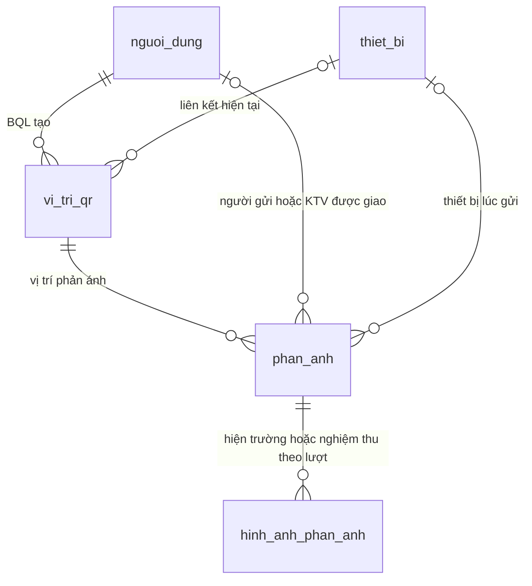
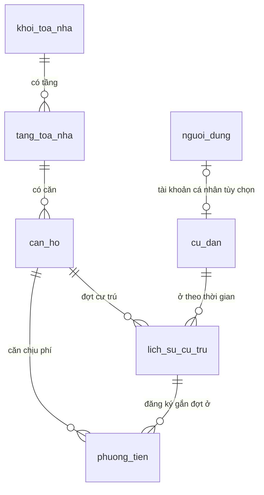
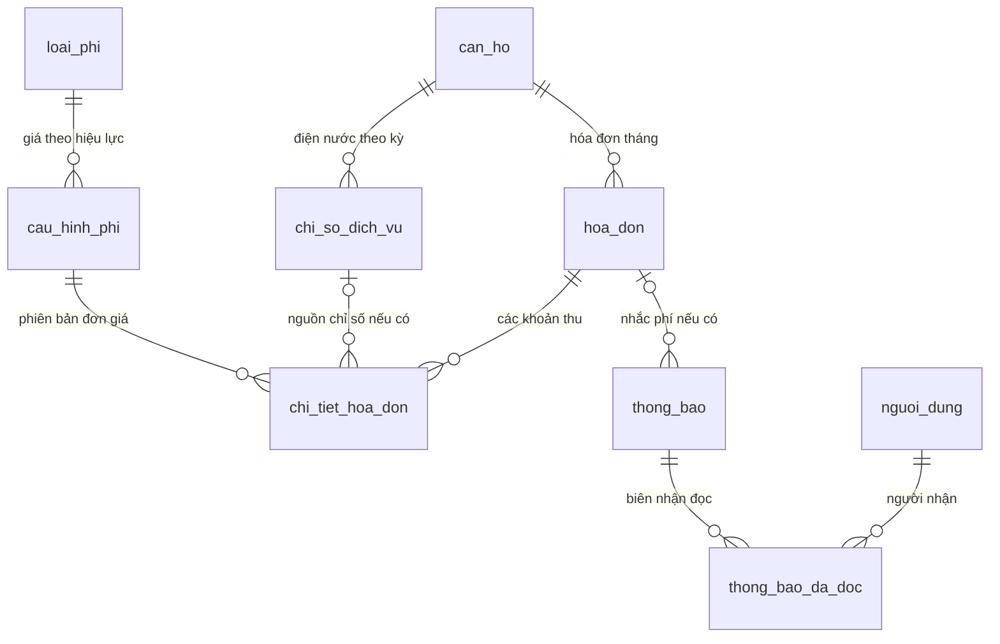

# ERD nghiệp vụ trọng tâm của đề tài

Đây là 18 bảng nghiệp vụ chính, chia thành 3 hình để chèn báo cáo. Schema vật lý vẫn có 31 bảng và 8 view; xem [phân nhóm đầy đủ](README.md) và [từ điển vật lý](../bao-cao/tu-dien-du-lieu.md). Các quan hệ trong hình được chọn để giải thích nghiệp vụ; ERD vật lý có đầy đủ FK/thuộc tính/ràng buộc.

## 1. QR → phản ánh → kỹ thuật → nghiệm thu

Trọng tâm của đề tài là định vị sự cố bằng QR, gửi nhanh không bắt đăng nhập, điều phối và theo dõi xử lý. Vai trò người gửi và KTV là hai FK khác nhau tới tài khoản; nhãn gộp trong hình cho dễ đọc, xem từ điển để phân biệt. Snapshot tên/mã/vị trí thiết bị giữ bối cảnh cũ khi đổi QR hoặc đổi hồ sơ thiết bị. Trạng thái/sự kiện/actor được ghi cùng transaction vào nhật ký và đọc qua view lịch sử phản ánh.

## 2. Cấu trúc tòa nhà, cư trú và phương tiện

Căn hiện tại và số người ở suy ra từ đợt chưa kết thúc; không ghi đè căn cũ trong hồ sơ. Tài khoản thanh toán căn và người phụ trách hiện tại liên kết qua `nguoi_dung`, còn tài khoản cá nhân là liên kết khác; không gộp danh tính chủ trước/chủ mới. Khóa ghép khối/tầng, UNIQUE đợt đang mở và UNIQUE biển đang gửi giữ tính toàn vẹn.

## 3. Phí, hóa đơn VietQR và thông báo

Đơn giá, lượng, tiền và nguồn của hóa đơn được chốt thành snapshot. VietQR là thông tin chuyển khoản; BQL xác nhận đối soát, không tự ghi đã thu khi cư dân quét mã. Biên nhận đọc theo cả tài khoản và chủ hộ tiếp nhận tại thời điểm đọc; bàn giao giữ quyền riêng tư và trạng thái đọc đúng người.
