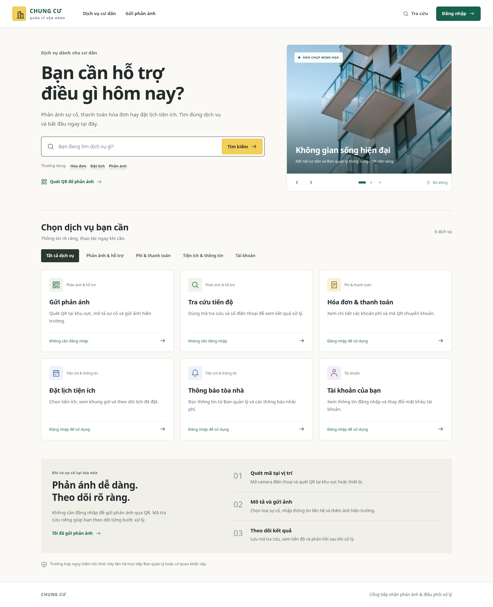
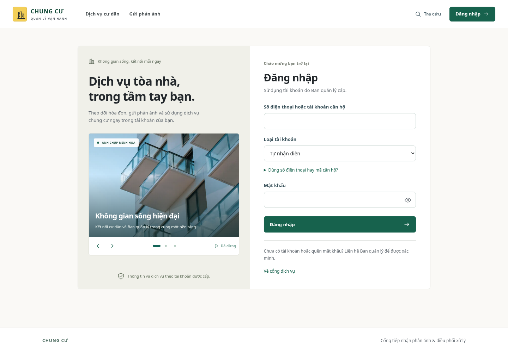
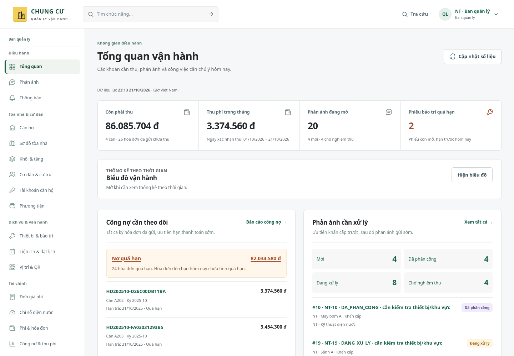
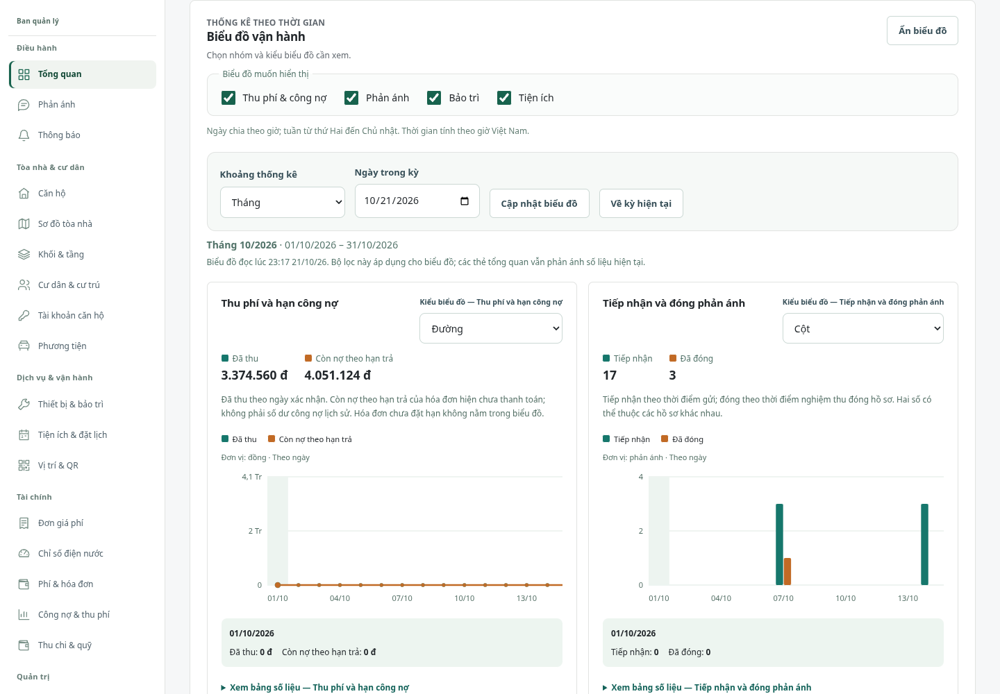
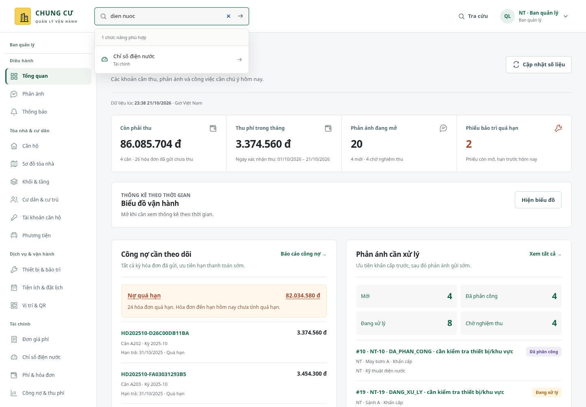
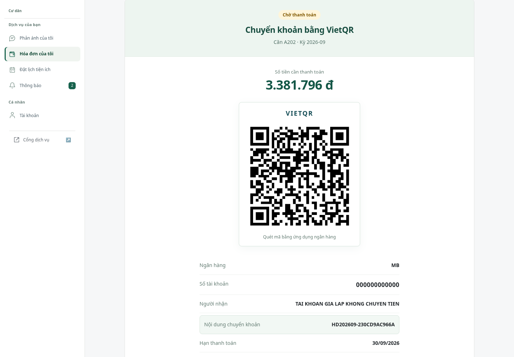
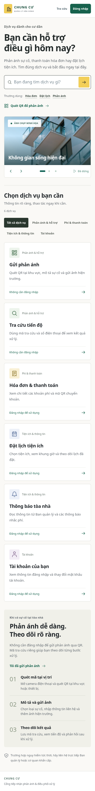
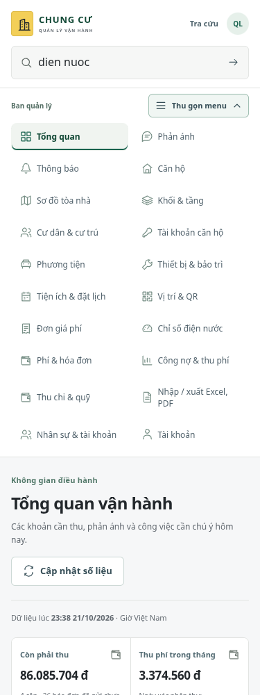

# Giao diện tìm kiếm và danh mục dịch vụ

Bản chạy được chụp ngày 21/10/2026 với dữ liệu nghiệm thu giả lập trong workspace. Tài khoản, căn hộ và số tiền trong ảnh dùng để minh họa. Các ảnh tĩnh bật chế độ giảm chuyển động khi chụp; bản web vẫn có thể tự chuyển ảnh khi người dùng cho phép.

[**Code đầy đủ từng file và cách cập nhật trong VS Code**](../cap-nhat-giao-dien-tim-kiem-danh-muc-vscode.md).

## Cổng cư dân

Ô tìm kiếm lọc các dịch vụ có thật; danh mục có thể chọn, trạng thái không có kết quả có nút đặt lại. Chọn dịch vụ cần đăng nhập sẽ tiếp tục đến dịch vụ đó sau khi xác thực, theo vai trò thực tế.

## Đăng nhập

Hướng dẫn tài khoản nằm trong mục có thể mở rộng; nút hiện mật khẩu và trình chiếu không gửi biểu mẫu.

## Không gian điều hành

Dải số liệu gọn; biểu đồ chỉ chiếm chỗ khi mở. Menu được nhóm theo nghiệp vụ và giữ đúng mục đang xem khi mở các trang con.

## Tìm nhanh chức năng

Chỉ tìm trong chức năng của vai trò hiện tại. Hỗ trợ gõ có/không dấu và điều hướng bàn phím.

## Thanh toán

Khung QR được căn giữa, thông tin thanh toán và số tiền tách rõ; giữ quy trình xác nhận giao dịch hiện có.

## Trên điện thoại

Danh mục dịch vụ xếp một cột. Menu trong không gian làm việc có thanh ngang và nút mở tất cả chức năng; bảng dữ liệu cuộn trong khung.

| Cổng dịch vụ ở 375 px | Menu ở 375 px |
| --- | --- |
|  |  |

## Phạm vi kiểm tra màn hình

[Nhật ký 84 lượt mở trang](kiem-tra-man-hinh.json) gồm 20 trang của Ban quản lý, 3 trang của kỹ thuật viên và 5 trang của cư dân, mỗi trang ở 1440, 768 và 320 px. Mỗi lượt có tiêu đề chính, không có thông báo lỗi API trên giao diện và không tràn ngang toàn trang; không ghi nhận lỗi JavaScript. Đây là kiểm tra tải trang và bố cục, được bổ sung bằng các bài kiểm thử nghiệp vụ/E2E trong hướng dẫn.

Bốn website tham khảo bị proxy của môi trường chặn trong phiên này. Bản thiết kế dựa trên ưu tiên người dùng đã chọn (tìm kiếm nổi bật, danh mục rõ, nội dung gọn), chưa thể so sánh trực tiếp với giao diện hiện hành của các website đó. Nguồn ảnh chụp minh họa nằm trong [README bộ ảnh cục bộ](../../frontend/public/images/residences/README.md).
