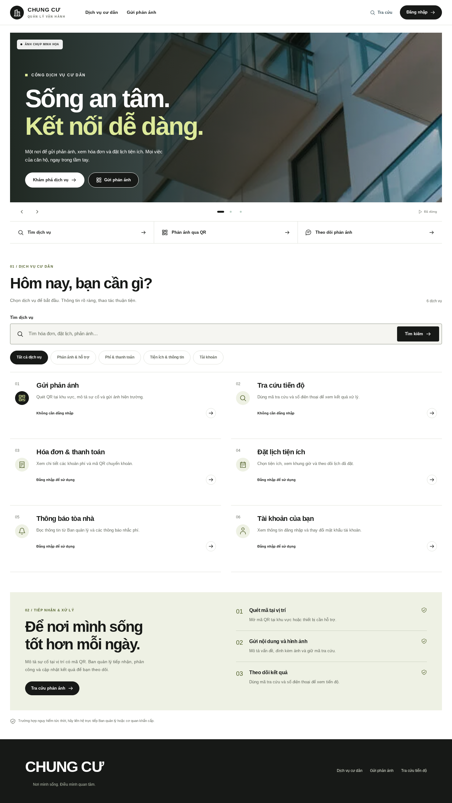
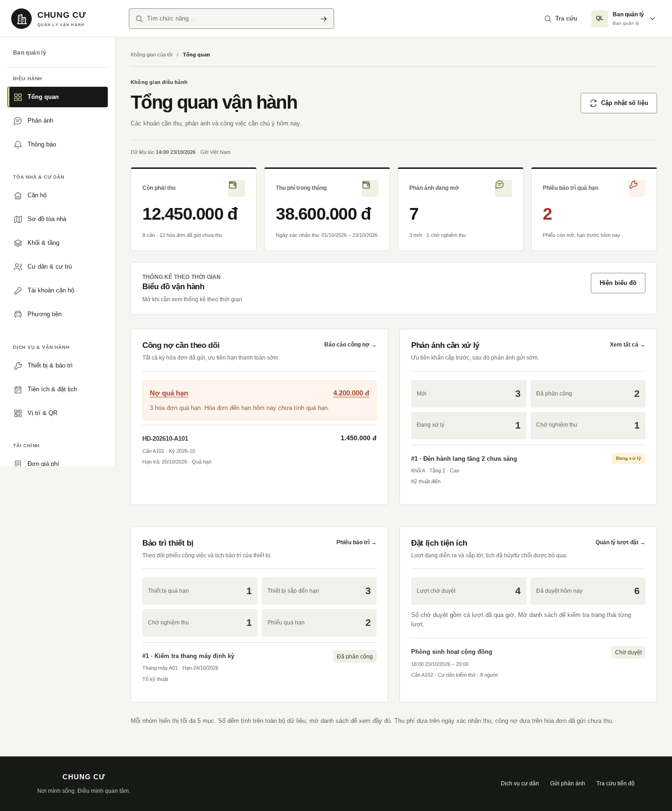
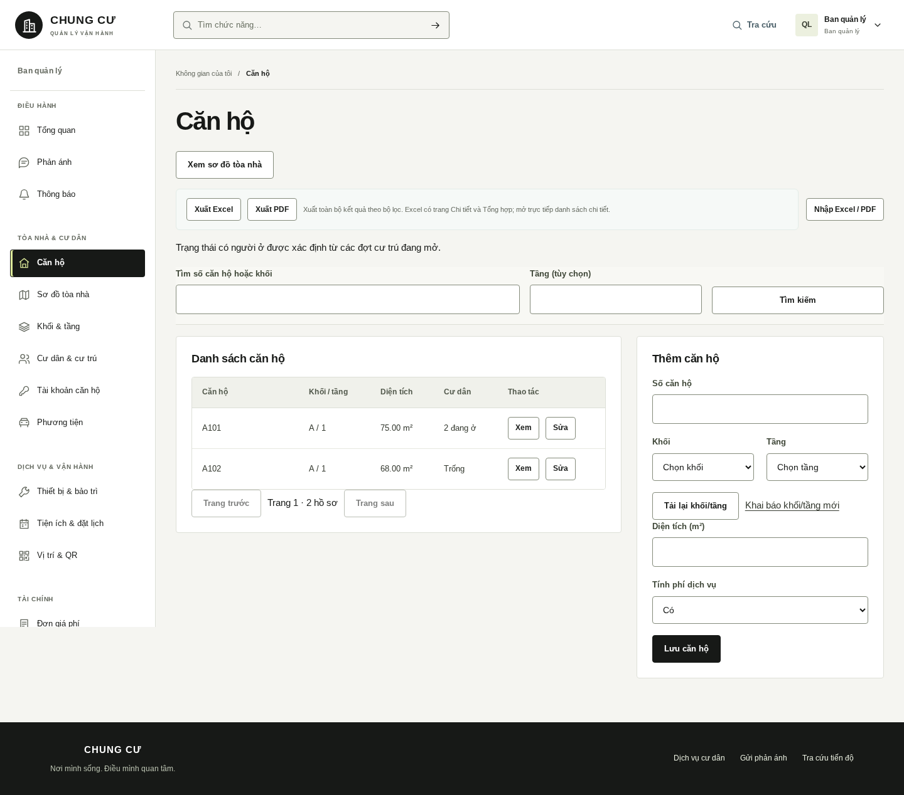
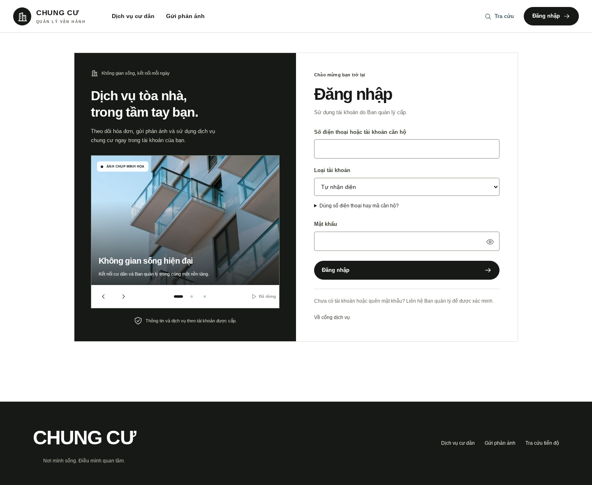
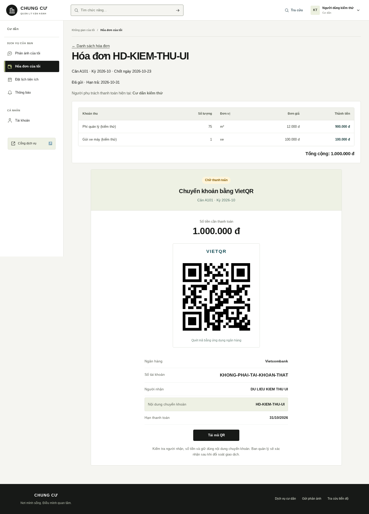

# Giao diện mới cho dự án quản lý vận hành chung cư

Nhánh `codex/editorial-business-ui`, phát triển trên bản đầy đủ nghiệp vụ. Hệ giao diện áp dụng cho cổng công khai và các phân hệ BQL, kỹ thuật viên, cư dân. Giữ nguyên API và dữ liệu; riêng bảng chi tiết hóa đơn được bổ sung focus để cuộn bằng bàn phím.

**[Code đầy đủ 6 file và cách chép vào VS Code](../cap-nhat-giao-dien-editorial-vscode.md)**. Nếu đã dùng đủ bản navy trước đó, chỉ 4 file thay đổi; hướng dẫn ghi rõ từng file.

## Trang cư dân

[Phiên bản điện thoại 320px](cong-cu-dan-320.png)

## Tổng quan quản trị

Các con số trong ảnh dưới là dữ liệu giả lập để kiểm tra bố cục; không lấy từ database của người dùng.

[Phiên bản điện thoại](tong-quan-320.png)

## Danh sách và biểu mẫu

## Đăng nhập

## Hóa đơn và thanh toán

Ảnh kiểm thử giao diện; QR chứa chuỗi kiểm thử, **không phải mã thanh toán thật**.

[Thanh toán trên điện thoại](thanh-toan-320.png) · [Quét QR](quet-qr-1440.png) · [Tra cứu phản ánh](tra-cuu-1440.png)

## Tham khảo và kiểm chứng

Không truy cập được Nike và Apple do proxy trả CONNECT 403. Thiết kế này là phương án độc lập với ảnh lớn, chữ rõ, bảng màu tiết chế; không tuyên bố sao chép hay đã xem phiên bản hiện tại của hai website. Dùng ảnh minh họa cục bộ sẵn có, không gọi máy chủ ảnh ngoài.

[Quyết định thiết kế](design-contract.md) · [Kết quả kiểm tra và giới hạn](verification.md) · [Script QA](verify-ui.mjs)
