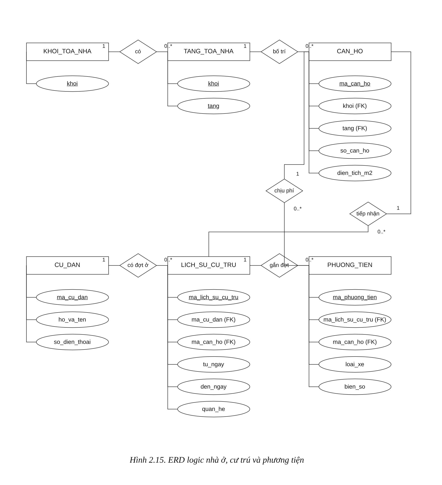
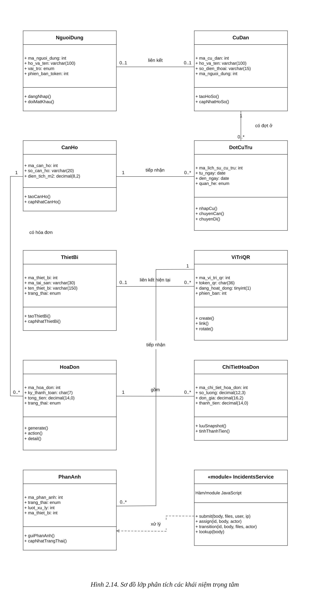
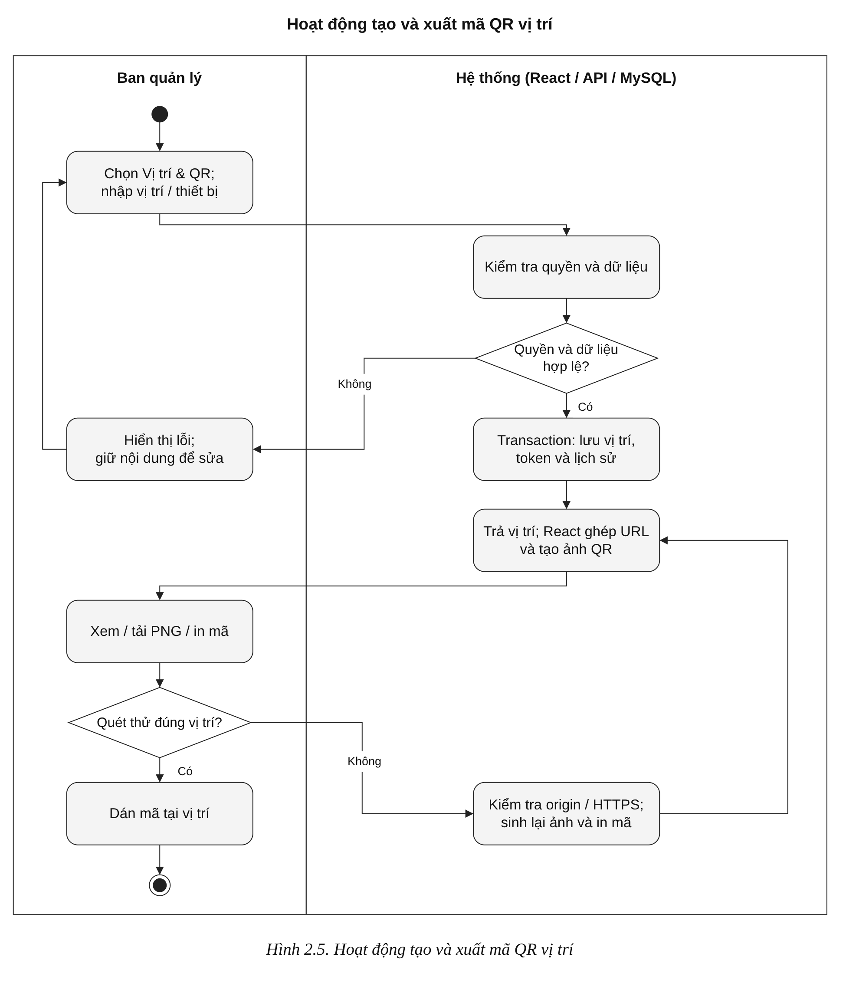

# 21 sơ đồ vẽ lại theo mẫu bạn gửi

**Quản lý vận hành chung cư và tiếp nhận phản ánh cư dân · Tô Hoàng Tuấn — 1250080221**

Bộ này vẽ lại **đủ Hình 2.1–2.21** theo cách trình bày trong sáu ảnh mẫu người dùng gửi. Nội dung là hệ thống chung cư trong repository; ảnh mẫu định hướng bố cục và ký pháp.

## Mở hoặc tải trọn bộ

- **[File draw.io tổng hợp — 21 trang chỉnh sửa được](Tat-ca-21-so-do-theo-mau.drawio)**
- **[PDF xem nhanh — 21 trang](Xem-truoc-21-so-do-theo-mau.pdf)** — các trang theo khổ hình, giữ vector/text.
- **[Word tập hợp 21 hình để copy/chèn](Tap-hinh-21-so-do-theo-mau.docx)** — tài liệu tập hình, không phải báo cáo toàn văn đã thay mọi nội dung.
- **[ZIP đầy đủ](So-do-theo-mau-tron-bo.zip)** — draw.io riêng/tổng hợp, XML, PNG, SVG, PDF, Word và mô hình đối chiếu.

GitHub có thể không preview DOCX hoặc draw.io. Mở file rồi chọn **Download raw file** để tải. PDF, PNG và trang Markdown có thể xem trực tiếp.

## Cách vẽ đã áp dụng

| Loại | Trình bày theo mẫu |
|---|---|
| Phân rã chức năng | Hệ thống ở trên; các nhóm và nhánh chức năng bên dưới. |
| Use Case | Actor người que ở ngoài ranh giới hệ thống; mục tiêu dùng ellipse. Quan hệ tham gia dùng đường liền. |
| ERD | Thực thể chữ nhật; thuộc tính oval; khóa chính gạch chân; quan hệ hình thoi có tên và số lượng. |
| Class | Ba ngăn: tên lớp; thuộc tính và kiểu; phương thức/trách nhiệm. Các liên kết có tên và bội số. |
| Activity | Làn trách nhiệm, điểm bắt đầu/kết thúc, hành động, quyết định và nhánh Có/Không. |
| Sequence | Actor, thành phần, lifeline, thanh kích hoạt, thông điệp đánh số và đường trả về nét đứt. |
| Trạng thái / kiến trúc / dữ liệu | Khối rõ, đường nối có hướng và nhãn theo đúng vai trò trong hệ thống. |

Các đường nối và chữ là đối tượng gốc của draw.io, không phải ảnh PNG đặt vào canvas. Thuộc tính và quan hệ được kiểm tra với schema MySQL đã lưu trong repository; không đọc .env hoặc database của người dùng.

## Từng hình để xem, tải và chỉnh sửa

| Hình | Nội dung | Xem PNG | SVG chèn Word | draw.io | XML để copy |
|---|---|---|---|---|---|
| 2.1 | Phân rã chức năng theo nhóm nghiệp vụ | [PNG](png/02-01-phan-ra-chuc-nang.png) | [SVG](svg/02-01-phan-ra-chuc-nang.svg) | [draw.io](drawio/02-01-phan-ra-chuc-nang.drawio) | [XML](xml/02-01-phan-ra-chuc-nang.xml.txt) |
| 2.2 | Use Case tổng thể | [PNG](png/02-02-use-case-tong-the.png) | [SVG](svg/02-02-use-case-tong-the.svg) | [draw.io](drawio/02-02-use-case-tong-the.drawio) | [XML](xml/02-02-use-case-tong-the.xml.txt) |
| 2.3 | Use Case phân rã Ban quản lý | [PNG](png/02-03-use-case-bql.png) | [SVG](svg/02-03-use-case-bql.svg) | [draw.io](drawio/02-03-use-case-bql.drawio) | [XML](xml/02-03-use-case-bql.xml.txt) |
| 2.4 | Use Case cư dân, người gửi công khai và kỹ thuật viên | [PNG](png/02-04-use-case-cu-dan.png) | [SVG](svg/02-04-use-case-cu-dan.svg) | [draw.io](drawio/02-04-use-case-cu-dan.drawio) | [XML](xml/02-04-use-case-cu-dan.xml.txt) |
| 2.5 | Hoạt động tạo và xuất mã QR vị trí | [PNG](png/02-05-activity-qr.png) | [SVG](svg/02-05-activity-qr.svg) | [draw.io](drawio/02-05-activity-qr.drawio) | [XML](xml/02-05-activity-qr.xml.txt) |
| 2.6 | Hoạt động quét QR và gửi phản ánh | [PNG](png/02-06-activity-gui.png) | [SVG](svg/02-06-activity-gui.svg) | [draw.io](drawio/02-06-activity-gui.drawio) | [XML](xml/02-06-activity-gui.xml.txt) |
| 2.7 | Hoạt động phân công, xử lý và nghiệm thu | [PNG](png/02-07-activity-xu-ly.png) | [SVG](svg/02-07-activity-xu-ly.svg) | [draw.io](drawio/02-07-activity-xu-ly.drawio) | [XML](xml/02-07-activity-xu-ly.xml.txt) |
| 2.8 | Hoạt động lập, duyệt, gửi và xác nhận thu hóa đơn | [PNG](png/02-08-activity-hoa-don.png) | [SVG](svg/02-08-activity-hoa-don.svg) | [draw.io](drawio/02-08-activity-hoa-don.drawio) | [XML](xml/02-08-activity-hoa-don.xml.txt) |
| 2.9 | Tuần tự tạo và hiển thị QR | [PNG](png/02-09-sequence-qr.png) | [SVG](svg/02-09-sequence-qr.svg) | [draw.io](drawio/02-09-sequence-qr.drawio) | [XML](xml/02-09-sequence-qr.xml.txt) |
| 2.10 | Tuần tự mở QR và gửi phản ánh | [PNG](png/02-10-sequence-gui.png) | [SVG](svg/02-10-sequence-gui.svg) | [draw.io](drawio/02-10-sequence-gui.drawio) | [XML](xml/02-10-sequence-gui.xml.txt) |
| 2.11 | Tuần tự điều phối và chuyển trạng thái phản ánh | [PNG](png/02-11-sequence-xu-ly.png) | [SVG](svg/02-11-sequence-xu-ly.svg) | [draw.io](drawio/02-11-sequence-xu-ly.drawio) | [XML](xml/02-11-sequence-xu-ly.xml.txt) |
| 2.12 | Tuần tự tra cứu hóa đơn và hiển thị VietQR | [PNG](png/02-12-sequence-vietqr.png) | [SVG](svg/02-12-sequence-vietqr.svg) | [draw.io](drawio/02-12-sequence-vietqr.drawio) | [XML](xml/02-12-sequence-vietqr.xml.txt) |
| 2.13 | Vòng đời phản ánh | [PNG](png/02-13-trang-thai-phan-anh.png) | [SVG](svg/02-13-trang-thai-phan-anh.svg) | [draw.io](drawio/02-13-trang-thai-phan-anh.drawio) | [XML](xml/02-13-trang-thai-phan-anh.xml.txt) |
| 2.14 | Sơ đồ lớp phân tích các khái niệm trọng tâm | [PNG](png/02-14-lop-phan-tich.png) | [SVG](svg/02-14-lop-phan-tich.svg) | [draw.io](drawio/02-14-lop-phan-tich.drawio) | [XML](xml/02-14-lop-phan-tich.xml.txt) |
| 2.15 | ERD logic nhà ở, cư trú và phương tiện | [PNG](png/02-15-erd-cu-tru.png) | [SVG](svg/02-15-erd-cu-tru.svg) | [draw.io](drawio/02-15-erd-cu-tru.drawio) | [XML](xml/02-15-erd-cu-tru.xml.txt) |
| 2.16 | ERD logic QR, phản ánh và ảnh | [PNG](png/02-16-erd-phan-anh.png) | [SVG](svg/02-16-erd-phan-anh.svg) | [draw.io](drawio/02-16-erd-phan-anh.drawio) | [XML](xml/02-16-erd-phan-anh.xml.txt) |
| 2.17 | ERD logic phí, chỉ số, hóa đơn và thông báo | [PNG](png/02-17-erd-hoa-don.png) | [SVG](svg/02-17-erd-hoa-don.svg) | [draw.io](drawio/02-17-erd-hoa-don.drawio) | [XML](xml/02-17-erd-hoa-don.xml.txt) |
| 2.18 | ERD vật lý rút gọn của luồng phản ánh và ảnh | [PNG](png/02-18-erd-vat-ly-phan-anh.png) | [SVG](svg/02-18-erd-vat-ly-phan-anh.svg) | [draw.io](drawio/02-18-erd-vat-ly-phan-anh.drawio) | [XML](xml/02-18-erd-vat-ly-phan-anh.xml.txt) |
| 2.19 | ERD vật lý rút gọn của luồng hóa đơn | [PNG](png/02-19-erd-vat-ly-hoa-don.png) | [SVG](svg/02-19-erd-vat-ly-hoa-don.svg) | [draw.io](drawio/02-19-erd-vat-ly-hoa-don.drawio) | [XML](xml/02-19-erd-vat-ly-hoa-don.xml.txt) |
| 2.20 | Kiến trúc ba tầng và kho ảnh | [PNG](png/02-20-kien-truc.png) | [SVG](svg/02-20-kien-truc.svg) | [draw.io](drawio/02-20-kien-truc.drawio) | [XML](xml/02-20-kien-truc.xml.txt) |
| 2.21 | Luồng dữ liệu từ QR đến theo dõi kết quả | [PNG](png/02-21-luong-du-lieu.png) | [SVG](svg/02-21-luong-du-lieu.svg) | [draw.io](drawio/02-21-luong-du-lieu.drawio) | [XML](xml/02-21-luong-du-lieu.xml.txt) |

## Xem trước các loại chính

### ERD theo mẫu thuộc tính oval — Hình 2.15

### Lớp có thuộc tính và phương thức — Hình 2.14

### Activity phân làn — Hình 2.5

## Sửa bằng draw.io hoặc copy XML

1. Tải file `.drawio` → diagrams.net/draw.io Desktop → **File → Open From → Device**.
2. Chọn tab hình ở dưới, nhấp đúp để sửa chữ; kéo các khối, điểm nối hoặc đường nối để chỉnh bố cục. Với một nhóm đối tượng, có thể vào nhóm hoặc **Arrange → Ungroup** để sửa từng phần.
3. Muốn copy mã: mở file `.xml.txt` tương ứng → **Raw** → copy toàn bộ `<mxGraphModel>...</mxGraphModel>`. Trong trang draw.io trống chọn **Extras → Edit Diagram**, dán XML rồi thay trang vẽ đó.
4. Sau khi chỉnh, **File → Export as → SVG/PNG/PDF**. Giữ file `.drawio` làm nguồn để sửa tiếp.

## Chèn vào Word

- Chọn đúng số Hình 2.x trong bảng trên để thay hình tương ứng; không phải đánh lại số cả chương.
- Dùng **Insert → Pictures → This Device**, ưu tiên SVG để phóng to vẫn rõ; PNG dùng được trên các bản Word không hỗ trợ SVG tốt.
- Hình đã có chú thích ở phía dưới như mẫu. Nếu dùng Caption tự động của Word, xóa chú thích nằm trong draw.io trước khi xuất để tránh lặp tiêu đề.
- Với Class/Sequence/ERD dài, dùng trang ngang hoặc khổ lớn khi cần; không thu nhỏ đến mức không đọc được thuộc tính. Nguồn draw.io cho phép tách tiếp một hình thành nhiều trang.
- Tập Word kèm theo chỉ hỗ trợ chọn/copy hình. Báo cáo toàn văn trước đó vẫn cần thay hình, cập nhật danh mục và mô tả theo bản đang sử dụng.

## Phạm vi và các quy tắc được giữ đúng

- Số thứ tự giữ Hình 2.1–2.21 của báo cáo. Các ERD là tập bảng/thuộc tính được chọn theo phân hệ; schema triển khai đầy đủ có 31 bảng và 8 view, không phải số thực thể cộng từ các hình này.
- Khóa chính gạch chân. Với khóa ghép, từng thành phần khóa được gạch chân; `FK` chỉ thuộc tính tham chiếu. `0..1` = không hoặc một; `0..*` = không hoặc nhiều; `1` = đúng một. Bội số trên từng nhánh quan hệ được suy từ khả năng NULL của FK; các quan hệ dùng trong bộ hình này không đặt giới hạn một-một sai với schema.
- Liên kết QR–thiết bị hiện tại và thiết bị lúc gửi phản ánh là hai quan hệ riêng. Người gửi và KTV trong phản ánh cũng là hai vai trò FK riêng.
- Phương thức trong các lớp thực thể mô tả trách nhiệm phân tích nghiệp vụ. Bản hiện thực dùng hàm/module JavaScript, không có các lớp ORM tương ứng. Khối «module» IncidentsService liệt kê các hàm thật submit/assign/transition/lookup.
- Thanh kích hoạt trong Sequence ứng với các lời gọi/trả về được thể hiện; hình chọn các thông điệp chính, không vẽ mọi câu SQL hoặc toàn bộ nhánh ngoại lệ. Kho tệp và MySQL không có transaction chung; ảnh không được giữ phải được dọn theo quy tắc xử lý lỗi/phát lại.
- Không tự thêm bước ngân hàng xác nhận: VietQR hỗ trợ xem thông tin chuyển khoản; BQL vẫn đối soát trước khi xác nhận đã thu. Các thao tác SQL được mô tả theo transaction, không dùng thanh fork/join để ngụ ý ghi đồng thời khi mã nguồn không có điều đó.

## Nguồn và kiểm chứng

- Nội dung đối chiếu phần mềm tại `cceb904` và baseline `database/thesis-mysql/001_thesis_schema.sql`; nguồn hình mẫu do người dùng gửi trong chat.
- [Mô hình, thuộc tính và FK đã chọn](nguon/mo-hinh-va-doi-chieu.json)
- [Kết quả nạp/kết xuất đối tượng bằng mxGraph](nguon/kiem-tra-ket-xuat.json)
- [Nguồn dựng draw.io/SVG/XML](nguon/tao-so-do.py) — Python + Pillow trên Linux; cần phông Liberation Sans. Script đọc schema trong checkout, không kết nối MySQL. Sau khi thay bố cục/nội dung nguồn cần xuất lại các bản xem trước.

Bộ cũ vẫn nằm tại [mục lục bàn giao trước](../tai-lieu-ban-giao-2026-11-17/README.md) để đối chiếu. Lần này bổ sung tài liệu; mã ứng dụng và database không đổi.
