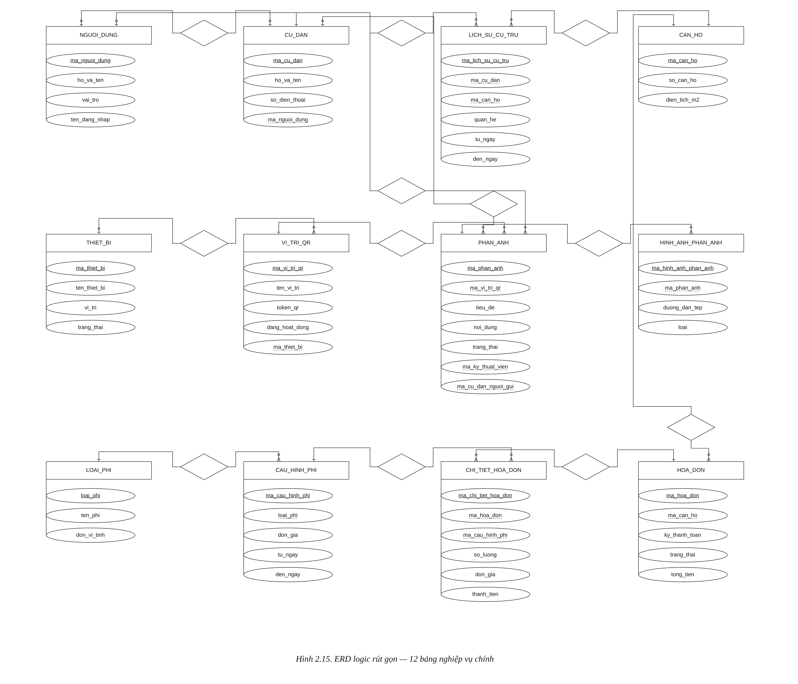

# ERD 18 bảng — bố cục dây nối đã sắp xếp lại

Giữ lại đúng 18 bảng và toàn bộ 218 thuộc tính như bản đầy đủ; chỉ thay cách đặt bảng, hình thoi và đi dây. Cách trình bày theo ảnh mẫu: thực thể chữ nhật; mỗi bảng có **một cột oval thẳng đứng**, nối vào đường dọc bên trái. **Khóa chính gạch chân liền, khóa ngoại gạch chân nét đứt**; không in đậm thuộc tính hoặc tên thực thể, không thêm nhãn “FK R…”. Các đường quan hệ chỉ đi ngang/dọc, dùng hình thoi trống và ký hiệu một/nhiều bằng vạch/chân quạ như mẫu.

**Một ERD có 18 bảng trọng tâm, đủ toàn bộ 218 thuộc tính và 46 quan hệ khóa ngoại giữa chúng.** Đã lược 13 bảng kỹ thuật, nhật ký và phần mở rộng khỏi hình. Database vẫn giữ nguyên **31 bảng, 362 cột và 81 FK**. Đây là hình rút gọn phạm vi bảng; không phải toàn bộ schema hoặc các ERD phân hệ tách riêng.

## Mở hoặc tải

- **[draw.io chỉnh sửa được — một trang](drawio/02-15-erd-hop-nhat.drawio)**
- **[PDF ERD — một trang vector](ERD-18-bang-bo-cuc-ro.pdf)**
- [PNG xem ngay](png/02-15-erd-hop-nhat.png) · [SVG chèn Word/phóng to](svg/02-15-erd-hop-nhat.svg) · [XML để copy vào draw.io](xml/02-15-erd-hop-nhat.xml.txt)
- **[Word tập hình đã cập nhật](Tap-hinh-17-so-do-ERD-hop-nhat.docx)** · [PDF 17 hình](Xem-truoc-17-so-do-ERD-hop-nhat.pdf)
- [draw.io tổng hợp 17 hình](Tat-ca-17-so-do-ERD-hop-nhat.drawio) · [ZIP trọn bộ](So-do-theo-mau-tron-bo.zip)

Trong GitHub, mở `.drawio`/`.docx` rồi chọn **Download raw file** để tải. Word này là tập hình để copy/chèn; bản báo cáo toàn văn cũ vẫn cần thay hình và cập nhật mô tả. Trang ERD trong Word dùng A3 dọc; SVG/PDF giữ vector để phóng to.

## Ký pháp và bố cục

- Tên thuộc tính dùng cùng một kiểu chữ thường; đủ tất cả cột theo thứ tự schema tính từ hộp thực thể đi dọc ra ngoài. Hàng bảng trên có thuộc tính ở phía trên hộp, các hàng còn lại ở phía dưới; mỗi bảng vẫn một cột.
- Khóa chính gạch chân liền; khóa ngoại gạch chân nét đứt ngay dưới tên. Cột mang cả hai vai trò có hai gạch.
- Thuộc tính nối thẳng dọc theo mép trái của thực thể như ảnh mẫu. Quan hệ dùng đoạn ngang/dọc, có dấu cầu vượt nhỏ ở giao điểm; không chạy qua các cột thuộc tính.
- Hình thoi để trống; bội số dùng vạch/chân quạ/vòng tròn. Tên constraint chỉ nằm trong tài liệu đối chiếu, không in lên hình.
- Không có bảng hoặc quan hệ ẩn dưới lớp tùy chọn. Các đối tượng đều chỉnh sửa được trong draw.io.

## Các thay đổi để dây và khối rõ hơn

- Giữ nguyên 18 bảng, 218 thuộc tính và 46 FK giữa chúng; không ẩn bớt quan hệ.
- Chia đầu nối sang cạnh trái/phải/trên/dưới phù hợp, không dồn hết vào nóc bảng `nguoi_dung`.
- Đặt hình thoi gần bảng liên quan, giãn khoảng cách với các khối và cột thuộc tính.
- Mỗi đường có đoạn đi riêng: **77 cặp đoạn dây chồng nhau ở bản 18 bảng cũ đã giảm về 0**.
- Các đường vẫn có thể cắt vuông góc do có 46 quan hệ. Bật sẵn kiểu nhảy cầu (`jumpStyle=arc`) trong draw.io; SVG/PNG/PDF/Word cũng có dấu cầu ở giao điểm để phân biệt hai dây.

[Đối chiếu bố cục trước/sau](DOI-CHIEU-BO-CUC.md) · [Số đo kiểm tra đường nối](nguon/kiem-tra-duong-noi.json)

## Bảng được giữ và lược

[Danh sách 18 bảng và đầy đủ thuộc tính, kèm 13 bảng được lược](VAI-TRO-VA-THUOC-TINH-CHINH.md) · [Đối chiếu toàn bộ 81 FK, ghi rõ 46 FK đã vẽ](DOI-CHIEU-KHOA-NGOAI.md) · [Từ điển 31 bảng / 362 cột](TU-DIEN-362-COT.md).

## Xem hình

## Danh mục 17 sơ đồ

| Hình | Nội dung | PNG | SVG | draw.io | XML |
|---|---|---|---|---|---|
| 2.1 | Phân rã chức năng theo nhóm nghiệp vụ | [PNG](png/02-01-phan-ra-chuc-nang.png) | [SVG](svg/02-01-phan-ra-chuc-nang.svg) | [draw.io](drawio/02-01-phan-ra-chuc-nang.drawio) | [XML](xml/02-01-phan-ra-chuc-nang.xml.txt) |
| 2.2 | Use Case tổng thể | [PNG](png/02-02-use-case-tong-the.png) | [SVG](svg/02-02-use-case-tong-the.svg) | [draw.io](drawio/02-02-use-case-tong-the.drawio) | [XML](xml/02-02-use-case-tong-the.xml.txt) |
| 2.3 | Use Case phân rã Ban quản lý | [PNG](png/02-03-use-case-bql.png) | [SVG](svg/02-03-use-case-bql.svg) | [draw.io](drawio/02-03-use-case-bql.drawio) | [XML](xml/02-03-use-case-bql.xml.txt) |
| 2.4 | Use Case cư dân, người gửi công khai và kỹ thuật viên | [PNG](png/02-04-use-case-cu-dan.png) | [SVG](svg/02-04-use-case-cu-dan.svg) | [draw.io](drawio/02-04-use-case-cu-dan.drawio) | [XML](xml/02-04-use-case-cu-dan.xml.txt) |
| 2.5 | Hoạt động tạo và xuất mã QR vị trí | [PNG](png/02-05-activity-qr.png) | [SVG](svg/02-05-activity-qr.svg) | [draw.io](drawio/02-05-activity-qr.drawio) | [XML](xml/02-05-activity-qr.xml.txt) |
| 2.6 | Hoạt động quét QR và gửi phản ánh | [PNG](png/02-06-activity-gui.png) | [SVG](svg/02-06-activity-gui.svg) | [draw.io](drawio/02-06-activity-gui.drawio) | [XML](xml/02-06-activity-gui.xml.txt) |
| 2.7 | Hoạt động phân công, xử lý và nghiệm thu | [PNG](png/02-07-activity-xu-ly.png) | [SVG](svg/02-07-activity-xu-ly.svg) | [draw.io](drawio/02-07-activity-xu-ly.drawio) | [XML](xml/02-07-activity-xu-ly.xml.txt) |
| 2.8 | Hoạt động lập, duyệt, gửi và xác nhận thu hóa đơn | [PNG](png/02-08-activity-hoa-don.png) | [SVG](svg/02-08-activity-hoa-don.svg) | [draw.io](drawio/02-08-activity-hoa-don.drawio) | [XML](xml/02-08-activity-hoa-don.xml.txt) |
| 2.9 | Tuần tự tạo và hiển thị QR | [PNG](png/02-09-sequence-qr.png) | [SVG](svg/02-09-sequence-qr.svg) | [draw.io](drawio/02-09-sequence-qr.drawio) | [XML](xml/02-09-sequence-qr.xml.txt) |
| 2.10 | Tuần tự mở QR và gửi phản ánh | [PNG](png/02-10-sequence-gui.png) | [SVG](svg/02-10-sequence-gui.svg) | [draw.io](drawio/02-10-sequence-gui.drawio) | [XML](xml/02-10-sequence-gui.xml.txt) |
| 2.11 | Tuần tự điều phối và chuyển trạng thái phản ánh | [PNG](png/02-11-sequence-xu-ly.png) | [SVG](svg/02-11-sequence-xu-ly.svg) | [draw.io](drawio/02-11-sequence-xu-ly.drawio) | [XML](xml/02-11-sequence-xu-ly.xml.txt) |
| 2.12 | Tuần tự tra cứu hóa đơn và hiển thị VietQR | [PNG](png/02-12-sequence-vietqr.png) | [SVG](svg/02-12-sequence-vietqr.svg) | [draw.io](drawio/02-12-sequence-vietqr.drawio) | [XML](xml/02-12-sequence-vietqr.xml.txt) |
| 2.13 | Vòng đời phản ánh | [PNG](png/02-13-trang-thai-phan-anh.png) | [SVG](svg/02-13-trang-thai-phan-anh.svg) | [draw.io](drawio/02-13-trang-thai-phan-anh.drawio) | [XML](xml/02-13-trang-thai-phan-anh.xml.txt) |
| 2.14 | Sơ đồ lớp phân tích các khái niệm trọng tâm | [PNG](png/02-14-lop-phan-tich.png) | [SVG](svg/02-14-lop-phan-tich.svg) | [draw.io](drawio/02-14-lop-phan-tich.drawio) | [XML](xml/02-14-lop-phan-tich.xml.txt) |
| 2.15 | ERD 18 bảng nghiệp vụ — bố cục dây nối sắp xếp lại | [PNG](png/02-15-erd-hop-nhat.png) | [SVG](svg/02-15-erd-hop-nhat.svg) | [draw.io](drawio/02-15-erd-hop-nhat.drawio) | [XML](xml/02-15-erd-hop-nhat.xml.txt) |
| 2.16 | Kiến trúc ba tầng của hệ thống | [PNG](png/02-16-kien-truc.png) | [SVG](svg/02-16-kien-truc.svg) | [draw.io](drawio/02-16-kien-truc.drawio) | [XML](xml/02-16-kien-truc.xml.txt) |
| 2.17 | Luồng dữ liệu phản ánh từ QR đến nghiệm thu | [PNG](png/02-17-luong-du-lieu.png) | [SVG](svg/02-17-luong-du-lieu.svg) | [draw.io](drawio/02-17-luong-du-lieu.drawio) | [XML](xml/02-17-luong-du-lieu.xml.txt) |

## Chỉnh sửa và đưa vào Word

1. Mở `.drawio` bằng **File → Open From → Device** trong diagrams.net/draw.io Desktop. File tổng hợp có đúng một trang ERD, ở Hình 2.15.
2. Nhấp đúp để sửa chữ; kéo cả nhóm bảng để giữ cột thuộc tính. Gạch đứt là đối tượng gốc nằm trong oval và di chuyển cùng oval; có thể chỉnh độ dài nếu đổi tên thuộc tính.
3. Muốn dán mã: mở `.xml.txt` → **Raw** → copy toàn bộ → **Extras → Edit Diagram** trong trang draw.io trống → dán thay trang đó.
4. Khi xuất PDF, chọn **Crop** hoặc **Fit to 1 × 1 page**. Trong Word ưu tiên SVG để giữ nét khi phóng to.
5. Thay năm ERD cũ (2.15–2.19) bằng Hình 2.15 hiện hành. Kiến trúc cũ 2.20 thành 2.16, luồng dữ liệu cũ 2.21 thành 2.17; Hình 2.1–2.14 giữ nguyên. Mô tả hình phải ghi đúng phạm vi 18 bảng / đủ 218 thuộc tính / 46 quan hệ.

## Nguồn và kiểm chứng

- Schema gốc: [`database/thesis-mysql/001_thesis_schema.sql`](../../database/thesis-mysql/001_thesis_schema.sql).
- [Mô hình và đối chiếu](nguon/mo-hinh-va-doi-chieu.json) · [Phạm vi bảng/thuộc tính](nguon/lua-chon-thuoc-tinh.json).
- [Kiểm tra đầy đủ thuộc tính/khóa/bố cục](nguon/kiem-tra-erd-hop-nhat.json) · [Mở và kết xuất bằng mxGraph](nguon/kiem-tra-ket-xuat.json) · [Kiểm tra Word/PDF](nguon/kiem-tra-tap-hinh.json).
- [Mã tái sinh](nguon/tao-so-do.py), cần Python 3 và Pillow. Chạy `python docs/so-do-theo-mau-2026-11-17/nguon/tao-so-do.py` để tái sinh draw.io/XML/SVG; file phạm vi phải nằm cùng thư mục với script.

Các bộ 12 bảng, bản 18 bảng với dây chồng nhau, các bộ 31 bảng, lớp bật/tắt và ERD phân hệ trước đây chỉ còn trong lịch sử/bộ tài liệu cũ; không dùng chúng thay bản hiện hành này.
