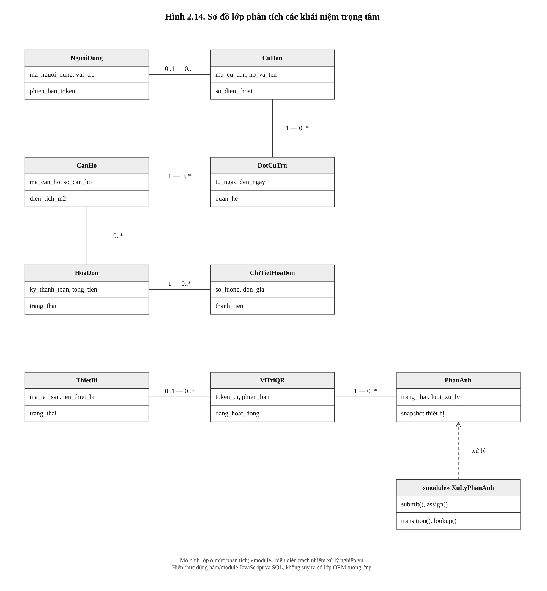
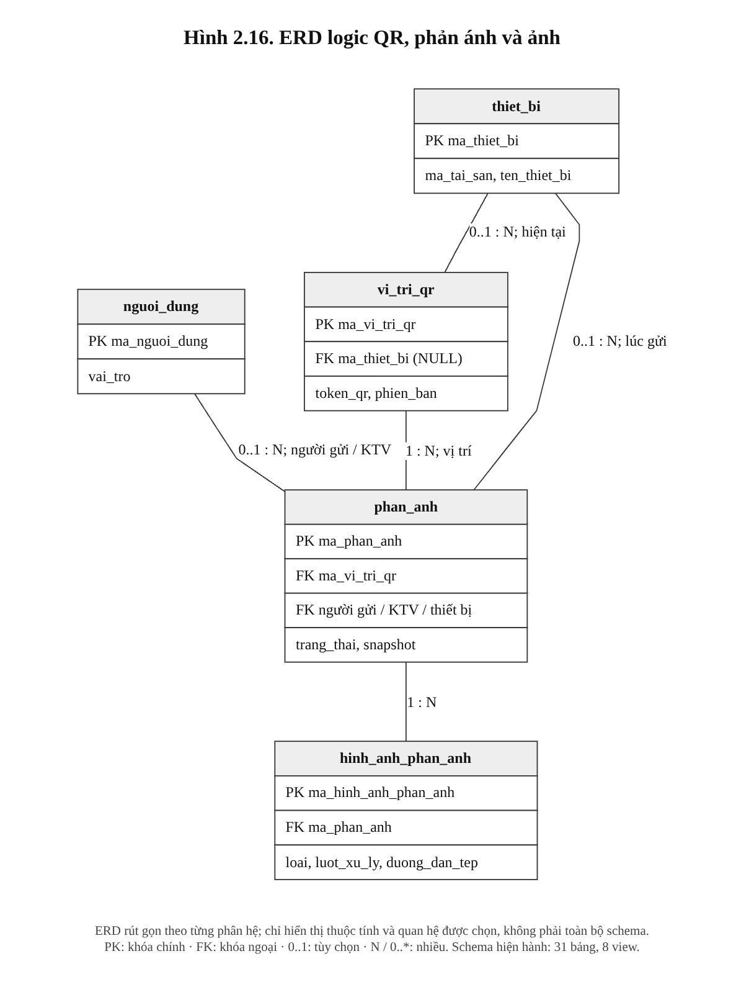
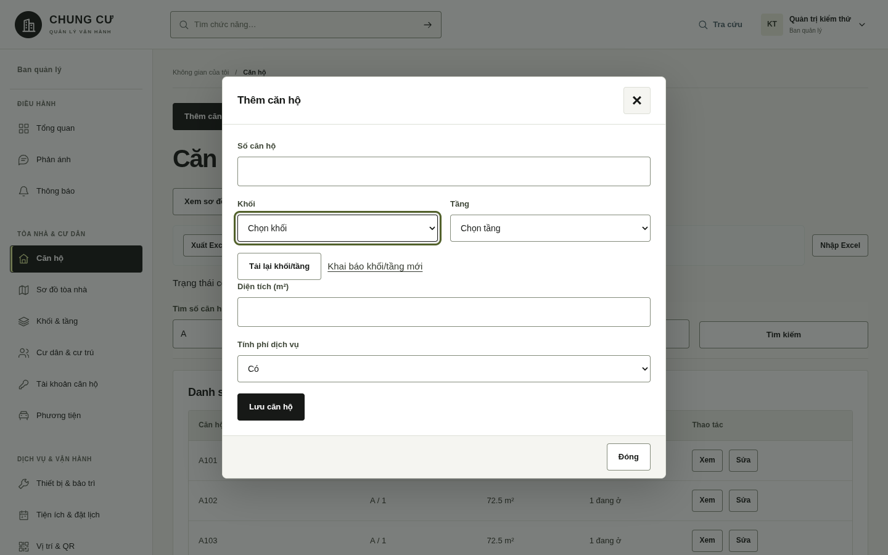

# Báo cáo Word, sơ đồ draw.io và hình minh họa

**Tô Hoàng Tuấn — MSSV 1250080221 · Bộ bàn giao ngày 17/11/2026**

Trang này tập hợp các tài liệu đã tạo trong lượt làm việc, để xem hoặc tải từng phần ngay trên GitHub. Các file mới được lưu riêng với bản thảo gốc.

## Nên mở file nào trước?

| Bạn cần | Mở/tải | Nội dung và phạm vi |
|---|---|---|
| **Sửa tiếp báo cáo Word** | **[Word đã bổ sung trích dẫn](Bao-cao-DACN_To-Hoang-Tuan_Bo-sung-trich-dan.docx)** | 14 tài liệu, 49 vị trí dẫn chiếu; giữ 25 hình, 56 bảng. Mô tả và ảnh nền vẫn dựa trên `56ebfe8`; chưa thay toàn bộ nội dung theo giao diện cửa sổ mới. |
| Xem nhanh báo cáo | [PDF xem trước — 126 trang](Bao-cao-DACN_Bo-sung-trich-dan_Xem-truoc.pdf) | Bản xem trước của Word bổ sung trích dẫn. Khi nộp, kiểm tra lại trong Microsoft Word với đúng phông chữ. |
| **Biết chính xác Word phải sửa chỗ nào khi dùng form riêng** | **[Hướng dẫn Word — 8 trang](Huong-dan-sua-Word-theo-ban-form-rieng.docx)** · [Đọc ngay trên GitHub](doi-chieu-sua-word/HUONG-DAN-SUA-WORD.md) | Bảng theo mục 2.7, 3.2–3.5, Phụ lục; 6 đoạn viết sẵn và ảnh cửa sổ. Đây là hướng dẫn sửa, không phải toàn bộ báo cáo đã được đồng bộ UI. |
| **Chỉnh sửa cả bộ sơ đồ** | **[File draw.io tổng hợp 21 trang](bao-cao-drawio/Tat-ca-21-so-do.drawio)** | Mỗi trang tương ứng Hình 2.1–2.21; các khối, chữ và đường nối đều chỉnh sửa được. |
| Xem nhanh sơ đồ | [PDF 21 sơ đồ](bao-cao-drawio/Xem-truoc-21-so-do.pdf) | Xem hình trước khi chọn file riêng bên dưới; khổ trang theo hình. |
| Tải trọn bộ sơ đồ | [ZIP: 21 draw.io riêng + XML + ảnh PNG](So-do-drawio-21-hinh-rieng.zip) | Giải nén để chỉnh sửa hoặc copy mã XML vào draw.io. |
| Tải hướng dẫn sửa Word và ảnh cửa sổ | [ZIP đối chiếu code và Word](Doi-chieu-code-va-Word.zip) | Word hướng dẫn, Markdown, ảnh desktop/mobile, CSV ánh xạ 33 file. |

## Cách xem/tải nhanh

1. **Word, draw.io, ZIP:** mở liên kết file trên GitHub, chọn **Download raw file** (biểu tượng tải xuống) hoặc **Raw** nếu không có bản xem trước. Thông báo không hỗ trợ preview không có nghĩa file bị lỗi.
2. **PDF, PNG, Markdown:** có thể xem trực tiếp trên GitHub. Mỗi hình bên dưới có liên kết PNG riêng.
3. **draw.io:** tải file `.drawio`, mở diagrams.net hoặc draw.io Desktop → **File → Open From → Device**. Nhấp đúp để sửa chữ, kéo khối/đường nối để chỉnh hình.
4. **Copy XML:** mở liên kết XML của hình → **Raw** → sao chép toàn bộ `<mxGraphModel>...</mxGraphModel>`. Trong một trang draw.io trống, chọn **Extras → Edit Diagram**, dán mã và thay trang vẽ hiện tại. Xem [hướng dẫn chi tiết](bao-cao-drawio/HUONG-DAN.md).

## Tất cả 21 sơ đồ, tải riêng từng hình

ERD là các phân hệ rút gọn của schema **31 bảng và 8 view**, không phải bản 38 bảng cũ. Sơ đồ lớp ở mức phân tích nghiệp vụ; bản JavaScript hiện thực dùng hàm/module, không suy ra có lớp ORM tương ứng.

| Hình | Nội dung | Xem ảnh | Sửa trong draw.io | XML để copy |
|---|---|---|---|---|
| 2.1 | Phân rã chức năng theo nhóm nghiệp vụ | [PNG](bao-cao-drawio/xem-truoc/02-01-phan-ra-chuc-nang.png) | [draw.io](bao-cao-drawio/drawio-rieng/02-01-phan-ra-chuc-nang.drawio) | [XML](bao-cao-drawio/xml-de-copy/02-01-phan-ra-chuc-nang.xml.txt) |
| 2.2 | Use Case tổng thể | [PNG](bao-cao-drawio/xem-truoc/02-02-use-case-tong-the.png) | [draw.io](bao-cao-drawio/drawio-rieng/02-02-use-case-tong-the.drawio) | [XML](bao-cao-drawio/xml-de-copy/02-02-use-case-tong-the.xml.txt) |
| 2.3 | Use Case phân rã Ban quản lý | [PNG](bao-cao-drawio/xem-truoc/02-03-use-case-bql.png) | [draw.io](bao-cao-drawio/drawio-rieng/02-03-use-case-bql.drawio) | [XML](bao-cao-drawio/xml-de-copy/02-03-use-case-bql.xml.txt) |
| 2.4 | Use Case cư dân, người gửi công khai và kỹ thuật viên | [PNG](bao-cao-drawio/xem-truoc/02-04-use-case-cu-dan.png) | [draw.io](bao-cao-drawio/drawio-rieng/02-04-use-case-cu-dan.drawio) | [XML](bao-cao-drawio/xml-de-copy/02-04-use-case-cu-dan.xml.txt) |
| 2.5 | Hoạt động tạo và xuất mã QR vị trí | [PNG](bao-cao-drawio/xem-truoc/02-05-activity-qr.png) | [draw.io](bao-cao-drawio/drawio-rieng/02-05-activity-qr.drawio) | [XML](bao-cao-drawio/xml-de-copy/02-05-activity-qr.xml.txt) |
| 2.6 | Hoạt động quét QR và gửi phản ánh | [PNG](bao-cao-drawio/xem-truoc/02-06-activity-gui.png) | [draw.io](bao-cao-drawio/drawio-rieng/02-06-activity-gui.drawio) | [XML](bao-cao-drawio/xml-de-copy/02-06-activity-gui.xml.txt) |
| 2.7 | Hoạt động phân công, xử lý và nghiệm thu | [PNG](bao-cao-drawio/xem-truoc/02-07-activity-xu-ly.png) | [draw.io](bao-cao-drawio/drawio-rieng/02-07-activity-xu-ly.drawio) | [XML](bao-cao-drawio/xml-de-copy/02-07-activity-xu-ly.xml.txt) |
| 2.8 | Hoạt động lập, duyệt, gửi và xác nhận thu hóa đơn | [PNG](bao-cao-drawio/xem-truoc/02-08-activity-hoa-don.png) | [draw.io](bao-cao-drawio/drawio-rieng/02-08-activity-hoa-don.drawio) | [XML](bao-cao-drawio/xml-de-copy/02-08-activity-hoa-don.xml.txt) |
| 2.9 | Tuần tự tạo và hiển thị QR | [PNG](bao-cao-drawio/xem-truoc/02-09-sequence-qr.png) | [draw.io](bao-cao-drawio/drawio-rieng/02-09-sequence-qr.drawio) | [XML](bao-cao-drawio/xml-de-copy/02-09-sequence-qr.xml.txt) |
| 2.10 | Tuần tự mở QR và gửi phản ánh | [PNG](bao-cao-drawio/xem-truoc/02-10-sequence-gui.png) | [draw.io](bao-cao-drawio/drawio-rieng/02-10-sequence-gui.drawio) | [XML](bao-cao-drawio/xml-de-copy/02-10-sequence-gui.xml.txt) |
| 2.11 | Tuần tự điều phối và chuyển trạng thái phản ánh | [PNG](bao-cao-drawio/xem-truoc/02-11-sequence-xu-ly.png) | [draw.io](bao-cao-drawio/drawio-rieng/02-11-sequence-xu-ly.drawio) | [XML](bao-cao-drawio/xml-de-copy/02-11-sequence-xu-ly.xml.txt) |
| 2.12 | Tuần tự tra cứu hóa đơn và hiển thị VietQR | [PNG](bao-cao-drawio/xem-truoc/02-12-sequence-vietqr.png) | [draw.io](bao-cao-drawio/drawio-rieng/02-12-sequence-vietqr.drawio) | [XML](bao-cao-drawio/xml-de-copy/02-12-sequence-vietqr.xml.txt) |
| 2.13 | Vòng đời phản ánh | [PNG](bao-cao-drawio/xem-truoc/02-13-trang-thai-phan-anh.png) | [draw.io](bao-cao-drawio/drawio-rieng/02-13-trang-thai-phan-anh.drawio) | [XML](bao-cao-drawio/xml-de-copy/02-13-trang-thai-phan-anh.xml.txt) |
| 2.14 | Sơ đồ lớp phân tích các khái niệm trọng tâm | [PNG](bao-cao-drawio/xem-truoc/02-14-lop-phan-tich.png) | [draw.io](bao-cao-drawio/drawio-rieng/02-14-lop-phan-tich.drawio) | [XML](bao-cao-drawio/xml-de-copy/02-14-lop-phan-tich.xml.txt) |
| 2.15 | ERD logic nhà ở, cư trú và phương tiện | [PNG](bao-cao-drawio/xem-truoc/02-15-erd-cu-tru.png) | [draw.io](bao-cao-drawio/drawio-rieng/02-15-erd-cu-tru.drawio) | [XML](bao-cao-drawio/xml-de-copy/02-15-erd-cu-tru.xml.txt) |
| 2.16 | ERD logic QR, phản ánh và ảnh | [PNG](bao-cao-drawio/xem-truoc/02-16-erd-phan-anh.png) | [draw.io](bao-cao-drawio/drawio-rieng/02-16-erd-phan-anh.drawio) | [XML](bao-cao-drawio/xml-de-copy/02-16-erd-phan-anh.xml.txt) |
| 2.17 | ERD logic phí, chỉ số, hóa đơn và thông báo | [PNG](bao-cao-drawio/xem-truoc/02-17-erd-hoa-don.png) | [draw.io](bao-cao-drawio/drawio-rieng/02-17-erd-hoa-don.drawio) | [XML](bao-cao-drawio/xml-de-copy/02-17-erd-hoa-don.xml.txt) |
| 2.18 | ERD vật lý rút gọn của luồng phản ánh và ảnh | [PNG](bao-cao-drawio/xem-truoc/02-18-erd-vat-ly-phan-anh.png) | [draw.io](bao-cao-drawio/drawio-rieng/02-18-erd-vat-ly-phan-anh.drawio) | [XML](bao-cao-drawio/xml-de-copy/02-18-erd-vat-ly-phan-anh.xml.txt) |
| 2.19 | ERD vật lý rút gọn của luồng hóa đơn | [PNG](bao-cao-drawio/xem-truoc/02-19-erd-vat-ly-hoa-don.png) | [draw.io](bao-cao-drawio/drawio-rieng/02-19-erd-vat-ly-hoa-don.drawio) | [XML](bao-cao-drawio/xml-de-copy/02-19-erd-vat-ly-hoa-don.xml.txt) |
| 2.20 | Kiến trúc ba tầng và kho ảnh | [PNG](bao-cao-drawio/xem-truoc/02-20-kien-truc.png) | [draw.io](bao-cao-drawio/drawio-rieng/02-20-kien-truc.drawio) | [XML](bao-cao-drawio/xml-de-copy/02-20-kien-truc.xml.txt) |
| 2.21 | Luồng dữ liệu từ QR đến theo dõi kết quả | [PNG](bao-cao-drawio/xem-truoc/02-21-luong-du-lieu.png) | [draw.io](bao-cao-drawio/drawio-rieng/02-21-luong-du-lieu.drawio) | [XML](bao-cao-drawio/xml-de-copy/02-21-luong-du-lieu.xml.txt) |

### Xem trước lớp và ERD phản ánh

| Lớp phân tích — Hình 2.14 | ERD QR, phản ánh và ảnh — Hình 2.16 |
|---|---|
|  |  |

## Hình giao diện cửa sổ để tham khảo khi sửa Word

| Hình dự kiến trong Word | Xem/tải PNG | Phạm vi |
|---|---|---|
| Hình 3.5 — Cửa sổ Thêm căn hộ trên desktop | [Ảnh 1440 × 900](doi-chieu-sua-word/Hinh-3.5-cua-so-them-can-ho-desktop.png) | Ảnh minh họa trong repository, dữ liệu kiểm thử; tài liệu ghi lượt 14/11/2026. |
| Hình 3.6 — Cửa sổ Thêm căn hộ trên điện thoại | [Ảnh 320 × 900](doi-chieu-sua-word/Hinh-3.6-cua-so-them-can-ho-mobile.png) | Ảnh theo viewport điện thoại, không phải bằng chứng camera hoặc nghiệm thu trên điện thoại thật. |

Ảnh giao diện nền trong báo cáo gốc:

- [Hình 3.1 — Đăng nhập](../bao-cao/quyen-bao-cao-2026/hinh/giao-dien-dang-nhap.png)
- [Hình 3.2 — Gửi phản ánh công khai](../bao-cao/quyen-bao-cao-2026/hinh/giao-dien-phan-anh.png)
- [Hình 3.3 — Ô xem QR](../bao-cao/quyen-bao-cao-2026/hinh/giao-dien-qr.png)
- [Hình 3.4 — Danh sách cư dân](../bao-cao/quyen-bao-cao-2026/hinh/giao-dien-cu-dan.png)

Các ảnh nền này dùng fixture API; nguồn và phạm vi chi tiết nằm trong [hồ sơ ảnh gốc](../bao-cao/quyen-bao-cao-2026/kiem-chung/giao-dien.json). Khi đã chạy bản mới trên máy, chụp lại các thao tác theo môi trường nghiệm thu thực tế trước khi chốt bản nộp.

## Đối chiếu code, trích dẫn và tài liệu gốc

- [Hướng dẫn sửa Word đọc ngay trên GitHub](doi-chieu-sua-word/HUONG-DAN-SUA-WORD.md)
- [CSV: đủ 33 file giao diện và mục Word cần sửa](doi-chieu-sua-word/33-file-va-muc-can-sua-Word.csv)
- [JSON ánh xạ 33 file](doi-chieu-sua-word/33-file-giao-dien-va-muc-word.json) · [Thống kê diff frontend](doi-chieu-sua-word/Bang-diff-frontend.txt)
- [Giải thích quy định và vị trí trích dẫn của 14 nguồn](Giai-thich-va-doi-chieu-trich-dan.md)
- [Bản Word gốc trước bổ sung trích dẫn](../bao-cao/quyen-bao-cao-2026/Bao-cao-DACN_To-Hoang-Tuan_1250080221.docx)
- [PDF gốc](../bao-cao/quyen-bao-cao-2026/Ban-xem-truoc_Bao-cao-DACN.pdf) · [Mục lục toàn bộ hồ sơ báo cáo gốc](../bao-cao/quyen-bao-cao-2026/README.md)
- [Hướng dẫn cập nhật giao diện cửa sổ trong VS Code](../cua-so-thao-tac-vscode.md)
- [Danh sách toàn bộ file trong bộ bàn giao](DANH-MUC-TEP.md)

Phạm vi so sánh phần mềm là `56ebfe8` → `cceb904`: 33 file frontend đổi; backend, database và lockfile giữ nguyên. Commit đưa tài liệu này lên GitHub bổ sung tài liệu và liên kết mục lục.

Khi hoàn thiện báo cáo, cập nhật mục lục/danh mục hình bằng **Ctrl+A → F9**. Giữ nguyên ngày và phiên bản của các minh chứng kiểm thử cũ; không tự chuyển các ca chưa nghiệm thu thành Pass.
